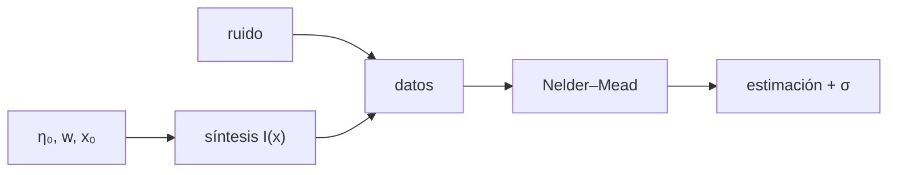

# B32-C08 — Síntesis espectral e inversión de perfiles

<!-- nav:top -->
<!-- /nav -->

## 1. Ubicación, nivel y alcance

Clase 8 del bloque B32. Nivel N3. Sintetizar un espectro y recuperar sus parámetros es la base del análisis cuantitativo. Aquí sintetizas una línea con el **modelo de Milne–Eddington** `I(x) = B₀ + B₁/(1 + η₀φ(x))`, le añades ruido y **inviertes** `η₀`, el ancho y el centro con un ajuste de mínimos cuadrados (Nelder–Mead propio), evaluando la incertidumbre con 30 repeticiones. Usas [B12](../../../tronco-comun/B12-probabilidad-estadistica-e-incertidumbre.md) y [B32-C07](../B32-C07-modelos-de-atmosferas-1d-y-3d/CLASE.md). Es un espectro sintético.

## 2. Por qué esta clase existe

Una inversión sin barras de error no sirve. La decisión central: **¿qué parámetros se recuperan y con qué incertidumbre?**

## 3. Lo que podrás hacer al terminar

1. Sintetizar `I(x)` con Milne–Eddington.
2. Añadir ruido gaussiano con semilla fija.
3. Invertir `(η₀, w, x₀)` con Nelder–Mead.
4. Calcular `χ²` reducido.
5. Estimar errores con 30 repeticiones.
6. Comparar con los valores verdaderos.

La evidencia es la **ficha de la inversión de perfiles** del ejercicio 12 (sección 20).

## 4. Con qué llegas y cómo comprobarlo

1. ¿Qué es una intensidad específica?
2. ¿Qué es una temperatura efectiva?
3. ¿Qué es una integral numérica?
4. ¿Qué es una función fuente?
5. ¿Qué es un perfil de línea?

<details>
<summary>Ver respuestas</summary>

1. La energía por área, tiempo, frecuencia y ángulo sólido. 2. La del cuerpo negro que da el mismo flujo. 3. Una suma que aproxima un área. 4. `S = j/κ`. 5. La forma de la absorción en función de la longitud de onda.
</details>

Con cuatro o cinco aciertos, sigue; si no, repasa los prerrequisitos.

## 5. Un caso de contexto y casos de referencia

Con `η₀ = 2,0`, `w = 0,05` y `x₀ = 0` se recupera `η₀ = 1,9709`, `w = 0,05036` y `x₀ = −0,00000`, con `χ²` reducido `1,19`. Es el **ejemplo conductor**. Todo es **sintético**.

## 6. Vocabulario

El **modelo de Milne–Eddington**. La **inversión**. El **χ² reducido** `χ²/gl`. El **simplex de Nelder–Mead**. El **remuestreo** estima la incertidumbre.

## 7. Modelo mental: descifrar una receta

Probar recetas hasta que el plato coincida con la muestra: la inversión busca los parámetros cuya síntesis se parece más al dato.



*Descripción textual:* los parámetros generan el espectro sintético con ruido; la inversión los recupera y se evalúa su incertidumbre.

Analogía: probar recetas hasta que el plato coincida con la muestra: la inversión busca los parámetros cuya síntesis se parece más al dato. Límite: B₀ y B₁ conocidos, perfil gaussiano.

## 8. La explicación, paso a paso

### 8.1 Recuperación

| parámetro | verdadero | recuperado | `σ` (30 repeticiones) | desviación (σ) |
|---|---|---|---|---|
| `η₀` | 2,0000 | 1,97091 | 0,02074 | 1,40 |
| `w` | 0,0500 | 0,05036 | 0,00028 | 1,30 |
| `x₀` | 0,0000 | −0,00000 | 0,00033 | 0,01 |

`χ² = 69,05` con 58 grados de libertad: `1,19`.

### 8.2 Lectura

La recuperación cae dentro de 1,4σ. Los parámetros están correlacionados (el ancho y la profundidad); con ruido mayor el error crece como `σ_ruido`.

## 9. Magnitudes, símbolos y unidades

| Símbolo | Qué es | Unidad | Valor / nota |
|---|---|---|---|
| `B₀`, `B₁` | constantes de la función fuente | — | 1,0; 0,6 (ilustrativas) |
| `η₀` | cociente de opacidades | — | 2,0 |
| `w` | ancho | — | 0,05 |
| `χ²` | estadístico | — | 69,05 |

## 10. Convenciones y referencias

B₀, B₁ conocidos; ruido gaussiano de 0,005; semilla `20261109`; todo **sintético**.

## 11. De dónde sale lo que afirmamos

| ID | Fuente | Localizador | Respalda | Estado |
|---|---|---|---|---|
| — | Sin fuente externa | — | relaciones estándar que verifica el laboratorio | No se consultó una fuente para esta clase |

Límites: no se invierte ningún espectro real.

## 12. Cómo ver la inversión

| Parámetro | Error |
|---|---|
| `η₀` | 1,4σ |
| `w` | 1,3σ |
| `x₀` | 0,01σ |

Descripción larga: la inversión recupera los tres parámetros dentro de 1,5σ.

## 13. Ejemplo trabajado: χ² reducido

**Paso 1 · χ².** `69,05`.

**Paso 2 · Grados de libertad.** `61 − 3 = 58`.

**Paso 3 · Cociente.** `69,05/58`.

**Paso 4 · Valor.** `1,19`.

## 14. Distintas formas de describir una inversión

**Por modelo:** Milne–Eddington. **Por ajuste:** mínimos cuadrados. **Por error:** remuestreo.

## 15. Práctica guiada

**Ejercicio 1 · con los pasos indicados.** `gl` del ajuste. *Pasos:* ejemplo 13.

<details><summary>Solución comentada</summary>

`58`.
</details>

**Ejercicio 2 · con una pista.** `χ²` reducido.

<details><summary>Solución comentada</summary>

`1,19`.
</details>

**Ejercicio 3 · casi autónomo.** Desviación de `η₀`.

<details><summary>Solución comentada</summary>

`1,40σ`.
</details>

## 16. Práctica autónoma, transferencia e integrador

**Ejercicio 4.** `I(0)` verdadero.

<details><summary>Solución comentada</summary>

`1 + 0,6/3 = 1,2`.
</details>

**Ejercicio 5.** `I` lejos de la línea.

<details><summary>Solución comentada</summary>

`1,6`.
</details>

**Ejercicio 6.** Profundidad relativa de la línea.

<details><summary>Solución comentada</summary>

`(1,6 − 1,2)/1,6 = 25 %`.
</details>

**Ejercicio 7.** ¿Qué pasa si el ruido se duplica?

<details><summary>Solución comentada</summary>

Los errores se duplican.
</details>

**Ejercicio 8.** ¿Qué indica `χ²` reducido ≈ 1?

<details><summary>Solución comentada</summary>

Que el ajuste es compatible con el ruido.
</details>

**Ejercicio 9 · transferencia.** **Transferencia.** Un compañero afirma que la inversión prueba el modelo físico. Responde.

<details><summary>Solución comentada</summary>

Solo prueba que el procedimiento recupera parámetros de datos sintéticos.
</details>

**Ejercicio 10 · transferencia.** **Transferencia.** ¿Por qué repetir 30 veces?

<details><summary>Solución comentada</summary>

Para estimar la dispersión de los parámetros.
</details>

**Ejercicio 11 · transferencia.** **Transferencia.** ¿Qué omite el modelo?

<details><summary>Solución comentada</summary>

Gradientes de campo y velocidad.
</details>

**Ejercicio 12.** **Integrador.** Elabora tu *ficha de la inversión de perfiles*: síntesis, ajuste y errores.

<details><summary>Solución comentada</summary>

Secciones 8.1–8.2.
</details>

**Ejercicio 12 · integrador.** **Integrador.** Elabora tu *ficha de la inversión de perfiles*: síntesis, ajuste y errores.

<details><summary>Solución modelo</summary>

Secciones 8.1–8.2.
</details>

## 17. Laboratorio: síntesis e inversión

El script [inversion.py](inversion.py) sintetiza una línea con ruido y la invierte con Nelder–Mead (**comprueba** `χ²` reducido entre 0,8 y 1,2 y 4σ).

**Datos:** sin constantes; parámetros y ruido **ilustrativos**; semilla `20261109`. **Predice antes de ejecutar:** ¿recuperará `η₀`? (≈1,97.) **Ejecución del 2026-11-09 (Python 3.12.9):**

```text
Python 3.12.9 (biblioteca estandar)
verdaderos: eta0 = 2.0, w = 0.05, x0 = 0.0 ; recuperados: eta0 = 1.9709, w = 0.05036, x0 = -0.00000 ; chi2 = 69.05 con 58 gl ; chi2 reducido = 1.191
parametro  verdadero  recuperado   sigma (30 repeticiones)   desviacion [sigma]
eta0         2.0000     1.97091                   0.02074                 1.40
w            0.0500     0.05036                   0.00028                 1.30
x0           0.0000    -0.00000                   0.00033                 0.01
Pruebas superadas.
```

```bash
python programa/clases/B32/B32-C08-sintesis-espectral-e-inversion/inversion.py
```

**Límites:** B₀, B₁ conocidos.

## 18. Errores frecuentes y cómo corregirlos

**Dar parámetros sin error.** Se corrige con 8.1.

**Ignorar correlaciones.** Se corrige con 8.2.

**Confundir síntesis e inversión.** Se corrige con la sección 6.

**Presentar el dato sintético como real.** Se corrige con la sección 10.

## 19. Cómo sabrás que vas bien

Tras 8: ¿qué resultado esperabas y cuál obtuviste? Si dudas, repasa el ejemplo 13. Tras el laboratorio: ¿qué comprueba? (ver la sección 17).

## 20. Qué entregas y cómo se evalúa

El producto es tu **ficha de la inversión de perfiles** (ejercicio 12).

| Criterio | Inicial | En desarrollo | Logrado | Destacado |
|---|---|---|---|---|
| Conceptos | Los confunde | Parciales | conceptos de la clase | Explica los límites |
| Cálculo | Sin unidades | Con errores | Tablas completas | Calcula casos nuevos |
| Numérico | Sin comprobar | Un caso | Contraste con el análisis | Interpreta las diferencias |
| Fuentes | Sin fuente | Sin fecha | fuentes con fecha | Declara lo ilustrativo |
| Límites | No los nombra | Uno | Tres | Discute qué falta del modelo |

**Condiciones críticas (no se compensan con promedio):** rotular los datos como sintéticos; no concluir sobre un espectro real; citar solo lo consultado.

## 21. Ética, seguridad y límites

Clase educativa: los modelos son simplificados. Accesibilidad: tablas equivalentes a las gráficas, fórmulas en texto, ejercicios sin conexión.

## 22. Para cerrar y seguir

Una línea sintética con ruido de 0,005 se invierte con `χ²` reducido de 1,19 y parámetros dentro de 1,4σ. Queda una pregunta: ¿cómo se mide el ancho de una línea?

**Glosario español–inglés.** síntesis espectral · *spectral synthesis*; inversión · *inversion*; Milne–Eddington · *Milne–Eddington*; χ² reducido · *reduced chi-squared*; Nelder–Mead · *Nelder–Mead*.

**Continuidad.** [B32-C09](../B32-C09-ancho-equivalente-y-curva-de-crecimiento/CLASE.md) estudia la medición de perfiles de línea.

**Referencias:** ver sección 11.

<!-- nav:bottom -->
---

<!-- /nav -->
