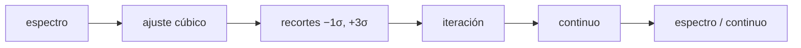

# B32-C10 — Normalización y modelado del continuo espectral

<!-- nav:top -->
<!-- /nav -->

## 1. Ubicación, nivel y alcance

Clase 10 del bloque B32. Nivel N3. Normalizar un espectro exige estimar el continuo sin que lo contaminen las líneas. Aquí ajustas un **polinomio cúbico** por mínimos cuadrados con **recortes asimétricos** iterados a un espectro sintético con cinco líneas y ruido, y lo comparas con la normalización ingenua por la mediana. Usas [B12](../../../tronco-comun/B12-probabilidad-estadistica-e-incertidumbre.md) y [B32-C09](../B32-C09-ancho-equivalente-y-curva-de-crecimiento/CLASE.md). El espectro es sintético.

## 2. Por qué esta clase existe

Un continuo mal puesto sesga los anchos equivalentes. La decisión central: **¿cómo estimar el continuo ignorando las líneas?**

## 3. Lo que podrás hacer al terminar

1. Resolver las ecuaciones normales del ajuste.
2. Aplicar recortes asimétricos.
3. Iterar hasta que la selección no cambie.
4. Medir el error del continuo recuperado.
5. Compararlo con la mediana.
6. Reconocer los límites.

La evidencia es la **ficha de la normalización del continuo** del ejercicio 12 (sección 20).

## 4. Con qué llegas y cómo comprobarlo

1. ¿Qué es una intensidad específica?
2. ¿Qué es una temperatura efectiva?
3. ¿Qué es una integral numérica?
4. ¿Qué es una función fuente?
5. ¿Qué es un perfil de línea?

<details>
<summary>Ver respuestas</summary>

1. La energía por área, tiempo, frecuencia y ángulo sólido. 2. La del cuerpo negro que da el mismo flujo. 3. Una suma que aproxima un área. 4. `S = j/κ`. 5. La forma de la absorción en función de la longitud de onda.
</details>

Con cuatro o cinco aciertos, sigue; si no, repasa los prerrequisitos.

## 5. Un caso de contexto y casos de referencia

Con 600 puntos y cinco líneas de profundidad 0,1–0,6, el ajuste iterado usa 182 puntos y recupera el continuo con un error máximo del `0,92 %`; la mediana tiene `75,9 %`. Es el **ejemplo conductor**. Todo es **sintético**.

## 6. Vocabulario

El **continuo**. El **ajuste polinomico**. El **recorte asimétrico** descarta puntos bajo el ajuste. Las **ecuaciones normales**. La **normalización** divide por el continuo.

## 7. Modelo mental: ver la orilla de un lago

Para dibujar la orilla ignoras las rocas que sobresalen; el ajuste ignora los puntos de absorción y sigue la envolvente superior.



*Descripción textual:* el ajuste y los recortes iterados producen el continuo, que normaliza el espectro.

Analogía: para dibujar la orilla ignoras las rocas que sobresalen; el ajuste ignora los puntos de absorción y sigue la envolvente superior. Límite: continuo suave.

## 8. La explicación, paso a paso

### 8.1 Resultado

| método | error máximo |
|---|---|
| polinomio con recortes (8 iteraciones, 182 de 600 puntos) | 0,919 % |
| mediana (normalización ingenua) | 75,92 % |

Coeficientes recuperados `[1,0037; 0,1495; −0,2000; 0,0992]` frente a los verdaderos `[1,0; 0,15; −0,2; 0,1]`.

### 8.2 Lectura

El recorte asimétrico elimina las líneas; el error residual (0,9 %) está en los extremos del intervalo. El continuo cúbico supone que el continuo es suave; una banda ancha lo violaría.

## 9. Magnitudes, símbolos y unidades

| Símbolo | Qué es | Unidad | Valor / nota |
|---|---|---|---|
| `c(x)` | continuo | — | polinomio cúbico (ilustrativo) |
| `σ` | ruido | — | 0,005 |
| recortes | −1σ, +3σ | — | valores de partida |

## 10. Convenciones y referencias

Continuo cúbico; ruido de 0,005; semilla `20261109`; sintético.

## 11. De dónde sale lo que afirmamos

| ID | Fuente | Localizador | Respalda | Estado |
|---|---|---|---|---|
| — | Sin fuente externa | — | relaciones estándar que verifica el laboratorio | No se consultó una fuente para esta clase |

Límites: no se normalizó ningún espectro real.

## 12. Cómo ver el continuo

| Método | Error |
|---|---|
| polinomio iterado | 0,92 % |
| mediana | 75,9 % |

Descripción larga: la mediana es inservible cuando el continuo varía.

## 13. Ejemplo trabajado: recorte asimétrico

**Paso 1 · Ajuste.** Se ajusta un cúbico a todos los puntos.

**Paso 2 · Residuos.** Se calcula `σ`.

**Paso 3 · Recorte.** Se descartan los puntos fuera de `(−1σ, +3σ)`.

**Paso 4 · Iteración.** Se repite hasta que no cambie.

## 14. Distintas formas de describir un espectro

**Por ajuste:** polinomio. **Por selección:** recorte. **Por error:** continuo recuperado.

## 15. Práctica guiada

**Ejercicio 1 · con los pasos indicados.** Grado del polinomio. *Pasos:* ejemplo 13.

<details><summary>Solución comentada</summary>

3.
</details>

**Ejercicio 2 · con una pista.** Número de coeficientes.

<details><summary>Solución comentada</summary>

4.
</details>

**Ejercicio 3 · casi autónomo.** Puntos usados.

<details><summary>Solución comentada</summary>

182.
</details>

## 16. Práctica autónoma, transferencia e integrador

**Ejercicio 4.** Error máximo.

<details><summary>Solución comentada</summary>

0,919 %.
</details>

**Ejercicio 5.** Error de la mediana.

<details><summary>Solución comentada</summary>

75,9 %.
</details>

**Ejercicio 6.** ¿Por qué recorte asimétrico?

<details><summary>Solución comentada</summary>

Porque las líneas bajan, no suben.
</details>

**Ejercicio 7.** Coeficiente constante recuperado.

<details><summary>Solución comentada</summary>

1,0037.
</details>

**Ejercicio 8.** Efecto del ruido duplicado.

<details><summary>Solución comentada</summary>

Más iteraciones y mayor error.
</details>

**Ejercicio 9 · transferencia.** **Transferencia.** Un compañero normaliza con la mediana. Responde.

<details><summary>Solución comentada</summary>

Es inadecuado si el continuo varía.
</details>

**Ejercicio 10 · transferencia.** **Transferencia.** ¿Qué pasa con una línea ancha?

<details><summary>Solución comentada</summary>

Puede ser absorbida por el ajuste.
</details>

**Ejercicio 11 · transferencia.** **Transferencia.** ¿Qué valida el ejercicio?

<details><summary>Solución comentada</summary>

El procedimiento sobre datos sintéticos.
</details>

**Ejercicio 12.** **Integrador.** Elabora tu *ficha de la normalización del continuo*: ajuste, recortes y errores.

<details><summary>Solución comentada</summary>

Secciones 8.1–8.2.
</details>

**Ejercicio 12 · integrador.** **Integrador.** Elabora tu *ficha de la normalización del continuo*: ajuste, recortes y errores.

<details><summary>Solución modelo</summary>

Secciones 8.1–8.2.
</details>

## 17. Laboratorio: continuo con recortes

El script [continuo.py](continuo.py) ajusta el continuo y lo compara con la mediana (**comprueba** error < 1,5 % y diez veces menor).

**Datos:** sin constantes; espectro **sintético**; semilla `20261109`. **Predice antes de ejecutar:** ¿qué error tendrá el continuo? (≈1 %.) **Ejecución del 2026-11-09 (Python 3.12.9):**

```text
Python 3.12.9 (biblioteca estandar)
iteraciones = 8 ; puntos de continuo = 182 de 600 ; error maximo relativo del continuo recuperado = 0.919 %
normalizacion ingenua con la mediana: error maximo = 75.92 %
coeficientes recuperados: [1.0037, 0.1495, -0.2, 0.0992] ; verdaderos: [1.0, 0.15, -0.2, 0.1]
Pruebas superadas.
```

```bash
python programa/clases/B32/B32-C10-normalizacion-del-continuo/continuo.py
```

**Límites:** continuo suave.

## 18. Errores frecuentes y cómo corregirlos

**Normalizar con la mediana.** Se corrige con 8.1.

**Recortar simétricamente.** Se corrige con el ejercicio 6.

**Ajustar un grado excesivo.** Se corrige con 8.2.

**Tomar el espectro por real.** Se corrige con la sección 10.

## 19. Cómo sabrás que vas bien

Tras 8: ¿qué resultado esperabas y cuál obtuviste? Si dudas, repasa el ejemplo 13. Tras el laboratorio: ¿qué comprueba? (ver la sección 17).

## 20. Qué entregas y cómo se evalúa

El producto es tu **ficha de la normalización del continuo** (ejercicio 12).

| Criterio | Inicial | En desarrollo | Logrado | Destacado |
|---|---|---|---|---|
| Conceptos | Los confunde | Parciales | conceptos de la clase | Explica los límites |
| Cálculo | Sin unidades | Con errores | Tablas completas | Calcula casos nuevos |
| Numérico | Sin comprobar | Un caso | Contraste con el análisis | Interpreta las diferencias |
| Fuentes | Sin fuente | Sin fecha | fuentes con fecha | Declara lo ilustrativo |
| Límites | No los nombra | Uno | Tres | Discute qué falta del modelo |

**Condiciones críticas (no se compensan con promedio):** rotular el espectro como sintético; no normalizar datos reales con este resultado; citar solo lo consultado.

## 21. Ética, seguridad y límites

Clase educativa: los modelos son simplificados. Accesibilidad: tablas equivalentes a las gráficas, fórmulas en texto, ejercicios sin conexión.

## 22. Para cerrar y seguir

El ajuste cúbico con recortes recupera el continuo con 0,9 % de error y la mediana con 76 %. Queda una pregunta: ¿cuánto rota la estrella?

**Glosario español–inglés.** continuo espectral · *spectral continuum*; normalización · *normalization*; recorte sigma · *sigma clipping*; ajuste polinómico · *polynomial fit*; ecuaciones normales · *normal equations*.

**Continuidad.** [B32-C11](../B32-C11-ensanchamiento-rotacional/CLASE.md) estudia el ensanchamiento rotacional.

**Referencias:** ver sección 11.

<!-- nav:bottom -->
---

<!-- /nav -->
