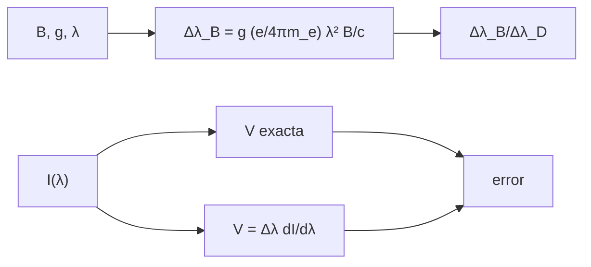

# B32-C12 — Efecto Zeeman y diagnóstico de campos magnéticos estelares

<!-- nav:top -->
[🏠 Programa](../../../../README.md) · [📚 Bloque B32](../../../tronco-comun/B32-atmosferas-estelares-y-espectroscopia-estelar-cuantitativa.md) · [← Anterior: B32-C11 — Ensanchamiento rotacional y v sin i](../B32-C11-ensanchamiento-rotacional-y-v-sin-i/CLASE.md) · [Siguiente: B33-C01 — Validación de modelos MHD con eventos solares documentados →](../../B33/B33-C01-validacion-de-modelos-mhd-con-eventos-solares-documentados/CLASE.md)
<!-- /nav -->

## 1. Ubicación, nivel y alcance

Clase 12 del bloque B32. Nivel N3. Un campo magnético desdobla las líneas y polariza la luz. Aquí calculas el **desdoblamiento** `Δλ_B = g(e/4πm_e)λ²B/c`, lo comparas con el ancho Doppler y evalúas la **aproximación de campo débil** de la polarización circular `V = Δλ dI/dλ` frente al cálculo exacto. Usas [B05](../../../tronco-comun/B05-fisica-fundamental-para-el-espacio.md) y [B31-C05](../../B31/B31-C05-espin-y-momento-angular/CLASE.md). Los campos y la línea son ilustrativos.

## 2. Por qué esta clase existe

Medir campos estelares exige saber cuándo el desdoblamiento se resuelve y cuándo basta la polarización. La decisión central: **¿qué campo produce un desdoblamiento comparable al ancho de la línea?**

## 3. Lo que podrás hacer al terminar

1. Calcular `e/(4πm_e)` y compararlo con `μ_B/h`.
2. Calcular `Δλ_B` para varios campos.
3. Compararlo con el ancho Doppler.
4. Calcular `V` exacta y de campo débil.
5. Medir el error de la aproximación.
6. Reconocer el régimen de validez.

La evidencia es la **ficha del efecto Zeeman estelar** del ejercicio 12 (sección 20).

## 4. Con qué llegas y cómo comprobarlo

1. ¿Qué es una intensidad específica?
2. ¿Qué es una temperatura efectiva?
3. ¿Qué es una integral numérica?
4. ¿Qué es una función fuente?
5. ¿Qué es un perfil de línea?

<details>
<summary>Ver respuestas</summary>

1. La energía por área, tiempo, frecuencia y ángulo sólido. 2. La del cuerpo negro que da el mismo flujo. 3. Una suma que aproxima un área. 4. `S = j/κ`. 5. La forma de la absorción en función de la longitud de onda.
</details>

Con cuatro o cinco aciertos, sigue; si no, repasa los prerrequisitos.

## 5. Un caso de contexto y casos de referencia

Con `g = 1,5`, `λ = 525 nm` y `B = 0,1 T` (1 kG), `Δλ_B = 1,93 pm`, frente a un ancho Doppler de `2,30 pm`. Es el **ejemplo conductor** (constantes de NIST, S1). Los campos y la línea son **ilustrativos**.

## 6. Vocabulario

El **efecto Zeeman**. El **factor de Landé efectivo** `g`. El **desdoblamiento** `Δλ_B`. La **polarización circular** `V`. La **aproximación de campo débil**.

## 7. Modelo mental: una cuerda que vibra distinto

Un campo magnético hace que la cuerda del átomo vibre con dos tonos ligeramente distintos según la polarización; la diferencia entre ambos tonos es el signo del campo.



*Descripción textual:* el campo y el factor de Landé dan el desdoblamiento, que se compara con el Doppler; la polarización exacta se compara con la de campo débil.

Analogía: un campo magnético hace que la cuerda del átomo vibre con dos tonos ligeramente distintos según la polarización; la diferencia entre ambos tonos es el signo del campo. Límite: triplete normal efectivo.

## 8. La explicación, paso a paso

### 8.1 Desdoblamiento (`g = 1,5`, 525 nm; `Δλ_D = 2,296 pm`)

| `B` (T) | `B` (G) | `Δλ_B` (pm) | `Δλ_B/Δλ_D` |
|---|---|---|---|
| 0,01 | 100 | 0,1930 | 0,084 |
| 0,10 | 1000 | 1,9302 | 0,841 |
| 0,30 | 3000 | 5,7906 | 2,522 |
| 0,50 | 5000 | 9,6510 | 4,204 |

`e/(4πm_e) = 1,399624 × 10¹⁰ Hz/T`, igual a `μ_B/h` de NIST.

### 8.2 Campo débil (línea gaussiana de 4 pm)

| `B` (T) | `Δλ_B/ancho` | `V` exacta | `V` campo débil | error |
|---|---|---|---|---|
| 0,01 | 0,0483 | 1,4623 × 10⁻² | 1,4634 × 10⁻² | 0,08 % |
| 0,05 | 0,2413 | 7,1763 × 10⁻² | 7,3170 × 10⁻² | 1,92 % |
| 0,10 | 0,4825 | 0,13537 | 0,14634 | 7,50 % |
| 0,30 | 1,4476 | 0,21366 | 0,43902 | 51,3 % |

### 8.3 Lectura

La aproximación es buena (error < 2 %) mientras el desdoblamiento sea menor que una quinta parte del ancho. Con 3000 G el desdoblamiento supera 2,5 veces al Doppler.

## 9. Magnitudes, símbolos y unidades

| Símbolo | Qué es | Unidad | Valor / nota |
|---|---|---|---|
| `g` | factor de Landé efectivo | — | 1,5 (ilustrativo) |
| `B` | campo | T | 0,01–0,5 |
| `Δλ_B` | desdoblamiento | pm | ver 8.1 |
| `V` | polarización circular | — | ver 8.2 |

## 10. Convenciones y referencias

Triplete normal efectivo, línea gaussiana; `g`, la línea y los campos **ilustrativos**.

## 11. De dónde sale lo que afirmamos

| ID | Fuente | Localizador | Respalda | Estado |
|---|---|---|---|---|
| S1 | NIST, *Fundamental Physical Constants* (CODATA 2022) | https://physics.nist.gov/cuu/Constants/Table/allascii.txt | constantes citadas en la sección 9 | Consultada el 2026-11-09 |
| S2 | UAI, Resolución B3 de 2015 | https://arxiv.org/abs/1510.07674 | `T_eff` nominal del Sol (5772 K) | Consultada el 2026-11-09 |

Límites: no se consultó ninguna medida de campo estelar.

## 12. Cómo ver el desdoblamiento

| `B` (G) | `Δλ_B/Δλ_D` |
|---|---|
| 100 | 0,084 |
| 1000 | 0,841 |
| 3000 | 2,52 |
| 5000 | 4,20 |

Descripción larga: el desdoblamiento supera al ancho Doppler a partir de unos 1200 G.

## 13. Ejemplo trabajado: desdoblamiento a 1000 G

**Paso 1 · Frecuencia.** `g × 1,3996 × 10¹⁰ × 0,1 = 2,0994 × 10⁹ Hz`.

**Paso 2 · `λ²/c`.** `(525 nm)²/c = 9,194 × 10⁻²² m s`.

**Paso 3 · Producto.** `Δλ = 2,0994 × 10⁹ × 9,194 × 10⁻²²`.

**Paso 4 · Valor.** `1,93 pm`.

## 14. Distintas formas de describir un campo estelar

**Por desdoblamiento:** `Δλ_B`. **Por Doppler:** razón. **Por polarización:** `V`. **Por validez:** campo débil.

## 15. Práctica guiada

**Ejercicio 1 · con los pasos indicados.** `e/(4πm_e)` frente a `μ_B/h`. *Pasos:* comparar.

<details><summary>Solución comentada</summary>

Iguales: `1,3996 × 10¹⁰ Hz/T`.
</details>

**Ejercicio 2 · con una pista.** `Δλ_B` a 1000 G.

<details><summary>Solución comentada</summary>

`1,93 pm`.
</details>

**Ejercicio 3 · casi autónomo.** `Δλ_B` a 5000 G.

<details><summary>Solución comentada</summary>

`9,65 pm`.
</details>

## 16. Práctica autónoma, transferencia e integrador

**Ejercicio 4.** `Δλ_B/Δλ_D` a 3000 G.

<details><summary>Solución comentada</summary>

`2,52`.
</details>

**Ejercicio 5.** Error del campo débil a 0,05 T.

<details><summary>Solución comentada</summary>

`1,9 %`.
</details>

**Ejercicio 6.** ¿Hasta qué `Δλ/ancho` vale al 2 %?

<details><summary>Solución comentada</summary>

≈ 0,24.
</details>

**Ejercicio 7.** `Δλ_B` si `g = 3`.

<details><summary>Solución comentada</summary>

El doble.
</details>

**Ejercicio 8.** `Δλ_B` en 600 nm a 1000 G.

<details><summary>Solución comentada</summary>

`2,52 pm`.
</details>

**Ejercicio 9 · transferencia.** **Transferencia.** Un compañero deduce un campo de 1 kG para una estrella. Responde.

<details><summary>Solución comentada</summary>

Es ilustrativo.
</details>

**Ejercicio 10 · transferencia.** **Transferencia.** ¿Por qué se usa la polarización y no el desdoblamiento?

<details><summary>Solución comentada</summary>

Porque el desdoblamiento queda oculto por el ensanchamiento.
</details>

**Ejercicio 11 · transferencia.** **Transferencia.** ¿Qué falla con 3000 G?

<details><summary>Solución comentada</summary>

La aproximación de campo débil.
</details>

**Ejercicio 12.** **Integrador.** Elabora tu *ficha del efecto Zeeman estelar*: tabla, comparación con el Doppler y error de la aproximación.

<details><summary>Solución comentada</summary>

Secciones 8.1–8.3.
</details>

**Ejercicio 12 · integrador.** **Integrador.** Elabora tu *ficha del efecto Zeeman estelar*: tabla, comparación con el Doppler y error de la aproximación.

<details><summary>Solución modelo</summary>

Secciones 8.1–8.3.
</details>

## 17. Laboratorio: desdoblamiento y campo débil

El script [zeeman.py](zeeman.py) calcula el desdoblamiento y compara `V` exacta con la de campo débil (**comprueba** `10⁻⁹` y 2 %).

**Datos:** `e`, `m_e`, `c`, `k_B`, `u`, `μ_B/h` de NIST y `T` de la UAI; `g`, línea, campos **ilustrativos**. **Predice antes de ejecutar:** ¿a qué campo iguala el Doppler? (≈1200 G.) **Ejecución del 2026-11-09 (Python 3.12.9):**

```text
Python 3.12.9 (biblioteca estandar)
e/(4 pi m_e) = 1.399624e+10 Hz/T ; mu_B/h (NIST) = 1.399624e+10 Hz/T ; cociente = 1.0000000000
Delta lambda_D (Fe, 5772 K) = 2.296 pm
  B [T]    B [G]  Delta lambda_B [pm]  cociente a Doppler
   0.01      100               0.1930               0.084
   0.10     1000               1.9302               0.841
   0.30     3000               5.7906               2.522
   0.50     5000               9.6510               4.204
  B [T]  Dl/ancho  V exacta (x = s)  V campo debil    error
   0.01    0.0483      1.462266e-02   1.463401e-02   0.078 %
   0.05    0.2413      7.176259e-02   7.317007e-02   1.924 %
   0.10    0.4825      1.353710e-01   1.463401e-01   7.496 %
   0.30    1.4476      2.136626e-01   4.390204e-01  51.332 %
Pruebas superadas.
```

```bash
python programa/clases/B32/B32-C12-efecto-zeeman-y-diagnostico-de-campos-magneticos-estelares/zeeman.py
```

**Límites:** triplete normal efectivo.

## 18. Errores frecuentes y cómo corregirlos

**Confundir gauss y tesla.** Se corrige con la sección 9.

**Usar la aproximación fuera de rango.** Se corrige con 8.3.

**Olvidar `g`.** Se corrige con el ejemplo 13.

**Tomar los campos por medidos.** Se corrige con la sección 10.

## 19. Cómo sabrás que vas bien

Tras 8: ¿qué resultado esperabas y cuál obtuviste? Si dudas, repasa el ejemplo 13. Tras el laboratorio: ¿qué comprueba? (ver la sección 17).

## 20. Qué entregas y cómo se evalúa

El producto es tu **ficha del efecto Zeeman estelar** (ejercicio 12).

| Criterio | Inicial | En desarrollo | Logrado | Destacado |
|---|---|---|---|---|
| Conceptos | Los confunde | Parciales | conceptos de la clase | Explica los límites |
| Cálculo | Sin unidades | Con errores | Tablas completas | Calcula casos nuevos |
| Numérico | Sin comprobar | Un caso | Contraste con el análisis | Interpreta las diferencias |
| Fuentes | Sin fuente | Sin fecha | fuentes con fecha | Declara lo ilustrativo |
| Límites | No los nombra | Uno | Tres | Discute qué falta del modelo |

**Condiciones críticas (no se compensan con promedio):** rotular `g`, la línea y los campos como ilustrativos; no atribuir campos a estrellas; citar solo lo consultado.

## 21. Ética, seguridad y límites

Clase educativa: los modelos son simplificados. Accesibilidad: tablas equivalentes a las gráficas, fórmulas en texto, ejercicios sin conexión.

## 22. Para cerrar y seguir

A 1 kG el desdoblamiento (1,9 pm) es casi igual al ancho Doppler (2,3 pm) y la aproximación de campo débil solo es buena por debajo del 24 % del ancho. Con esto cierra el bloque de atmósferas estelares.

**Glosario español–inglés.** efecto Zeeman · *Zeeman effect*; factor de Landé · *Landé factor*; polarización circular · *circular polarization*; campo débil · *weak field*; campo magnético estelar · *stellar magnetic field*.

**Continuidad.** Es la última clase del bloque; el siguiente trata el clima espacial.

**Referencias:** ver sección 11.

<!-- nav:bottom -->
---

[← Anterior: B32-C11 — Ensanchamiento rotacional y v sin i](../B32-C11-ensanchamiento-rotacional-y-v-sin-i/CLASE.md) · [📚 Bloque B32](../../../tronco-comun/B32-atmosferas-estelares-y-espectroscopia-estelar-cuantitativa.md) · [Siguiente: B33-C01 — Validación de modelos MHD con eventos solares documentados →](../../B33/B33-C01-validacion-de-modelos-mhd-con-eventos-solares-documentados/CLASE.md)
<!-- /nav -->
