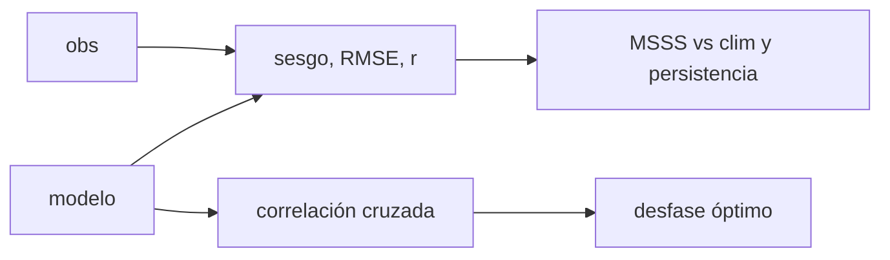

# B33-C01 — Validación de modelos MHD con eventos solares documentados

<!-- nav:top -->
<!-- /nav -->

## 1. Ubicación, nivel y alcance

Clase 1 del bloque B33. Nivel N3. Validar un modelo es medir cuánto se parece a las observaciones. Aquí calculas **sesgo**, **RMSE**, **correlación**, **destreza** frente a la climatología y a la persistencia, el **desfase óptimo** por correlación cruzada y un intervalo del RMSE por remuestreo, con una serie sintética de velocidad del viento solar. Usas [B12](../../../tronco-comun/B12-probabilidad-estadistica-e-incertidumbre.md) y [B30-C20](../../B30/B30-C20-analisis-de-alerta-solar-real/CLASE.md). Ningún modelo ni evento real se valida.

## 2. Por qué esta clase existe

Un modelo sin validación no sirve para pronosticar. La decisión central: **¿cuán bien reproduce el modelo la serie y con qué desfase?**

## 3. Lo que podrás hacer al terminar

1. Calcular sesgo, RMSE y correlación.
2. Calcular MSSS frente a climatología y persistencia.
3. Hallar el desfase óptimo.
4. Estimar un intervalo del RMSE por remuestreo.
5. Interpretar la destreza.
6. Reconocer los límites del remuestreo.

La evidencia es la **ficha de validación de un modelo** del ejercicio 12 (sección 20).

## 4. Con qué llegas y cómo comprobarlo

1. ¿Qué es una incertidumbre?
2. ¿Qué es una simulación Monte Carlo?
3. ¿Qué es una tabla de resultados?
4. ¿Qué es un valor ilustrativo?
5. ¿Qué es una verificación?

<details>
<summary>Ver respuestas</summary>

1. Un intervalo en que se espera el valor verdadero. 2. Repetir con números aleatorios de semilla fija. 3. Un resumen ordenado de cálculos. 4. Un valor propuesto para el ejemplo, no medido. 5. Comparar un cálculo con un caso independiente.
</details>

Con cuatro o cinco aciertos, sigue; si no, repasa los prerrequisitos.

## 5. Un caso de contexto y casos de referencia

Con una serie sintética de 720 h y un modelo con desfase de 6 h, el RMSE es `39,39 km/s`, la correlación `0,806` y el desfase óptimo `6 h`. Es el **ejemplo conductor**. Todo es **sintético**.

## 6. Vocabulario

El **sesgo**. El **RMSE**. La **correlación** de Pearson. La **destreza** `MSSS = 1 − MSE/MSE_ref`. La **persistencia** repite el valor de hace 24 h. El **desfase** es el retraso entre modelo y observación.

## 7. Modelo mental: afinar un reloj

Como comparar un reloj con la hora oficial: miras cuánto se adelanta (sesgo), cuánto se desvía (RMSE) y si va con retraso constante (desfase).



*Descripción textual:* se comparan modelo y observación con métricas y se busca el desfase de mayor correlación.

Analogía: afinar un reloj. Límite: errores independientes entre horas.

## 8. La explicación, paso a paso

### 8.1 Métricas

Sesgo `−5,22 km/s`, RMSE `39,39 km/s`, correlación `0,8059`, `MSSS` frente a la climatología `0,5907` y frente a la persistencia de 24 h `0,3341`.

### 8.2 Desfase

| desfase (h) | correlación |
|---|---|
| −12 | 0,7034 |
| −6 | 0,7701 |
| 0 | 0,8059 |
| 3 | 0,8261 |
| 6 | 0,8837 |
| 9 | 0,8202 |

El máximo está en `6 h`, igual al desfase impuesto.

### 8.3 Incertidumbre

El RMSE por remuestreo tiene mediana `39,48` e intervalo del 5–95 % `[37,73; 41,67] km/s`; el valor observado cae dentro.

### 8.4 Lectura

Una correlación de 0,81 oculta un retraso de 6 h: corregirlo la sube a 0,88. El remuestreo supone errores independientes y subestima la incertidumbre si hay autocorrelación.

## 9. Magnitudes, símbolos y unidades

| Símbolo | Qué es | Unidad | Valor / nota |
|---|---|---|---|
| RMSE | raíz del error cuadrático medio | km/s | 39,39 |
| `r` | correlación | — | 0,8059 |
| MSSS | destreza | — | 0,59; 0,33 |
| desfase | retraso | h | 6 |

## 10. Convenciones y referencias

Serie sintética de 720 h; el modelo es la serie con desfase, factor 0,9 y ruido; semilla `20261109`.

## 11. De dónde sale lo que afirmamos

| ID | Fuente | Localizador | Respalda | Estado |
|---|---|---|---|---|
| — | Sin fuente externa | — | relaciones estándar que verifica el laboratorio | No se consultó una fuente para esta clase |

Límites: no se validó ningún modelo real.

## 12. Cómo ver las métricas

| Métrica | Valor |
|---|---|
| RMSE | 39,39 km/s |
| `r` | 0,806 |
| MSSS (clim) | 0,591 |
| MSSS (persistencia) | 0,334 |

Descripción larga: el modelo supera a ambas referencias.

## 13. Ejemplo trabajado: RMSE

**Paso 1 · Errores.** `m_i − o_i`.

**Paso 2 · Cuadrados.** Se elevan al cuadrado.

**Paso 3 · Media.** Se promedian.

**Paso 4 · Raíz.** `39,39 km/s`.

## 14. Distintas formas de describir un modelo

**Por error:** RMSE. **Por forma:** correlación. **Por referencia:** destreza. **Por tiempo:** desfase.

## 15. Práctica guiada

**Ejercicio 1 · con los pasos indicados.** RMSE a partir de un MSE de 1551. *Pasos:* raíz.

<details><summary>Solución comentada</summary>

`39,4`.
</details>

**Ejercicio 2 · con una pista.** MSSS si MSE_modelo = MSE_ref.

<details><summary>Solución comentada</summary>

`0`.
</details>

**Ejercicio 3 · casi autónomo.** ¿Qué indica un desfase de 6 h?

<details><summary>Solución comentada</summary>

El modelo va atrasado.
</details>

## 16. Práctica autónoma, transferencia e integrador

**Ejercicio 4.** Correlación al corregir el desfase.

<details><summary>Solución comentada</summary>

`0,884`.
</details>

**Ejercicio 5.** Intervalo del RMSE.

<details><summary>Solución comentada</summary>

`[37,73; 41,67]`.
</details>

**Ejercicio 6.** Sesgo.

<details><summary>Solución comentada</summary>

`−5,22 km/s`.
</details>

**Ejercicio 7.** ¿Supera el modelo a la persistencia?

<details><summary>Solución comentada</summary>

Sí: MSSS = 0,33.
</details>

**Ejercicio 8.** Efecto de duplicar el ruido.

<details><summary>Solución comentada</summary>

Sube el RMSE.
</details>

**Ejercicio 9 · transferencia.** **Transferencia.** Un compañero dice que el modelo valida el viento real. Responde.

<details><summary>Solución comentada</summary>

Es sintético.
</details>

**Ejercicio 10 · transferencia.** **Transferencia.** ¿Por qué usar dos referencias?

<details><summary>Solución comentada</summary>

Porque la persistencia es más exigente que la climatología.
</details>

**Ejercicio 11 · transferencia.** **Transferencia.** ¿Qué subestima el remuestreo?

<details><summary>Solución comentada</summary>

La incertidumbre por autocorrelación.
</details>

**Ejercicio 12.** **Integrador.** Elabora tu *ficha de validación de un modelo*: métricas, desfase e intervalo.

<details><summary>Solución comentada</summary>

Secciones 8.1–8.4.
</details>

**Ejercicio 12 · integrador.** **Integrador.** Elabora tu *ficha de validación de un modelo*: métricas, desfase e intervalo.

<details><summary>Solución modelo</summary>

Secciones 8.1–8.4.
</details>

## 17. Laboratorio: métricas de validación

El script [validacion.py](validacion.py) calcula métricas, desfase e intervalo (**comprueba** el desfase de 6 h y el RMSE en el intervalo).

**Datos:** sin constantes; serie **sintética**; semilla `20261109`. **Predice antes de ejecutar:** ¿qué desfase recuperará? (6 h.) **Ejecución del 2026-11-09 (Python 3.12.9):**

```text
Python 3.12.9 (biblioteca estandar)
sesgo = -5.22 km/s ; RMSE = 39.39 km/s ; correlacion = 0.8059 ; MSSS(clim) = 0.5907 ; MSSS(persistencia 24 h) = 0.3341
desfase [h]  correlacion
        -12       0.7034
         -9       0.7330
         -6       0.7701
         -3       0.7948
          0       0.8059
          3       0.8261
          6       0.8837
          9       0.8202
         12       0.8203
desfase optimo = 6 h (impuesto: 6 h)
RMSE por remuestreo: mediana 39.48 ; intervalo 5-95 % [37.73, 41.67] km/s
Pruebas superadas.
```

```bash
python programa/clases/B33/B33-C01-validacion-de-modelos-mhd/validacion.py
```

**Límites:** errores independientes.

## 18. Errores frecuentes y cómo corregirlos

**Medir solo la correlación.** Se corrige con 8.2.

**Olvidar la referencia.** Se corrige con 8.1.

**Creer en el intervalo con autocorrelación.** Se corrige con 8.4.

**Presentar lo sintético como real.** Se corrige con la sección 10.

## 19. Cómo sabrás que vas bien

Tras la sección 8: ¿qué resultado esperabas y cuál obtuviste? Si dudas, repasa el ejemplo 13. Tras el laboratorio: ¿qué comprueba? (ver la sección 17).

## 20. Qué entregas y cómo se evalúa

El producto es tu **ficha de validación de un modelo** (ejercicio 12).

| Criterio | Inicial | En desarrollo | Logrado | Destacado |
|---|---|---|---|---|
| Conceptos | Los confunde | Parciales | conceptos de la clase | Explica los límites |
| Cálculo | Sin unidades | Con errores | Tablas completas | Calcula casos nuevos |
| Numérico | Sin comprobar | Un caso | Contraste con el análisis | Interpreta las diferencias |
| Fuentes | Sin fuente | Sin fecha | fuentes con fecha | Declara lo ilustrativo |
| Límites | No los nombra | Uno | Tres | Discute qué falta del modelo |

**Condiciones críticas (no se compensan con promedio):** rotular la serie como sintética; no validar un modelo real; citar solo lo consultado.

## 21. Ética, seguridad y límites

Clase educativa: los modelos son simplificados. Accesibilidad: tablas equivalentes a las gráficas, fórmulas en texto, ejercicios sin conexión.

## 22. Para cerrar y seguir

El modelo sintético tiene RMSE de 39 km/s, correlación 0,81 y un desfase de 6 h que sube la correlación a 0,88. Queda una pregunta: ¿cuánto tarda en llegar una CME y con qué incertidumbre?

**Glosario español–inglés.** validación · *validation*; destreza · *skill score*; persistencia · *persistence*; desfase · *time lag*; remuestreo · *bootstrap*.

**Continuidad.** [B33-C02](../B33-C02-propagacion-de-cme/CLASE.md) estudia la propagación de CME.

**Referencias:** ver sección 11.

<!-- nav:bottom -->
---

<!-- /nav -->
