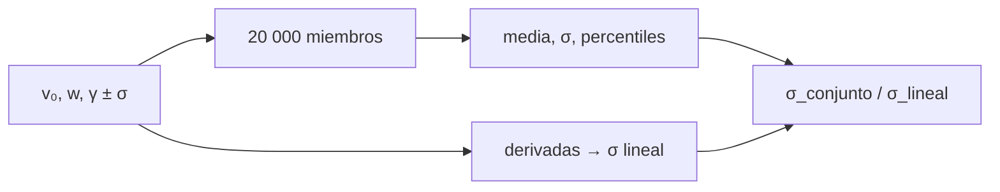

# B33-C02 — Modelos de propagación de CME

<!-- nav:top -->
[🏠 Programa](../../../../README.md) · [📚 Bloque B33](../../../tronco-comun/B33-clima-espacial-impactos-pronostico-y-riesgo.md) · [← Anterior: B33-C01 — Validación de modelos MHD con eventos solares documentados](../B33-C01-validacion-de-modelos-mhd-con-eventos-solares-documentados/CLASE.md) · [Siguiente: B33-C03 — Eventos extremos históricos de clima espacial →](../B33-C03-eventos-extremos-historicos-de-clima-espacial/CLASE.md)
<!-- /nav -->

## 1. Ubicación, nivel y alcance

Clase 2 del bloque B33. Nivel N3. El tiempo de llegada de una CME depende de parámetros inciertos. Aquí generas un **conjunto de 20 000 miembros** del modelo de arrastre con velocidad inicial, viento y arrastre gaussianos y comparas su dispersión con la **propagación lineal de errores**. Usas [B12](../../../tronco-comun/B12-probabilidad-estadistica-e-incertidumbre.md) y [B30-C13](../../B30/B30-C13-eyecciones-de-masa-coronal/CLASE.md). Los parámetros son ilustrativos.

## 2. Por qué esta clase existe

Un pronóstico de llegada sin incertidumbre es engañoso. La decisión central: **¿qué parámetro domina la incertidumbre del tiempo de llegada?**

## 3. Lo que podrás hacer al terminar

1. Calcular el tránsito del modelo de arrastre.
2. Generar un conjunto.
3. Obtener media, desviación y percentiles.
4. Calcular derivadas numéricas.
5. Repartir la varianza.
6. Comparar conjunto y propagación lineal.

La evidencia es la **ficha de la propagación de una CME** del ejercicio 12 (sección 20).

## 4. Con qué llegas y cómo comprobarlo

1. ¿Qué es una incertidumbre?
2. ¿Qué es una simulación Monte Carlo?
3. ¿Qué es una tabla de resultados?
4. ¿Qué es un valor ilustrativo?
5. ¿Qué es una verificación?

<details>
<summary>Ver respuestas</summary>

1. Un intervalo en que se espera el valor verdadero. 2. Repetir con números aleatorios de semilla fija. 3. Un resumen ordenado de cálculos. 4. Un valor propuesto para el ejemplo, no medido. 5. Comparar un cálculo con un caso independiente.
</details>

Con cuatro o cinco aciertos, sigue; si no, repasa los prerrequisitos.

## 5. Un caso de contexto y casos de referencia

Con `v₀ = 1000 ± 100 km/s`, `w = 400 ± 50 km/s` y `γ = (2 ± 1) × 10⁻⁸ km⁻¹` (ilustrativos), el tránsito central es `52,92 h`; el conjunto da `53,41 ± 7,09 h` y el 22,5 % llega antes de 48 h. Es el **ejemplo conductor**.

## 6. Vocabulario

El **conjunto** es un grupo de simulaciones con parámetros perturbados. La **propagación lineal** usa derivadas. La **contribución a la varianza** de cada parámetro. Un **percentil** es el valor bajo el cual cae esa fracción de miembros.

## 7. Modelo mental: una moneda con tres dados

Es como lanzar tres dados inciertos: el resultado final varía, y unos dados pesan más que otros.



*Descripción textual:* los parámetros inciertos generan un conjunto y una propagación lineal que se comparan.

Analogía: una moneda con tres dados. Límite: parámetros gaussianos e independientes.

## 8. La explicación, paso a paso

### 8.1 Conjunto

Tránsito central `52,92 h`; conjunto: media `53,41 h`, desviación `7,09 h`, percentiles 5/50/95 `42,0/53,3/65,2 h`.

### 8.2 Contribuciones

| parámetro | `dT/dp` | contribución (h²) |
|---|---|---|
| `v₀` | −2,76 × 10⁻² h/(km/s) | 7,64 |
| `w` | −6,32 × 10⁻² h/(km/s) | 9,98 |
| `γ` | 5,89 × 10⁸ h/km⁻¹ | 34,67 |

La desviación lineal es `7,23 h` y el cociente conjunto/lineal `0,981`.

### 8.3 Lectura

La incertidumbre del arrastre aporta el 66 % de la varianza. La fracción que llega antes de 48 h (`0,225`) es una probabilidad útil para una alerta.

## 9. Magnitudes, símbolos y unidades

| Símbolo | Qué es | Unidad | Valor / nota |
|---|---|---|---|
| `σ_T` | desviación del tránsito | h | 7,09 |
| `γ` | arrastre | km⁻¹ | (2 ± 1) × 10⁻⁸ (ilustrativo) |
| `P(T<48 h)` | probabilidad | — | 0,225 |

## 10. Convenciones y referencias

Arrastre cuadrático y viento uniforme; parámetros ilustrativos; semilla `20261109`.

## 11. De dónde sale lo que afirmamos

| ID | Fuente | Localizador | Respalda | Estado |
|---|---|---|---|---|
| S2 | UAI, Resolución B3 de 2015 | https://arxiv.org/abs/1510.07674 | valores nominales solares y planetarios | Consultada el 2026-11-09 |
| S3 | IERS Technical Note 36, Tabla 1.1 | https://iers-conventions.obspm.fr/ | `au` | Consultada el 2026-11-09 |

Límites: no se consultaron parámetros reales de CME.

## 12. Cómo ver la dispersión

| Magnitud | Valor |
|---|---|
| central | 52,92 h |
| media del conjunto | 53,41 h |
| `σ` | 7,09 h |
| `P(T<48 h)` | 0,225 |

Descripción larga: la media del conjunto supera ligeramente al valor central.

## 13. Ejemplo trabajado: contribución del arrastre

**Paso 1 · Derivada.** `5,89 × 10⁸ h/km⁻¹`.

**Paso 2 · Producto.** `× 10⁻⁸ = 5,89 h`.

**Paso 3 · Cuadrado.** `34,7 h²`.

**Paso 4 · Fracción.** `34,7/52,3 = 66 %`.

## 14. Distintas formas de describir una llegada

**Por conjunto:** Monte Carlo. **Por derivada:** lineal. **Por parámetro:** varianza. **Por umbral:** probabilidad.

## 15. Práctica guiada

**Ejercicio 1 · con los pasos indicados.** `σ` lineal. *Pasos:* raíz de la suma.

<details><summary>Solución comentada</summary>

`7,23 h`.
</details>

**Ejercicio 2 · con una pista.** Fracción de la varianza por `γ`.

<details><summary>Solución comentada</summary>

`66 %`.
</details>

**Ejercicio 3 · casi autónomo.** Cociente conjunto/lineal.

<details><summary>Solución comentada</summary>

`0,981`.
</details>

## 16. Práctica autónoma, transferencia e integrador

**Ejercicio 4.** Percentil 95.

<details><summary>Solución comentada</summary>

`65,2 h`.
</details>

**Ejercicio 5.** Probabilidad de llegar antes de 48 h.

<details><summary>Solución comentada</summary>

`0,225`.
</details>

**Ejercicio 6.** Diferencia media − central.

<details><summary>Solución comentada</summary>

`0,49 h`.
</details>

**Ejercicio 7.** ¿Qué parámetro reduce más la incertidumbre si se mejora?

<details><summary>Solución comentada</summary>

El arrastre.
</details>

**Ejercicio 8.** Rango 5–95 %.

<details><summary>Solución comentada</summary>

`23,2 h`.
</details>

**Ejercicio 9 · transferencia.** **Transferencia.** Un compañero usa 53 h como pronóstico. Responde.

<details><summary>Solución comentada</summary>

Es un caso ilustrativo.
</details>

**Ejercicio 10 · transferencia.** **Transferencia.** ¿Por qué difieren conjunto y lineal?

<details><summary>Solución comentada</summary>

Por la no linealidad del modelo.
</details>

**Ejercicio 11 · transferencia.** **Transferencia.** ¿Qué omite el modelo?

<details><summary>Solución comentada</summary>

Interacción con el viento ambiente real.
</details>

**Ejercicio 12.** **Integrador.** Elabora tu *ficha de la propagación de una CME*: conjunto, contribuciones y probabilidad.

<details><summary>Solución comentada</summary>

Secciones 8.1–8.3.
</details>

**Ejercicio 12 · integrador.** **Integrador.** Elabora tu *ficha de la propagación de una CME*: conjunto, contribuciones y probabilidad.

<details><summary>Solución modelo</summary>

Secciones 8.1–8.3.
</details>

## 17. Laboratorio: conjunto de tránsitos

El script [conjunto.py](conjunto.py) genera el conjunto y compara con la propagación lineal (**comprueba** 10 %).

**Datos:** `R_☉` de la UAI y 1 au de IERS; parámetros **ilustrativos**; semilla `20261109`. **Predice antes de ejecutar:** ¿qué parámetro domina? (el arrastre.) **Ejecución del 2026-11-09 (Python 3.12.9):**

```text
Python 3.12.9 (biblioteca estandar)
transito central = 52.92 h
conjunto: media = 53.41 h ; desviacion = 7.09 h ; percentiles 5/50/95 = 42.0/53.3/65.2 h
parametro    dT/dp (h por unidad)   contribucion a la varianza [h^2]
v0                    -2.7641e-02                              7.640
w                     -6.3189e-02                              9.982
gamma                  5.8884e+08                             34.673
desviacion lineal = 7.23 h ; conjunto = 7.09 h ; cociente = 0.981
fraccion que llega en menos de 48 h: 0.225
Pruebas superadas.
```

```bash
python programa/clases/B33/B33-C02-modelos-de-propagacion-de-cme/conjunto.py
```

**Límites:** gaussianos independientes.

## 18. Errores frecuentes y cómo corregirlos

**Dar solo el valor central.** Se corrige con 8.1.

**Sumar desviaciones en vez de varianzas.** Se corrige con 8.2.

**Tomar los parámetros por medidos.** Se corrige con la sección 10.

**Ignorar la no linealidad.** Se corrige con 8.3.

## 19. Cómo sabrás que vas bien

Tras la sección 8: ¿qué resultado esperabas y cuál obtuviste? Si dudas, repasa el ejemplo 13. Tras el laboratorio: ¿qué comprueba? (ver la sección 17).

## 20. Qué entregas y cómo se evalúa

El producto es tu **ficha de la propagación de una CME** (ejercicio 12).

| Criterio | Inicial | En desarrollo | Logrado | Destacado |
|---|---|---|---|---|
| Conceptos | Los confunde | Parciales | conceptos de la clase | Explica los límites |
| Cálculo | Sin unidades | Con errores | Tablas completas | Calcula casos nuevos |
| Numérico | Sin comprobar | Un caso | Contraste con el análisis | Interpreta las diferencias |
| Fuentes | Sin fuente | Sin fecha | fuentes con fecha | Declara lo ilustrativo |
| Límites | No los nombra | Uno | Tres | Discute qué falta del modelo |

**Condiciones críticas (no se compensan con promedio):** rotular los parámetros como ilustrativos; no emitir pronósticos; citar solo lo consultado.

## 21. Ética, seguridad y límites

Clase educativa: los modelos son simplificados. Accesibilidad: tablas equivalentes a las gráficas, fórmulas en texto, ejercicios sin conexión.

## 22. Para cerrar y seguir

El tránsito central de 52,9 h tiene una incertidumbre de 7 h dominada por el arrastre, y el 22,5 % de los miembros llega antes de 48 h. Queda una pregunta: ¿qué tan extremos pueden ser los eventos?

**Glosario español–inglés.** propagación de CME · *CME propagation*; conjunto · *ensemble*; propagación de errores · *error propagation*; percentil · *percentile*; tiempo de llegada · *arrival time*.

**Continuidad.** [B33-C03](../B33-C03-eventos-extremos-historicos-de-clima-espacial/CLASE.md) estudia los eventos extremos históricos.

**Referencias:** ver sección 11.

<!-- nav:bottom -->
---

[← Anterior: B33-C01 — Validación de modelos MHD con eventos solares documentados](../B33-C01-validacion-de-modelos-mhd-con-eventos-solares-documentados/CLASE.md) · [📚 Bloque B33](../../../tronco-comun/B33-clima-espacial-impactos-pronostico-y-riesgo.md) · [Siguiente: B33-C03 — Eventos extremos históricos de clima espacial →](../B33-C03-eventos-extremos-historicos-de-clima-espacial/CLASE.md)
<!-- /nav -->
