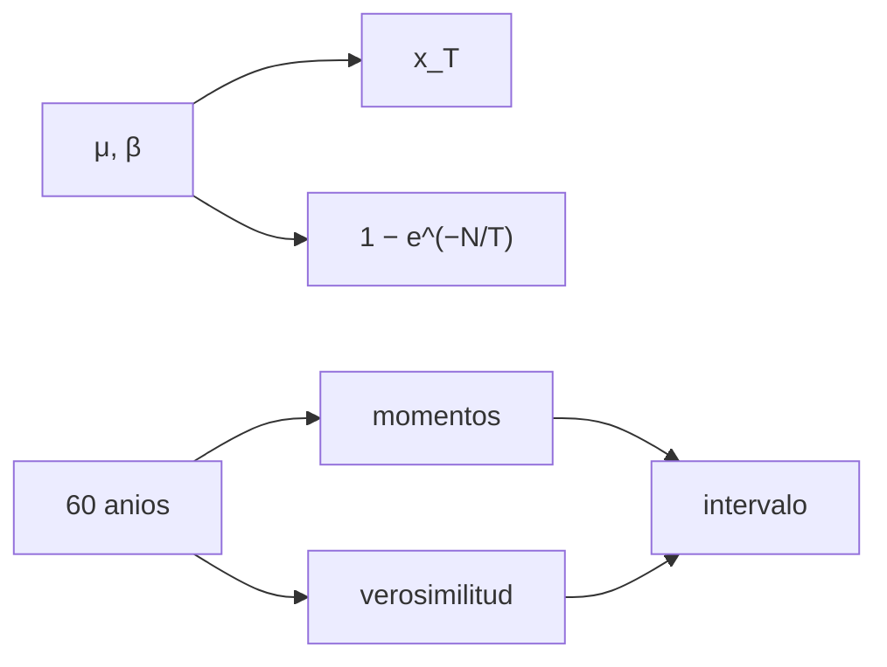

# B33-C03 — Eventos extremos históricos de clima espacial

<!-- nav:top -->
<!-- /nav -->

## 1. Ubicación, nivel y alcance

Clase 3 del bloque B33. Nivel N3. Los eventos extremos se estudian con distribuciones de valores extremos. Aquí generas **máximos anuales sintéticos** de una distribución de Gumbel, estimas sus parámetros por **momentos** y por **máxima verosimilitud**, calculas **niveles de retorno** y la probabilidad de al menos un evento en una década, y mides la incertidumbre del nivel de 100 años con 500 registros. Usas [B12](../../../tronco-comun/B12-probabilidad-estadistica-e-incertidumbre.md). No se reproduce ninguna serie histórica ni el evento de Carrington de 1859 (S1, solo resumen).

## 2. Por qué esta clase existe

Las decisiones de protección se basan en periodos de retorno que superan al registro. La decisión central: **¿qué nivel se espera una vez cada T años y cuán incierto es?**

## 3. Lo que podrás hacer al terminar

1. Calcular `x_T = μ − β ln(−ln(1 − 1/T))`.
2. Calcular `1 − e^(−N/T)`.
3. Ajustar por momentos.
4. Ajustar por máxima verosimilitud.
5. Obtener el intervalo del nivel de 100 años.
6. Comparar los dos métodos.

La evidencia es la **ficha de eventos extremos** del ejercicio 12 (sección 20).

## 4. Con qué llegas y cómo comprobarlo

1. ¿Qué es una incertidumbre?
2. ¿Qué es una simulación Monte Carlo?
3. ¿Qué es una tabla de resultados?
4. ¿Qué es un valor ilustrativo?
5. ¿Qué es una verificación?

<details>
<summary>Ver respuestas</summary>

1. Un intervalo en que se espera el valor verdadero. 2. Repetir con números aleatorios de semilla fija. 3. Un resumen ordenado de cálculos. 4. Un valor propuesto para el ejemplo, no medido. 5. Comparar un cálculo con un caso independiente.
</details>

Con cuatro o cinco aciertos, sigue; si no, repasa los prerrequisitos.

## 5. Un caso de contexto y casos de referencia

Con `μ = 100` y `β = 30` (ilustrativos), el nivel de 100 años es `238,0` y la probabilidad de al menos uno en 10 años es `9,5 %`. Es el **ejemplo conductor**. Un estudio sobre la tormenta de Carrington del 2 de septiembre de 1859 es el contexto (S1, solo resumen).

## 6. Vocabulario

La **distribución de Gumbel**. El **nivel de retorno** `x_T`. El **periodo de retorno** `T`. La **máxima verosimilitud**. El **método de momentos**.

## 7. Modelo mental: el nivel de un río

Como la crecida de cada cien años de un río: con 60 años de registro se estima, pero con incertidumbre.



*Descripción textual:* los parámetros dan niveles de retorno; los registros cortos los estiman por dos métodos con intervalo.

Analogía: el nivel de un río. Límite: máximos independientes de Gumbel.

## 8. La explicación, paso a paso

### 8.1 Niveles de retorno

| `T` (años) | `x_T` | `P(≥ 1 en 10 años)` |
|---|---|---|
| 2 | 111,00 | 0,9933 |
| 10 | 167,51 | 0,6321 |
| 50 | 217,06 | 0,1813 |
| 100 | 238,00 | 0,0952 |
| 500 | 286,41 | 0,0198 |

### 8.2 Incertidumbre (500 registros de 60 años)

Momentos: mediana `236,86`, 5–95 % `[207,49; 270,16]`. Máxima verosimilitud: mediana `237,45`, `[212,14; 260,75]`. El valor verdadero (`238,00`) cae dentro de ambos.

### 8.3 Lectura

Con 60 años el nivel de 100 años queda en un intervalo de ±12 %; la máxima verosimilitud es algo más precisa que los momentos.

## 9. Magnitudes, símbolos y unidades

| Símbolo | Qué es | Unidad | Valor / nota |
|---|---|---|---|
| `μ`, `β` | parámetros de Gumbel | — | 100; 30 (ilustrativos) |
| `x_T` | nivel de retorno | — | 238,0 (T = 100) |
| `T` | periodo de retorno | años | 2–500 |

## 10. Convenciones y referencias

Maxima anuales independientes; semilla `20261109`; sin serie real.

## 11. De dónde sale lo que afirmamos

| ID | Fuente | Localizador | Respalda | Estado |
|---|---|---|---|---|
| S1 | arXiv:1608.07702 | https://arxiv.org/abs/1608.07702 | estudio de la tormenta de Carrington del 2 de septiembre de 1859 | Solo resumen, consultado el 2026-11-09 |

Límites: S1 solo resumen y no respalda ningún número de la clase.

## 12. Cómo ver el nivel de retorno

| `T` (años) | `x_T` |
|---|---|
| 10 | 167,5 |
| 100 | 238,0 |
| 500 | 286,4 |

Descripción larga: el nivel crece de forma logarítmica con el periodo.

## 13. Ejemplo trabajado: nivel de 100 años

**Paso 1 · Probabilidad.** `1 − 1/100 = 0,99`.

**Paso 2 · Doble logaritmo.** `−ln(−ln 0,99) = 4,600`.

**Paso 3 · Producto.** `30 × 4,600 = 138,0`.

**Paso 4 · Suma.** `x_T = 100 + 138 = 238,0`.

## 14. Distintas formas de describir un extremo

**Por parámetros:** Gumbel. **Por retorno:** `x_T`. **Por registro:** estimación. **Por incertidumbre:** intervalo.

## 15. Práctica guiada

**Ejercicio 1 · con los pasos indicados.** `x_T` para `T = 10`. *Pasos:* ejemplo 13.

<details><summary>Solución comentada</summary>

`167,5`.
</details>

**Ejercicio 2 · con una pista.** `P(≥ 1 en 10 años)` para `T = 100`.

<details><summary>Solución comentada</summary>

`9,5 %`.
</details>

**Ejercicio 3 · casi autónomo.** Intervalo por máxima verosimilitud.

<details><summary>Solución comentada</summary>

`[212,1; 260,8]`.
</details>

## 16. Práctica autónoma, transferencia e integrador

**Ejercicio 4.** Amplitud relativa.

<details><summary>Solución comentada</summary>

`±10 %`.
</details>

**Ejercicio 5.** `x_T` para `T = 2`.

<details><summary>Solución comentada</summary>

`111,0`.
</details>

**Ejercicio 6.** Cociente `x₅₀₀/x₁₀₀`.

<details><summary>Solución comentada</summary>

`1,20`.
</details>

**Ejercicio 7.** ¿Qué método es más preciso?

<details><summary>Solución comentada</summary>

El de máxima verosimilitud.
</details>

**Ejercicio 8.** Probabilidad de ≥ 1 en 100 años con `T = 100`.

<details><summary>Solución comentada</summary>

`63 %`.
</details>

**Ejercicio 9 · transferencia.** **Transferencia.** Un compañero identifica 238 con la tormenta de 1859. Responde.

<details><summary>Solución comentada</summary>

S1 es solo resumen; los números son sintéticos.
</details>

**Ejercicio 10 · transferencia.** **Transferencia.** ¿Qué supone Gumbel?

<details><summary>Solución comentada</summary>

Colas exponenciales; una cola pesada daría niveles mayores.
</details>

**Ejercicio 11 · transferencia.** **Transferencia.** ¿Por qué 60 años no bastan para 500?

<details><summary>Solución comentada</summary>

Se extrapola más allá del registro.
</details>

**Ejercicio 12.** **Integrador.** Elabora tu *ficha de eventos extremos*: niveles, probabilidades e intervalo.

<details><summary>Solución comentada</summary>

Secciones 8.1–8.3.
</details>

**Ejercicio 12 · integrador.** **Integrador.** Elabora tu *ficha de eventos extremos*: niveles, probabilidades e intervalo.

<details><summary>Solución modelo</summary>

Secciones 8.1–8.3.
</details>

## 17. Laboratorio: Gumbel y niveles de retorno

El script [gumbel.py](gumbel.py) estima los parámetros por dos métodos y calcula el intervalo (**comprueba** `10⁻⁹` y que el verdadero cae en el intervalo).

**Datos:** sin constantes; parámetros **ilustrativos**; semilla `20261109`. **Predice antes de ejecutar:** ¿cuánto vale el nivel de 100 años? (≈238.) **Ejecución del 2026-11-09 (Python 3.12.9):**

```text
Python 3.12.9 (biblioteca estandar)
 T [anios]       x_T   P(al menos 1 en 10 anios)
         2    111.00                      0.9933
        10    167.51                      0.6321
        50    217.06                      0.1813
       100    238.00                      0.0952
       500    286.41                      0.0198
nivel de 100 anios verdadero = 238.00
momentos: mediana 236.86, 5-95 % [207.49, 270.16] ; maxima verosimilitud: mediana 237.45, 5-95 % [212.14, 260.75]
Pruebas superadas.
```

```bash
python programa/clases/B33/B33-C03-eventos-extremos-historicos/gumbel.py
```

**Límites:** Gumbel, independientes.

## 18. Errores frecuentes y cómo corregirlos

**Confundir periodo de retorno y probabilidad anual.** Se corrige con 8.1.

**Dar un nivel sin intervalo.** Se corrige con 8.2.

**Usar Gumbel sin discutir la cola.** Se corrige con el ejercicio 10.

**Atribuir los números a un evento real.** Se corrige con la sección 10.

## 19. Cómo sabrás que vas bien

Tras la sección 8: ¿qué resultado esperabas y cuál obtuviste? Si dudas, repasa el ejemplo 13. Tras el laboratorio: ¿qué comprueba? (ver la sección 17).

## 20. Qué entregas y cómo se evalúa

El producto es tu **ficha de eventos extremos** (ejercicio 12).

| Criterio | Inicial | En desarrollo | Logrado | Destacado |
|---|---|---|---|---|
| Conceptos | Los confunde | Parciales | conceptos de la clase | Explica los límites |
| Cálculo | Sin unidades | Con errores | Tablas completas | Calcula casos nuevos |
| Numérico | Sin comprobar | Un caso | Contraste con el análisis | Interpreta las diferencias |
| Fuentes | Sin fuente | Sin fecha | fuentes con fecha | Declara lo ilustrativo |
| Límites | No los nombra | Uno | Tres | Discute qué falta del modelo |

**Condiciones críticas (no se compensan con promedio):** rotular todo como sintético; no atribuir niveles a eventos históricos; citar solo lo consultado.

## 21. Ética, seguridad y límites

Clase educativa: los modelos son simplificados. Accesibilidad: tablas equivalentes a las gráficas, fórmulas en texto, ejercicios sin conexión.

## 22. Para cerrar y seguir

El nivel de 100 años es 238 (de 100 y 30 ilustrativos) con un 9,5 % de probabilidad en una década y una incertidumbre de ±10 % con 60 años. Queda una pregunta: ¿cómo se comunica la severidad?

**Glosario español–inglés.** valores extremos · *extreme values*; distribución de Gumbel · *Gumbel distribution*; nivel de retorno · *return level*; periodo de retorno · *return period*; máxima verosimilitud · *maximum likelihood*.

**Continuidad.** [B33-C04](../B33-C04-escalas-de-severidad/CLASE.md) estudia las escalas de severidad.

**Referencias:** ver sección 11.

<!-- nav:bottom -->
---

<!-- /nav -->
