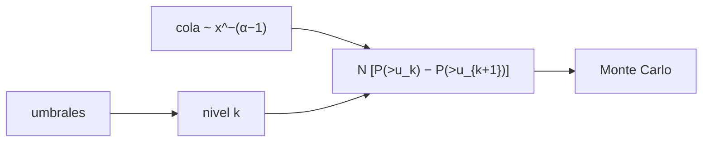

# B33-C04 — Escalas de severidad de clima espacial

<!-- nav:top -->
[🏠 Programa](../../../../README.md) · [📚 Bloque B33](../../../tronco-comun/B33-clima-espacial-impactos-pronostico-y-riesgo.md) · [← Anterior: B33-C03 — Eventos extremos históricos de clima espacial](../B33-C03-eventos-extremos-historicos-de-clima-espacial/CLASE.md) · [Siguiente: B33-C05 — Comunicación de riesgo y alertas de clima espacial →](../B33-C05-comunicacion-de-riesgo-y-alertas-de-clima-espacial/CLASE.md)
<!-- /nav -->

## 1. Ubicación, nivel y alcance

Clase 4 del bloque B33. Nivel N3. Las escalas G, S y R de NOAA traducen una medida física a un nivel de 1 a 5. Aquí clasificas valores, calculas el **número esperado de eventos por nivel** a partir de una cola de potencias y lo verificas por Monte Carlo, y observas que los niveles no están igualmente espaciados. Usas [B12](../../../tronco-comun/B12-probabilidad-estadistica-e-incertidumbre.md), [B30-C20](../../B30/B30-C20-analisis-de-alerta-solar-real/CLASE.md) y la escala de [B30-C12](../../B30/B30-C12-erupciones-y-fulguraciones-solares/CLASE.md). La cola es ilustrativa.

## 2. Por qué esta clase existe

Comparar severidades exige conocer cómo se definió cada nivel. La decisión central: **¿cuántos eventos caen en cada nivel y por qué no son comparables entre escalas?**

## 3. Lo que podrás hacer al terminar

1. Aplicar los umbrales G, S y R.
2. Calcular razones sucesivas.
3. Calcular conteos esperados de una cola de potencias.
4. Verificarlos por Monte Carlo.
5. Explicar la no monotonía.
6. Distinguir escala y frecuencia.

La evidencia es la **ficha de las escalas de severidad** del ejercicio 12 (sección 20).

## 4. Con qué llegas y cómo comprobarlo

1. ¿Qué es una incertidumbre?
2. ¿Qué es una simulación Monte Carlo?
3. ¿Qué es una tabla de resultados?
4. ¿Qué es un valor ilustrativo?
5. ¿Qué es una verificación?

<details>
<summary>Ver respuestas</summary>

1. Un intervalo en que se espera el valor verdadero. 2. Repetir con números aleatorios de semilla fija. 3. Un resumen ordenado de cálculos. 4. Un valor propuesto para el ejemplo, no medido. 5. Comparar un cálculo con un caso independiente.
</details>

Con cuatro o cinco aciertos, sigue; si no, repasa los prerrequisitos.

## 5. Un caso de contexto y casos de referencia

Los umbrales de R son `10⁻⁵`, `5 × 10⁻⁵`, `10⁻⁴`, `10⁻³` y `2 × 10⁻³ W/m²` (razones `5, 2, 10, 2`) y los de S van de 10 a 10⁵ pfu (razón 10) (S1). Es el **ejemplo conductor**. La cola de índice 1,8 es **ilustrativa**.

## 6. Vocabulario

Una **escala** es una clasificación por umbrales. Un **nivel** es un intervalo de la escala. La **razón** entre umbrales. La **cola de potencias**. Los **conteos esperados** son `N [P(X>u_k) − P(X>u_{k+1})]`.

## 7. Modelo mental: los grados de una escalera

Una escalera con peldaños de alturas distintas: el número de personas que cae en cada peldaño no es monótono si los peldaños son desiguales.



*Descripción textual:* los umbrales definen niveles; la cola de potencias da conteos esperados que el Monte Carlo verifica.

Analogía: los grados de una escalera. Límite: valores independientes con cola de potencias.

## 8. La explicación, paso a paso

### 8.1 Razones

R: `5, 2, 10, 2`. S: `10, 10, 10, 10`.

### 8.2 Conteos (200 000 valores)

| escala | nivel | 0 | 1 | 2 | 3 | 4 | 5 |
|---|---|---|---|---|---|---|---|
| R | esperado | 168 302 | 22 951 | 3723 | 4228 | 339 | 457 |
| R | simulado | 168 183 | 23 005 | 3663 | 4330 | 360 | 459 |
| S | esperado | 168 302 | 26 674 | 4228 | 670 | 106 | 20 |
| S | simulado | 168 426 | 26 637 | 4220 | 598 | 103 | 16 |

### 8.3 Lectura

En R, el nivel 3 (X1–X10, un factor 10) tiene más eventos que el 2 (M5–X1, un factor 2): los niveles no son igualmente anchos. En S, con razón constante, los conteos decrecen siempre.

## 9. Magnitudes, símbolos y unidades

| Símbolo | Qué es | Unidad | Valor / nota |
|---|---|---|---|
| R1–R5 | niveles de radioapagón | W/m² | 10⁻⁵…2 × 10⁻³ (S1) |
| S1–S5 | tormentas de radiación | pfu | 10…10⁵ (S1) |
| `α` | índice | — | 1,8 (ilustrativo) |

## 10. Convenciones y referencias

Cola de potencias ilustrativa; semilla `20261109`.

## 11. De dónde sale lo que afirmamos

| ID | Fuente | Localizador | Respalda | Estado |
|---|---|---|---|---|
| S1 | NOAA, *Space Weather Scales* | https://www.spaceweather.gov/noaa-scales-explanation | escalas G1–G5 (Kp 5, 6, 7, 8 incluido 9−, 9), S1–S5 y R1–R5 | Consultada el 2026-11-09 |

Límites: no se consultaron registros de eventos.

## 12. Cómo ver los niveles

| Escala | Razón entre umbrales |
|---|---|
| R | 5, 2, 10, 2 |
| S | 10 |

Descripción larga: S es logarítmica regular; R no.

## 13. Ejemplo trabajado: razón entre niveles

**Paso 1 · Umbrales R.** `10⁻⁵`, `5 × 10⁻⁵`.

**Paso 2 · Cociente.** `5 × 10⁻⁵/10⁻⁵ = 5`.

**Paso 3 · Siguiente.** `10⁻⁴/5 × 10⁻⁵ = 2`.

**Paso 4 · Lectura.** Los niveles no son uniformes.

## 14. Distintas formas de describir una escala

**Por umbral:** nivel. **Por razón:** espaciado. **Por cola:** conteo. **Por simulación:** verificación.

## 15. Práctica guiada

**Ejercicio 1 · con los pasos indicados.** Razón R1→R2. *Pasos:* ejemplo 13.

<details><summary>Solución comentada</summary>

5.
</details>

**Ejercicio 2 · con una pista.** Razón S2→S3.

<details><summary>Solución comentada</summary>

10.
</details>

**Ejercicio 3 · casi autónomo.** Nivel R de `7 × 10⁻⁵`.

<details><summary>Solución comentada</summary>

R2.
</details>

## 16. Práctica autónoma, transferencia e integrador

**Ejercicio 4.** Nivel S de 150 pfu.

<details><summary>Solución comentada</summary>

S2.
</details>

**Ejercicio 5.** Conteo esperado del nivel R3.

<details><summary>Solución comentada</summary>

4228.
</details>

**Ejercicio 6.** ¿Por qué R3 > R2?

<details><summary>Solución comentada</summary>

R3 abarca un factor 10 y R2 un factor 2.
</details>

**Ejercicio 7.** Desviación del conteo S5 (20 esperados, 16 simulados).

<details><summary>Solución comentada</summary>

−0,9σ.
</details>

**Ejercicio 8.** Eventos de nivel 1+ en R.

<details><summary>Solución comentada</summary>

≈ 31 600.
</details>

**Ejercicio 9 · transferencia.** **Transferencia.** Un compañero compara R3 con S3 como equivalentes. Responde.

<details><summary>Solución comentada</summary>

Son escalas de magnitudes distintas.
</details>

**Ejercicio 10 · transferencia.** **Transferencia.** ¿Qué suponen los conteos?

<details><summary>Solución comentada</summary>

Una cola de potencias ilustrativa.
</details>

**Ejercicio 11 · transferencia.** **Transferencia.** ¿Por qué es útil la escala?

<details><summary>Solución comentada</summary>

Comunica severidad con un número pequeño.
</details>

**Ejercicio 12.** **Integrador.** Elabora tu *ficha de las escalas de severidad*: razones, conteos y lectura.

<details><summary>Solución comentada</summary>

Secciones 8.1–8.3.
</details>

**Ejercicio 12 · integrador.** **Integrador.** Elabora tu *ficha de las escalas de severidad*: razones, conteos y lectura.

<details><summary>Solución modelo</summary>

Secciones 8.1–8.3.
</details>

## 17. Laboratorio: escalas y conteos

El script [escalas.py](escalas.py) clasifica valores, calcula conteos esperados y los verifica (**comprueba** 4 desviaciones multinomiales).

**Datos:** umbrales de NOAA; cola **ilustrativa**; semilla `20261109`. **Predice antes de ejecutar:** ¿qué nivel tiene más eventos? (el 0.) **Ejecución del 2026-11-09 (Python 3.12.9):**

```text
Python 3.12.9 (biblioteca estandar)
umbrales R: R1 >= 1e-05, R2 >= 5e-05, R3 >= 0.0001, R4 >= 0.001, R5 >= 0.002 W/m2
razones sucesivas de R: 5, 2, 10, 2 ; de S: 10, 10, 10, 10
R:  nivel         0         1         2         3         4         5
   esperado  168302.1   22951.0    3723.1    4227.6     338.9     457.3
   simulado    168183     23005      3663      4330       360       459
S:  nivel         0         1         2         3         4         5
   esperado  168302.1   26674.1    4227.6     670.0     106.2      20.0
   simulado    168426     26637      4220       598       103        16
exponente local de la cola entre R1 y R3: log10(N_R1+/N_R3+)/log10(R3/R1) = 0.80 por construccion
Pruebas superadas.
```

```bash
python programa/clases/B33/B33-C04-escalas-de-severidad-de-clima-espacial/escalas.py
```

**Límites:** valores independientes.

## 18. Errores frecuentes y cómo corregirlos

**Suponer niveles igualmente anchos.** Se corrige con 8.3.

**Comparar escalas distintas.** Se corrige con el ejercicio 9.

**Tomar la cola por medida.** Se corrige con la sección 10.

**Confundir nivel y valor.** Se corrige con la sección 6.

## 19. Cómo sabrás que vas bien

Tras la sección 8: ¿qué resultado esperabas y cuál obtuviste? Si dudas, repasa el ejemplo 13. Tras el laboratorio: ¿qué comprueba? (ver la sección 17).

## 20. Qué entregas y cómo se evalúa

El producto es tu **ficha de las escalas de severidad** (ejercicio 12).

| Criterio | Inicial | En desarrollo | Logrado | Destacado |
|---|---|---|---|---|
| Conceptos | Los confunde | Parciales | conceptos de la clase | Explica los límites |
| Cálculo | Sin unidades | Con errores | Tablas completas | Calcula casos nuevos |
| Numérico | Sin comprobar | Un caso | Contraste con el análisis | Interpreta las diferencias |
| Fuentes | Sin fuente | Sin fecha | fuentes con fecha | Declara lo ilustrativo |
| Límites | No los nombra | Uno | Tres | Discute qué falta del modelo |

**Condiciones críticas (no se compensan con promedio):** rotular la cola como ilustrativa; no comparar escalas; citar solo lo consultado.

## 21. Ética, seguridad y límites

Clase educativa: los modelos son simplificados. Accesibilidad: tablas equivalentes a las gráficas, fórmulas en texto, ejercicios sin conexión.

## 22. Para cerrar y seguir

Los umbrales de R tienen razones 5, 2, 10 y 2, por lo que los conteos por nivel no son monótonos; los de S, de razón 10, sí. Queda una pregunta: ¿cómo se comunica una alerta?

**Glosario español–inglés.** escala de severidad · *severity scale*; umbral · *threshold*; cola de potencias · *power-law tail*; nivel · *level*; conteo esperado · *expected count*.

**Continuidad.** [B33-C05](../B33-C05-comunicacion-de-riesgo-y-alertas-de-clima-espacial/CLASE.md) estudia la comunicación del riesgo y las alertas.

**Referencias:** ver sección 11.

<!-- nav:bottom -->
---

[← Anterior: B33-C03 — Eventos extremos históricos de clima espacial](../B33-C03-eventos-extremos-historicos-de-clima-espacial/CLASE.md) · [📚 Bloque B33](../../../tronco-comun/B33-clima-espacial-impactos-pronostico-y-riesgo.md) · [Siguiente: B33-C05 — Comunicación de riesgo y alertas de clima espacial →](../B33-C05-comunicacion-de-riesgo-y-alertas-de-clima-espacial/CLASE.md)
<!-- /nav -->
