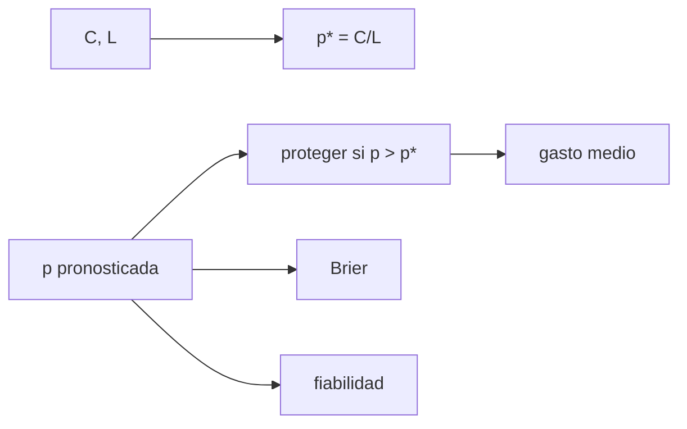

# B33-C05 — Comunicación de riesgo y alertas de clima espacial

<!-- nav:top -->
<!-- /nav -->

## 1. Ubicación, nivel y alcance

Clase 5 del bloque B33. Nivel N3. Una alerta es útil si ayuda a decidir. Aquí aplicas el **modelo de costo–pérdida** (proteger si `p > C/L`), calculas el gasto frente a las referencias «nunca» y «siempre» proteger, la **puntuación de Brier** y la **fiabilidad** de pronósticos probabilísticos calibrados. Usas [B12](../../../tronco-comun/B12-probabilidad-estadistica-e-incertidumbre.md) y [B30-C20](../../B30/B30-C20-analisis-de-alerta-solar-real/CLASE.md). Los costos son ilustrativos.

## 2. Por qué esta clase existe

La mejor comunicación de riesgo da probabilidades calibradas y deja decidir al usuario. La decisión central: **¿cuándo conviene proteger y cuán fiables son las probabilidades?**

## 3. Lo que podrás hacer al terminar

1. Calcular el umbral `C/L`.
2. Calcular el gasto esperado.
3. Compararlo con las referencias.
4. Calcular el Brier.
5. Verificar la fiabilidad por intervalos.
6. Interpretar el ahorro.

La evidencia es la **ficha del riesgo y las alertas** del ejercicio 12 (sección 20).

## 4. Con qué llegas y cómo comprobarlo

1. ¿Qué es una incertidumbre?
2. ¿Qué es una simulación Monte Carlo?
3. ¿Qué es una tabla de resultados?
4. ¿Qué es un valor ilustrativo?
5. ¿Qué es una verificación?

<details>
<summary>Ver respuestas</summary>

1. Un intervalo en que se espera el valor verdadero. 2. Repetir con números aleatorios de semilla fija. 3. Un resumen ordenado de cálculos. 4. Un valor propuesto para el ejemplo, no medido. 5. Comparar un cálculo con un caso independiente.
</details>

Con cuatro o cinco aciertos, sigue; si no, repasa los prerrequisitos.

## 5. Un caso de contexto y casos de referencia

Con `C = 1` y `L = 10`, el umbral es `p > 0,10`; el gasto con el pronóstico es `0,919` frente a `1,000` de la mejor referencia (ahorro del `8,1 %`). Es el **ejemplo conductor**. Los costos y las probabilidades son **ilustrativos**.

## 6. Vocabulario

El **costo** `C` de proteger. La **pérdida** `L` evitable. El **umbral de decisión**. La **puntuación de Brier**. La **fiabilidad** compara la probabilidad pronosticada con la frecuencia observada.

## 7. Modelo mental: llevar paraguas

Llevas paraguas si la probabilidad de lluvia supera la razón entre su costo y el daño de mojarte.



*Descripción textual:* el cociente costo/pérdida fija el umbral de decisión, que da el gasto; el Brier y la fiabilidad miden la calidad de las probabilidades.

Analogía: llevar paraguas. Límite: pronósticos calibrados y costos fijos.

## 8. La explicación, paso a paso

### 8.1 Gasto

Umbral `0,10`; frecuencia climatológica `0,2978`. Gasto medio por caso: con pronóstico `0,9193`; nunca proteger `2,9775`; siempre proteger `1,0000`. Ahorro respecto de la mejor referencia: `8,1 %`.

### 8.2 Brier

Simulado `0,18073`, esperado para pronósticos calibrados `0,18085` (error estándar `0,00119`).

### 8.3 Fiabilidad

| intervalo | casos | `p` media | frecuencia | desviación (errores) |
|---|---|---|---|---|
| 0,0–0,1 | 3254 | 0,0507 | 0,0504 | 0,07 |
| 0,1–0,2 | 3322 | 0,1502 | 0,1439 | 1,01 |
| 0,2–0,3 | 3371 | 0,2501 | 0,2557 | 0,75 |
| 0,3–0,4 | 3347 | 0,3493 | 0,3511 | 0,21 |
| 0,4–0,5 | 3305 | 0,4506 | 0,4360 | 1,69 |
| 0,5–0,6 | 3401 | 0,5499 | 0,5395 | 1,21 |

### 8.4 Lectura

Aun con pronósticos perfectamente calibrados, el ahorro es modesto (8 %) porque la mayoría de los casos tiene probabilidad media. La fiabilidad no garantiza utilidad.

## 9. Magnitudes, símbolos y unidades

| Símbolo | Qué es | Unidad | Valor / nota |
|---|---|---|---|
| `C`, `L` | costo y pérdida | unid. | 1; 10 (ilustrativos) |
| `p*` | umbral | — | 0,10 |
| BS | Brier | — | 0,18073 |

## 10. Convenciones y referencias

Pronósticos calibrados; costos ilustrativos; semilla `20261109`.

## 11. De dónde sale lo que afirmamos

| ID | Fuente | Localizador | Respalda | Estado |
|---|---|---|---|---|
| — | Sin fuente externa | — | relaciones estándar que verifica el laboratorio | No se consultó una fuente para esta clase |

Límites: no se estimaron costos de ningún sector.

## 12. Cómo ver el gasto

| Estrategia | Gasto |
|---|---|
| con pronóstico | 0,919 |
| nunca | 2,978 |
| siempre | 1,000 |

Descripción larga: solo el pronóstico mejora a las referencias.

## 13. Ejemplo trabajado: umbral de decisión

**Paso 1 · Costo.** `C = 1`.

**Paso 2 · Pérdida.** `L = 10`.

**Paso 3 · Cociente.** `C/L = 0,10`.

**Paso 4 · Regla.** Proteger si `p > 0,10`.

## 14. Distintas formas de describir una alerta

**Por decisión:** costo–pérdida. **Por gasto:** referencias. **Por calidad:** Brier. **Por calibración:** fiabilidad.

## 15. Práctica guiada

**Ejercicio 1 · con los pasos indicados.** Umbral con `C = 2` y `L = 10`.

<details><summary>Solución comentada</summary>

`0,20`.
</details>

**Ejercicio 2 · con una pista.** Gasto de siempre proteger.

<details><summary>Solución comentada</summary>

`C = 1`.
</details>

**Ejercicio 3 · casi autónomo.** Ahorro relativo.

<details><summary>Solución comentada</summary>

`8,1 %`.
</details>

## 16. Práctica autónoma, transferencia e integrador

**Ejercicio 4.** Brier esperado de un pronóstico de `p = 0,5`.

<details><summary>Solución comentada</summary>

`0,25`.
</details>

**Ejercicio 5.** Desviación del intervalo 0,4–0,5.

<details><summary>Solución comentada</summary>

`1,69` errores.
</details>

**Ejercicio 6.** Frecuencia climatológica.

<details><summary>Solución comentada</summary>

`0,2978`.
</details>

**Ejercicio 7.** ¿Qué pasa si `C/L > p` siempre?

<details><summary>Solución comentada</summary>

Nunca se protege.
</details>

**Ejercicio 8.** Brier de un pronóstico perfecto.

<details><summary>Solución comentada</summary>

`0`.
</details>

**Ejercicio 9 · transferencia.** **Transferencia.** Un compañero aplica `C = 1`, `L = 10` a la red eléctrica. Responde.

<details><summary>Solución comentada</summary>

Son ilustrativos.
</details>

**Ejercicio 10 · transferencia.** **Transferencia.** ¿Por qué comunicar probabilidades?

<details><summary>Solución comentada</summary>

Porque cada usuario tiene su propio `C/L`.
</details>

**Ejercicio 11 · transferencia.** **Transferencia.** ¿Es el Brier suficiente?

<details><summary>Solución comentada</summary>

No: no mide la utilidad.
</details>

**Ejercicio 12.** **Integrador.** Elabora tu *ficha del riesgo y las alertas*: umbral, gasto, Brier y fiabilidad.

<details><summary>Solución comentada</summary>

Secciones 8.1–8.4.
</details>

**Ejercicio 12 · integrador.** **Integrador.** Elabora tu *ficha del riesgo y las alertas*: umbral, gasto, Brier y fiabilidad.

<details><summary>Solución modelo</summary>

Secciones 8.1–8.4.
</details>

## 17. Laboratorio: costo-pérdida, Brier y fiabilidad

El script [riesgo.py](riesgo.py) calcula el gasto, el Brier y la fiabilidad (**comprueba** 4 errores estándar).

**Datos:** sin constantes; costos **ilustrativos**; semilla `20261109`. **Predice antes de ejecutar:** ¿cuál es el umbral? (0,10.) **Ejecución del 2026-11-09 (Python 3.12.9):**

```text
Python 3.12.9 (biblioteca estandar)
umbral de decision p > C/L = 0.10 ; frecuencia climatologica = 0.2978
gasto medio por caso: con pronostico = 0.9193 ; nunca proteger = 2.9775 ; siempre proteger = 1.0000 ; mejor referencia = 1.0000
ahorro relativo respecto de la mejor referencia = 8.1 %
Brier simulado = 0.18073 ; esperado para pronosticos calibrados = 0.18085 ; error estandar = 0.00119
  intervalo  casos  p media  frecuencia  desviacion [errores]
 0.0- 0.1   3254   0.0507      0.0504                  0.07
 0.1- 0.2   3322   0.1502      0.1439                  1.01
 0.2- 0.3   3371   0.2501      0.2557                  0.75
 0.3- 0.4   3347   0.3493      0.3511                  0.21
 0.4- 0.5   3305   0.4506      0.4360                  1.69
 0.5- 0.6   3401   0.5499      0.5395                  1.21
Pruebas superadas.
```

```bash
python programa/clases/B33/B33-C05-comunicacion-de-riesgo-y-alertas/riesgo.py
```

**Límites:** calibrados, costos fijos.

## 18. Errores frecuentes y cómo corregirlos

**Alertar siempre.** Se corrige con 8.1.

**Confundir calibración y utilidad.** Se corrige con 8.4.

**Tomar los costos por reales.** Se corrige con la sección 10.

**Ignorar al usuario.** Se corrige con el ejercicio 10.

## 19. Cómo sabrás que vas bien

Tras la sección 8: ¿qué resultado esperabas y cuál obtuviste? Si dudas, repasa el ejemplo 13. Tras el laboratorio: ¿qué comprueba? (ver la sección 17).

## 20. Qué entregas y cómo se evalúa

El producto es tu **ficha del riesgo y las alertas** (ejercicio 12).

| Criterio | Inicial | En desarrollo | Logrado | Destacado |
|---|---|---|---|---|
| Conceptos | Los confunde | Parciales | conceptos de la clase | Explica los límites |
| Cálculo | Sin unidades | Con errores | Tablas completas | Calcula casos nuevos |
| Numérico | Sin comprobar | Un caso | Contraste con el análisis | Interpreta las diferencias |
| Fuentes | Sin fuente | Sin fecha | fuentes con fecha | Declara lo ilustrativo |
| Límites | No los nombra | Uno | Tres | Discute qué falta del modelo |

**Condiciones críticas (no se compensan con promedio):** rotular costos como ilustrativos; no estimar riesgos reales; citar solo lo consultado.

## 21. Ética, seguridad y límites

Clase educativa: los modelos son simplificados. Accesibilidad: tablas equivalentes a las gráficas, fórmulas en texto, ejercicios sin conexión.

## 22. Para cerrar y seguir

Con C/L = 0,10 un pronóstico calibrado ahorra 8 % frente a la mejor referencia y tiene Brier 0,181. Queda una pregunta: ¿qué corriente induce el campo geoeléctrico?

**Glosario español–inglés.** comunicación de riesgo · *risk communication*; modelo de costo–pérdida · *cost–loss model*; puntuación de Brier · *Brier score*; fiabilidad · *reliability*; calibración · *calibration*.

**Continuidad.** [B33-C06](../B33-C06-corrientes-geomagneticas-inducidas/CLASE.md) estudia las corrientes geomagnéticas inducidas.

**Referencias:** ver sección 11.

<!-- nav:bottom -->
---

<!-- /nav -->
