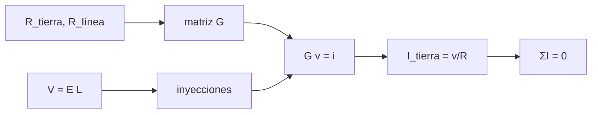

# B33-C07 — Impactos del clima espacial en redes eléctricas

<!-- nav:top -->
<!-- /nav -->

## 1. Ubicación, nivel y alcance

Clase 7 del bloque B33. Nivel N3. En una red, la corriente continua inducida se reparte según las resistencias. Aquí resuelves por **análisis nodal** una red de tres subestaciones con campo geoeléctrico uniforme, verificas la **conservación de la corriente** y comparas con el caso analítico de dos nodos. Usas [B05](../../../tronco-comun/B05-fisica-fundamental-para-el-espacio.md) y [B33-C06](../B33-C06-corrientes-geomagneticas-inducidas/CLASE.md). Los valores son ilustrativos.

## 2. Por qué esta clase existe

Una subestación con una corriente de tierra alta puede saturar un transformador. La decisión central: **¿cómo se reparte la corriente inducida entre las subestaciones?**

## 3. Lo que podrás hacer al terminar

1. Armar la matriz de conductancias.
2. Resolver con eliminación gaussiana.
3. Calcular las corrientes de tierra.
4. Verificar `ΣI = 0`.
5. Comparar con el caso de dos nodos.
6. Verificar la linealidad.

La evidencia es la **ficha de la red eléctrica** del ejercicio 12 (sección 20).

## 4. Con qué llegas y cómo comprobarlo

1. ¿Qué es una incertidumbre?
2. ¿Qué es una simulación Monte Carlo?
3. ¿Qué es una tabla de resultados?
4. ¿Qué es un valor ilustrativo?
5. ¿Qué es una verificación?

<details>
<summary>Ver respuestas</summary>

1. Un intervalo en que se espera el valor verdadero. 2. Repetir con números aleatorios de semilla fija. 3. Un resumen ordenado de cálculos. 4. Un valor propuesto para el ejemplo, no medido. 5. Comparar un cálculo con un caso independiente.
</details>

Con cuatro o cinco aciertos, sigue; si no, repasa los prerrequisitos.

## 5. Un caso de contexto y casos de referencia

Con tres nodos y líneas de 100, 150 y 80 km a 1 V/km, las corrientes de tierra son `−37,22; −4,24; +41,47 A` y suman `−6 × 10⁻¹⁵ A`. Es el **ejemplo conductor**. Las resistencias son **ilustrativas**.

## 6. Vocabulario

El **análisis nodal**. La **conductancia**. La **corriente de tierra**. La **fuente en serie** representa el campo inducido en una línea. La **conservación** de la corriente.

## 7. Modelo mental: un sistema de tuberías

Es como una red de tuberías con bombas en cada tramo: el agua que entra por un desagüe debe salir por otros.



*Descripción textual:* las resistencias y las fuentes definen el sistema nodal, cuya solución da las corrientes de tierra, que suman cero.

Analogía: un sistema de tuberías. Límite: red resistiva en corriente continua.

## 8. La explicación, paso a paso

### 8.1 Dos nodos

Corrientes de tierra `∓23,2558 A`; analítico `V/(R + R₁ + R₂) = 100/4,3 = 23,2558 A`.

### 8.2 Tres nodos

| nodo | `R` tierra (Ω) | `V` (V) | `I` tierra (A) |
|---|---|---|---|
| 0 | 0,50 | −18,6109 | −37,2219 |
| 1 | 0,80 | −3,3948 | −4,2435 |
| 2 | 0,40 | 16,5861 | +41,4654 |

Suma `−6,2 × 10⁻¹⁵ A`. Con el campo duplicado las corrientes se duplican exactamente.

### 8.3 Lectura

La subestación de menor resistencia a tierra (nodo 2) recibe la mayor corriente. La red es lineal: el reparto no depende de la amplitud.

## 9. Magnitudes, símbolos y unidades

| Símbolo | Qué es | Unidad | Valor / nota |
|---|---|---|---|
| `R_k` | resistencias de tierra | Ω | 0,5; 0,8; 0,4 |
| `V` | tensión inducida `EL` | V | 100; 150; 80 |
| `I_k` | corrientes de tierra | A | ver 8.2 |

## 10. Convenciones y referencias

Red resistiva lineal sin transformadores no lineales; valores ilustrativos.

## 11. De dónde sale lo que afirmamos

| ID | Fuente | Localizador | Respalda | Estado |
|---|---|---|---|---|
| — | Sin fuente externa | — | relaciones estándar que verifica el laboratorio | No se consultó una fuente para esta clase |

Límites: no se modeló ninguna red real.

## 12. Cómo ver el reparto

| Nodo | `I` (A) |
|---|---|
| 0 | −37,2 |
| 1 | −4,2 |
| 2 | +41,5 |

Descripción larga: las corrientes suman cero.

## 13. Ejemplo trabajado: dos nodos

**Paso 1 · Tensión.** `V = 100 V`.

**Paso 2 · Resistencia.** `3 + 0,5 + 0,8 = 4,3 Ω`.

**Paso 3 · Cociente.** `I = 100/4,3`.

**Paso 4 · Valor.** `23,26 A`.

## 14. Distintas formas de describir una red

**Por nodo:** tierra. **Por línea:** fuente en serie. **Por conservación:** `ΣI = 0`.

## 15. Práctica guiada

**Ejercicio 1 · con los pasos indicados.** `I` de dos nodos. *Pasos:* ejemplo 13.

<details><summary>Solución comentada</summary>

`23,26 A`.
</details>

**Ejercicio 2 · con una pista.** Suma de las corrientes de tierra.

<details><summary>Solución comentada</summary>

`≈ 0`.
</details>

**Ejercicio 3 · casi autónomo.** Corriente del nodo 2 con el campo duplicado.

<details><summary>Solución comentada</summary>

`82,93 A`.
</details>

## 16. Práctica autónoma, transferencia e integrador

**Ejercicio 4.** ¿Qué nodo recibe más?

<details><summary>Solución comentada</summary>

El 2.
</details>

**Ejercicio 5.** Razón de resistencias de tierra 0/2.

<details><summary>Solución comentada</summary>

`1,25`.
</details>

**Ejercicio 6.** Efecto de duplicar `R_línea`.

<details><summary>Solución comentada</summary>

Disminuye la corriente.
</details>

**Ejercicio 7.** `V` del nodo 0.

<details><summary>Solución comentada</summary>

`−18,61 V`.
</details>

**Ejercicio 8.** ¿Es lineal el sistema?

<details><summary>Solución comentada</summary>

Sí.
</details>

**Ejercicio 9 · transferencia.** **Transferencia.** Un compañero aplica estas corrientes a una red real. Responde.

<details><summary>Solución comentada</summary>

Son ilustrativas.
</details>

**Ejercicio 10 · transferencia.** **Transferencia.** ¿Qué omite el modelo?

<details><summary>Solución comentada</summary>

Transformadores saturables y topología real.
</details>

**Ejercicio 11 · transferencia.** **Transferencia.** ¿Qué valida `ΣI = 0`?

<details><summary>Solución comentada</summary>

La consistencia del sistema.
</details>

**Ejercicio 12.** **Integrador.** Elabora tu *ficha de la red eléctrica*: matriz, corrientes y conservación.

<details><summary>Solución comentada</summary>

Secciones 8.1–8.3.
</details>

**Ejercicio 12 · integrador.** **Integrador.** Elabora tu *ficha de la red eléctrica*: matriz, corrientes y conservación.

<details><summary>Solución modelo</summary>

Secciones 8.1–8.3.
</details>

## 17. Laboratorio: red de tres nodos

El script [red.py](red.py) resuelve el sistema nodal (**comprueba** `ΣI = 0` a `10⁻¹²` y el caso de dos nodos a `10⁻¹²`).

**Datos:** sin constantes; resistencias **ilustrativas**. **Predice antes de ejecutar:** ¿qué nodo recibe más corriente? (el de menor resistencia.) **Ejecución del 2026-11-09 (Python 3.12.9):**

```text
Python 3.12.9 (biblioteca estandar)
dos nodos: corrientes de tierra = -23.255814 A y 23.255814 A ; analitico V/(R + R1 + R2) = 23.255814 A
 nodo  R tierra [ohm]  V nodo [V]  I tierra [A]
    0            0.50    -18.6109      -37.2219
    1            0.80     -3.3948       -4.2435
    2            0.40     16.5861       41.4654
suma de corrientes de tierra = -6.22e-15 A (conservacion)
campo duplicado: corrientes = [-74.4437, -8.487, 82.9307] (el doble: [-74.4437, -8.487, 82.9307])
Pruebas superadas.
```

```bash
python programa/clases/B33/B33-C07-impactos-en-redes-electricas/red.py
```

**Límites:** red resistiva lineal.

## 18. Errores frecuentes y cómo corregirlos

**Olvidar la fuente en serie.** Se corrige con la sección 6.

**Confundir `V` y `I`.** Se corrige con 8.2.

**Tomar los valores por reales.** Se corrige con la sección 10.

**Ignorar la conservación.** Se corrige con 8.2.

## 19. Cómo sabrás que vas bien

Tras la sección 8: ¿qué resultado esperabas y cuál obtuviste? Si dudas, repasa el ejemplo 13. Tras el laboratorio: ¿qué comprueba? (ver la sección 17).

## 20. Qué entregas y cómo se evalúa

El producto es tu **ficha de la red eléctrica** (ejercicio 12).

| Criterio | Inicial | En desarrollo | Logrado | Destacado |
|---|---|---|---|---|
| Conceptos | Los confunde | Parciales | conceptos de la clase | Explica los límites |
| Cálculo | Sin unidades | Con errores | Tablas completas | Calcula casos nuevos |
| Numérico | Sin comprobar | Un caso | Contraste con el análisis | Interpreta las diferencias |
| Fuentes | Sin fuente | Sin fecha | fuentes con fecha | Declara lo ilustrativo |
| Límites | No los nombra | Uno | Tres | Discute qué falta del modelo |

**Condiciones críticas (no se compensan con promedio):** rotular resistencias como ilustrativas; no evaluar una red real; citar solo lo consultado.

## 21. Ética, seguridad y límites

Clase educativa: los modelos son simplificados. Accesibilidad: tablas equivalentes a las gráficas, fórmulas en texto, ejercicios sin conexión.

## 22. Para cerrar y seguir

En una red ilustrativa de tres nodos la corriente se concentra en la subestación de menor resistencia (41 A) y la suma es cero. Queda una pregunta: ¿qué radiación reciben los vuelos?

**Glosario español–inglés.** red eléctrica · *power grid*; análisis nodal · *nodal analysis*; corriente de tierra · *ground current*; conservación de la corriente · *current conservation*; subestación · *substation*.

**Continuidad.** [B33-C08](../B33-C08-dosis-de-radiacion-en-aviacion/CLASE.md) estudia la dosis de radiación en aviación.

**Referencias:** ver sección 11.

<!-- nav:bottom -->
---

<!-- /nav -->
