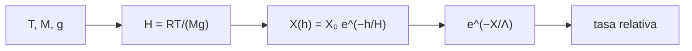

# B33-C08 — Dosis de radiación en aviación

<!-- nav:top -->
[🏠 Programa](../../../../README.md) · [📚 Bloque B33](../../../tronco-comun/B33-clima-espacial-impactos-pronostico-y-riesgo.md) · [← Anterior: B33-C07 — Impactos del clima espacial en redes eléctricas](../B33-C07-impactos-del-clima-espacial-en-redes-electricas/CLASE.md) · [Siguiente: B33-C09 — Planes de continuidad ante eventos de clima espacial →](../B33-C09-planes-de-continuidad-ante-eventos-de-clima-espacial/CLASE.md)
<!-- /nav -->

## 1. Ubicación, nivel y alcance

Clase 8 del bloque B33. Nivel N3. A mayor altitud hay menos atmósfera que proteja. Aquí calculas la **altura de escala** con `R`, `T`, `M` y `g`, la **profundidad atmosférica** `X` por forma cerrada y por integración hidrostática, y una **atenuación exponencial** de juguete para estimar cuánto crece la tasa entre el suelo y 12 km. No es un cálculo de dosis. Usas [B05](../../../tronco-comun/B05-fisica-fundamental-para-el-espacio.md). Las cifras son ilustrativas.

## 2. Por qué esta clase existe

La altitud y la profundidad atmosférica determinan cuánta radiación llega. La decisión central: **¿cuánto menos atmósfera hay a la altitud de vuelo?**

## 3. Lo que podrás hacer al terminar

1. Calcular `H = RT/(Mg)`.
2. Calcular `X = P/g`.
3. Integrar la hidrostática.
4. Aplicar `e^(−X/Λ)`.
5. Calcular la tasa relativa.
6. Reconocer que es un juguete.

La evidencia es la **ficha de la radiación en aviación (modelo de juguete)** del ejercicio 12 (sección 20).

## 4. Con qué llegas y cómo comprobarlo

1. ¿Qué es una incertidumbre?
2. ¿Qué es una simulación Monte Carlo?
3. ¿Qué es una tabla de resultados?
4. ¿Qué es un valor ilustrativo?
5. ¿Qué es una verificación?

<details>
<summary>Ver respuestas</summary>

1. Un intervalo en que se espera el valor verdadero. 2. Repetir con números aleatorios de semilla fija. 3. Un resumen ordenado de cálculos. 4. Un valor propuesto para el ejemplo, no medido. 5. Comparar un cálculo con un caso independiente.
</details>

Con cuatro o cinco aciertos, sigue; si no, repasa los prerrequisitos.

## 5. Un caso de contexto y casos de referencia

Con `T = 250 K` (ilustrativa), `H = 7,318 km` y a 12 km quedan `200,5 g/cm²` de atmósfera frente a `1033,2` al nivel del mar. Es el **ejemplo conductor**. El modelo de juguete da una tasa 258 veces mayor.

## 6. Vocabulario

La **profundidad atmosférica** `X`. La **altura de escala**. La **longitud de atenuación** `Λ`. La **tasa relativa**. Una **dosis** es la energía absorbida por masa.

## 7. Modelo mental: una manta que se adelgaza

Cuanto más alto subes, la manta de aire es más fina y deja pasar más.



*Descripción textual:* la temperatura y la gravedad dan la altura de escala y la profundidad; esta, con la atenuación, da la tasa relativa.

Analogía: una manta que se adelgaza. Límite: atmósfera isoterma y un componente.

## 8. La explicación, paso a paso

### 8.1 Profundidad atmosférica

`H = 7,318 km`; `X(0) = 1033,2 g/cm²`.

| `h` (km) | `X` cerrada (g/cm²) | `X` numérica | `e^(−X/Λ)` | tasa relativa |
|---|---|---|---|---|
| 0 | 1033,23 | 1033,23 | 1,02 × 10⁻³ | 1 |
| 3 | 685,73 | 685,73 | 1,03 × 10⁻² | 10,1 |
| 6 | 455,11 | 455,10 | 4,81 × 10⁻² | 47,2 |
| 9 | 302,05 | 302,03 | 0,1335 | 130,9 |
| 12 | 200,46 | 200,45 | 0,2628 | 257,7 |
| 15 | 133,04 | 133,03 | 0,4119 | 403,9 |

### 8.2 Tiempo

Con una tasa **ilustrativa** de `5 µSv/h` un vuelo de 10 h acumula `50 µSv` y se necesitarían 200 h para `1000 µSv`.

### 8.3 Lectura

Subir de 0 a 12 km reduce la atmósfera a la quinta parte. El juguete exagera el crecimiento porque supone un solo componente sin cascada; no debe usarse para estimar dosis.

## 9. Magnitudes, símbolos y unidades

| Símbolo | Qué es | Unidad | Valor / nota |
|---|---|---|---|
| `H` | altura de escala | km | 7,318 |
| `X` | profundidad | g/cm² | ver 8.1 |
| `Λ` | longitud de atenuación | g/cm² | 150 (ilustrativa) |

## 10. Convenciones y referencias

Atmósfera isoterma; `T`, `M`, `Λ` y la tasa son ilustrativos; no es un cálculo de dosis.

## 11. De dónde sale lo que afirmamos

| ID | Fuente | Localizador | Respalda | Estado |
|---|---|---|---|---|
| S1 | NIST, *Fundamental Physical Constants* (CODATA 2022) | https://physics.nist.gov/cuu/Constants/Table/allascii.txt | constantes citadas en la sección 9 | Consultada el 2026-11-09 |

Límites: no se consultó ningún cálculo de dosis; `M` es estándar.

## 12. Cómo ver la profundidad

| `h` (km) | `X` (g/cm²) |
|---|---|
| 0 | 1033 |
| 6 | 455 |
| 12 | 200 |

Descripción larga: la profundidad cae exponencialmente con la altura.

## 13. Ejemplo trabajado: altura de escala

**Paso 1 · Numerador.** `R T = 8,3145 × 250 = 2078,6`.

**Paso 2 · Denominador.** `M g = 0,0289647 × 9,80665 = 0,28405`.

**Paso 3 · Cociente.** `2078,6/0,28405`.

**Paso 4 · Valor.** `7318 m`.

## 14. Distintas formas de describir un vuelo

**Por altura:** `X`. **Por atenuación:** `e^(−X/Λ)`. **Por tasa:** relativa. **Por tiempo:** acumulación.

## 15. Práctica guiada

**Ejercicio 1 · con los pasos indicados.** `H`. *Pasos:* ejemplo 13.

<details><summary>Solución comentada</summary>

`7,318 km`.
</details>

**Ejercicio 2 · con una pista.** `X(12 km)`.

<details><summary>Solución comentada</summary>

`200,5 g/cm²`.
</details>

**Ejercicio 3 · casi autónomo.** Cociente `X(0)/X(12)`.

<details><summary>Solución comentada</summary>

`5,15`.
</details>

## 16. Práctica autónoma, transferencia e integrador

**Ejercicio 4.** Tasa relativa a 12 km.

<details><summary>Solución comentada</summary>

`258`.
</details>

**Ejercicio 5.** Dosis ilustrativa de 8 h a 5 µSv/h.

<details><summary>Solución comentada</summary>

`40 µSv`.
</details>

**Ejercicio 6.** `X` a 6 km.

<details><summary>Solución comentada</summary>

`455 g/cm²`.
</details>

**Ejercicio 7.** ¿Qué supone `e^(−X/Λ)`?

<details><summary>Solución comentada</summary>

Un solo componente.
</details>

**Ejercicio 8.** Tiempo para 500 µSv.

<details><summary>Solución comentada</summary>

100 h.
</details>

**Ejercicio 9 · transferencia.** **Transferencia.** Un compañero estima su dosis de un vuelo con este laboratorio. Responde.

<details><summary>Solución comentada</summary>

No: es un juguete.
</details>

**Ejercicio 10 · transferencia.** **Transferencia.** ¿Qué omite?

<details><summary>Solución comentada</summary>

Cascadas, rigidez de corte y composición.
</details>

**Ejercicio 11 · transferencia.** **Transferencia.** ¿Por qué la tasa crece tanto?

<details><summary>Solución comentada</summary>

La exponencial amplifica pequeñas diferencias de `X`.
</details>

**Ejercicio 12.** **Integrador.** Elabora tu *ficha de la radiación en aviación*: profundidad, tasa relativa y límites.

<details><summary>Solución comentada</summary>

Secciones 8.1–8.3.
</details>

**Ejercicio 12 · integrador.** **Integrador.** Elabora tu *ficha de la radiación en aviación*: profundidad, tasa relativa y límites.

<details><summary>Solución modelo</summary>

Secciones 8.1–8.3.
</details>

## 17. Laboratorio: profundidad y atenuación de juguete

El script [dosis.py](dosis.py) calcula la profundidad por dos vías y la tasa relativa de juguete (**comprueba** `10⁻³`).

**Datos:** `R` de NIST; `T`, `M`, `Λ`, tasa **ilustrativos**. **Predice antes de ejecutar:** ¿cuánta atmósfera queda a 12 km? (≈200 g/cm².) **Ejecución del 2026-11-09 (Python 3.12.9):**

```text
Python 3.12.9 (biblioteca estandar)
altura de escala H = R T/(M g) = 7.318 km (T = 250 K, ilustrativa) ; profundidad al nivel del mar = 1033.2 g/cm^2
 h [km]  X cerrada [g/cm2]   X numerica   exp(-X/Lambda)  tasa rel. a h = 0
      0           1033.227     1033.227       1.0198e-03          1.000e+00
      3            685.732      685.729       1.0342e-02          1.014e+01
      6            455.107      455.099       4.8121e-02          4.719e+01
      9            302.045      302.034       1.3350e-01          1.309e+02
     12            200.461      200.448       2.6279e-01          2.577e+02
     15            133.042      133.028       4.1191e-01          4.039e+02
a 12 km: X = 200.5 g/cm^2 ; tasa relativa (juguete) = 257.7 veces la del nivel del mar
con una tasa ilustrativa de 5.0 uSv/h, un vuelo de 10 h acumula 50.0 uSv ; tiempo para 1000 uSv = 200 h
Pruebas superadas.
```

```bash
python programa/clases/B33/B33-C08-dosis-de-radiacion-en-aviacion/dosis.py
```

**Límites:** juguete.

## 18. Errores frecuentes y cómo corregirlos

**Usar el juguete para dosis.** Se corrige con 8.3.

**Olvidar convertir Pa a g/cm².** Se corrige con la sección 9.

**Tomar la tasa por medida.** Se corrige con la sección 10.

**Ignorar la cascada.** Se corrige con 8.3.

## 19. Cómo sabrás que vas bien

Tras la sección 8: ¿qué resultado esperabas y cuál obtuviste? Si dudas, repasa el ejemplo 13. Tras el laboratorio: ¿qué comprueba? (ver la sección 17).

## 20. Qué entregas y cómo se evalúa

El producto es tu **ficha de la radiación en aviación (modelo de juguete)** (ejercicio 12).

| Criterio | Inicial | En desarrollo | Logrado | Destacado |
|---|---|---|---|---|
| Conceptos | Los confunde | Parciales | conceptos de la clase | Explica los límites |
| Cálculo | Sin unidades | Con errores | Tablas completas | Calcula casos nuevos |
| Numérico | Sin comprobar | Un caso | Contraste con el análisis | Interpreta las diferencias |
| Fuentes | Sin fuente | Sin fecha | fuentes con fecha | Declara lo ilustrativo |
| Límites | No los nombra | Uno | Tres | Discute qué falta del modelo |

**Condiciones críticas (no se compensan con promedio):** rotular el modelo como de juguete; no estimar dosis; citar solo lo consultado.

## 21. Ética, seguridad y límites

Clase educativa: los modelos son simplificados. Accesibilidad: tablas equivalentes a las gráficas, fórmulas en texto, ejercicios sin conexión.

## 22. Para cerrar y seguir

A 12 km queda la quinta parte de la atmósfera (200 g/cm²) y el juguete multiplica la tasa por 258, pero no estima dosis reales. Queda una pregunta: ¿cómo se asegura la continuidad de un servicio?

**Glosario español–inglés.** dosis de radiación · *radiation dose*; profundidad atmosférica · *atmospheric depth*; altura de escala · *scale height*; longitud de atenuación · *attenuation length*; aviación · *aviation*.

**Continuidad.** [B33-C09](../B33-C09-planes-de-continuidad-ante-eventos-de-clima-espacial/CLASE.md) estudia los planes de continuidad.

**Referencias:** ver sección 11.

<!-- nav:bottom -->
---

[← Anterior: B33-C07 — Impactos del clima espacial en redes eléctricas](../B33-C07-impactos-del-clima-espacial-en-redes-electricas/CLASE.md) · [📚 Bloque B33](../../../tronco-comun/B33-clima-espacial-impactos-pronostico-y-riesgo.md) · [Siguiente: B33-C09 — Planes de continuidad ante eventos de clima espacial →](../B33-C09-planes-de-continuidad-ante-eventos-de-clima-espacial/CLASE.md)
<!-- /nav -->
