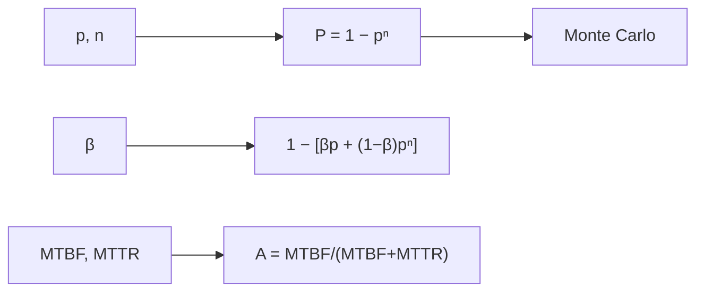

# B33-C09 — Planes de continuidad ante eventos de clima espacial

<!-- nav:top -->
[🏠 Programa](../../../../README.md) · [📚 Bloque B33](../../../tronco-comun/B33-clima-espacial-impactos-pronostico-y-riesgo.md) · [← Anterior: B33-C08 — Dosis de radiación en aviación](../B33-C08-dosis-de-radiacion-en-aviacion/CLASE.md) · [Siguiente: B33-C10 — Modelos de viento solar para pronóstico (Parker y WSA) →](../B33-C10-modelos-de-viento-solar-para-pronostico-parker-y-wsa/CLASE.md)
<!-- /nav -->

## 1. Ubicación, nivel y alcance

Clase 9 del bloque B33. Nivel N3. Un plan de continuidad usa redundancia para sobrevivir a fallas. Aquí calculas la probabilidad de servicio `1 − pⁿ` con unidades independientes, la comparas con Monte Carlo, añades un **factor de causa común** `β` y calculas la **disponibilidad** `MTBF/(MTBF + MTTR)`. Usas [B12](../../../tronco-comun/B12-probabilidad-estadistica-e-incertidumbre.md) y [B33-C05](../B33-C05-comunicacion-de-riesgo-y-alertas-de-clima-espacial/CLASE.md). Los valores son ilustrativos.

## 2. Por qué esta clase existe

Una unidad adicional mejora menos que la anterior y las fallas comunes limitan la ganancia. La decisión central: **¿cuántas unidades de respaldo valen la pena?**

## 3. Lo que podrás hacer al terminar

1. Calcular `P = 1 − pⁿ`.
2. Verificarlo por Monte Carlo.
3. Incluir `β` de causa común.
4. Calcular la ganancia marginal.
5. Calcular la disponibilidad.
6. Probabilidad de falla en un periodo.

La evidencia es la **ficha de la continuidad** del ejercicio 12 (sección 20).

## 4. Con qué llegas y cómo comprobarlo

1. ¿Qué es una incertidumbre?
2. ¿Qué es una simulación Monte Carlo?
3. ¿Qué es una tabla de resultados?
4. ¿Qué es un valor ilustrativo?
5. ¿Qué es una verificación?

<details>
<summary>Ver respuestas</summary>

1. Un intervalo en que se espera el valor verdadero. 2. Repetir con números aleatorios de semilla fija. 3. Un resumen ordenado de cálculos. 4. Un valor propuesto para el ejemplo, no medido. 5. Comparar un cálculo con un caso independiente.
</details>

Con cuatro o cinco aciertos, sigue; si no, repasa los prerrequisitos.

## 5. Un caso de contexto y casos de referencia

Con `p = 0,3` por unidad, 1, 2, 3 y 4 unidades dan `0,700; 0,910; 0,973; 0,992`. Es el **ejemplo conductor**. Con un 30 % de causa común, 4 unidades dan solo `0,904`. Los valores son **ilustrativos**.

## 6. Vocabulario

La **redundancia**. La **causa común** `β`. La **disponibilidad** `A`. El **MTBF** y el **MTTR**. La **ganancia marginal**.

## 7. Modelo mental: ruedas de repuesto

Cada rueda de repuesto ayuda menos que la anterior, y si todas se pinchan por la misma causa, el repuesto no sirve.



*Descripción textual:* la probabilidad de servicio depende de `n` y de la causa común; la disponibilidad depende de fallas y reparación.

Analogía: ruedas de repuesto. Límite: fallas independientes salvo `β`.

## 8. La explicación, paso a paso

### 8.1 Redundancia

| `n` | `P = 1 − pⁿ` | Monte Carlo | desviación (errores) | ganancia marginal |
|---|---|---|---|---|
| 1 | 0,70000 | 0,70081 | 0,79 | 0,70000 |
| 2 | 0,91000 | 0,90955 | 0,70 | 0,21000 |
| 3 | 0,97300 | 0,97339 | 1,08 | 0,06300 |
| 4 | 0,99190 | 0,99188 | 0,10 | 0,01890 |

### 8.2 Causa común

| `β` | n = 1 | n = 2 | n = 3 | n = 4 |
|---|---|---|---|---|
| 0 | 0,700 | 0,910 | 0,973 | 0,992 |
| 0,1 | 0,700 | 0,889 | 0,946 | 0,963 |
| 0,3 | 0,700 | 0,847 | 0,891 | 0,904 |

### 8.3 Disponibilidad

`A = 2000/(2000 + 24) = 0,98814`; fallas esperadas en 48 h `0,024`; probabilidad de al menos una `2,37 %`.

### 8.4 Lectura

La cuarta unidad aporta 1,9 puntos; con 30 % de causa común, la ganancia se aplana en torno a 0,90: la diversidad importa más que la cantidad.

## 9. Magnitudes, símbolos y unidades

| Símbolo | Qué es | Unidad | Valor / nota |
|---|---|---|---|
| `p` | falla por unidad | — | 0,3 (ilustrativa) |
| `β` | causa común | — | 0–0,3 |
| `A` | disponibilidad | — | 0,98814 |

## 10. Convenciones y referencias

Independencia salvo `β`; tasas constantes; valores ilustrativos; semilla `20261109`.

## 11. De dónde sale lo que afirmamos

| ID | Fuente | Localizador | Respalda | Estado |
|---|---|---|---|---|
| — | Sin fuente externa | — | relaciones estándar que verifica el laboratorio | No se consultó una fuente para esta clase |

Límites: no se modeló ningún sistema real.

## 12. Cómo ver la redundancia

| `n` | `P` |
|---|---|
| 1 | 0,700 |
| 2 | 0,910 |
| 3 | 0,973 |
| 4 | 0,992 |

Descripción larga: cada unidad adicional mejora menos.

## 13. Ejemplo trabajado: dos unidades

**Paso 1 · Falla conjunta.** `p² = 0,09`.

**Paso 2 · Complemento.** `1 − 0,09`.

**Paso 3 · Valor.** `0,91`.

**Paso 4 · Lectura.** Dos unidades dan 91 % de servicio.

## 14. Distintas formas de describir un plan

**Por unidades:** `1 − pⁿ`. **Por causa común:** `β`. **Por disponibilidad:** `A`. **Por costo:** marginal.

## 15. Práctica guiada

**Ejercicio 1 · con los pasos indicados.** `P` con `n = 2`. *Pasos:* ejemplo 13.

<details><summary>Solución comentada</summary>

`0,91`.
</details>

**Ejercicio 2 · con una pista.** `P` con `n = 3`.

<details><summary>Solución comentada</summary>

`0,973`.
</details>

**Ejercicio 3 · casi autónomo.** Ganancia de la tercera unidad.

<details><summary>Solución comentada</summary>

`0,063`.
</details>

## 16. Práctica autónoma, transferencia e integrador

**Ejercicio 4.** `P` con `n = 4` y `β = 0,3`.

<details><summary>Solución comentada</summary>

`0,904`.
</details>

**Ejercicio 5.** `A` con MTBF = 2000 h y MTTR = 24 h.

<details><summary>Solución comentada</summary>

`0,988`.
</details>

**Ejercicio 6.** Probabilidad de falla en 48 h.

<details><summary>Solución comentada</summary>

`2,37 %`.
</details>

**Ejercicio 7.** Unidades para `P ≥ 0,99` con `p = 0,3`.

<details><summary>Solución comentada</summary>

4.
</details>

**Ejercicio 8.** Efecto de `β` en `n = 1`.

<details><summary>Solución comentada</summary>

Ninguno.
</details>

**Ejercicio 9 · transferencia.** **Transferencia.** Un compañero usa `p = 0,3` para un satélite. Responde.

<details><summary>Solución comentada</summary>

Es ilustrativo.
</details>

**Ejercicio 10 · transferencia.** **Transferencia.** ¿Por qué la diversidad importa?

<details><summary>Solución comentada</summary>

Porque la causa común anula la redundancia.
</details>

**Ejercicio 11 · transferencia.** **Transferencia.** ¿Qué omite el modelo?

<details><summary>Solución comentada</summary>

Costos, tiempos de conmutación y degradación parcial.
</details>

**Ejercicio 12.** **Integrador.** Elabora tu *ficha de la continuidad*: redundancia, causa común y disponibilidad.

<details><summary>Solución comentada</summary>

Secciones 8.1–8.4.
</details>

**Ejercicio 12 · integrador.** **Integrador.** Elabora tu *ficha de la continuidad*: redundancia, causa común y disponibilidad.

<details><summary>Solución modelo</summary>

Secciones 8.1–8.4.
</details>

## 17. Laboratorio: redundancia y disponibilidad

El script [continuidad.py](continuidad.py) calcula `P`, `β` y `A` (**comprueba** 4 errores estándar).

**Datos:** sin constantes; valores **ilustrativos**; semilla `20261109`. **Predice antes de ejecutar:** ¿cuántas unidades para 99 %? (4.) **Ejecución del 2026-11-09 (Python 3.12.9):**

```text
Python 3.12.9 (biblioteca estandar)
 n  P = 1 - p^n  Monte Carlo  desviacion [errores]  ganancia marginal
 1      0.70000      0.70081                  0.79            0.70000
 2      0.91000      0.90955                  0.70            0.21000
 3      0.97300      0.97339                  1.08            0.06300
 4      0.99190      0.99188                  0.10            0.01890
 beta      n = 1     n = 2     n = 3     n = 4
 0.00    0.70000   0.91000   0.97300   0.99190
 0.10    0.70000   0.88900   0.94570   0.96271
 0.30    0.70000   0.84700   0.89110   0.90433
disponibilidad A = MTBF/(MTBF + MTTR) = 0.98814 ; fallas esperadas en 48 h = 0.024 ; probabilidad de al menos una = 0.0237
Pruebas superadas.
```

```bash
python programa/clases/B33/B33-C09-planes-de-continuidad-ante-eventos-de-clima-espacial/continuidad.py
```

**Límites:** independencia salvo `β`.

## 18. Errores frecuentes y cómo corregirlos

**Ignorar la causa común.** Se corrige con 8.2.

**Sumar probabilidades de falla.** Se corrige con el ejemplo 13.

**Confundir disponibilidad y confiabilidad.** Se corrige con la sección 6.

**Tomar `p` por real.** Se corrige con la sección 10.

## 19. Cómo sabrás que vas bien

Tras la sección 8: ¿qué resultado esperabas y cuál obtuviste? Si dudas, repasa el ejemplo 13. Tras el laboratorio: ¿qué comprueba? (ver la sección 17).

## 20. Qué entregas y cómo se evalúa

El producto es tu **ficha de la continuidad** (ejercicio 12).

| Criterio | Inicial | En desarrollo | Logrado | Destacado |
|---|---|---|---|---|
| Conceptos | Los confunde | Parciales | conceptos de la clase | Explica los límites |
| Cálculo | Sin unidades | Con errores | Tablas completas | Calcula casos nuevos |
| Numérico | Sin comprobar | Un caso | Contraste con el análisis | Interpreta las diferencias |
| Fuentes | Sin fuente | Sin fecha | fuentes con fecha | Declara lo ilustrativo |
| Límites | No los nombra | Uno | Tres | Discute qué falta del modelo |

**Condiciones críticas (no se compensan con promedio):** rotular `p` y `β` como ilustrativos; no diseñar sistemas reales; citar solo lo consultado.

## 21. Ética, seguridad y límites

Clase educativa: los modelos son simplificados. Accesibilidad: tablas equivalentes a las gráficas, fórmulas en texto, ejercicios sin conexión.

## 22. Para cerrar y seguir

Con p = 0,3 cuatro unidades dan 99,2 %, pero con 30 % de causa común quedan en 90 %; la disponibilidad ilustrativa es 98,8 %. Queda una pregunta: ¿cómo se modela el viento solar para pronóstico?

**Glosario español–inglés.** plan de continuidad · *continuity plan*; redundancia · *redundancy*; causa común · *common cause*; disponibilidad · *availability*; tiempo medio entre fallas · *mean time between failures*.

**Continuidad.** [B33-C10](../B33-C10-modelos-de-viento-solar-para-pronostico-parker-y-wsa/CLASE.md) estudia los modelos de viento solar.

**Referencias:** ver sección 11.

<!-- nav:bottom -->
---

[← Anterior: B33-C08 — Dosis de radiación en aviación](../B33-C08-dosis-de-radiacion-en-aviacion/CLASE.md) · [📚 Bloque B33](../../../tronco-comun/B33-clima-espacial-impactos-pronostico-y-riesgo.md) · [Siguiente: B33-C10 — Modelos de viento solar para pronóstico (Parker y WSA) →](../B33-C10-modelos-de-viento-solar-para-pronostico-parker-y-wsa/CLASE.md)
<!-- /nav -->
