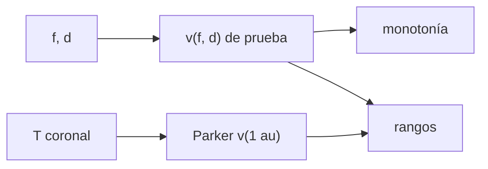

# B33-C10 — Modelos de viento solar para pronóstico (Parker y WSA)

<!-- nav:top -->
[🏠 Programa](../../../../README.md) · [📚 Bloque B33](../../../tronco-comun/B33-clima-espacial-impactos-pronostico-y-riesgo.md) · [← Anterior: B33-C09 — Planes de continuidad ante eventos de clima espacial](../B33-C09-planes-de-continuidad-ante-eventos-de-clima-espacial/CLASE.md) · [Siguiente: B33-C11 — Modelos empíricos y de persistencia en clima espacial →](../B33-C11-modelos-empiricos-y-de-persistencia-en-clima-espacial/CLASE.md)
<!-- /nav -->

## 1. Ubicación, nivel y alcance

Clase 10 del bloque B33. Nivel N3. Los pronósticos de viento solar combinan modelos físicos y relaciones empíricas. Aquí evalúas una **relación empírica de prueba** de la velocidad frente al factor de expansión de las líneas de campo y a la distancia al borde de un agujero coronal (de forma tipo WSA, con coeficientes **ilustrativos**), verificas su monotonía y la comparas con el viento de **Parker** (B30-C10). Usas [B05](../../../tronco-comun/B05-fisica-fundamental-para-el-espacio.md) y [B30-C10](../../B30/B30-C10-viento-solar-y-heliosfera/CLASE.md). No se contrasta con la literatura.

## 2. Por qué esta clase existe

Un pronóstico necesita una condición de frontera coronal. La decisión central: **¿cómo cambia la velocidad con la expansión y la distancia al borde?**

## 3. Lo que podrás hacer al terminar

1. Evaluar la relación de prueba.
2. Verificar la monotonía.
3. Evaluar Parker para tres temperaturas.
4. Comparar rangos.
5. Reconocer el carácter de prueba.
6. Distinguir modelo físico y empírico.

La evidencia es la **ficha del viento solar para pronóstico** del ejercicio 12 (sección 20).

## 4. Con qué llegas y cómo comprobarlo

1. ¿Qué es una incertidumbre?
2. ¿Qué es una simulación Monte Carlo?
3. ¿Qué es una tabla de resultados?
4. ¿Qué es un valor ilustrativo?
5. ¿Qué es una verificación?

<details>
<summary>Ver respuestas</summary>

1. Un intervalo en que se espera el valor verdadero. 2. Repetir con números aleatorios de semilla fija. 3. Un resumen ordenado de cálculos. 4. Un valor propuesto para el ejemplo, no medido. 5. Comparar un cálculo con un caso independiente.
</details>

Con cuatro o cinco aciertos, sigue; si no, repasa los prerrequisitos.

## 5. Un caso de contexto y casos de referencia

La relación de prueba da de `298,6` a `766,0 km/s` según `f` y `d`; el viento de Parker a 1 au da `432,5; 562,0; 674,2 km/s` para 1, 1,5 y 2 MK. Es el **ejemplo conductor**. Todos los coeficientes son **ilustrativos**.

## 6. Vocabulario

El **factor de expansión** `f` de las líneas de campo. La **distancia angular** `d` al borde de un agujero coronal. Una **relación empírica** ajusta datos. El **modelo físico** (Parker) resuelve ecuaciones.

## 7. Modelo mental: una receta frente a una ley

La relación empírica es una receta que funciona en la práctica; Parker es una ley derivada de principios.



*Descripción textual:* la relación de prueba y Parker dan velocidades en rangos comparables, con monotonía comprobada.

Analogía: una receta frente a una ley. Límite: relación de prueba y Parker isotermo.

## 8. La explicación, paso a paso

### 8.1 Relación de prueba (km/s)

| `f` | `d = 1°` | `d = 3°` | `d = 5°` | `d = 10°` |
|---|---|---|---|---|
| 2 | 314,7 | 476,3 | 640,1 | 766,0 |
| 5 | 310,5 | 449,0 | 589,4 | 697,3 |
| 10 | 307,3 | 428,3 | 551,1 | 645,4 |
| 30 | 302,7 | 398,8 | 496,3 | 571,3 |
| 100 | 298,6 | 372,6 | 447,5 | 505,2 |

Decrece con `f` y crece con `d` en todos los casos.

### 8.2 Parker

| `T` (K) | `v(1 au)` (km/s) |
|---|---|
| 1,0 × 10⁶ | 432,5 |
| 1,5 × 10⁶ | 562,0 |
| 2,0 × 10⁶ | 674,2 |

### 8.3 Lectura

Ambas dan velocidades de 300 a 770 km/s, pero por razones distintas: la empírica depende de la topología magnética y Parker de la temperatura. Esta clase no contrasta ninguna con mediciones.

## 9. Magnitudes, símbolos y unidades

| Símbolo | Qué es | Unidad | Valor / nota |
|---|---|---|---|
| `f` | factor de expansión | — | 2–100 |
| `d` | distancia al borde | grados | 1–10 |
| `T` | temperatura de Parker | K | 10⁶–2 × 10⁶ (ilustrativa) |

## 10. Convenciones y referencias

Relación de prueba con coeficientes ilustrativos; Parker isotermo.

## 11. De dónde sale lo que afirmamos

| ID | Fuente | Localizador | Respalda | Estado |
|---|---|---|---|---|
| S1 | NIST, *Fundamental Physical Constants* (CODATA 2022) | https://physics.nist.gov/cuu/Constants/Table/allascii.txt | constantes citadas en la sección 9 | Consultada el 2026-11-09 |
| S2 | UAI, Resolución B3 de 2015 | https://arxiv.org/abs/1510.07674 | valores nominales solares y planetarios | Consultada el 2026-11-09 |

Límites: la relación no se contrastó con la literatura ni con datos.

## 12. Cómo ver las velocidades

| Modelo | Rango (km/s) |
|---|---|
| prueba | 299–766 |
| Parker | 433–674 |

Descripción larga: los rangos son comparables.

## 13. Ejemplo trabajado: monotonía

**Paso 1 · `f`.** De 2 a 100.

**Paso 2 · Velocidad (d = 5°).** De 640,1 a 447,5.

**Paso 3 · Signo.** Decrece.

**Paso 4 · Lectura.** Más expansión, viento más lento.

## 14. Distintas formas de describir un pronóstico

**Por topología:** `f`, `d`. **Por física:** Parker. **Por validez:** monotonía.

## 15. Práctica guiada

**Ejercicio 1 · con los pasos indicados.** Velocidad de prueba con `f = 2`, `d = 5°`. *Pasos:* tabla.

<details><summary>Solución comentada</summary>

`640,1 km/s`.
</details>

**Ejercicio 2 · con una pista.** Con `f = 100`, `d = 5°`.

<details><summary>Solución comentada</summary>

`447,5 km/s`.
</details>

**Ejercicio 3 · casi autónomo.** Cociente 2/100.

<details><summary>Solución comentada</summary>

`1,43`.
</details>

## 16. Práctica autónoma, transferencia e integrador

**Ejercicio 4.** `v` de Parker a 1,5 MK.

<details><summary>Solución comentada</summary>

`562,0`.
</details>

**Ejercicio 5.** ¿Crece `v` con `d`?

<details><summary>Solución comentada</summary>

Sí.
</details>

**Ejercicio 6.** Diferencia Parker 2 MK − 1 MK.

<details><summary>Solución comentada</summary>

`241,7 km/s`.
</details>

**Ejercicio 7.** ¿Se contrastó con datos?

<details><summary>Solución comentada</summary>

No.
</details>

**Ejercicio 8.** Rango de la relación de prueba.

<details><summary>Solución comentada</summary>

`299–766`.
</details>

**Ejercicio 9 · transferencia.** **Transferencia.** Un compañero usa estos coeficientes como los operativos. Responde.

<details><summary>Solución comentada</summary>

Son ilustrativos.
</details>

**Ejercicio 10 · transferencia.** **Transferencia.** ¿Cuál es empírico y cuál físico?

<details><summary>Solución comentada</summary>

La relación de prueba es empírica; Parker es físico.
</details>

**Ejercicio 11 · transferencia.** **Transferencia.** ¿Qué hace falta para validar?

<details><summary>Solución comentada</summary>

Mediciones, que no se consultaron.
</details>

**Ejercicio 12.** **Integrador.** Elabora tu *ficha del viento solar para pronóstico*: tabla, monotonía y comparación.

<details><summary>Solución comentada</summary>

Secciones 8.1–8.3.
</details>

**Ejercicio 12 · integrador.** **Integrador.** Elabora tu *ficha del viento solar para pronóstico*: tabla, monotonía y comparación.

<details><summary>Solución modelo</summary>

Secciones 8.1–8.3.
</details>

## 17. Laboratorio: relación de prueba y Parker

El script [wsa.py](wsa.py) evalúa la relación y Parker (**comprueba** monotonía y residuo de Parker).

**Datos:** `k_B`, `u` de NIST; `GM_☉`, `R_☉` de la UAI; coeficientes **ilustrativos**. **Predice antes de ejecutar:** ¿decrece la velocidad con `f`? (sí.) **Ejecución del 2026-11-09 (Python 3.12.9):**

```text
Python 3.12.9 (biblioteca estandar)
     f    d = 1 deg   d = 3 deg   d = 5 deg  d = 10 deg
     2        314.7       476.3       640.1       766.0
     5        310.5       449.0       589.4       697.3
    10        307.3       428.3       551.1       645.4
    30        302.7       398.8       496.3       571.3
   100        298.6       372.6       447.5       505.2
monotonia: decrece con f y crece con d (prueba superada)
    T [K]  v(1 au) Parker [km/s]
 1.00e+06                  432.5
 1.50e+06                  562.0
 2.00e+06                  674.2
Pruebas superadas.
```

```bash
python programa/clases/B33/B33-C10-modelos-de-viento-solar-para-pronostico-parker-y-wsa/wsa.py
```

**Límites:** relación de prueba.

## 18. Errores frecuentes y cómo corregirlos

**Tomar los coeficientes por reales.** Se corrige con la sección 10.

**Confundir empírico y físico.** Se corrige con la sección 6.

**Extrapolar fuera de rango.** Se corrige con 8.3.

**Olvidar la validación.** Se corrige con 8.3.

## 19. Cómo sabrás que vas bien

Tras la sección 8: ¿qué resultado esperabas y cuál obtuviste? Si dudas, repasa el ejemplo 13. Tras el laboratorio: ¿qué comprueba? (ver la sección 17).

## 20. Qué entregas y cómo se evalúa

El producto es tu **ficha del viento solar para pronóstico** (ejercicio 12).

| Criterio | Inicial | En desarrollo | Logrado | Destacado |
|---|---|---|---|---|
| Conceptos | Los confunde | Parciales | conceptos de la clase | Explica los límites |
| Cálculo | Sin unidades | Con errores | Tablas completas | Calcula casos nuevos |
| Numérico | Sin comprobar | Un caso | Contraste con el análisis | Interpreta las diferencias |
| Fuentes | Sin fuente | Sin fecha | fuentes con fecha | Declara lo ilustrativo |
| Límites | No los nombra | Uno | Tres | Discute qué falta del modelo |

**Condiciones críticas (no se compensan con promedio):** rotular los coeficientes como ilustrativos; no presentar la relación como operativa; citar solo lo consultado.

## 21. Ética, seguridad y límites

Clase educativa: los modelos son simplificados. Accesibilidad: tablas equivalentes a las gráficas, fórmulas en texto, ejercicios sin conexión.

## 22. Para cerrar y seguir

Una relación de prueba y el modelo de Parker dan velocidades de 300 a 770 km/s, pero ninguna se contrastó con datos. Queda una pregunta: ¿cuánto vale la persistencia como pronóstico?

**Glosario español–inglés.** modelo empírico · *empirical model*; factor de expansión · *expansion factor*; agujero coronal · *coronal hole*; viento solar · *solar wind*; condición de frontera · *boundary condition*.

**Continuidad.** [B33-C11](../B33-C11-modelos-empiricos-y-de-persistencia-en-clima-espacial/CLASE.md) estudia los modelos empíricos y de persistencia.

**Referencias:** ver sección 11.

<!-- nav:bottom -->
---

[← Anterior: B33-C09 — Planes de continuidad ante eventos de clima espacial](../B33-C09-planes-de-continuidad-ante-eventos-de-clima-espacial/CLASE.md) · [📚 Bloque B33](../../../tronco-comun/B33-clima-espacial-impactos-pronostico-y-riesgo.md) · [Siguiente: B33-C11 — Modelos empíricos y de persistencia en clima espacial →](../B33-C11-modelos-empiricos-y-de-persistencia-en-clima-espacial/CLASE.md)
<!-- /nav -->
