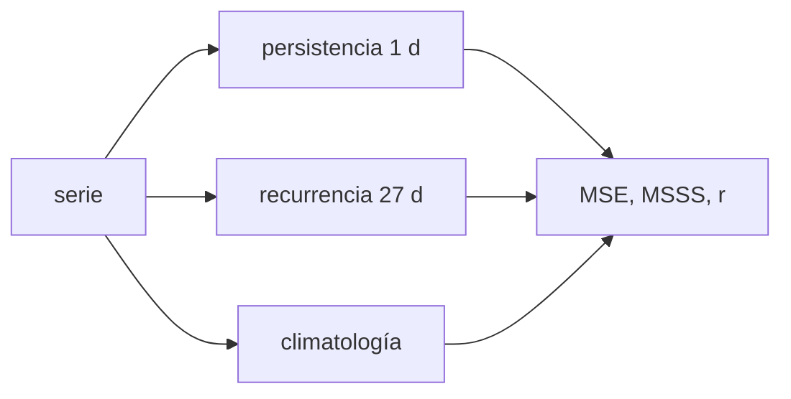

# B33-C11 — Modelos empíricos y de persistencia en clima espacial

<!-- nav:top -->
[🏠 Programa](../../../../README.md) · [📚 Bloque B33](../../../tronco-comun/B33-clima-espacial-impactos-pronostico-y-riesgo.md) · [← Anterior: B33-C10 — Modelos de viento solar para pronóstico (Parker y WSA)](../B33-C10-modelos-de-viento-solar-para-pronostico-parker-y-wsa/CLASE.md) · [Siguiente: B33-C12 — Pronóstico de llegada y severidad de CME →](../B33-C12-pronostico-de-llegada-y-severidad-de-cme/CLASE.md)
<!-- /nav -->

## 1. Ubicación, nivel y alcance

Clase 11 del bloque B33. Nivel N3. La persistencia y la recurrencia son los pronósticos más simples. Aquí comparas, en una serie diaria sintética con componente de 27 días, la **climatología**, la **persistencia a 1 día**, la **recurrencia a 27 días** y la persistencia a 14 días, con MSE, destreza y correlación, y buscas el desfase de mayor correlación. Usas [B12](../../../tronco-comun/B12-probabilidad-estadistica-e-incertidumbre.md) y [B33-C01](../B33-C01-validacion-de-modelos-mhd-con-eventos-solares-documentados/CLASE.md). La recurrencia es una suposición del generador.

## 2. Por qué esta clase existe

Un modelo complejo debe superar a la persistencia. La decisión central: **¿qué desfase da el mejor pronóstico simple?**

## 3. Lo que podrás hacer al terminar

1. Calcular MSE y MSSS.
2. Calcular la correlación por desfase.
3. Identificar el desfase de 27 días.
4. Comparar con la climatología.
5. Reconocer cuando un pronóstico es peor que la climatología.
6. Interpretar el resultado.

La evidencia es la **ficha de la persistencia** del ejercicio 12 (sección 20).

## 4. Con qué llegas y cómo comprobarlo

1. ¿Qué es una incertidumbre?
2. ¿Qué es una simulación Monte Carlo?
3. ¿Qué es una tabla de resultados?
4. ¿Qué es un valor ilustrativo?
5. ¿Qué es una verificación?

<details>
<summary>Ver respuestas</summary>

1. Un intervalo en que se espera el valor verdadero. 2. Repetir con números aleatorios de semilla fija. 3. Un resumen ordenado de cálculos. 4. Un valor propuesto para el ejemplo, no medido. 5. Comparar un cálculo con un caso independiente.
</details>

Con cuatro o cinco aciertos, sigue; si no, repasa los prerrequisitos.

## 5. Un caso de contexto y casos de referencia

En 3000 días sintéticos, la persistencia a 1 día tiene `MSSS = 0,580` y la recurrencia a 27 días `0,050`; la persistencia a 14 días es peor que la climatología (`−2,05`). Es el **ejemplo conductor**. El desfase de mayor correlación es `27 d`.

## 6. Vocabulario

La **persistencia** repite el último valor. La **recurrencia** repite el valor de hace un periodo. La **climatología** es la media. La **destreza** `MSSS`.

## 7. Modelo mental: una canción con estribillo

Si la canción repite el estribillo cada 27 compases, puedes predecir con el de hace 27 compases; pero predecir con el de hace 14 es peor que adivinar el promedio.



*Descripción textual:* la serie genera pronósticos simples cuyas métricas se comparan con la climatología.

Analogía: una canción con estribillo. Límite: serie estacionaria con componente periódico.

## 8. La explicación, paso a paso

### 8.1 Métricas

| método | MSE | MSSS | correlación |
|---|---|---|---|
| climatología | 2,079 | 0,000 | — |
| persistencia 1 día | 0,872 | 0,580 | 0,790 |
| recurrencia 27 días | 1,975 | 0,050 | 0,521 |
| persistencia 14 días | 6,342 | −2,050 | −0,532 |

### 8.2 Correlación por desfase

`20 d: −0,011; 24: 0,415; 26: 0,506; 27: 0,521; 28: 0,514; 30: 0,404; 34: −0,039`. El máximo está en 27 días.

### 8.3 Lectura

A 1 día la persistencia explica el 58 %; a 27 días la recurrencia apenas supera a la climatología. A 14 días, medio ciclo, es peor que adivinar la media.

## 9. Magnitudes, símbolos y unidades

| Símbolo | Qué es | Unidad | Valor / nota |
|---|---|---|---|
| MSSS | destreza | — | ver 8.1 |
| `P` | periodo de recurrencia | d | 27 (supuesto del generador) |

## 10. Convenciones y referencias

Serie sintética con componente de 27 días; semilla `20261109`.

## 11. De dónde sale lo que afirmamos

| ID | Fuente | Localizador | Respalda | Estado |
|---|---|---|---|---|
| — | Sin fuente externa | — | relaciones estándar que verifica el laboratorio | No se consultó una fuente para esta clase |

Límites: no se usó ninguna serie real.

## 12. Cómo ver la destreza

| Método | MSSS |
|---|---|
| persistencia 1 d | 0,58 |
| recurrencia 27 d | 0,05 |
| persistencia 14 d | −2,05 |

Descripción larga: la persistencia de medio periodo es peor que la climatología.

## 13. Ejemplo trabajado: MSSS de la persistencia

**Paso 1 · MSE de climatología.** `2,079`.

**Paso 2 · MSE de persistencia.** `0,872`.

**Paso 3 · Cociente.** `0,872/2,079 = 0,419`.

**Paso 4 · Destreza.** `1 − 0,419 = 0,581`.

## 14. Distintas formas de describir un pronóstico simple

**Por corto plazo:** persistencia. **Por periodo:** recurrencia. **Por referencia:** climatología.

## 15. Práctica guiada

**Ejercicio 1 · con los pasos indicados.** MSSS de la persistencia a 1 día. *Pasos:* ejemplo 13.

<details><summary>Solución comentada</summary>

`0,58`.
</details>

**Ejercicio 2 · con una pista.** Desfase de mayor correlación.

<details><summary>Solución comentada</summary>

27 d.
</details>

**Ejercicio 3 · casi autónomo.** Correlación en 27 d.

<details><summary>Solución comentada</summary>

`0,521`.
</details>

## 16. Práctica autónoma, transferencia e integrador

**Ejercicio 4.** ¿Por qué 14 d es peor que la climatología?

<details><summary>Solución comentada</summary>

Está en antifase.
</details>

**Ejercicio 5.** MSE de climatología.

<details><summary>Solución comentada</summary>

`2,079`.
</details>

**Ejercicio 6.** Cociente de MSE persistencia 1 d y recurrencia 27 d.

<details><summary>Solución comentada</summary>

`0,44`.
</details>

**Ejercicio 7.** Correlación en 34 d.

<details><summary>Solución comentada</summary>

`−0,04`.
</details>

**Ejercicio 8.** Destreza de recurrencia.

<details><summary>Solución comentada</summary>

`0,05`.
</details>

**Ejercicio 9 · transferencia.** **Transferencia.** Un compañero afirma que el viento solar recurre cada 27 días según la clase. Responde.

<details><summary>Solución comentada</summary>

Es un supuesto del generador.
</details>

**Ejercicio 10 · transferencia.** **Transferencia.** ¿Qué referencia debe batir un modelo?

<details><summary>Solución comentada</summary>

La mejor entre persistencia y climatología.
</details>

**Ejercicio 11 · transferencia.** **Transferencia.** ¿Qué omite el generador?

<details><summary>Solución comentada</summary>

Variabilidad de ciclo a ciclo.
</details>

**Ejercicio 12.** **Integrador.** Elabora tu *ficha de la persistencia*: métricas, correlación por desfase y lectura.

<details><summary>Solución comentada</summary>

Secciones 8.1–8.3.
</details>

**Ejercicio 12 · integrador.** **Integrador.** Elabora tu *ficha de la persistencia*: métricas, correlación por desfase y lectura.

<details><summary>Solución modelo</summary>

Secciones 8.1–8.3.
</details>

## 17. Laboratorio: persistencia y recurrencia

El script [persistencia.py](persistencia.py) calcula MSE, destreza y correlación por desfase (**comprueba** el máximo en 27 días).

**Datos:** sin constantes; serie **sintética**; semilla `20261109`. **Predice antes de ejecutar:** ¿qué desfase da la mayor correlación? (27 d.) **Ejecución del 2026-11-09 (Python 3.12.9):**

```text
Python 3.12.9 (biblioteca estandar)
metodo                          MSE     MSSS  correlacion
climatologia                  2.079    0.000          nan
persistencia 1 dia            0.872    0.580        0.790
recurrencia 27 dias           1.975    0.050        0.521
persistencia 14 dias          6.342   -2.050       -0.532
correlacion por desfase: 20:-0.011, 24:0.415, 26:0.506, 27:0.521, 28:0.514, 30:0.404, 34:-0.039
desfase de mayor correlacion = 27 dias
Pruebas superadas.
```

```bash
python programa/clases/B33/B33-C11-modelos-empiricos-y-de-persistencia-en-clima-espacial/persistencia.py
```

**Límites:** serie estacionaria.

## 18. Errores frecuentes y cómo corregirlos

**Usar solo la climatología como referencia.** Se corrige con 8.1.

**Olvidar la antifase.** Se corrige con el ejercicio 4.

**Tomar el periodo por real.** Se corrige con la sección 10.

**Confundir correlación y destreza.** Se corrige con 8.1.

## 19. Cómo sabrás que vas bien

Tras la sección 8: ¿qué resultado esperabas y cuál obtuviste? Si dudas, repasa el ejemplo 13. Tras el laboratorio: ¿qué comprueba? (ver la sección 17).

## 20. Qué entregas y cómo se evalúa

El producto es tu **ficha de la persistencia** (ejercicio 12).

| Criterio | Inicial | En desarrollo | Logrado | Destacado |
|---|---|---|---|---|
| Conceptos | Los confunde | Parciales | conceptos de la clase | Explica los límites |
| Cálculo | Sin unidades | Con errores | Tablas completas | Calcula casos nuevos |
| Numérico | Sin comprobar | Un caso | Contraste con el análisis | Interpreta las diferencias |
| Fuentes | Sin fuente | Sin fecha | fuentes con fecha | Declara lo ilustrativo |
| Límites | No los nombra | Uno | Tres | Discute qué falta del modelo |

**Condiciones críticas (no se compensan con promedio):** rotular el periodo como supuesto; no atribuir recurrencia a datos; citar solo lo consultado.

## 21. Ética, seguridad y límites

Clase educativa: los modelos son simplificados. Accesibilidad: tablas equivalentes a las gráficas, fórmulas en texto, ejercicios sin conexión.

## 22. Para cerrar y seguir

La persistencia a 1 día tiene destreza 0,58, la recurrencia a 27 d apenas 0,05 y la de 14 d es peor que la climatología. Queda una pregunta: ¿cuánto se equivoca un pronóstico de llegada?

**Glosario español–inglés.** persistencia · *persistence*; recurrencia · *recurrence*; climatología · *climatology*; destreza · *skill*; antifase · *antiphase*.

**Continuidad.** [B33-C12](../B33-C12-pronostico-de-llegada-y-severidad-de-cme/CLASE.md) estudia el pronóstico de llegada y severidad de CME.

**Referencias:** ver sección 11.

<!-- nav:bottom -->
---

[← Anterior: B33-C10 — Modelos de viento solar para pronóstico (Parker y WSA)](../B33-C10-modelos-de-viento-solar-para-pronostico-parker-y-wsa/CLASE.md) · [📚 Bloque B33](../../../tronco-comun/B33-clima-espacial-impactos-pronostico-y-riesgo.md) · [Siguiente: B33-C12 — Pronóstico de llegada y severidad de CME →](../B33-C12-pronostico-de-llegada-y-severidad-de-cme/CLASE.md)
<!-- /nav -->
