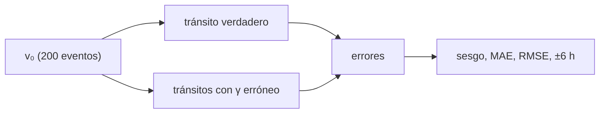

# B33-C12 — Pronóstico de llegada y severidad de CME

<!-- nav:top -->
[🏠 Programa](../../../../README.md) · [📚 Bloque B33](../../../tronco-comun/B33-clima-espacial-impactos-pronostico-y-riesgo.md) · [← Anterior: B33-C11 — Modelos empíricos y de persistencia en clima espacial](../B33-C11-modelos-empiricos-y-de-persistencia-en-clima-espacial/CLASE.md) · [Siguiente: B33-C13 — Pronóstico de actividad geomagnética →](../B33-C13-pronostico-de-actividad-geomagnetica/CLASE.md)
<!-- /nav -->

## 1. Ubicación, nivel y alcance

Clase 12 del bloque B33. Nivel N3. Un pronóstico de llegada se evalúa con su error. Aquí generas 200 eventos sintéticos con un arrastre «verdadero» y los pronosticas con modelos de arrastre mal especificado (mitad, doble y nulo), midiendo **sesgo**, **MAE**, **RMSE** y la fracción dentro de **±6 h**. Usas [B30-C13](../../B30/B30-C13-eyecciones-de-masa-coronal/CLASE.md) y [B33-C02](../B33-C02-modelos-de-propagacion-de-cme/CLASE.md). Los eventos son sintéticos.

## 2. Por qué esta clase existe

Saber cómo falla un modelo orienta su mejora. La decisión central: **¿qué sesgo y qué precisión tiene cada especificación del arrastre?**

## 3. Lo que podrás hacer al terminar

1. Calcular tránsitos con distintos `γ`.
2. Calcular sesgo, MAE y RMSE.
3. Calcular la fracción dentro de ±6 h.
4. Reconocer el signo del sesgo.
5. Comparar con el modelo sin arrastre.
6. Interpretar la mala especificación.

La evidencia es la **ficha del pronóstico de llegada** del ejercicio 12 (sección 20).

## 4. Con qué llegas y cómo comprobarlo

1. ¿Qué es una incertidumbre?
2. ¿Qué es una simulación Monte Carlo?
3. ¿Qué es una tabla de resultados?
4. ¿Qué es un valor ilustrativo?
5. ¿Qué es una verificación?

<details>
<summary>Ver respuestas</summary>

1. Un intervalo en que se espera el valor verdadero. 2. Repetir con números aleatorios de semilla fija. 3. Un resumen ordenado de cálculos. 4. Un valor propuesto para el ejemplo, no medido. 5. Comparar un cálculo con un caso independiente.
</details>

Con cuatro o cinco aciertos, sigue; si no, repasa los prerrequisitos.

## 5. Un caso de contexto y casos de referencia

Con arrastre verdadero `2 × 10⁻⁸ km⁻¹`, un modelo con la mitad tiene sesgo `−7,67 h` y el 18,5 % dentro de ±6 h; el modelo sin arrastre, `−16,0 h` y 2 %. Es el **ejemplo conductor**. Los eventos son **sintéticos**.

## 6. Vocabulario

El **sesgo**. El **MAE**. El **RMSE**. La **ventana de acierto** ±6 h. La **mala especificación** del modelo.

## 7. Modelo mental: un reloj que atrasa

Un reloj adelantado o atrasado tiene un sesgo constante, y su error depende de cuánto se desvíe.



*Descripción textual:* los eventos tienen un tránsito verdadero y varios modelados; sus diferencias dan las métricas.

Analogía: un reloj que atrasa. Límite: eventos generados con el modelo.

## 8. La explicación, paso a paso

### 8.1 Resultados (200 eventos)

| modelo | sesgo (h) | MAE (h) | RMSE (h) | dentro de ±6 h |
|---|---|---|---|---|
| `γ` verdadero | 0,00 | 0,00 | 0,00 | 1,000 |
| `γ`/2 | −7,67 | 7,67 | 7,87 | 0,185 |
| `γ` × 2 | +11,24 | 11,24 | 11,62 | 0,070 |
| sin arrastre | −16,03 | 16,03 | 16,32 | 0,020 |

### 8.2 Lectura

Subestimar el arrastre da llegadas demasiado tempranas (sesgo negativo); sobreestimarlo, demasiado tardías. Un factor 2 en `γ` ya deja fuera de ±6 h a más del 80 % de los eventos.

## 9. Magnitudes, símbolos y unidades

| Símbolo | Qué es | Unidad | Valor / nota |
|---|---|---|---|
| `γ` | arrastre | km⁻¹ | 2 × 10⁻⁸ (verdadero, ilustrativo) |
| MAE | error absoluto medio | h | ver 8.1 |

## 10. Convenciones y referencias

Eventos sintéticos; semilla `20261109`.

## 11. De dónde sale lo que afirmamos

| ID | Fuente | Localizador | Respalda | Estado |
|---|---|---|---|---|
| S2 | UAI, Resolución B3 de 2015 | https://arxiv.org/abs/1510.07674 | valores nominales solares y planetarios | Consultada el 2026-11-09 |
| S3 | IERS Technical Note 36, Tabla 1.1 | https://iers-conventions.obspm.fr/ | `au` | Consultada el 2026-11-09 |

Límites: no se evaluó ningún evento real.

## 12. Cómo ver los errores

| Modelo | MAE (h) |
|---|---|
| `γ`/2 | 7,67 |
| `γ` × 2 | 11,24 |
| sin arrastre | 16,03 |

Descripción larga: el error crece al alejarse del arrastre verdadero.

## 13. Ejemplo trabajado: sesgo

**Paso 1 · Tránsito verdadero.** `T`.

**Paso 2 · Tránsito del modelo.** `T'`.

**Paso 3 · Diferencia.** `T' − T`.

**Paso 4 · Promedio.** Sobre los 200 eventos.

## 14. Distintas formas de describir un pronóstico

**Por signo:** sesgo. **Por magnitud:** MAE. **Por umbral:** ±6 h.

## 15. Práctica guiada

**Ejercicio 1 · con los pasos indicados.** Sesgo del modelo sin arrastre. *Pasos:* ejemplo 13.

<details><summary>Solución comentada</summary>

`−16,0 h`.
</details>

**Ejercicio 2 · con una pista.** MAE de `γ`/2.

<details><summary>Solución comentada</summary>

`7,67 h`.
</details>

**Ejercicio 3 · casi autónomo.** Fracción en ±6 h de `γ` × 2.

<details><summary>Solución comentada</summary>

`0,070`.
</details>

## 16. Práctica autónoma, transferencia e integrador

**Ejercicio 4.** ¿Qué signo tiene el sesgo si `γ` es alto?

<details><summary>Solución comentada</summary>

Positivo.
</details>

**Ejercicio 5.** RMSE de `γ`/2.

<details><summary>Solución comentada</summary>

`7,87 h`.
</details>

**Ejercicio 6.** Cociente RMSE/MAE de `γ` × 2.

<details><summary>Solución comentada</summary>

`1,03`.
</details>

**Ejercicio 7.** ¿Qué modelo no tiene error?

<details><summary>Solución comentada</summary>

El verdadero.
</details>

**Ejercicio 8.** Diferencia de MAE entre `γ`/2 y sin arrastre.

<details><summary>Solución comentada</summary>

`8,4 h`.
</details>

**Ejercicio 9 · transferencia.** **Transferencia.** Un compañero afirma que los modelos de arrastre aciertan 18 % a ±6 h. Responde.

<details><summary>Solución comentada</summary>

Es con eventos sintéticos mal especificados.
</details>

**Ejercicio 10 · transferencia.** **Transferencia.** ¿Por qué el error de `γ` × 2 es mayor que el de `γ`/2?

<details><summary>Solución comentada</summary>

El modelo con más arrastre frena más.
</details>

**Ejercicio 11 · transferencia.** **Transferencia.** ¿Qué hace falta para calibrar `γ`?

<details><summary>Solución comentada</summary>

Eventos reales, que no se consultaron.
</details>

**Ejercicio 12.** **Integrador.** Elabora tu *ficha del pronóstico de llegada*: métricas por modelo y lectura.

<details><summary>Solución comentada</summary>

Secciones 8.1–8.2.
</details>

**Ejercicio 12 · integrador.** **Integrador.** Elabora tu *ficha del pronóstico de llegada*: métricas por modelo y lectura.

<details><summary>Solución modelo</summary>

Secciones 8.1–8.2.
</details>

## 17. Laboratorio: errores de llegada

El script [llegada.py](llegada.py) calcula sesgo, MAE, RMSE y la fracción en ±6 h (**comprueba** error cero con `γ` verdadero y signos del sesgo).

**Datos:** `R_☉`, 1 au; eventos **sintéticos**; semilla `20261109`. **Predice antes de ejecutar:** ¿qué signo tiene el sesgo sin arrastre? (negativo.) **Ejecución del 2026-11-09 (Python 3.12.9):**

```text
Python 3.12.9 (biblioteca estandar)
modelo                sesgo [h]  MAE [h]  RMSE [h]  dentro de +/- 6 h
gamma verdadero            0.00     0.00      0.00              1.000
gamma / 2                 -7.67     7.67      7.87              0.185
gamma x 2                 11.24    11.24     11.62              0.070
sin arrastre             -16.03    16.03     16.32              0.020
Pruebas superadas.
```

```bash
python programa/clases/B33/B33-C12-pronostico-de-llegada-y-severidad-de-cme/llegada.py
```

**Límites:** eventos generados con el modelo.

## 18. Errores frecuentes y cómo corregirlos

**Confundir sesgo y MAE.** Se corrige con 8.1.

**Evaluar con un solo evento.** Se corrige con 8.1.

**Presentar el resultado como real.** Se corrige con la sección 10.

**Olvidar el signo.** Se corrige con 8.2.

## 19. Cómo sabrás que vas bien

Tras la sección 8: ¿qué resultado esperabas y cuál obtuviste? Si dudas, repasa el ejemplo 13. Tras el laboratorio: ¿qué comprueba? (ver la sección 17).

## 20. Qué entregas y cómo se evalúa

El producto es tu **ficha del pronóstico de llegada** (ejercicio 12).

| Criterio | Inicial | En desarrollo | Logrado | Destacado |
|---|---|---|---|---|
| Conceptos | Los confunde | Parciales | conceptos de la clase | Explica los límites |
| Cálculo | Sin unidades | Con errores | Tablas completas | Calcula casos nuevos |
| Numérico | Sin comprobar | Un caso | Contraste con el análisis | Interpreta las diferencias |
| Fuentes | Sin fuente | Sin fecha | fuentes con fecha | Declara lo ilustrativo |
| Límites | No los nombra | Uno | Tres | Discute qué falta del modelo |

**Condiciones críticas (no se compensan con promedio):** rotular los eventos como sintéticos; no evaluar modelos reales; citar solo lo consultado.

## 21. Ética, seguridad y límites

Clase educativa: los modelos son simplificados. Accesibilidad: tablas equivalentes a las gráficas, fórmulas en texto, ejercicios sin conexión.

## 22. Para cerrar y seguir

Equivocar el arrastre por un factor 2 produce errores de 8–11 h y deja fuera de ±6 h a más del 80 % de los eventos sintéticos. Queda una pregunta: ¿cómo se pronostica la actividad geomagnética?

**Glosario español–inglés.** pronóstico de llegada · *arrival forecast*; error absoluto medio · *mean absolute error*; sesgo · *bias*; mala especificación · *misspecification*; ventana de acierto · *hit window*.

**Continuidad.** [B33-C13](../B33-C13-pronostico-de-actividad-geomagnetica/CLASE.md) estudia el pronóstico de la actividad geomagnética.

**Referencias:** ver sección 11.

<!-- nav:bottom -->
---

[← Anterior: B33-C11 — Modelos empíricos y de persistencia en clima espacial](../B33-C11-modelos-empiricos-y-de-persistencia-en-clima-espacial/CLASE.md) · [📚 Bloque B33](../../../tronco-comun/B33-clima-espacial-impactos-pronostico-y-riesgo.md) · [Siguiente: B33-C13 — Pronóstico de actividad geomagnética →](../B33-C13-pronostico-de-actividad-geomagnetica/CLASE.md)
<!-- /nav -->
