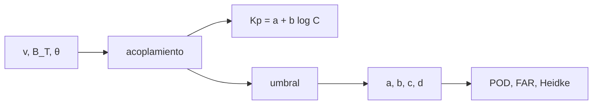

# B33-C13 — Pronóstico de actividad geomagnética

<!-- nav:top -->
[🏠 Programa](../../../../README.md) · [📚 Bloque B33](../../../tronco-comun/B33-clima-espacial-impactos-pronostico-y-riesgo.md) · [← Anterior: B33-C12 — Pronóstico de llegada y severidad de CME](../B33-C12-pronostico-de-llegada-y-severidad-de-cme/CLASE.md) · [Siguiente: B33-C14 — Verificación de alertas con tablas de contingencia →](../../../tronco-comun/B33-clima-espacial-impactos-pronostico-y-riesgo.md#b33-c14)
<!-- /nav -->

## 1. Ubicación, nivel y alcance

Clase 13 del bloque B33. Nivel N3. El índice de actividad depende de cómo el viento solar acopla energía a la magnetosfera. Aquí ajustas un modelo `Kp = a + b log₁₀(acoplamiento)` a datos sintéticos con una función de acoplamiento **de prueba**, calculas su `R²` y pronosticas el evento `Kp ≥ 5` con un umbral, con tabla de contingencia y puntuación de Heidke. Usas [B12](../../../tronco-comun/B12-probabilidad-estadistica-e-incertidumbre.md) y [B30-C20](../../B30/B30-C20-analisis-de-alerta-solar-real/CLASE.md). La función y los parámetros son ilustrativos.

## 2. Por qué esta clase existe

Predecir una tormenta es predecir un evento raro. La decisión central: **¿qué precisión tiene un pronóstico por umbral de un evento raro?**

## 3. Lo que podrás hacer al terminar

1. Calcular el acoplamiento de prueba.
2. Ajustar por mínimos cuadrados.
3. Calcular `R²` y la pendiente con error.
4. Barrer el umbral.
5. Calcular POD, FAR y Heidke.
6. Interpretar la baja destreza.

La evidencia es la **ficha del pronóstico geomagnético** del ejercicio 12 (sección 20).

## 4. Con qué llegas y cómo comprobarlo

1. ¿Qué es una incertidumbre?
2. ¿Qué es una simulación Monte Carlo?
3. ¿Qué es una tabla de resultados?
4. ¿Qué es un valor ilustrativo?
5. ¿Qué es una verificación?

<details>
<summary>Ver respuestas</summary>

1. Un intervalo en que se espera el valor verdadero. 2. Repetir con números aleatorios de semilla fija. 3. Un resumen ordenado de cálculos. 4. Un valor propuesto para el ejemplo, no medido. 5. Comparar un cálculo con un caso independiente.
</details>

Con cuatro o cinco aciertos, sigue; si no, repasa los prerrequisitos.

## 5. Un caso de contexto y casos de referencia

El ajuste recupera `b = 2,185 ± 0,012` (verdadero 2,2) con `R² = 0,913`; el pronóstico binario de `Kp ≥ 5` (33 de 3000 intervalos) tiene `Heidke = 0,153` en el mejor umbral. Es el **ejemplo conductor**. Todo es **sintético**.

## 6. Vocabulario

La **función de acoplamiento**. La **regresión**. El **umbral**. El **POD**, el **FAR** y el **Heidke**.

## 7. Modelo mental: una escalera de caracol

Un buen ajuste global no garantiza predecir los pocos casos extremos.



*Descripción textual:* el acoplamiento alimenta la regresión y el pronóstico por umbral, evaluado con la tabla de contingencia.

Analogía: una escalera de caracol. Límite: relación lineal en el logaritmo con ruido gaussiano.

## 8. La explicación, paso a paso

### 8.1 Ajuste

`a = −4,980`, `b = 2,185 ± 0,012`, `R² = 0,913`, error residual `0,701`.

### 8.2 Umbral para `Kp ≥ 5` (33 eventos de 3000)

| umbral `log₁₀C` | `a` | `b` | `c` | `d` | POD | FAR | Heidke |
|---|---|---|---|---|---|---|---|
| 3,0 | 33 | 2044 | 0 | 923 | 1,000 | 0,984 | 0,010 |
| 3,5 | 33 | 1401 | 0 | 1566 | 1,000 | 0,977 | 0,024 |
| 4,0 | 21 | 247 | 12 | 2720 | 0,636 | 0,922 | 0,122 |
| 4,2 (mejor) | 5 | 24 | 28 | 2943 | 0,152 | 0,828 | 0,153 |

### 8.3 Lectura

Un `R²` de 0,91 convive con una destreza de 0,15 para el evento raro: la regresión es buena en el centro, pero la cola es difícil. Pedir POD alto implica falsas alarmas masivas.

## 9. Magnitudes, símbolos y unidades

| Símbolo | Qué es | Unidad | Valor / nota |
|---|---|---|---|
| `R²` | coeficiente de determinación | — | 0,913 |
| Heidke | destreza | — | 0,153 |
| umbral | log del acoplamiento | — | 4,2 |

## 10. Convenciones y referencias

Función de acoplamiento y parámetros ilustrativos; semilla `20261109`; sintético.

## 11. De dónde sale lo que afirmamos

| ID | Fuente | Localizador | Respalda | Estado |
|---|---|---|---|---|
| — | Sin fuente externa | — | relaciones estándar que verifica el laboratorio | No se consultó una fuente para esta clase |

Límites: no se usaron datos reales ni la función de la literatura.

## 12. Cómo ver la destreza

| Umbral | POD | FAR | Heidke |
|---|---|---|---|
| 3,5 | 1,00 | 0,98 | 0,02 |
| 4,0 | 0,64 | 0,92 | 0,12 |
| 4,2 | 0,15 | 0,83 | 0,15 |

Descripción larga: la destreza máxima es baja para el evento raro.

## 13. Ejemplo trabajado: ajuste

**Paso 1 · Datos.** `(log C, Kp)`.

**Paso 2 · Pendiente.** `Σ(x − x̄)(y − ȳ)/Σ(x − x̄)²`.

**Paso 3 · Ordenada.** `ȳ − b x̄`.

**Paso 4 · Valor.** `b = 2,185`.

## 14. Distintas formas de describir un pronóstico de evento raro

**Por regresión:** `R²`. **Por umbral:** tabla. **Por destreza:** Heidke.

## 15. Práctica guiada

**Ejercicio 1 · con los pasos indicados.** Pendiente recuperada. *Pasos:* ejemplo 13.

<details><summary>Solución comentada</summary>

`2,185 ± 0,012`.
</details>

**Ejercicio 2 · con una pista.** `R²`.

<details><summary>Solución comentada</summary>

`0,913`.
</details>

**Ejercicio 3 · casi autónomo.** POD en el umbral 4,0.

<details><summary>Solución comentada</summary>

`0,636`.
</details>

## 16. Práctica autónoma, transferencia e integrador

**Ejercicio 4.** FAR en 4,2.

<details><summary>Solución comentada</summary>

`0,828`.
</details>

**Ejercicio 5.** Heidke máximo.

<details><summary>Solución comentada</summary>

`0,153`.
</details>

**Ejercicio 6.** Eventos `Kp ≥ 5`.

<details><summary>Solución comentada</summary>

33.
</details>

**Ejercicio 7.** ¿Por qué el FAR es alto?

<details><summary>Solución comentada</summary>

Porque el evento es raro.
</details>

**Ejercicio 8.** Desviación de `b` respecto de 2,2.

<details><summary>Solución comentada</summary>

`1,3σ`.
</details>

**Ejercicio 9 · transferencia.** **Transferencia.** Un compañero usa la función de acoplamiento como operativa. Responde.

<details><summary>Solución comentada</summary>

Es de prueba.
</details>

**Ejercicio 10 · transferencia.** **Transferencia.** ¿Qué omite el modelo?

<details><summary>Solución comentada</summary>

Memoria y estado de la magnetosfera.
</details>

**Ejercicio 11 · transferencia.** **Transferencia.** ¿Qué umbral elegir?

<details><summary>Solución comentada</summary>

Depende de `C/L` del usuario.
</details>

**Ejercicio 12.** **Integrador.** Elabora tu *ficha del pronóstico geomagnético*: ajuste, barrido de umbral y lectura.

<details><summary>Solución comentada</summary>

Secciones 8.1–8.3.
</details>

**Ejercicio 12 · integrador.** **Integrador.** Elabora tu *ficha del pronóstico geomagnético*: ajuste, barrido de umbral y lectura.

<details><summary>Solución modelo</summary>

Secciones 8.1–8.3.
</details>

## 17. Laboratorio: regresión y umbral

El script [acoplamiento.py](acoplamiento.py) ajusta, barre el umbral y calcula Heidke (**comprueba** la pendiente a 4 errores y Heidke positivo).

**Datos:** sin constantes; datos **sintéticos**; semilla `20261109`. **Predice antes de ejecutar:** ¿qué destreza tendrá el evento raro? (baja.) **Ejecución del 2026-11-09 (Python 3.12.9):**

```text
Python 3.12.9 (biblioteca estandar)
ajuste: a = -4.980, b = 2.185 +/- 0.012 (verdadero a = -5, b = 2.2) ; R^2 = 0.913 ; error residual = 0.701
 umbral log10(c)     a     b     c      d    POD    FAR  Heidke
           -3.50    33  2966     0      1  1.000  0.989   0.000
           -3.00    33  2966     0      1  1.000  0.989   0.000
           -2.50    33  2962     0      5  1.000  0.989   0.000
           -2.00    33  2961     0      6  1.000  0.989   0.000
           -1.50    33  2955     0     12  1.000  0.989   0.000
           -1.00    33  2945     0     22  1.000  0.989   0.000
           -0.50    33  2922     0     45  1.000  0.989   0.000
            0.00    33  2904     0     63  1.000  0.989   0.000
            0.50    33  2873     0     94  1.000  0.989   0.001
            1.00    33  2810     0    157  1.000  0.988   0.001
            1.50    33  2733     0    234  1.000  0.988   0.002
            2.00    33  2586     0    381  1.000  0.987   0.003
            2.50    33  2394     0    573  1.000  0.986   0.005
            3.00    33  2044     0    923  1.000  0.984   0.010
            3.50    33  1401     0   1566  1.000  0.977   0.024
            4.00    21   247    12   2720  0.636  0.922   0.122
mejor umbral = 4.20 (en log10 del acoplamiento): a = 5, b = 24, c = 28, d = 2943 ; POD = 0.152 ; FAR = 0.828 ; Heidke = 0.153
Pruebas superadas.
```

```bash
python programa/clases/B33/B33-C13-pronostico-de-actividad-geomagnetica/acoplamiento.py
```

**Límites:** relación lineal en el logaritmo.

## 18. Errores frecuentes y cómo corregirlos

**Confiar en el `R²` para el evento raro.** Se corrige con 8.3.

**Fijar el umbral sin el usuario.** Se corrige con el ejercicio 11.

**Usar la función de prueba como real.** Se corrige con la sección 10.

**Ignorar la tasa base.** Se corrige con 8.2.

## 19. Cómo sabrás que vas bien

Tras la sección 8: ¿qué resultado esperabas y cuál obtuviste? Si dudas, repasa el ejemplo 13. Tras el laboratorio: ¿qué comprueba? (ver la sección 17).

## 20. Qué entregas y cómo se evalúa

El producto es tu **ficha del pronóstico geomagnético** (ejercicio 12).

| Criterio | Inicial | En desarrollo | Logrado | Destacado |
|---|---|---|---|---|
| Conceptos | Los confunde | Parciales | conceptos de la clase | Explica los límites |
| Cálculo | Sin unidades | Con errores | Tablas completas | Calcula casos nuevos |
| Numérico | Sin comprobar | Un caso | Contraste con el análisis | Interpreta las diferencias |
| Fuentes | Sin fuente | Sin fecha | fuentes con fecha | Declara lo ilustrativo |
| Límites | No los nombra | Uno | Tres | Discute qué falta del modelo |

**Condiciones críticas (no se compensan con promedio):** rotular la función como de prueba; no emitir pronósticos; citar solo lo consultado.

## 21. Ética, seguridad y límites

Clase educativa: los modelos son simplificados. Accesibilidad: tablas equivalentes a las gráficas, fórmulas en texto, ejercicios sin conexión.

## 22. Para cerrar y seguir

Un ajuste con R² de 0,91 pronostica un evento de 1 % con Heidke de apenas 0,15. Queda una pregunta: ¿cómo se verifican las alertas con rigor?

**Glosario español–inglés.** función de acoplamiento · *coupling function*; regresión · *regression*; evento raro · *rare event*; umbral · *threshold*; destreza · *skill*.

**Continuidad.** [B33-C14](../B33-C14-verificacion-de-alertas/CLASE.md) estudia la verificación de alertas.

**Referencias:** ver sección 11.

<!-- nav:bottom -->
---

[← Anterior: B33-C12 — Pronóstico de llegada y severidad de CME](../B33-C12-pronostico-de-llegada-y-severidad-de-cme/CLASE.md) · [📚 Bloque B33](../../../tronco-comun/B33-clima-espacial-impactos-pronostico-y-riesgo.md) · [Siguiente: B33-C14 — Verificación de alertas con tablas de contingencia →](../../../tronco-comun/B33-clima-espacial-impactos-pronostico-y-riesgo.md#b33-c14)
<!-- /nav -->
