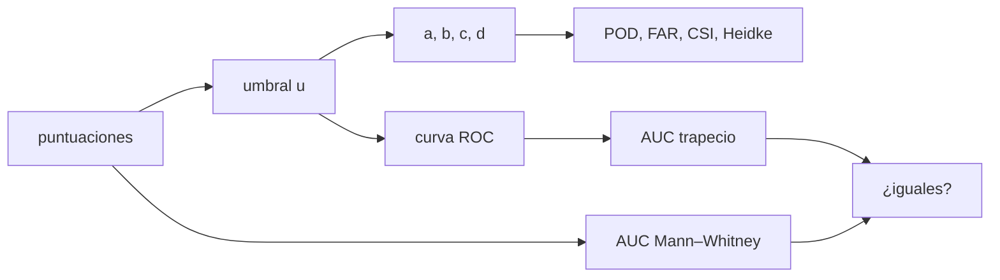

# B33-C14 — Verificación de alertas con tablas de contingencia

<!-- nav:top -->
[🏠 Programa](../../../../README.md) · [📚 Bloque B33](../../../tronco-comun/B33-clima-espacial-impactos-pronostico-y-riesgo.md) · [← Anterior: B33-C13 — Pronóstico de actividad geomagnética](../B33-C13-pronostico-de-actividad-geomagnetica/CLASE.md) · [Siguiente: B34-C01 — Calentamiento coronal: mecanismos y evidencias →](../../../tronco-comun/B34-corona-solar-y-erupciones-diagnostico-y-modelos.md#b34-c01)
<!-- /nav -->

## 1. Ubicación, nivel y alcance

Clase 14 del bloque B33. Nivel N3. Verificar una alerta es cruzar lo pronosticado con lo observado. Aquí construyes la **tabla de contingencia** para varios umbrales, calculas POD, FAR, CSI, sesgo de frecuencia y Heidke, y obtienes la **curva ROC** y su **área** por dos vías independientes: la regla del trapecio y el estadístico de **Mann–Whitney**, además del valor teórico. Usas [B12](../../../tronco-comun/B12-probabilidad-estadistica-e-incertidumbre.md) y [B30-C20](../../B30/B30-C20-analisis-de-alerta-solar-real/CLASE.md). Las puntuaciones son sintéticas.

## 2. Por qué esta clase existe

La verificación decide si una alerta merece confianza. La decisión central: **¿cómo resumir la capacidad de discriminar de un pronóstico?**

## 3. Lo que podrás hacer al terminar

1. Armar la tabla de contingencia.
2. Calcular POD, FAR, CSI, sesgo y Heidke.
3. Construir la curva ROC.
4. Calcular el AUC por trapecio.
5. Calcular el AUC por Mann–Whitney.
6. Compararlo con la teoría.

La evidencia es la **ficha de la verificación de alertas** del ejercicio 12 (sección 20).

## 4. Con qué llegas y cómo comprobarlo

1. ¿Qué es una incertidumbre?
2. ¿Qué es una simulación Monte Carlo?
3. ¿Qué es una tabla de resultados?
4. ¿Qué es un valor ilustrativo?
5. ¿Qué es una verificación?

<details>
<summary>Ver respuestas</summary>

1. Un intervalo en que se espera el valor verdadero. 2. Repetir con números aleatorios de semilla fija. 3. Un resumen ordenado de cálculos. 4. Un valor propuesto para el ejemplo, no medido. 5. Comparar un cálculo con un caso independiente.
</details>

Con cuatro o cinco aciertos, sigue; si no, repasa los prerrequisitos.

## 5. Un caso de contexto y casos de referencia

Con 5000 casos (383 sucesos), el AUC es `0,804698` por el trapecio y por Mann–Whitney (idénticos) frente a `0,801928` teórico. Es el **ejemplo conductor**. Para el umbral 1,5: POD `0,397`, FAR `0,675`, Heidke `0,299`. Todo es **sintético**.

## 6. Vocabulario

La **curva ROC** es POD frente a la tasa de falsas alarmas. El **AUC** es el área bajo ella. El **estadístico de Mann–Whitney** es la probabilidad de que una puntuación de suceso supere a una de no suceso. El **sesgo de frecuencia** `(a + b)/(a + c)`.

## 7. Modelo mental: un detector de humo con perilla

Girar la perilla de sensibilidad recorre la curva ROC: más sensibilidad, más detecciones y más falsas alarmas.



*Descripción textual:* las puntuaciones y un umbral dan la tabla y las puntuaciones; barrer el umbral da el ROC, cuyo área se calcula por dos vías.

Analogía: un detector de humo con perilla. Límite: dos normales de igual varianza.

## 8. La explicación, paso a paso

### 8.1 Tabla y puntuaciones (383 sucesos y 4617 no sucesos)

| umbral | `a` | `b` | `c` | `d` | POD | FAR | CSI | sesgo | Heidke |
|---|---|---|---|---|---|---|---|---|---|
| 0,0 | 343 | 2302 | 40 | 2315 | 0,896 | 0,870 | 0,128 | 6,91 | 0,107 |
| 0,5 | 294 | 1444 | 89 | 3173 | 0,768 | 0,831 | 0,161 | 4,54 | 0,173 |
| 1,0 | 229 | 765 | 154 | 3852 | 0,598 | 0,770 | 0,199 | 2,60 | 0,250 |
| 1,5 | 152 | 315 | 231 | 4302 | 0,397 | 0,675 | 0,218 | 1,22 | 0,299 |
| 2,0 | 76 | 115 | 307 | 4502 | 0,198 | 0,602 | 0,153 | 0,50 | 0,225 |

### 8.2 AUC

Trapecio `0,804698`; Mann–Whitney `0,804698`; teoría `Φ(d′/√2) = 0,801928`.

### 8.3 Lectura

El mejor Heidke (0,30) está en el umbral 1,5, donde el sesgo de frecuencia (1,22) es cercano a 1. El AUC resume la discriminación sin depender del umbral.

## 9. Magnitudes, símbolos y unidades

| Símbolo | Qué es | Unidad | Valor / nota |
|---|---|---|---|
| AUC | área bajo la curva ROC | — | 0,8047 |
| Heidke | destreza | — | 0,299 |
| `d′` | separación de las normales | — | 1,2 (ilustrativa) |

## 10. Convenciones y referencias

Puntuaciones normales con `d′ = 1,2` y tasa base 8 %; semilla `20261109`; sintético.

## 11. De dónde sale lo que afirmamos

| ID | Fuente | Localizador | Respalda | Estado |
|---|---|---|---|---|
| — | Sin fuente externa | — | relaciones estándar que verifica el laboratorio | No se consultó una fuente para esta clase |

Límites: no se verificó ninguna alerta real.

## 12. Cómo ver el ROC

| Umbral | POD | tasa de falsas alarmas |
|---|---|---|
| 0,0 | 0,896 | 0,50 |
| 1,0 | 0,598 | 0,166 |
| 2,0 | 0,198 | 0,025 |

Descripción larga: al subir el umbral caen ambas tasas.

## 13. Ejemplo trabajado: AUC por Mann–Whitney

**Paso 1 · Rangos.** Se ordenan todas las puntuaciones.

**Paso 2 · Suma.** `R` de los sucesos.

**Paso 3 · `U`.** `R − n(n+1)/2`.

**Paso 4 · AUC.** `U/(n_pos n_neg) = 0,8047`.

## 14. Distintas formas de describir una alerta

**Por umbral:** tabla. **Por barrido:** ROC. **Por resumen:** AUC. **Por azar:** 0,5.

## 15. Práctica guiada

**Ejercicio 1 · con los pasos indicados.** POD en el umbral 1,5. *Pasos:* `a/(a+c)`.

<details><summary>Solución comentada</summary>

`0,397`.
</details>

**Ejercicio 2 · con una pista.** FAR en 1,5.

<details><summary>Solución comentada</summary>

`0,675`.
</details>

**Ejercicio 3 · casi autónomo.** CSI en 1,5.

<details><summary>Solución comentada</summary>

`0,218`.
</details>

## 16. Práctica autónoma, transferencia e integrador

**Ejercicio 4.** Sesgo de frecuencia en 1,5.

<details><summary>Solución comentada</summary>

`1,22`.
</details>

**Ejercicio 5.** AUC.

<details><summary>Solución comentada</summary>

`0,8047`.
</details>

**Ejercicio 6.** AUC de un pronóstico al azar.

<details><summary>Solución comentada</summary>

`0,5`.
</details>

**Ejercicio 7.** Diferencia con la teoría.

<details><summary>Solución comentada</summary>

`0,0028`.
</details>

**Ejercicio 8.** ¿Qué umbral da el mejor Heidke?

<details><summary>Solución comentada</summary>

1,5.
</details>

**Ejercicio 9 · transferencia.** **Transferencia.** Un compañero usa AUC = 0,80 como el de un servicio real. Responde.

<details><summary>Solución comentada</summary>

Es sintético.
</details>

**Ejercicio 10 · transferencia.** **Transferencia.** ¿Por qué coinciden trapecio y Mann–Whitney?

<details><summary>Solución comentada</summary>

Son dos formas del mismo estadístico.
</details>

**Ejercicio 11 · transferencia.** **Transferencia.** ¿Qué no dice el AUC?

<details><summary>Solución comentada</summary>

El sesgo de frecuencia ni la utilidad.
</details>

**Ejercicio 12.** **Integrador.** Elabora tu *ficha de la verificación de alertas*: tabla, puntuaciones y AUC.

<details><summary>Solución comentada</summary>

Secciones 8.1–8.3.
</details>

**Ejercicio 12 · integrador.** **Integrador.** Elabora tu *ficha de la verificación de alertas*: tabla, puntuaciones y AUC.

<details><summary>Solución modelo</summary>

Secciones 8.1–8.3.
</details>

## 17. Laboratorio: tabla, ROC y AUC

El script [verificacion.py](verificacion.py) calcula la tabla, las puntuaciones y el AUC por dos vías (**comprueba** coincidencia a `10⁻¹²`).

**Datos:** sin constantes; puntuaciones **sintéticas**; semilla `20261109`. **Predice antes de ejecutar:** ¿qué AUC tendrá? (≈0,80.) **Ejecución del 2026-11-09 (Python 3.12.9):**

```text
Python 3.12.9 (biblioteca estandar)
casos = 5000 ; sucesos = 383 ; no sucesos = 4617
 umbral     a     b     c      d    POD    FAR    CSI  sesgo  Heidke
    0.0   343  2302    40   2315  0.896  0.870  0.128   6.91   0.107
    0.5   294  1444    89   3173  0.768  0.831  0.161   4.54   0.173
    1.0   229   765   154   3852  0.598  0.770  0.199   2.60   0.250
    1.5   152   315   231   4302  0.397  0.675  0.218   1.22   0.299
    2.0    76   115   307   4502  0.198  0.602  0.153   0.50   0.225
AUC por trapecio = 0.804698 ; AUC por Mann-Whitney = 0.804698 ; teoria Phi(d'/sqrt2) = 0.801928
Pruebas superadas.
```

```bash
python programa/clases/B33/B33-C14-verificacion-de-alertas-con-tablas-de-contingencia/verificacion.py
```

**Límites:** dos normales.

## 18. Errores frecuentes y cómo corregirlos

**Usar solo la tasa de aciertos.** Se corrige con 8.1.

**Olvidar el sesgo de frecuencia.** Se corrige con 8.3.

**Tomar el AUC por real.** Se corrige con la sección 10.

**Confundir FAR y tasa de falsas alarmas.** Se corrige con la sección 6.

## 19. Cómo sabrás que vas bien

Tras la sección 8: ¿qué resultado esperabas y cuál obtuviste? Si dudas, repasa el ejemplo 13. Tras el laboratorio: ¿qué comprueba? (ver la sección 17).

## 20. Qué entregas y cómo se evalúa

El producto es tu **ficha de la verificación de alertas** (ejercicio 12).

| Criterio | Inicial | En desarrollo | Logrado | Destacado |
|---|---|---|---|---|
| Conceptos | Los confunde | Parciales | conceptos de la clase | Explica los límites |
| Cálculo | Sin unidades | Con errores | Tablas completas | Calcula casos nuevos |
| Numérico | Sin comprobar | Un caso | Contraste con el análisis | Interpreta las diferencias |
| Fuentes | Sin fuente | Sin fecha | fuentes con fecha | Declara lo ilustrativo |
| Límites | No los nombra | Uno | Tres | Discute qué falta del modelo |

**Condiciones críticas (no se compensan con promedio):** rotular las puntuaciones como sintéticas; no verificar alertas reales; citar solo lo consultado.

## 21. Ética, seguridad y límites

Clase educativa: los modelos son simplificados. Accesibilidad: tablas equivalentes a las gráficas, fórmulas en texto, ejercicios sin conexión.

## 22. Para cerrar y seguir

El AUC sintético es 0,805 por dos vías idénticas y el mejor Heidke 0,30 en el umbral 1,5. Con esto cierra el bloque de clima espacial: de la validación al riesgo, cada resultado se calculó y se rotuló como ilustrativo.

**Glosario español–inglés.** tabla de contingencia · *contingency table*; curva ROC · *ROC curve*; área bajo la curva · *area under the curve*; Mann–Whitney · *Mann–Whitney*; sesgo de frecuencia · *frequency bias*.

**Continuidad.** Es la última clase del bloque; el siguiente trata la corona solar.

**Referencias:** ver sección 11.

<!-- nav:bottom -->
---

[← Anterior: B33-C13 — Pronóstico de actividad geomagnética](../B33-C13-pronostico-de-actividad-geomagnetica/CLASE.md) · [📚 Bloque B33](../../../tronco-comun/B33-clima-espacial-impactos-pronostico-y-riesgo.md) · [Siguiente: B34-C01 — Calentamiento coronal: mecanismos y evidencias →](../../../tronco-comun/B34-corona-solar-y-erupciones-diagnostico-y-modelos.md#b34-c01)
<!-- /nav -->
