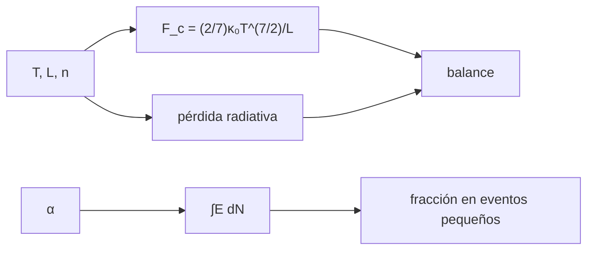

# B34-C01 — Calentamiento coronal: mecanismos y evidencias

<!-- nav:top -->
[🏠 Programa](../../../../README.md) · [📚 Bloque B34](../../../tronco-comun/B34-corona-solar-y-erupciones-diagnostico-y-modelos.md) · [← Anterior: B33-C14 — Verificación de alertas con tablas de contingencia](../../B33/B33-C14-verificacion-de-alertas-con-tablas-de-contingencia/CLASE.md) · [Siguiente: B34-C02 — Emisión EUV y rayos X de la corona →](../B34-C02-emision-euv-y-rayos-x-de-la-corona/CLASE.md)
<!-- /nav -->

## 1. Ubicación, nivel y alcance

Clase 1 del bloque B34. Nivel N3. La corona está mucho más caliente que la fotosfera y algo debe sostenerla. Aquí comparas, para un bucle ilustrativo, el **flujo conductivo** con la **pérdida radiativa** y calculas la **energía total** de una población de eventos pequeños con ley de potencias `dN/dE ∝ E^(−α)`, verificando la integral numérica y viendo cuándo dominan los eventos pequeños. Usas [B05](../../../tronco-comun/B05-fisica-fundamental-para-el-espacio.md) y [B30-C02](../../B30/B30-C02-fotosfera-cromosfera-y-corona/CLASE.md). Los números son ilustrativos.

## 2. Por qué esta clase existe

Elegir un mecanismo de calentamiento exige saber cuánta energía hay que reponer y de dónde sale. La decisión central: **¿cuánta energía pierde un bucle y qué eventos pueden reponerla?**

## 3. Lo que podrás hacer al terminar

1. Calcular el flujo conductivo `(2/7)κ₀T^(7/2)/L`.
2. Calcular la pérdida radiativa por área de base.
3. Comparar ambos.
4. Integrar la energía de una ley de potencias.
5. Calcular la fracción de energía en eventos pequeños.
6. Reconocer el papel de `α = 2`.

La evidencia es la **ficha del calentamiento coronal** del ejercicio 12 (sección 20).

## 4. Con qué llegas y cómo comprobarlo

1. ¿Qué es una incertidumbre?
2. ¿Qué es una simulación Monte Carlo?
3. ¿Qué es una tabla de resultados?
4. ¿Qué es un valor ilustrativo?
5. ¿Qué es una verificación?

<details>
<summary>Ver respuestas</summary>

1. Un intervalo en que se espera el valor verdadero. 2. Repetir con números aleatorios de semilla fija. 3. Un resumen ordenado de cálculos. 4. Un valor propuesto para el ejemplo, no medido. 5. Comparar un cálculo con un caso independiente.
</details>

Con cuatro o cinco aciertos, sigue; si no, repasa los prerrequisitos.

## 5. Un caso de contexto y casos de referencia

Con `T = 2 × 10⁶ K`, `L = 100 Mm` y `n = 10¹⁵ m⁻³` (ilustrativos), el flujo conductivo es `323 W/m²` y la pérdida radiativa `150 W/m²`. Es el **ejemplo conductor**. Con `α = 2,2` el 86 % de la energía está en eventos con `E < 10²¹`.

## 6. Vocabulario

El **calentamiento coronal**. El **flujo conductivo** de Spitzer. La **pérdida radiativa**. Una **nanofulguración** es un evento pequeño. La **ley de potencias** `dN/dE`. El **índice crítico** `α = 2`.

## 7. Modelo mental: una olla con tapa que gotea

Es como una casa con calefacción y ventanas abiertas: la calefacción debe reponer la pérdida; muchas estufas pequeñas pueden bastar si son bastantes.



*Descripción textual:* la temperatura, longitud y densidad dan las pérdidas, que se comparan; la ley de potencias da la energía por tamaño de evento.

Analogía: una olla con tapa que gotea. Límite: bucle uniforme y estacionario.

## 8. La explicación, paso a paso

### 8.1 Balance (`T = 2 × 10⁶ K`, `L = 10⁸ m`, `n = 10¹⁵ m⁻³`)

| magnitud | valor |
|---|---|
| flujo conductivo `F_c` | 323,2 W/m² |
| pérdida radiativa por área de base | 150,0 W/m² |
| cociente | 2,15 |

### 8.2 Energía de eventos pequeños (de `10¹⁷` a `10²⁵` J, unidades arbitrarias)

| `α` | energía total analítica | numérica | fracción en `E < 10²¹` |
|---|---|---|---|
| 1,8 | 4,874406 × 10⁵ | 4,874406 × 10⁵ | 0,1368 |
| 2,0 | 18,42068 | 18,42068 | 0,5000 |
| 2,2 | 1,940536 × 10⁻³ | 1,940536 × 10⁻³ | 0,8632 |

### 8.3 Lectura

Con `α > 2` los eventos pequeños aportan la mayor parte de la energía, con `α < 2` los grandes. El resultado depende del índice y de los límites, que son ilustrativos.

## 9. Magnitudes, símbolos y unidades

| Símbolo | Qué es | Unidad | Valor / nota |
|---|---|---|---|
| `κ₀` | conductividad de Spitzer | W m⁻¹ K⁻⁷ᐟ² | 10⁻¹¹ (estándar, no consultado) |
| `F_c` | flujo conductivo | W/m² | 323,2 |
| `α` | índice de la ley de potencias | — | 1,8; 2,0; 2,2 |

## 10. Convenciones y referencias

Bucle uniforme; `κ₀`, `Λ`, `L`, `n`, `α` y los límites de energía son ilustrativos.

## 11. De dónde sale lo que afirmamos

| ID | Fuente | Localizador | Respalda | Estado |
|---|---|---|---|---|
| — | Sin fuente externa | — | relaciones estándar que verifica el laboratorio | No se consultó una fuente para esta clase |

Límites: no se consultó ninguna medida de calentamiento ni de eventos.

## 12. Cómo ver el balance

| Término | Valor (W/m²) |
|---|---|
| conductivo | 323 |
| radiativo | 150 |

Descripción larga: la conducción supera a la radiación en este ejemplo.

## 13. Ejemplo trabajado: flujo conductivo

**Paso 1 · `T^(7/2)`.** `(2 × 10⁶)^3,5 = 1,131 × 10²²`.

**Paso 2 · Producto.** `(2/7) × 10⁻¹¹ × 1,131 × 10²² = 3,23 × 10¹⁰`.

**Paso 3 · División.** `/10⁸ m`.

**Paso 4 · Valor.** `323 W/m²`.

## 14. Distintas formas de describir un bucle

**Por pérdida:** conducción y radiación. **Por fuente:** eventos pequeños. **Por índice:** `α` frente a 2.

## 15. Práctica guiada

**Ejercicio 1 · con los pasos indicados.** `F_c` con los datos. *Pasos:* ejemplo 13.

<details><summary>Solución comentada</summary>

`323 W/m²`.
</details>

**Ejercicio 2 · con una pista.** Cociente conducción/radiación.

<details><summary>Solución comentada</summary>

`2,15`.
</details>

**Ejercicio 3 · casi autónomo.** Fracción de pequeños con `α = 2`.

<details><summary>Solución comentada</summary>

`0,5`.
</details>

## 16. Práctica autónoma, transferencia e integrador

**Ejercicio 4.** Fracción con `α = 2,2`.

<details><summary>Solución comentada</summary>

`0,863`.
</details>

**Ejercicio 5.** `F_c` si `T` se duplica.

<details><summary>Solución comentada</summary>

`2^3,5 = 11,3` veces.
</details>

**Ejercicio 6.** `F_c` si `L` se duplica.

<details><summary>Solución comentada</summary>

La mitad.
</details>

**Ejercicio 7.** ¿Qué eventos dominan con `α = 1,8`?

<details><summary>Solución comentada</summary>

Los grandes.
</details>

**Ejercicio 8.** Razón de energías totales `α = 2,2` y 1,8.

<details><summary>Solución comentada</summary>

`4 × 10⁻⁹`.
</details>

**Ejercicio 9 · transferencia.** **Transferencia.** Un compañero afirma que las nanofulguraciones calientan la corona. Responde.

<details><summary>Solución comentada</summary>

La clase solo muestra cuándo podrían dominar; no se consultaron observaciones.
</details>

**Ejercicio 10 · transferencia.** **Transferencia.** ¿Por qué importan los límites de energía?

<details><summary>Solución comentada</summary>

Con `α` cercano a 2, la energía depende del logaritmo del rango.
</details>

**Ejercicio 11 · transferencia.** **Transferencia.** ¿Qué omite el balance?

<details><summary>Solución comentada</summary>

Gradientes y evolución temporal.
</details>

**Ejercicio 12.** **Integrador.** Elabora tu *ficha del calentamiento coronal*: balance y energía por tamaño de evento.

<details><summary>Solución comentada</summary>

Secciones 8.1–8.3.
</details>

**Ejercicio 12 · integrador.** **Integrador.** Elabora tu *ficha del calentamiento coronal*: balance y energía por tamaño de evento.

<details><summary>Solución modelo</summary>

Secciones 8.1–8.3.
</details>

## 17. Laboratorio: balance de energía y eventos pequeños

El script [calentamiento.py](calentamiento.py) calcula el balance y la energía de la ley de potencias (**comprueba** `10⁻⁶`).

**Datos:** sin constantes consultadas; todo **ilustrativo**. **Predice antes de ejecutar:** ¿qué eventos dominan con α > 2? (los pequeños.) **Ejecución del 2026-11-09 (Python 3.12.9):**

```text
Python 3.12.9 (biblioteca estandar)
T = 2.0e+06 K, L = 1e+08 m, n = 1e+15 m-3 (ilustrativos)
flujo conductivo F_c = (2/7) kappa_0 T^(7/2)/L = 323.2 W/m2 ; perdida radiativa por area de base = 150.0 W/m2 ; cociente = 2.15
 alpha   energia total analitica [u.a.]       numerica  fraccion de eventos pequenos (E < 1e21)
   1.8                     4.874406e+05   4.874406e+05                                   0.1368
   2.0                     1.842068e+01   1.842068e+01                                   0.5000
   2.2                     1.940536e-03   1.940536e-03                                   0.8632
Pruebas superadas.
```

```bash
python programa/clases/B34/B34-C01-calentamiento-coronal-mecanismos-y-evidencias/calentamiento.py
```

**Límites:** bucle uniforme.

## 18. Errores frecuentes y cómo corregirlos

**Confundir flujo y potencia.** Se corrige con 8.1.

**Olvidar los límites de energía.** Se corrige con 8.3.

**Presentar `α` como medido.** Se corrige con la sección 10.

**Mezclar erg y J.** Se corrige con la sección 9.

## 19. Cómo sabrás que vas bien

Tras la sección 8: ¿qué resultado esperabas y cuál obtuviste? Si dudas, repasa el ejemplo 13. Tras el laboratorio: ¿qué comprueba? (ver la sección 17).

## 20. Qué entregas y cómo se evalúa

El producto es tu **ficha del calentamiento coronal** (ejercicio 12).

| Criterio | Inicial | En desarrollo | Logrado | Destacado |
|---|---|---|---|---|
| Conceptos | Los confunde | Parciales | conceptos de la clase | Explica los límites |
| Cálculo | Sin unidades | Con errores | Tablas completas | Calcula casos nuevos |
| Numérico | Sin comprobar | Un caso | Contraste con el análisis | Interpreta las diferencias |
| Fuentes | Sin fuente | Sin fecha | fuentes con fecha | Declara lo ilustrativo |
| Límites | No los nombra | Uno | Tres | Discute qué falta del modelo |

**Condiciones críticas (no se compensan con promedio):** rotular todos los parámetros como ilustrativos; no afirmar el mecanismo real; citar solo lo consultado.

## 21. Ética, seguridad y límites

Clase educativa: los modelos son simplificados. Accesibilidad: tablas equivalentes a las gráficas, fórmulas en texto, ejercicios sin conexión.

## 22. Para cerrar y seguir

El bucle ilustrativo pierde unos 150–320 W/m² y con α > 2 los eventos pequeños repondrían la mayor parte de la energía. Queda una pregunta: ¿qué luz emite el plasma caliente?

**Glosario español–inglés.** calentamiento coronal · *coronal heating*; nanofulguración · *nanoflare*; flujo conductivo · *conductive flux*; ley de potencias · *power law*; pérdida radiativa · *radiative loss*.

**Continuidad.** [B34-C02](../B34-C02-emision-euv-y-rayos-x-de-la-corona/CLASE.md) estudia la emisión EUV y de rayos X.

**Referencias:** ver sección 11.

<!-- nav:bottom -->
---

[← Anterior: B33-C14 — Verificación de alertas con tablas de contingencia](../../B33/B33-C14-verificacion-de-alertas-con-tablas-de-contingencia/CLASE.md) · [📚 Bloque B34](../../../tronco-comun/B34-corona-solar-y-erupciones-diagnostico-y-modelos.md) · [Siguiente: B34-C02 — Emisión EUV y rayos X de la corona →](../B34-C02-emision-euv-y-rayos-x-de-la-corona/CLASE.md)
<!-- /nav -->
