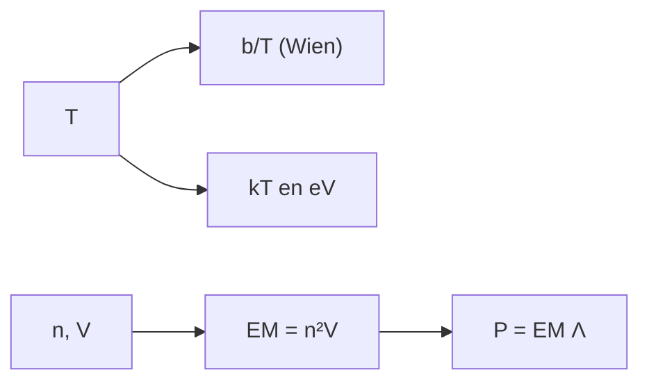

# B34-C02 — Emisión EUV y rayos X de la corona

<!-- nav:top -->
[🏠 Programa](../../../../README.md) · [📚 Bloque B34](../../../tronco-comun/B34-corona-solar-y-erupciones-diagnostico-y-modelos.md) · [← Anterior: B34-C01 — Calentamiento coronal: mecanismos y evidencias](../B34-C01-calentamiento-coronal-mecanismos-y-evidencias/CLASE.md) · [Siguiente: B34-C03 — Bucles magnéticos coronales →](../B34-C03-bucles-magneticos-coronales/CLASE.md)
<!-- /nav -->

## 1. Ubicación, nivel y alcance

Clase 2 del bloque B34. Nivel N3. La corona emite en el EUV y los rayos X porque su plasma está a millones de kelvin. Aquí calculas el **máximo de Wien** a distintas temperaturas con la constante de NIST (como escala de referencia: el plasma coronal es ópticamente delgado, no un cuerpo negro), la energía térmica `kT`, la **medida de emisión** `EM = n²V` de un bucle y su potencia radiada. Usas [B05](../../../tronco-comun/B05-fisica-fundamental-para-el-espacio.md) y [B30-C02](../../B30/B30-C02-fotosfera-cromosfera-y-corona/CLASE.md). Los parámetros son ilustrativos.

## 2. Por qué esta clase existe

Cada banda del espectro traza una temperatura. La decisión central: **¿en qué banda emite el plasma a una temperatura dada y cuánta potencia radia?**

## 3. Lo que podrás hacer al terminar

1. Calcular `b/T` con la constante de Wien.
2. Calcular `kT` en eV.
3. Calcular `EM = n²V`.
4. Calcular `P = EM Λ`.
5. Calcular la razón del bremsstrahlung.
6. Distinguir cuerpo negro y plasma delgado.

La evidencia es la **ficha de la emisión EUV y de rayos X** del ejercicio 12 (sección 20).

## 4. Con qué llegas y cómo comprobarlo

1. ¿Qué es una incertidumbre?
2. ¿Qué es una simulación Monte Carlo?
3. ¿Qué es una tabla de resultados?
4. ¿Qué es un valor ilustrativo?
5. ¿Qué es una verificación?

<details>
<summary>Ver respuestas</summary>

1. Un intervalo en que se espera el valor verdadero. 2. Repetir con números aleatorios de semilla fija. 3. Un resumen ordenado de cálculos. 4. Un valor propuesto para el ejemplo, no medido. 5. Comparar un cálculo con un caso independiente.
</details>

Con cuatro o cinco aciertos, sigue; si no, repasa los prerrequisitos.

## 5. Un caso de contexto y casos de referencia

A `10⁶ K` el máximo de Wien está en `2,898 nm` y `kT = 86,2 eV`; a `10⁷ K`, en `0,290 nm` y `0,86 keV`. Es el **ejemplo conductor** (constante de Wien de NIST, S1). El bucle ilustrativo tiene `EM = 3,14 × 10⁵⁰ m⁻³` y radia `9,4 × 10¹⁴ W`.

## 6. Vocabulario

La **medida de emisión** `EM`. El **máximo de Wien**. La **energía térmica** `kT`. El **bremsstrahlung** es la emisión por colisiones. Un **plasma ópticamente delgado** deja escapar su radiación.

## 7. Modelo mental: una lámpara de neón

Una lámpara de neón brilla en líneas, no como un cuerpo negro; la temperatura se lee en qué líneas aparecen.



*Descripción textual:* la temperatura fija la banda y la energía térmica; la densidad y el volumen fijan la medida de emisión y la potencia.

Analogía: una lámpara de neón. Límite: plasma isotermo y ópticamente delgado.

## 8. La explicación, paso a paso

### 8.1 Escala de temperatura

| `T` (K) | `kT` (eV) | `b/T` (nm) | banda |
|---|---|---|---|
| 10⁶ | 86,2 | 2,8978 | EUV/X blando |
| 3 × 10⁶ | 258,5 | 0,9659 | rayos X |
| 10⁷ | 861,7 | 0,2898 | rayos X |
| 3 × 10⁷ | 2585,2 | 0,0966 | rayos X |

### 8.2 Bucle ilustrativo

`V = π r² L = 3,142 × 10²⁰ m³` (`r = 10⁶ m`, `L = 10⁸ m`); `EM = 3,142 × 10⁵⁰ m⁻³ = 3,142 × 10⁴⁴ cm⁻³`; `P = EM Λ = 9,425 × 10¹⁴ W`. A igual `EM`, el bremsstrahlung integrado (`n² T^(1/2)`) a `10⁷ K` es `3,16` veces el de `10⁶ K`.

## 9. Magnitudes, símbolos y unidades

| Símbolo | Qué es | Unidad | Valor / nota |
|---|---|---|---|
| `b` | constante de Wien | m K | `2,897771955 × 10⁻³` (S1) |
| `EM` | medida de emisión | m⁻³ | 3,142 × 10⁵⁰ |
| `Λ` | pérdida radiativa | erg cm³ s⁻¹ | 3 × 10⁻²³ (ilustrativa) |

## 10. Convenciones y referencias

Plasma isotermo y delgado; dimensiones y `Λ` ilustrativos.

## 11. De dónde sale lo que afirmamos

| ID | Fuente | Localizador | Respalda | Estado |
|---|---|---|---|---|
| S1 | NIST, *Fundamental Physical Constants* (CODATA 2022) | https://physics.nist.gov/cuu/Constants/Table/allascii.txt | constantes citadas en la sección 9 | Consultada el 2026-11-09 |

Límites: no se consultó ninguna respuesta instrumental ni espectro coronal.

## 12. Cómo ver la emisión

| `T` (K) | máximo (nm) |
|---|---|
| 10⁶ | 2,90 |
| 10⁷ | 0,29 |

Descripción larga: el máximo se desplaza a menores longitudes de onda al aumentar `T`.

## 13. Ejemplo trabajado: máximo de Wien a 10⁶ K

**Paso 1 · Constante.** `b = 2,897771955 × 10⁻³ m K`.

**Paso 2 · Cociente.** `b/10⁶`.

**Paso 3 · Valor.** `2,898 × 10⁻⁹ m`.

**Paso 4 · Lectura.** `2,898 nm`.

## 14. Distintas formas de describir la emisión coronal

**Por temperatura:** Wien. **Por energía:** `kT`. **Por volumen:** `EM`. **Por potencia:** `EMΛ`.

## 15. Práctica guiada

**Ejercicio 1 · con los pasos indicados.** Máximo de Wien a 10⁷ K. *Pasos:* ejemplo 13.

<details><summary>Solución comentada</summary>

`0,2898 nm`.
</details>

**Ejercicio 2 · con una pista.** `kT` a 10⁶ K.

<details><summary>Solución comentada</summary>

`86,2 eV`.
</details>

**Ejercicio 3 · casi autónomo.** Volumen del bucle.

<details><summary>Solución comentada</summary>

`3,14 × 10²⁰ m³`.
</details>

## 16. Práctica autónoma, transferencia e integrador

**Ejercicio 4.** `EM`.

<details><summary>Solución comentada</summary>

`3,14 × 10⁵⁰ m⁻³`.
</details>

**Ejercicio 5.** Potencia radiada.

<details><summary>Solución comentada</summary>

`9,4 × 10¹⁴ W`.
</details>

**Ejercicio 6.** Razón de bremsstrahlung 10⁷/10⁶ K.

<details><summary>Solución comentada</summary>

`√10 = 3,16`.
</details>

**Ejercicio 7.** ¿Es la corona un cuerpo negro?

<details><summary>Solución comentada</summary>

No: es ópticamente delgada.
</details>

**Ejercicio 8.** `b/T` a 3 × 10⁶ K.

<details><summary>Solución comentada</summary>

`0,966 nm`.
</details>

**Ejercicio 9 · transferencia.** **Transferencia.** Un compañero deduce la temperatura coronal del máximo de Wien. Responde.

<details><summary>Solución comentada</summary>

No aplica: el plasma no es un cuerpo negro.
</details>

**Ejercicio 10 · transferencia.** **Transferencia.** ¿Para qué sirve entonces Wien?

<details><summary>Solución comentada</summary>

Como escala de referencia.
</details>

**Ejercicio 11 · transferencia.** **Transferencia.** ¿Qué es ilustrativo?

<details><summary>Solución comentada</summary>

Las dimensiones, `n` y `Λ`.
</details>

**Ejercicio 12.** **Integrador.** Elabora tu *ficha de la emisión EUV y de rayos X*: escalas, `EM` y potencia.

<details><summary>Solución comentada</summary>

Secciones 8.1–8.2.
</details>

**Ejercicio 12 · integrador.** **Integrador.** Elabora tu *ficha de la emisión EUV y de rayos X*: escalas, `EM` y potencia.

<details><summary>Solución modelo</summary>

Secciones 8.1–8.2.
</details>

## 17. Laboratorio: Wien, EM y potencia

El script [emision.py](emision.py) calcula las escalas y la medida de emisión (**comprueba** Wien a `10⁻⁹`).

**Datos:** `h`, `c`, `k_B`, `e`, `b` de NIST; el bucle **ilustrativo**. **Predice antes de ejecutar:** ¿en qué banda emite 10⁷ K? (rayos X.) **Ejecución del 2026-11-09 (Python 3.12.9):**

```text
Python 3.12.9 (biblioteca estandar)
    T [K]    kT [eV]   maximo de Wien b/T [nm]          banda
  1.0e+06       86.2                    2.8978   EUV/X blando
  3.0e+06      258.5                    0.9659        rayos X
  1.0e+07      861.7                    0.2898        rayos X
  3.0e+07     2585.2                    0.0966        rayos X
volumen = 3.142e+20 m3 ; EM = n^2 V = 3.142e+50 m-3 = 3.142e+44 cm-3 ; potencia radiada P = EM Lambda = 9.425e+14 W
bremsstrahlung integrado (n^2 T^(1/2)): cociente 1e7 K / 1e6 K = 3.1623 para igual EM
Pruebas superadas.
```

```bash
python programa/clases/B34/B34-C02-emision-euv-y-rayos-x-de-la-corona/emision.py
```

**Límites:** plasma delgado isotermo.

## 18. Errores frecuentes y cómo corregirlos

**Tratar la corona como cuerpo negro.** Se corrige con 8.2.

**Confundir `EM` y `n`.** Se corrige con la sección 6.

**Mezclar cm⁻³ y m⁻³.** Se corrige con la sección 9.

**Tomar `Λ` por medida.** Se corrige con la sección 10.

## 19. Cómo sabrás que vas bien

Tras la sección 8: ¿qué resultado esperabas y cuál obtuviste? Si dudas, repasa el ejemplo 13. Tras el laboratorio: ¿qué comprueba? (ver la sección 17).

## 20. Qué entregas y cómo se evalúa

El producto es tu **ficha de la emisión EUV y de rayos X** (ejercicio 12).

| Criterio | Inicial | En desarrollo | Logrado | Destacado |
|---|---|---|---|---|
| Conceptos | Los confunde | Parciales | conceptos de la clase | Explica los límites |
| Cálculo | Sin unidades | Con errores | Tablas completas | Calcula casos nuevos |
| Numérico | Sin comprobar | Un caso | Contraste con el análisis | Interpreta las diferencias |
| Fuentes | Sin fuente | Sin fecha | fuentes con fecha | Declara lo ilustrativo |
| Límites | No los nombra | Uno | Tres | Discute qué falta del modelo |

**Condiciones críticas (no se compensan con promedio):** rotular el bucle y `Λ` como ilustrativos; no inferir temperaturas de Wien; citar solo lo consultado.

## 21. Ética, seguridad y límites

Clase educativa: los modelos son simplificados. Accesibilidad: tablas equivalentes a las gráficas, fórmulas en texto, ejercicios sin conexión.

## 22. Para cerrar y seguir

A 10⁶ K el máximo de Wien está en 2,9 nm y a 10⁷ K en 0,29 nm; el bucle ilustrativo tiene EM de 3 × 10⁵⁰ m⁻³. Queda una pregunta: ¿cómo se organiza la corona en bucles?

**Glosario español–inglés.** medida de emisión · *emission measure*; máximo de Wien · *Wien peak*; plasma ópticamente delgado · *optically thin plasma*; bremsstrahlung · *bremsstrahlung*; banda de rayos X · *X-ray band*.

**Continuidad.** [B34-C03](../B34-C03-bucles-magneticos-coronales/CLASE.md) estudia los bucles magnéticos coronales.

**Referencias:** ver sección 11.

<!-- nav:bottom -->
---

[← Anterior: B34-C01 — Calentamiento coronal: mecanismos y evidencias](../B34-C01-calentamiento-coronal-mecanismos-y-evidencias/CLASE.md) · [📚 Bloque B34](../../../tronco-comun/B34-corona-solar-y-erupciones-diagnostico-y-modelos.md) · [Siguiente: B34-C03 — Bucles magnéticos coronales →](../B34-C03-bucles-magneticos-coronales/CLASE.md)
<!-- /nav -->
