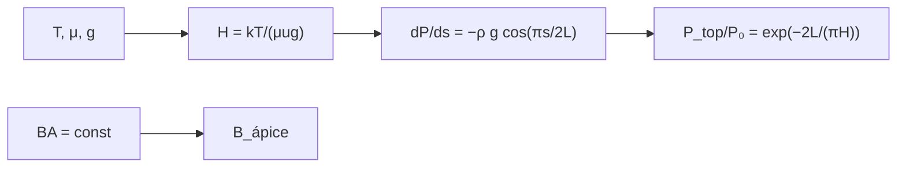

# B34-C03 — Bucles magnéticos coronales

<!-- nav:top -->
[🏠 Programa](../../../../README.md) · [📚 Bloque B34](../../../tronco-comun/B34-corona-solar-y-erupciones-diagnostico-y-modelos.md) · [← Anterior: B34-C02 — Emisión EUV y rayos X de la corona](../B34-C02-emision-euv-y-rayos-x-de-la-corona/CLASE.md) · [Siguiente: B34-C04 — Ondas y oscilaciones coronales como sismología solar →](../B34-C04-ondas-y-oscilaciones-coronales-como-sismologia-solar/CLASE.md)
<!-- /nav -->

## 1. Ubicación, nivel y alcance

Clase 3 del bloque B34. Nivel N3. Un bucle coronal es un tubo de flujo magnético lleno de plasma. Aquí calculas su **estratificación hidrostática** con gravedad efectiva `g cos(πs/2L)` a lo largo de un semicírculo, verificas por RK4 el cociente de presión apice/base `exp(−2L/(πH))` y aplicas la **conservación del flujo** `BA = const` a la expansión de la sección. Usas [B05](../../../tronco-comun/B05-fisica-fundamental-para-el-espacio.md) y [B30-C02](../../B30/B30-C02-fotosfera-cromosfera-y-corona/CLASE.md). Las dimensiones son ilustrativas.

## 2. Por qué esta clase existe

La densidad en el ápice limita la luz que se ve. La decisión central: **¿cuánto cae la presión de la base al ápice y cómo cambia el campo con la sección?**

## 3. Lo que podrás hacer al terminar

1. Calcular `H = kT/(μug)`.
2. Integrar `dP/ds` a lo largo del semicírculo.
3. Verificar `exp(−2L/(πH))`.
4. Aplicar `BA = const`.
5. Comparar longitudes de bucle.
6. Reconocer los límites.

La evidencia es la **ficha de un bucle coronal** del ejercicio 12 (sección 20).

## 4. Con qué llegas y cómo comprobarlo

1. ¿Qué es una incertidumbre?
2. ¿Qué es una simulación Monte Carlo?
3. ¿Qué es una tabla de resultados?
4. ¿Qué es un valor ilustrativo?
5. ¿Qué es una verificación?

<details>
<summary>Ver respuestas</summary>

1. Un intervalo en que se espera el valor verdadero. 2. Repetir con números aleatorios de semilla fija. 3. Un resumen ordenado de cálculos. 4. Un valor propuesto para el ejemplo, no medido. 5. Comparar un cálculo con un caso independiente.
</details>

Con cuatro o cinco aciertos, sigue; si no, repasa los prerrequisitos.

## 5. Un caso de contexto y casos de referencia

A `1,5 × 10⁶ K`, `H = 75,81 Mm` y en un bucle de `L = 50 Mm` la presión del ápice es `0,657` la de la base. Es el **ejemplo conductor**. Con una sección 1,3 veces mayor en el ápice, `B` pasa de `10 mT` a `7,69 mT`.

## 6. Vocabulario

La **altura de escala** `H`. La **gravedad efectiva** `g_∥`. La **estratificación**. El **tubo de flujo**. La **conservación del flujo**.

## 7. Modelo mental: un tobogán

Como una pelota que sube por un tobogán semicircular: la gravedad que siente a lo largo del camino cambia con el ángulo.



*Descripción textual:* la temperatura da la altura de escala; integrar a lo largo del bucle da el cociente de presiones; el flujo da el campo.

Analogía: un tobogán. Límite: isotermo y estático; g constante.

## 8. La explicación, paso a paso

### 8.1 Presión

`g = 274,2 m/s²` y `H = 75,81 Mm`.

| `L` (Mm) | `P_ápice/P₀` numérico | `exp(−2L/(πH))` | cociente |
|---|---|---|---|
| 30 | 0,777292417 | 0,777292417 | 1,00000000 |
| 50 | 0,657113998 | 0,657113998 | 1,00000000 |
| 100 | 0,431798806 | 0,431798806 | 1,00000000 |

### 8.2 Flujo

Con `B = 0,01 T` en la base y una sección 1,3 veces mayor, `B = 0,00769 T` en el ápice.

### 8.3 Lectura

La presión cae 34 % hasta el ápice de un bucle de 50 Mm y 57 % en uno de 100 Mm. La gravedad se trata como constante, lo que sobreestima la caída.

## 9. Magnitudes, símbolos y unidades

| Símbolo | Qué es | Unidad | Valor / nota |
|---|---|---|---|
| `H` | altura de escala | Mm | 75,81 |
| `g` | gravedad | m/s² | 274,2 |
| `L` | semilongitud | Mm | 30–100 (ilustrativa) |

## 10. Convenciones y referencias

Isotermo y estático; `T`, `μ`, `L` y la expansión ilustrativos.

## 11. De dónde sale lo que afirmamos

| ID | Fuente | Localizador | Respalda | Estado |
|---|---|---|---|---|
| S1 | NIST, *Fundamental Physical Constants* (CODATA 2022) | https://physics.nist.gov/cuu/Constants/Table/allascii.txt | constantes citadas en la sección 9 | Consultada el 2026-11-09 |
| S2 | UAI, Resolución B3 de 2015 | https://arxiv.org/abs/1510.07674 | valores nominales solares y planetarios | Consultada el 2026-11-09 |

Límites: no se consultó ninguna medida de bucles ni la ley RTV.

## 12. Cómo ver la estratificación

| `L` (Mm) | `P_ápice/P₀` |
|---|---|
| 30 | 0,777 |
| 50 | 0,657 |
| 100 | 0,432 |

Descripción larga: la presión del ápice cae al alargar el bucle.

## 13. Ejemplo trabajado: cociente de presiones

**Paso 1 · Exponente.** `2L/(πH) = 10⁸/(π × 7,581 × 10⁷)`.

**Paso 2 · Valor.** `0,4199`.

**Paso 3 · Exponencial.** `e^(−0,4199)`.

**Paso 4 · Resultado.** `0,657`.

## 14. Distintas formas de describir un bucle

**Por escala:** `H`. **Por geometría:** `cos`. **Por flujo:** `BA`.

## 15. Práctica guiada

**Ejercicio 1 · con los pasos indicados.** `H` a 1,5 MK. *Pasos:* `kT/(μug)`.

<details><summary>Solución comentada</summary>

`75,81 Mm`.
</details>

**Ejercicio 2 · con una pista.** `P_ápice/P₀` para `L = 50 Mm`. *Pista:* ejemplo 13.

<details><summary>Solución comentada</summary>

`0,657`.
</details>

**Ejercicio 3 · casi autónomo.** Para `L = 100 Mm`.

<details><summary>Solución comentada</summary>

`0,432`.
</details>

## 16. Práctica autónoma, transferencia e integrador

**Ejercicio 4.** `B` en el ápice con sección ×2.

<details><summary>Solución comentada</summary>

`5 mT`.
</details>

**Ejercicio 5.** Exponente para `L = 30 Mm`.

<details><summary>Solución comentada</summary>

`0,252`.
</details>

**Ejercicio 6.** ¿Qué pasa si `T` se duplica?

<details><summary>Solución comentada</summary>

`H` se duplica y la caída se reduce.
</details>

**Ejercicio 7.** Cociente `P(100)/P(50)`.

<details><summary>Solución comentada</summary>

`0,657`.
</details>

**Ejercicio 8.** Caída porcentual a 30 Mm.

<details><summary>Solución comentada</summary>

`22 %`.
</details>

**Ejercicio 9 · transferencia.** **Transferencia.** Un compañero afirma que ese es el perfil de un bucle real. Responde.

<details><summary>Solución comentada</summary>

Es un modelo isotermo e ilustrativo.
</details>

**Ejercicio 10 · transferencia.** **Transferencia.** ¿Por qué `cos`?

<details><summary>Solución comentada</summary>

Porque la componente de la gravedad a lo largo del bucle cambia con el ángulo.
</details>

**Ejercicio 11 · transferencia.** **Transferencia.** ¿Qué omite el modelo?

<details><summary>Solución comentada</summary>

Gradiente de temperatura y flujo.
</details>

**Ejercicio 12.** **Integrador.** Elabora tu *ficha de un bucle coronal*: `H`, presión y flujo.

<details><summary>Solución comentada</summary>

Secciones 8.1–8.3.
</details>

**Ejercicio 12 · integrador.** **Integrador.** Elabora tu *ficha de un bucle coronal*: `H`, presión y flujo.

<details><summary>Solución modelo</summary>

Secciones 8.1–8.3.
</details>

## 17. Laboratorio: bucle hidrostático

El script [bucle.py](bucle.py) integra la presión con RK4 y la compara con la fórmula (**comprueba** `10⁻⁹`).

**Datos:** `k_B`, `u` de NIST; `GM_☉`, `R_☉` de la UAI; `T`, `μ`, `L` **ilustrativos**. **Predice antes de ejecutar:** ¿cuánto cae la presión en 50 Mm? (≈34 %.) **Ejecución del 2026-11-09 (Python 3.12.9):**

```text
Python 3.12.9 (biblioteca estandar)
g = 274.200 m/s2 ; H = kT/(mu u g) = 75.81 Mm
 L [Mm]  P_top/P_0 numerico   exp(-2L/(pi H))   cociente
     30         0.777292417       0.777292417 1.00000000
     50         0.657113998       0.657113998 1.00000000
    100         0.431798806       0.431798806 1.00000000
flujo: B_base = 0.01 T con seccion A0 ; en el apice con A = 1.3 A0, B = 0.00769 T (B A = constante)
Pruebas superadas.
```

```bash
python programa/clases/B34/B34-C03-bucles-magneticos-coronales/bucle.py
```

**Límites:** isotermo y estático.

## 18. Errores frecuentes y cómo corregirlos

**Usar `g` terrestre.** Se corrige con 8.1.

**Olvidar el 2 de `2L/π`.** Se corrige con el ejemplo 13.

**Tomar los bucles por reales.** Se corrige con la sección 10.

**Ignorar el flujo.** Se corrige con 8.2.

## 19. Cómo sabrás que vas bien

Tras la sección 8: ¿qué resultado esperabas y cuál obtuviste? Si dudas, repasa el ejemplo 13. Tras el laboratorio: ¿qué comprueba? (ver la sección 17).

## 20. Qué entregas y cómo se evalúa

El producto es tu **ficha de un bucle coronal** (ejercicio 12).

| Criterio | Inicial | En desarrollo | Logrado | Destacado |
|---|---|---|---|---|
| Conceptos | Los confunde | Parciales | conceptos de la clase | Explica los límites |
| Cálculo | Sin unidades | Con errores | Tablas completas | Calcula casos nuevos |
| Numérico | Sin comprobar | Un caso | Contraste con el análisis | Interpreta las diferencias |
| Fuentes | Sin fuente | Sin fecha | fuentes con fecha | Declara lo ilustrativo |
| Límites | No los nombra | Uno | Tres | Discute qué falta del modelo |

**Condiciones críticas (no se compensan con promedio):** rotular el modelo como isotermo e ilustrativo; no atribuirlo a bucles reales; citar solo lo consultado.

## 21. Ética, seguridad y límites

Clase educativa: los modelos son simplificados. Accesibilidad: tablas equivalentes a las gráficas, fórmulas en texto, ejercicios sin conexión.

## 22. Para cerrar y seguir

A 1,5 MK la altura de escala es 76 Mm y la presión del ápice de un bucle de 50 Mm es el 66 % de la base. Queda una pregunta: ¿qué informan las oscilaciones del bucle?

**Glosario español–inglés.** bucle coronal · *coronal loop*; estratificación hidrostática · *hydrostatic stratification*; tubo de flujo · *flux tube*; altura de escala · *scale height*; conservación del flujo · *flux conservation*.

**Continuidad.** [B34-C04](../B34-C04-ondas-y-oscilaciones-coronales-como-sismologia-solar/CLASE.md) estudia las ondas y oscilaciones coronales.

**Referencias:** ver sección 11.

<!-- nav:bottom -->
---

[← Anterior: B34-C02 — Emisión EUV y rayos X de la corona](../B34-C02-emision-euv-y-rayos-x-de-la-corona/CLASE.md) · [📚 Bloque B34](../../../tronco-comun/B34-corona-solar-y-erupciones-diagnostico-y-modelos.md) · [Siguiente: B34-C04 — Ondas y oscilaciones coronales como sismología solar →](../B34-C04-ondas-y-oscilaciones-coronales-como-sismologia-solar/CLASE.md)
<!-- /nav -->
