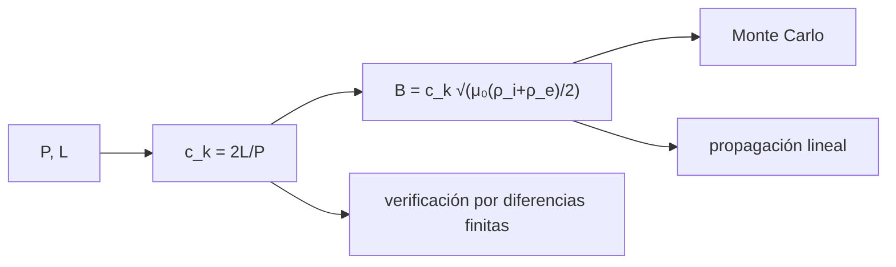

# B34-C04 — Ondas y oscilaciones coronales como sismología solar

<!-- nav:top -->
[🏠 Programa](../../../../README.md) · [📚 Bloque B34](../../../tronco-comun/B34-corona-solar-y-erupciones-diagnostico-y-modelos.md) · [← Anterior: B34-C03 — Bucles magnéticos coronales](../B34-C03-bucles-magneticos-coronales/CLASE.md) · [Siguiente: B34-C05 — Diagnóstico de densidad electrónica coronal →](../B34-C05-diagnostico-de-densidad-electronica-coronal/CLASE.md)
<!-- /nav -->

## 1. Ubicación, nivel y alcance

Clase 4 del bloque B34. Nivel N3. Un bucle que oscila es un instrumento musical: su período revela su campo. Aquí usas el **modo de torsión (kink) estacionario**, `P = 2L/c_k` con `c_k = √(2B²/(μ₀(ρ_i + ρ_e)))`, para **inferir el campo** de un período y una longitud, verificas el período por **diferencias finitas** y propagas las incertidumbres por Monte Carlo y de forma lineal. Usas [B12](../../../tronco-comun/B12-probabilidad-estadistica-e-incertidumbre.md) y [B30-C09](../../B30/B30-C09-magnetohidrodinamica/CLASE.md). Los valores son ilustrativos.

## 2. Por qué esta clase existe

La sismología coronal mide lo que no se ve. La decisión central: **¿qué campo implica un período y con qué incertidumbre?**

## 3. Lo que podrás hacer al terminar

1. Calcular `c_k` y `B`.
2. Verificar el período por diferencias finitas.
3. Propagar errores por Monte Carlo.
4. Propagar errores linealmente.
5. Comparar ambos.
6. Reconocer las suposiciones.

La evidencia es la **ficha de la sismología coronal** del ejercicio 12 (sección 20).

## 4. Con qué llegas y cómo comprobarlo

1. ¿Qué es una incertidumbre?
2. ¿Qué es una simulación Monte Carlo?
3. ¿Qué es una tabla de resultados?
4. ¿Qué es un valor ilustrativo?
5. ¿Qué es una verificación?

<details>
<summary>Ver respuestas</summary>

1. Un intervalo en que se espera el valor verdadero. 2. Repetir con números aleatorios de semilla fija. 3. Un resumen ordenado de cálculos. 4. Un valor propuesto para el ejemplo, no medido. 5. Comparar un cálculo con un caso independiente.
</details>

Con cuatro o cinco aciertos, sigue; si no, repasa los prerrequisitos.

## 5. Un caso de contexto y casos de referencia

Con `P = 300 s`, `L = 100 Mm`, `n_i = 10¹⁵ m⁻³` y `n_i/n_e = 3` (ilustrativos), `c_k = 666,7 km/s` y `B = 7,89 G`. Es el **ejemplo conductor** (`μ₀`, `m_p` de NIST, S1). Con incertidumbres de `10 %`, `20 %` y `20 %`, `σ_B ≈ 1,8 G`.

## 6. Vocabulario

El **modo kink**. La **velocidad de fase** `c_k`. El **período fundamental** `P = 2L/c_k`. La **sismología coronal**. La **propagación de errores**.

## 7. Modelo mental: una cuerda de guitarra

El período y la longitud de una cuerda revelan su tensión; aquí revelan el campo.



*Descripción textual:* el período y la longitud dan la velocidad de fase y el campo; la incertidumbre se propaga de dos maneras y el período se verifica numéricamente.

Analogía: una cuerda de guitarra. Límite: bucle recto y extremos fijos.

## 8. La explicación, paso a paso

### 8.1 Campo inferido

`c_k = 666,7 km/s`; `B = 7,89 G = 0,789 mT`.

### 8.2 Verificación

Las diferencias finitas dan un período de `300,75 s`, frente a `2L/c_k = 300,00 s` (cociente `1,0025`).

### 8.3 Incertidumbre

Monte Carlo (20 000): `B = 8,01 ± 1,85 G`; propagación lineal `σ_B = 1,78 G`; cociente `1,040`.

### 8.4 Lectura

El error de `L` (20 %) y del período (10 %) domina; la mejora de la razón de densidades contribuye poco. La suposición de un bucle recto de campo uniforme es fuerte.

## 9. Magnitudes, símbolos y unidades

| Símbolo | Qué es | Unidad | Valor / nota |
|---|---|---|---|
| `P`, `L` | período y longitud | s; Mm | 300; 100 (ilustrativos) |
| `c_k` | velocidad kink | km/s | 666,7 |
| `B` | campo | G | 7,89 |
| `μ₀`, `m_p` | constantes | SI | S1 |

## 10. Convenciones y referencias

Bucle recto, campo uniforme, extremos fijos; valores ilustrativos; semilla `20261109`.

## 11. De dónde sale lo que afirmamos

| ID | Fuente | Localizador | Respalda | Estado |
|---|---|---|---|---|
| S1 | NIST, *Fundamental Physical Constants* (CODATA 2022) | https://physics.nist.gov/cuu/Constants/Table/allascii.txt | constantes citadas en la sección 9 | Consultada el 2026-11-09 |

Límites: no se analizó ninguna oscilación observada.

## 12. Cómo ver el campo

| Método | `B` (G) | `σ_B` (G) |
|---|---|---|
| central | 7,89 | — |
| Monte Carlo | 8,01 | 1,85 |
| lineal | 7,89 | 1,78 |

Descripción larga: los dos métodos de propagación concuerdan al 4 %.

## 13. Ejemplo trabajado: velocidad kink

**Paso 1 · Longitud.** `2L = 2 × 10⁸ m`.

**Paso 2 · Período.** `300 s`.

**Paso 3 · Cociente.** `c_k = 6,667 × 10⁵ m/s`.

**Paso 4 · Lectura.** `666,7 km/s`.

## 14. Distintas formas de describir un bucle que oscila

**Por período:** `c_k`. **Por campo:** `B`. **Por incertidumbre:** MC y lineal.

## 15. Práctica guiada

**Ejercicio 1 · con los pasos indicados.** `c_k` con `P = 300 s`, `L = 100 Mm`. *Pasos:* ejemplo 13.

<details><summary>Solución comentada</summary>

`666,7 km/s`.
</details>

**Ejercicio 2 · con una pista.** `B` con esos datos.

<details><summary>Solución comentada</summary>

`7,89 G`.
</details>

**Ejercicio 3 · casi autónomo.** `B` si `P` se duplica.

<details><summary>Solución comentada</summary>

La mitad.
</details>

## 16. Práctica autónoma, transferencia e integrador

**Ejercicio 4.** `B` si `L` se duplica.

<details><summary>Solución comentada</summary>

El doble.
</details>

**Ejercicio 5.** Cociente MC/lineal.

<details><summary>Solución comentada</summary>

`1,040`.
</details>

**Ejercicio 6.** Período numérico.

<details><summary>Solución comentada</summary>

`300,75 s`.
</details>

**Ejercicio 7.** ¿Qué incertidumbre domina?

<details><summary>Solución comentada</summary>

La de `L`.
</details>

**Ejercicio 8.** `σ_B/B` aproximada.

<details><summary>Solución comentada</summary>

`23 %`.
</details>

**Ejercicio 9 · transferencia.** **Transferencia.** Un compañero afirma que el campo coronal es 7,9 G. Responde.

<details><summary>Solución comentada</summary>

Es el resultado con datos ilustrativos.
</details>

**Ejercicio 10 · transferencia.** **Transferencia.** ¿Qué supone el extremo fijo?

<details><summary>Solución comentada</summary>

Que la base es una pared rígida.
</details>

**Ejercicio 11 · transferencia.** **Transferencia.** ¿Por qué MC y lineal difieren poco?

<details><summary>Solución comentada</summary>

Porque las incertidumbres son moderadas.
</details>

**Ejercicio 12.** **Integrador.** Elabora tu *ficha de la sismología coronal*: `c_k`, `B`, verificación e incertidumbre.

<details><summary>Solución comentada</summary>

Secciones 8.1–8.4.
</details>

**Ejercicio 12 · integrador.** **Integrador.** Elabora tu *ficha de la sismología coronal*: `c_k`, `B`, verificación e incertidumbre.

<details><summary>Solución modelo</summary>

Secciones 8.1–8.4.
</details>

## 17. Laboratorio: kink estacionario e incertidumbre

El script [sismologia.py](sismologia.py) infiere `B`, verifica el período y compara las incertidumbres (**comprueba** 1 % y 10 %).

**Datos:** `μ₀`, `m_p` de NIST; `P`, `L`, `n` **ilustrativos**; semilla `20261109`. **Predice antes de ejecutar:** ¿qué campo implican 300 s y 100 Mm? (≈8 G.) **Ejecución del 2026-11-09 (Python 3.12.9):**

```text
Python 3.12.9 (biblioteca estandar)
P = 300 s, L = 100 Mm, n_i = 1e15 m-3, n_i/n_e = 3: c_k = 666.7 km/s ; B = 7.89 G = 0.789 mT
periodo por diferencias finitas = 300.75 s ; 2 L/c_k = 300.00 s ; cociente = 1.00250
B por Monte Carlo = 8.01 +/- 1.85 G ; propagacion lineal sigma_B = 1.78 G ; cociente = 1.040
Pruebas superadas.
```

```bash
python programa/clases/B34/B34-C04-ondas-y-oscilaciones-coronales-como-sismologia-solar/sismologia.py
```

**Límites:** bucle recto.

## 18. Errores frecuentes y cómo corregirlos

**Olvidar el factor 2.** Se corrige con el ejemplo 13.

**Dar `B` sin error.** Se corrige con 8.3.

**Tomar los datos por observados.** Se corrige con la sección 10.

**Confundir `v_A` y `c_k`.** Se corrige con la sección 6.

## 19. Cómo sabrás que vas bien

Tras la sección 8: ¿qué resultado esperabas y cuál obtuviste? Si dudas, repasa el ejemplo 13. Tras el laboratorio: ¿qué comprueba? (ver la sección 17).

## 20. Qué entregas y cómo se evalúa

El producto es tu **ficha de la sismología coronal** (ejercicio 12).

| Criterio | Inicial | En desarrollo | Logrado | Destacado |
|---|---|---|---|---|
| Conceptos | Los confunde | Parciales | conceptos de la clase | Explica los límites |
| Cálculo | Sin unidades | Con errores | Tablas completas | Calcula casos nuevos |
| Numérico | Sin comprobar | Un caso | Contraste con el análisis | Interpreta las diferencias |
| Fuentes | Sin fuente | Sin fecha | fuentes con fecha | Declara lo ilustrativo |
| Límites | No los nombra | Uno | Tres | Discute qué falta del modelo |

**Condiciones críticas (no se compensan con promedio):** rotular todos los valores como ilustrativos; no atribuir campos a bucles reales; citar solo lo consultado.

## 21. Ética, seguridad y límites

Clase educativa: los modelos son simplificados. Accesibilidad: tablas equivalentes a las gráficas, fórmulas en texto, ejercicios sin conexión.

## 22. Para cerrar y seguir

Un período de 300 s en un bucle de 100 Mm implica 7,9 ± 1,8 G con datos ilustrativos. Queda una pregunta: ¿cómo se mide la densidad?

**Glosario español–inglés.** sismología coronal · *coronal seismology*; modo kink · *kink mode*; velocidad de fase · *phase speed*; oscilación · *oscillation*; propagación de errores · *error propagation*.

**Continuidad.** [B34-C05](../B34-C05-diagnostico-de-densidad-electronica-coronal/CLASE.md) estudia el diagnóstico de densidad electrónica.

**Referencias:** ver sección 11.

<!-- nav:bottom -->
---

[← Anterior: B34-C03 — Bucles magnéticos coronales](../B34-C03-bucles-magneticos-coronales/CLASE.md) · [📚 Bloque B34](../../../tronco-comun/B34-corona-solar-y-erupciones-diagnostico-y-modelos.md) · [Siguiente: B34-C05 — Diagnóstico de densidad electrónica coronal →](../B34-C05-diagnostico-de-densidad-electronica-coronal/CLASE.md)
<!-- /nav -->
