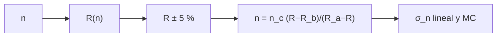

# B34-C05 — Diagnóstico de densidad electrónica coronal

<!-- nav:top -->
[🏠 Programa](../../../../README.md) · [📚 Bloque B34](../../../tronco-comun/B34-corona-solar-y-erupciones-diagnostico-y-modelos.md) · [← Anterior: B34-C04 — Ondas y oscilaciones coronales como sismología solar](../B34-C04-ondas-y-oscilaciones-coronales-como-sismologia-solar/CLASE.md) · [Siguiente: B34-C06 — Tomografía coronal →](../B34-C06-tomografia-coronal/CLASE.md)
<!-- /nav -->

## 1. Ubicación, nivel y alcance

Clase 5 del bloque B34. Nivel N3. El cociente de dos líneas sensible a la densidad permite medirla. Aquí usas un **modelo de dos niveles de juguete** `R(n) = R_b + (R_a − R_b)n/(n + n_c)`, lo inviertes analíticamente, propagas el **error del cociente** al de la densidad linealmente y por Monte Carlo y ves que la sensibilidad se pierde cerca de la **saturación**. Usas [B12](../../../tronco-comun/B12-probabilidad-estadistica-e-incertidumbre.md) y [B30-C08](../../B30/B30-C08-frecuencias-y-ondas-de-plasma/CLASE.md). Es un modelo de prueba.

## 2. Por qué esta clase existe

Un diagnóstico es útil solo en su rango sensible. La decisión central: **¿en qué rango de densidades es fiable un cociente de líneas?**

## 3. Lo que podrás hacer al terminar

1. Invertir `n = n_c(R − R_b)/(R_a − R)`.
2. Propagar el error linealmente.
3. Propagarlo por Monte Carlo.
4. Comparar ambos.
5. Identificar el rango sensible.
6. Reconocer la saturación.

La evidencia es la **ficha del diagnóstico de densidad** del ejercicio 12 (sección 20).

## 4. Con qué llegas y cómo comprobarlo

1. ¿Qué es una incertidumbre?
2. ¿Qué es una simulación Monte Carlo?
3. ¿Qué es una tabla de resultados?
4. ¿Qué es un valor ilustrativo?
5. ¿Qué es una verificación?

<details>
<summary>Ver respuestas</summary>

1. Un intervalo en que se espera el valor verdadero. 2. Repetir con números aleatorios de semilla fija. 3. Un resumen ordenado de cálculos. 4. Un valor propuesto para el ejemplo, no medido. 5. Comparar un cálculo con un caso independiente.
</details>

Con cuatro o cinco aciertos, sigue; si no, repasa los prerrequisitos.

## 5. Un caso de contexto y casos de referencia

Con `R_b = 0,2`, `R_a = 1,2` y `n_c = 10¹⁵ m⁻³`, una densidad de `10¹⁵` da `R = 0,70`; con un error del 5 % en `R`, la densidad se recupera con un `14 %`. Es el **ejemplo conductor**. Todo es **de prueba**.

## 6. Vocabulario

El **cociente de líneas**. La **densidad crítica** `n_c`. La **saturación**. La **inversión**. La **sensibilidad** `dR/dn`.

## 7. Modelo mental: un termómetro que se satura

Un termómetro que marca máximo a partir de cierta temperatura: no distingue entre muy caliente y más caliente.



*Descripción textual:* la densidad produce un cociente con error, que se invierte y se propaga; cerca de la saturación el error explota.

Analogía: un termómetro que se satura. Límite: cociente monótono con errores gaussianos.

## 8. La explicación, paso a paso

### 8.1 Inversión (error del 5 % en `R`)

| `n` verdadera (m⁻³) | `R` | `σ_n` lineal | `σ_n` MC | `σ_n/n` lineal | MC/lineal |
|---|---|---|---|---|---|
| 10¹⁴ | 0,2909 | 1,76 × 10¹³ | 1,77 × 10¹³ | 0,176 | 1,007 |
| 3 × 10¹⁴ | 0,4308 | 3,64 × 10¹³ | 3,68 × 10¹³ | 0,121 | 1,012 |
| 10¹⁵ | 0,7000 | 1,40 × 10¹⁴ | 1,42 × 10¹⁴ | 0,140 | 1,016 |
| 3 × 10¹⁵ | 0,9500 | 7,60 × 10¹⁴ | 9,08 × 10¹⁴ | 0,253 | 1,195 |
| 10¹⁶ | 1,1091 | 6,71 × 10¹⁵ | 4,52 × 10¹⁶ | 0,671 | 6,74 |

### 8.2 Lectura

El mejor rango es `0,3–1` veces `n_c` (error de 12–14 %). Cerca de `R_a` el error relativo sube a `67 %` y la aproximación lineal falla (MC/lineal = 6,7).

## 9. Magnitudes, símbolos y unidades

| Símbolo | Qué es | Unidad | Valor / nota |
|---|---|---|---|
| `R` | cociente de líneas | — | 0,2–1,2 |
| `n_c` | densidad crítica | m⁻³ | 10¹⁵ (ilustrativa) |
| `σ_R/R` | error del cociente | — | 5 % |

## 10. Convenciones y referencias

Modelo de dos niveles de juguete; parámetros ilustrativos; semilla `20261109`.

## 11. De dónde sale lo que afirmamos

| ID | Fuente | Localizador | Respalda | Estado |
|---|---|---|---|---|
| — | Sin fuente externa | — | relaciones estándar que verifica el laboratorio | No se consultó una fuente para esta clase |

Límites: no corresponde a ningún par de líneas real.

## 12. Cómo ver el error

| `n/n_c` | `σ_n/n` |
|---|---|
| 0,1 | 0,176 |
| 1 | 0,140 |
| 3 | 0,253 |
| 10 | 0,671 |

Descripción larga: el error relativo es mínimo cerca de `n_c` y crece en la saturación.

## 13. Ejemplo trabajado: inversión

**Paso 1 · `R`.** `0,70`.

**Paso 2 · Numerador.** `R − R_b = 0,50`.

**Paso 3 · Denominador.** `R_a − R = 0,50`.

**Paso 4 · Valor.** `n = n_c × 1 = 10¹⁵ m⁻³`.

## 14. Distintas formas de describir un diagnóstico

**Por inversión:** fórmula. **Por error:** lineal y MC. **Por rango:** sensibilidad.

## 15. Práctica guiada

**Ejercicio 1 · con los pasos indicados.** `R` para `n = n_c`. *Pasos:* ejemplo 13.

<details><summary>Solución comentada</summary>

`0,70`.
</details>

**Ejercicio 2 · con una pista.** `n` para `R = 0,95`.

<details><summary>Solución comentada</summary>

`3 × 10¹⁵ m⁻³`.
</details>

**Ejercicio 3 · casi autónomo.** Error relativo en `n = n_c`.

<details><summary>Solución comentada</summary>

`14 %`.
</details>

## 16. Práctica autónoma, transferencia e integrador

**Ejercicio 4.** MC/lineal a `3 n_c`.

<details><summary>Solución comentada</summary>

`1,195`.
</details>

**Ejercicio 5.** ¿Dónde falla la linealización?

<details><summary>Solución comentada</summary>

Cerca de `R_a`.
</details>

**Ejercicio 6.** `R` límite cuando `n → ∞`.

<details><summary>Solución comentada</summary>

`R_a = 1,2`.
</details>

**Ejercicio 7.** `R` cuando `n → 0`.

<details><summary>Solución comentada</summary>

`R_b = 0,2`.
</details>

**Ejercicio 8.** Error relativo a `10 n_c`.

<details><summary>Solución comentada</summary>

`67 %`.
</details>

**Ejercicio 9 · transferencia.** **Transferencia.** Un compañero aplica estos parámetros a un par real. Responde.

<details><summary>Solución comentada</summary>

Son de prueba.
</details>

**Ejercicio 10 · transferencia.** **Transferencia.** ¿Qué rango conviene?

<details><summary>Solución comentada</summary>

`0,3–1` veces `n_c`.
</details>

**Ejercicio 11 · transferencia.** **Transferencia.** ¿Qué pasa con errores mayores?

<details><summary>Solución comentada</summary>

La linealización falla antes.
</details>

**Ejercicio 12.** **Integrador.** Elabora tu *ficha del diagnóstico de densidad*: inversión, errores y rango sensible.

<details><summary>Solución comentada</summary>

Secciones 8.1–8.2.
</details>

**Ejercicio 12 · integrador.** **Integrador.** Elabora tu *ficha del diagnóstico de densidad*: inversión, errores y rango sensible.

<details><summary>Solución modelo</summary>

Secciones 8.1–8.2.
</details>

## 17. Laboratorio: inversión de un cociente

El script [densidad.py](densidad.py) invierte y propaga el error (**comprueba** 5 % entre `0,3` y 2 `n_c`).

**Datos:** sin constantes; modelo de prueba **ilustrativo**; semilla `20261109`. **Predice antes de ejecutar:** ¿dónde es mejor el diagnóstico? (cerca de `n_c`.) **Ejecución del 2026-11-09 (Python 3.12.9):**

```text
Python 3.12.9 (biblioteca estandar)
 n verdadera [m-3]       R  n invertida  sigma_n lineal  sigma_n MC  sigma_n/n lineal  MC/lineal
          1.00e+14  0.2909    1.000e+14       1.760e+13   1.773e+13             0.176      1.007
          3.00e+14  0.4308    3.000e+14       3.640e+13   3.683e+13             0.121      1.012
          1.00e+15  0.7000    1.000e+15       1.400e+14   1.422e+14             0.140      1.016
          3.00e+15  0.9500    3.000e+15       7.600e+14   9.084e+14             0.253      1.195
          1.00e+16  1.1091    1.000e+16       6.710e+15   4.524e+16             0.671      6.743
Pruebas superadas.
```

```bash
python programa/clases/B34/B34-C05-diagnostico-de-densidad-electronica-coronal/densidad.py
```

**Límites:** cociente monótono.

## 18. Errores frecuentes y cómo corregirlos

**Usar el cociente saturado.** Se corrige con 8.2.

**Propagar linealmente sin comprobar.** Se corrige con 8.1.

**Tomar los parámetros por reales.** Se corrige con la sección 10.

**Ignorar el sesgo del MC.** Se corrige con 8.2.

## 19. Cómo sabrás que vas bien

Tras la sección 8: ¿qué resultado esperabas y cuál obtuviste? Si dudas, repasa el ejemplo 13. Tras el laboratorio: ¿qué comprueba? (ver la sección 17).

## 20. Qué entregas y cómo se evalúa

El producto es tu **ficha del diagnóstico de densidad** (ejercicio 12).

| Criterio | Inicial | En desarrollo | Logrado | Destacado |
|---|---|---|---|---|
| Conceptos | Los confunde | Parciales | conceptos de la clase | Explica los límites |
| Cálculo | Sin unidades | Con errores | Tablas completas | Calcula casos nuevos |
| Numérico | Sin comprobar | Un caso | Contraste con el análisis | Interpreta las diferencias |
| Fuentes | Sin fuente | Sin fecha | fuentes con fecha | Declara lo ilustrativo |
| Límites | No los nombra | Uno | Tres | Discute qué falta del modelo |

**Condiciones críticas (no se compensan con promedio):** rotular el cociente como de prueba; no atribuirlo a líneas reales; citar solo lo consultado.

## 21. Ética, seguridad y límites

Clase educativa: los modelos son simplificados. Accesibilidad: tablas equivalentes a las gráficas, fórmulas en texto, ejercicios sin conexión.

## 22. Para cerrar y seguir

El cociente de prueba mide la densidad con 12–14 % de error cerca de n_c, y el error crece al 67 % en la saturación. Queda una pregunta: ¿cómo se reconstruye la emisión en 3D?

**Glosario español–inglés.** diagnóstico de densidad · *density diagnostic*; cociente de líneas · *line ratio*; saturación · *saturation*; densidad crítica · *critical density*; inversión · *inversion*.

**Continuidad.** [B34-C06](../B34-C06-tomografia-coronal/CLASE.md) estudia la tomografía coronal.

**Referencias:** ver sección 11.

<!-- nav:bottom -->
---

[← Anterior: B34-C04 — Ondas y oscilaciones coronales como sismología solar](../B34-C04-ondas-y-oscilaciones-coronales-como-sismologia-solar/CLASE.md) · [📚 Bloque B34](../../../tronco-comun/B34-corona-solar-y-erupciones-diagnostico-y-modelos.md) · [Siguiente: B34-C06 — Tomografía coronal →](../B34-C06-tomografia-coronal/CLASE.md)
<!-- /nav -->
