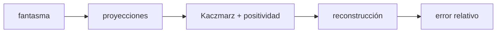

# B34-C06 — Tomografía coronal

<!-- nav:top -->
[🏠 Programa](../../../../README.md) · [📚 Bloque B34](../../../tronco-comun/B34-corona-solar-y-erupciones-diagnostico-y-modelos.md) · [← Anterior: B34-C05 — Diagnóstico de densidad electrónica coronal](../B34-C05-diagnostico-de-densidad-electronica-coronal/CLASE.md) · [Siguiente: B34-C07 — Comparación de modelos coronales con observaciones →](../B34-C07-comparacion-de-modelos-coronales-con-observaciones/CLASE.md)
<!-- /nav -->

## 1. Ubicación, nivel y alcance

Clase 6 del bloque B34. Nivel N3. Con vistas desde distintas direcciones se puede reconstruir la emisividad. Aquí reconstruyes un fantasma 2D de 16 × 16 píxeles (un bulto y un anillo) con el **método de Kaczmarz (ART)** a partir de integrales de línea en 2 y 4 direcciones, midiendo el error con y sin ruido. Usas [B10](../../../tronco-comun/B10-algebra-lineal-y-matematicas-geometricas.md) y [B11-C08](../../B11/B11-C08-integradores-de-paso-adaptativo/CLASE.md). El fantasma es sintético.

## 2. Por qué esta clase existe

Más ángulos dan mejores imágenes, pero las vistas disponibles son pocas. La decisión central: **¿cuánto mejora la reconstrucción con más direcciones de vista?**

## 3. Lo que podrás hacer al terminar

1. Construir las integrales de línea.
2. Aplicar Kaczmarz con positividad.
3. Medir el error relativo.
4. Comparar 2 y 4 direcciones.
5. Añadir ruido.
6. Reconocer la falta de unicidad.

La evidencia es la **ficha de la tomografía coronal** del ejercicio 12 (sección 20).

## 4. Con qué llegas y cómo comprobarlo

1. ¿Qué es una incertidumbre?
2. ¿Qué es una simulación Monte Carlo?
3. ¿Qué es una tabla de resultados?
4. ¿Qué es un valor ilustrativo?
5. ¿Qué es una verificación?

<details>
<summary>Ver respuestas</summary>

1. Un intervalo en que se espera el valor verdadero. 2. Repetir con números aleatorios de semilla fija. 3. Un resumen ordenado de cálculos. 4. Un valor propuesto para el ejemplo, no medido. 5. Comparar un cálculo con un caso independiente.
</details>

Con cuatro o cinco aciertos, sigue; si no, repasa los prerrequisitos.

## 5. Un caso de contexto y casos de referencia

Con 2 direcciones (32 ecuaciones) el error relativo es `0,66`; con 4 (94 ecuaciones), `0,18`. Es el **ejemplo conductor**. Con ruido del 1 % sube solo a `0,183`. Todo es **sintético**.

## 6. Vocabulario

La **tomografía**. Una **proyección** es la integral a lo largo de una línea. El **método ART/Kaczmarz**. La **positividad**. La **no unicidad** con pocas vistas.

## 7. Modelo mental: adivinar un objeto por sus sombras

Con pocas sombras hay muchos objetos compatibles; con más direcciones las posibilidades se reducen.



*Descripción textual:* las proyecciones del fantasma alimentan el algoritmo, cuya reconstrucción se compara con el original.

Analogía: adivinar un objeto por sus sombras. Límite: píxeles discretos y vistas ortogonales y diagonales.

## 8. La explicación, paso a paso

### 8.1 Error de reconstrucción

| direcciones | ecuaciones | iteraciones | error sin ruido | error con ruido 1 % |
|---|---|---|---|---|
| (0°, 90°) | 32 | 10 | 0,6599 | 0,6601 |
| (0°, 90°) | 32 | 200 | 0,6566 | 0,6567 |
| (0°, 90°, 45°, 135°) | 94 | 10 | 0,3337 | 0,3340 |
| (0°, 90°, 45°, 135°) | 94 | 200 | 0,1823 | 0,1833 |

### 8.2 Lectura

Añadir direcciones reduce el error de 0,66 a 0,18, mucho más que iterar más: con pocas vistas el problema no tiene solución única y el algoritmo converge a una de las compatibles.

## 9. Magnitudes, símbolos y unidades

| Símbolo | Qué es | Unidad | Valor / nota |
|---|---|---|---|
| `A x = b` | sistema de proyecciones | — | ver 8 |
| error | error cuadrático relativo | — | 0,18–0,66 |
| vistas | direcciones | ° | 0, 90, 45, 135 |

## 10. Convenciones y referencias

Pixeles discretos; fantasma, ruido y semilla `20261109` ilustrativos; sintético.

## 11. De dónde sale lo que afirmamos

| ID | Fuente | Localizador | Respalda | Estado |
|---|---|---|---|---|
| — | Sin fuente externa | — | relaciones estándar que verifica el laboratorio | No se consultó una fuente para esta clase |

Límites: no se reconstruyó ninguna corona.

## 12. Cómo ver el error

| Vistas | Error |
|---|---|
| 2 | 0,657 |
| 4 | 0,182 |

Descripción larga: duplicar las vistas reduce el error a un tercio.

## 13. Ejemplo trabajado: proyección

**Paso 1 · Fila.** Suma de 16 píxeles.

**Paso 2 · Columna.** Suma de otros 16.

**Paso 3 · Sistema.** 32 ecuaciones para 256 incógnitas.

**Paso 4 · Lectura.** El sistema está indeterminado.

## 14. Distintas formas de describir una reconstrucción

**Por vistas:** ecuaciones. **Por algoritmo:** Kaczmarz. **Por error:** relativo.

## 15. Práctica guiada

**Ejercicio 1 · con los pasos indicados.** Ecuaciones con 2 vistas. *Pasos:* ejemplo 13.

<details><summary>Solución comentada</summary>

`32`.
</details>

**Ejercicio 2 · con una pista.** Ecuaciones con 4 vistas.

<details><summary>Solución comentada</summary>

`94`.
</details>

**Ejercicio 3 · casi autónomo.** Incógnitas.

<details><summary>Solución comentada</summary>

`256`.
</details>

## 16. Práctica autónoma, transferencia e integrador

**Ejercicio 4.** Error con 4 vistas.

<details><summary>Solución comentada</summary>

`0,182`.
</details>

**Ejercicio 5.** Reducción de error al pasar de 2 a 4.

<details><summary>Solución comentada</summary>

`72 %`.
</details>

**Ejercicio 6.** Efecto del ruido del 1 %.

<details><summary>Solución comentada</summary>

Casi nulo.
</details>

**Ejercicio 7.** ¿Mejora iterar más con 2 vistas?

<details><summary>Solución comentada</summary>

Casi nada.
</details>

**Ejercicio 8.** ¿Por qué?

<details><summary>Solución comentada</summary>

Falta información.
</details>

**Ejercicio 9 · transferencia.** **Transferencia.** Un compañero reconstruye la corona con estas cifras. Responde.

<details><summary>Solución comentada</summary>

Son sintéticas.
</details>

**Ejercicio 10 · transferencia.** **Transferencia.** ¿Qué aporta la positividad?

<details><summary>Solución comentada</summary>

Elimina soluciones no físicas.
</details>

**Ejercicio 11 · transferencia.** **Transferencia.** ¿Qué limita la tomografía solar?

<details><summary>Solución comentada</summary>

El número de vistas disponibles.
</details>

**Ejercicio 12.** **Integrador.** Elabora tu *ficha de la tomografía coronal*: proyecciones, error y lectura.

<details><summary>Solución comentada</summary>

Secciones 8.1–8.2.
</details>

**Ejercicio 12 · integrador.** **Integrador.** Elabora tu *ficha de la tomografía coronal*: proyecciones, error y lectura.

<details><summary>Solución modelo</summary>

Secciones 8.1–8.2.
</details>

## 17. Laboratorio: ART con 2 y 4 vistas

El script [tomografia.py](tomografia.py) reconstruye y compara errores (**comprueba** que 4 vistas superan a 2).

**Datos:** sin constantes; fantasma **sintético**; semilla `20261109`. **Predice antes de ejecutar:** ¿cuánto mejora con 4 vistas? (de 0,66 a 0,18.) **Ejecución del 2026-11-09 (Python 3.12.9):**

```text
Python 3.12.9 (biblioteca estandar)
direcciones              ecuaciones  iteraciones   error relativo (sin ruido)   error con ruido 1 %
(0, 90)                          32           10                       0.6599                0.6601
(0, 90)                          32          200                       0.6566                0.6567
(0, 90, 45, 135)                 94           10                       0.3337                0.3340
(0, 90, 45, 135)                 94          200                       0.1823                0.1833
Pruebas superadas.
```

```bash
python programa/clases/B34/B34-C06-tomografia-coronal/tomografia.py
```

**Límites:** píxeles discretos.

## 18. Errores frecuentes y cómo corregirlos

**Iterar sin más vistas.** Se corrige con 8.2.

**Ignorar la positividad.** Se corrige con la sección 6.

**Tomar el fantasma por real.** Se corrige con la sección 10.

**Confundir error y residuo.** Se corrige con 8.1.

## 19. Cómo sabrás que vas bien

Tras la sección 8: ¿qué resultado esperabas y cuál obtuviste? Si dudas, repasa el ejemplo 13. Tras el laboratorio: ¿qué comprueba? (ver la sección 17).

## 20. Qué entregas y cómo se evalúa

El producto es tu **ficha de la tomografía coronal** (ejercicio 12).

| Criterio | Inicial | En desarrollo | Logrado | Destacado |
|---|---|---|---|---|
| Conceptos | Los confunde | Parciales | conceptos de la clase | Explica los límites |
| Cálculo | Sin unidades | Con errores | Tablas completas | Calcula casos nuevos |
| Numérico | Sin comprobar | Un caso | Contraste con el análisis | Interpreta las diferencias |
| Fuentes | Sin fuente | Sin fecha | fuentes con fecha | Declara lo ilustrativo |
| Límites | No los nombra | Uno | Tres | Discute qué falta del modelo |

**Condiciones críticas (no se compensan con promedio):** rotular el fantasma como sintético; no reconstruir coronas reales con esto; citar solo lo consultado.

## 21. Ética, seguridad y límites

Clase educativa: los modelos son simplificados. Accesibilidad: tablas equivalentes a las gráficas, fórmulas en texto, ejercicios sin conexión.

## 22. Para cerrar y seguir

Dos direcciones dejan un error de 0,66 y cuatro de 0,18 en un fantasma sintético. Queda una pregunta: ¿cómo se comparan modelos y observaciones?

**Glosario español–inglés.** tomografía · *tomography*; proyección · *projection*; método ART · *algebraic reconstruction technique*; Kaczmarz · *Kaczmarz*; positividad · *positivity*.

**Continuidad.** [B34-C07](../B34-C07-comparacion-de-modelos-coronales-con-observaciones/CLASE.md) estudia la comparación de modelos con observaciones.

**Referencias:** ver sección 11.

<!-- nav:bottom -->
---

[← Anterior: B34-C05 — Diagnóstico de densidad electrónica coronal](../B34-C05-diagnostico-de-densidad-electronica-coronal/CLASE.md) · [📚 Bloque B34](../../../tronco-comun/B34-corona-solar-y-erupciones-diagnostico-y-modelos.md) · [Siguiente: B34-C07 — Comparación de modelos coronales con observaciones →](../B34-C07-comparacion-de-modelos-coronales-con-observaciones/CLASE.md)
<!-- /nav -->
