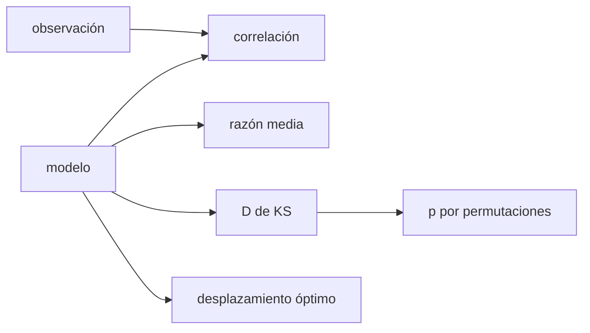

# B34-C07 — Comparación de modelos coronales con observaciones

<!-- nav:top -->
[🏠 Programa](../../../../README.md) · [📚 Bloque B34](../../../tronco-comun/B34-corona-solar-y-erupciones-diagnostico-y-modelos.md) · [← Anterior: B34-C06 — Tomografía coronal](../B34-C06-tomografia-coronal/CLASE.md) · [Siguiente: B34-C08 — Erupciones de filamentos y prominencias →](../B34-C08-erupciones-de-filamentos-y-prominencias/CLASE.md)
<!-- /nav -->

## 1. Ubicación, nivel y alcance

Clase 7 del bloque B34. Nivel N3. Comparar un mapa modelado con uno observado exige métricas y una estimación honesta de su significancia. Aquí comparas dos modelos sintéticos con un «mapa observado» mediante la **correlación**, la **razón media**, el **desplazamiento óptimo** y la **prueba de Kolmogorov–Smirnov** calibrada con **permutaciones**. Usas [B12](../../../tronco-comun/B12-probabilidad-estadistica-e-incertidumbre.md) y [B34-C06](../B34-C06-tomografia-coronal/CLASE.md). Los mapas son sintéticos.

## 2. Por qué esta clase existe

Una buena correlación puede ocultar un error de escala. La decisión central: **¿qué métrica detecta cada tipo de discrepancia?**

## 3. Lo que podrás hacer al terminar

1. Calcular la correlación y la razón media.
2. Calcular la distancia de Kolmogorov–Smirnov.
3. Calibrar el valor p con permutaciones.
4. Hallar el desplazamiento óptimo.
5. Interpretar cada discrepancia.
6. Reconocer la correlación espacial.

La evidencia es la **ficha de la comparación modelo–observación** del ejercicio 12 (sección 20).

## 4. Con qué llegas y cómo comprobarlo

1. ¿Qué es una incertidumbre?
2. ¿Qué es una simulación Monte Carlo?
3. ¿Qué es una tabla de resultados?
4. ¿Qué es un valor ilustrativo?
5. ¿Qué es una verificación?

<details>
<summary>Ver respuestas</summary>

1. Un intervalo en que se espera el valor verdadero. 2. Repetir con números aleatorios de semilla fija. 3. Un resumen ordenado de cálculos. 4. Un valor propuesto para el ejemplo, no medido. 5. Comparar un cálculo con un caso independiente.
</details>

Con cuatro o cinco aciertos, sigue; si no, repasa los prerrequisitos.

## 5. Un caso de contexto y casos de referencia

El modelo A (desplazado 1 píxel) tiene correlación `0,974` y razón `0,998`; el B (bulto más ancho) tiene `0,950` pero una razón de `2,06` y `D = 0,488`. Es el **ejemplo conductor**. Todo es **sintético**.

## 6. Vocabulario

La **correlación** de Pearson. La **razón media**. La **distancia KS** entre distribuciones. La **prueba de permutaciones**. El **desplazamiento** óptimo.

## 7. Modelo mental: comparar dos fotografías

Dos fotos pueden tener la misma forma y distinto brillo, o el mismo brillo y distinta forma.



*Descripción textual:* las métricas miden forma, escala y distribución; el desplazamiento corrige la posición.

Analogía: comparar dos fotografías. Límite: píxeles independientes.

## 8. La explicación, paso a paso

### 8.1 Métricas

| modelo | correlación | razón media | `D` (KS) | `p` asintótico | `p` por permutaciones |
|---|---|---|---|---|---|
| A: desplazado 1 píxel | 0,9735 | 0,9980 | 0,0260 | 0,9888 | 0,9920 |
| B: bulto más ancho | 0,9500 | 2,0594 | 0,4878 | 0,0000 | 0,0000 |

### 8.2 Desplazamiento

El mejor desplazamiento del modelo A es `(−1, 0)` píxeles, con correlación `0,9970`.

### 8.3 Lectura

El modelo B se distingue por la razón y por KS, no por la correlación (0,95). Los píxeles no son independientes en mapas reales, y el valor p ingenuo sobreestima la significancia.

## 9. Magnitudes, símbolos y unidades

| Símbolo | Qué es | Unidad | Valor / nota |
|---|---|---|---|
| `r` | correlación | — | 0,9735; 0,9500 |
| `D` | distancia KS | — | 0,026; 0,488 |
| razón | modelo/observación | — | 0,998; 2,06 |

## 10. Convenciones y referencias

Mapas sintéticos de 24 × 24; ruido del 5 %; semilla `20261109`.

## 11. De dónde sale lo que afirmamos

| ID | Fuente | Localizador | Respalda | Estado |
|---|---|---|---|---|
| — | Sin fuente externa | — | relaciones estándar que verifica el laboratorio | No se consultó una fuente para esta clase |

Límites: no se compararon modelos coronales reales.

## 12. Cómo ver las métricas

| Modelo | `r` | razón | `D` |
|---|---|---|---|
| A | 0,974 | 1,00 | 0,026 |
| B | 0,950 | 2,06 | 0,488 |

Descripción larga: solo la razón y KS detectan el error de escala del modelo B.

## 13. Ejemplo trabajado: distancia KS

**Paso 1 · Ordenar.** Las intensidades de ambos mapas.

**Paso 2 · Distribuciones acumuladas.** `F_m`, `F_o`.

**Paso 3 · Máxima diferencia.** `D = max|F_m − F_o|`.

**Paso 4 · Valor.** `0,488` para B.

## 14. Distintas formas de describir una comparación

**Por forma:** correlación. **Por escala:** razón. **Por distribución:** KS. **Por posición:** desplazamiento.

## 15. Práctica guiada

**Ejercicio 1 · con los pasos indicados.** Correlación del modelo A. *Pasos:* tabla.

<details><summary>Solución comentada</summary>

`0,9735`.
</details>

**Ejercicio 2 · con una pista.** Razón del modelo B.

<details><summary>Solución comentada</summary>

`2,06`.
</details>

**Ejercicio 3 · casi autónomo.** `D` del modelo B.

<details><summary>Solución comentada</summary>

`0,488`.
</details>

## 16. Práctica autónoma, transferencia e integrador

**Ejercicio 4.** Desplazamiento óptimo del A.

<details><summary>Solución comentada</summary>

`(−1, 0)`.
</details>

**Ejercicio 5.** Correlación tras desplazar.

<details><summary>Solución comentada</summary>

`0,997`.
</details>

**Ejercicio 6.** ¿Detecta la correlación el error de B?

<details><summary>Solución comentada</summary>

No.
</details>

**Ejercicio 7.** ¿Qué detecta?

<details><summary>Solución comentada</summary>

La razón y KS.
</details>

**Ejercicio 8.** `p` por permutaciones del A.

<details><summary>Solución comentada</summary>

`0,992`.
</details>

**Ejercicio 9 · transferencia.** **Transferencia.** Un compañero valida un modelo real con r = 0,95. Responde.

<details><summary>Solución comentada</summary>

Es insuficiente; hay que mirar razón y distribución.
</details>

**Ejercicio 10 · transferencia.** **Transferencia.** ¿Por qué se calibra con permutaciones?

<details><summary>Solución comentada</summary>

Porque no depende de fórmulas asintóticas.
</details>

**Ejercicio 11 · transferencia.** **Transferencia.** ¿Qué invalida el valor p?

<details><summary>Solución comentada</summary>

La correlación espacial de los píxeles.
</details>

**Ejercicio 12.** **Integrador.** Elabora tu *ficha de la comparación modelo–observación*: métricas, desplazamiento y lectura.

<details><summary>Solución comentada</summary>

Secciones 8.1–8.3.
</details>

**Ejercicio 12 · integrador.** **Integrador.** Elabora tu *ficha de la comparación modelo–observación*: métricas, desplazamiento y lectura.

<details><summary>Solución modelo</summary>

Secciones 8.1–8.3.
</details>

## 17. Laboratorio: métricas de mapas y KS

El script [comparacion.py](comparacion.py) calcula las métricas y calibra el valor p (**comprueba** el desplazamiento de 1 píxel y que A supera a B).

**Datos:** sin constantes; mapas **sintéticos**; semilla `20261109`. **Predice antes de ejecutar:** ¿qué métrica detecta el error de escala? (la razón.) **Ejecución del 2026-11-09 (Python 3.12.9):**

```text
Python 3.12.9 (biblioteca estandar)
modelo                        correlacion  razon media   D (KS)  p asintotico  p por permutaciones
A: desplazado 1 pixel              0.9735       0.9980   0.0260        0.9888               0.9920
B: bulto mas ancho                 0.9500       2.0594   0.4878        0.0000               0.0000
desplazamiento optimo del modelo A respecto de lo observado: (-1, 0) pixeles con correlacion 0.9970
Pruebas superadas.
```

```bash
python programa/clases/B34/B34-C07-comparacion-de-modelos-coronales-con-observaciones/comparacion.py
```

**Límites:** píxeles independientes.

## 18. Errores frecuentes y cómo corregirlos

**Usar solo la correlación.** Se corrige con 8.1.

**Fiarse del valor p ingenuo.** Se corrige con 8.3.

**Tomar los mapas por reales.** Se corrige con la sección 10.

**Ignorar el desplazamiento.** Se corrige con 8.2.

## 19. Cómo sabrás que vas bien

Tras la sección 8: ¿qué resultado esperabas y cuál obtuviste? Si dudas, repasa el ejemplo 13. Tras el laboratorio: ¿qué comprueba? (ver la sección 17).

## 20. Qué entregas y cómo se evalúa

El producto es tu **ficha de la comparación modelo–observación** (ejercicio 12).

| Criterio | Inicial | En desarrollo | Logrado | Destacado |
|---|---|---|---|---|
| Conceptos | Los confunde | Parciales | conceptos de la clase | Explica los límites |
| Cálculo | Sin unidades | Con errores | Tablas completas | Calcula casos nuevos |
| Numérico | Sin comprobar | Un caso | Contraste con el análisis | Interpreta las diferencias |
| Fuentes | Sin fuente | Sin fecha | fuentes con fecha | Declara lo ilustrativo |
| Límites | No los nombra | Uno | Tres | Discute qué falta del modelo |

**Condiciones críticas (no se compensan con promedio):** rotular los mapas como sintéticos; no validar modelos reales; citar solo lo consultado.

## 21. Ética, seguridad y límites

Clase educativa: los modelos son simplificados. Accesibilidad: tablas equivalentes a las gráficas, fórmulas en texto, ejercicios sin conexión.

## 22. Para cerrar y seguir

Un modelo con r = 0,95 puede tener el doble de brillo (razón 2,06) y D = 0,49; el desplazamiento óptimo del otro es 1 píxel. Queda una pregunta: ¿cuándo erupciona un filamento?

**Glosario español–inglés.** comparación modelo–observación · *model–observation comparison*; distancia de Kolmogorov–Smirnov · *Kolmogorov–Smirnov distance*; prueba de permutaciones · *permutation test*; razón media · *mean ratio*; desplazamiento · *offset*.

**Continuidad.** [B34-C08](../B34-C08-erupciones-de-filamentos-y-prominencias/CLASE.md) estudia las erupciones de filamentos.

**Referencias:** ver sección 11.

<!-- nav:bottom -->
---

[← Anterior: B34-C06 — Tomografía coronal](../B34-C06-tomografia-coronal/CLASE.md) · [📚 Bloque B34](../../../tronco-comun/B34-corona-solar-y-erupciones-diagnostico-y-modelos.md) · [Siguiente: B34-C08 — Erupciones de filamentos y prominencias →](../B34-C08-erupciones-de-filamentos-y-prominencias/CLASE.md)
<!-- /nav -->
