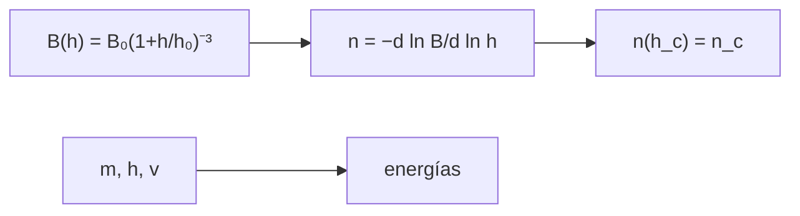

# B34-C08 — Erupciones de filamentos y prominencias

<!-- nav:top -->
[🏠 Programa](../../../../README.md) · [📚 Bloque B34](../../../tronco-comun/B34-corona-solar-y-erupciones-diagnostico-y-modelos.md) · [← Anterior: B34-C07 — Comparación de modelos coronales con observaciones](../B34-C07-comparacion-de-modelos-coronales-con-observaciones/CLASE.md) · [Siguiente: B34-C09 — Integración multiinstrumento de datos heliofísicos →](../B34-C09-integracion-multiinstrumento-de-datos-heliofisicos/CLASE.md)
<!-- /nav -->

## 1. Ubicación, nivel y alcance

Clase 8 del bloque B34. Nivel N3. Un filamento se mantiene sujeto por el campo externo hasta que este decae demasiado rápido con la altura. Aquí calculas el **índice de decaimiento** `n = −d ln B/d ln h` de un campo de dipolo de juguete (analítico y por diferencias finitas), la **altura crítica** donde `n` alcanza un valor de referencia, y las **energías** potencial y cinética de una prominencia. Usas [B05](../../../tronco-comun/B05-fisica-fundamental-para-el-espacio.md) y [B30-C02](../../B30/B30-C02-fotosfera-cromosfera-y-corona/CLASE.md). El valor crítico es ilustrativo.

## 2. Por qué esta clase existe

Saber a qué altura el campo ya no sostiene al filamento sirve para anticipar erupciones. La decisión central: **¿a qué altura el decaimiento del campo supera el umbral?**

## 3. Lo que podrás hacer al terminar

1. Calcular `n(h) = 3h/(h₀ + h)`.
2. Verificarlo por diferencias finitas.
3. Hallar la altura crítica por biseccion.
4. Compararla con `n_c h₀/(3 − n_c)`.
5. Calcular las energías potencial y cinética.
6. Comparar con la velocidad de escape.

La evidencia es la **ficha de la erupción de un filamento** del ejercicio 12 (sección 20).

## 4. Con qué llegas y cómo comprobarlo

1. ¿Qué es una incertidumbre?
2. ¿Qué es una simulación Monte Carlo?
3. ¿Qué es una tabla de resultados?
4. ¿Qué es un valor ilustrativo?
5. ¿Qué es una verificación?

<details>
<summary>Ver respuestas</summary>

1. Un intervalo en que se espera el valor verdadero. 2. Repetir con números aleatorios de semilla fija. 3. Un resumen ordenado de cálculos. 4. Un valor propuesto para el ejemplo, no medido. 5. Comparar un cálculo con un caso independiente.
</details>

Con cuatro o cinco aciertos, sigue; si no, repasa los prerrequisitos.

## 5. Un caso de contexto y casos de referencia

Con `h₀ = 50 Mm` y `n_c = 1,5` (ilustrativo), la altura crítica es `50 Mm`. Es el **ejemplo conductor**. Una prominencia de `10¹² kg` a `30 Mm` tiene `8,2 × 10²¹ J` de energía potencial; a `100 km/s`, `5,0 × 10²¹ J` de cinética.

## 6. Vocabulario

El **índice de decaimiento** `n`. La **altura crítica**. El **filamento** o la **prominencia**. La **inestabilidad** por encima del umbral. La **velocidad de escape**.

## 7. Modelo mental: una bola sobre una colina

Mientras la colina (el campo) es empinada pero sostiene, la bola queda; si la pendiente cae demasiado rápido, rueda.



*Descripción textual:* el campo externo define el índice de decaimiento y la altura crítica; la masa y la altura dan las energías.

Analogía: una bola sobre una colina. Límite: g constante; umbral de referencia.

## 8. La explicación, paso a paso

### 8.1 Índice de decaimiento

| `h` (Mm) | `n` analítico | `n` por diferencias finitas |
|---|---|---|
| 10 | 0,500000 | 0,500000 |
| 30 | 1,125000 | 1,125000 |
| 50 | 1,500000 | 1,500000 |
| 100 | 2,000000 | 2,000000 |
| 200 | 2,400000 | 2,400000 |

### 8.2 Altura crítica y energías

`h_c = 50,000000 Mm` (biseccion y analítica). `g = 274,2 m/s²`; energía potencial `m g h = 8,226 × 10²¹ J`; cinética `5,000 × 10²¹ J`; cociente `0,608`; velocidad de escape en la superficie `617,7 km/s`.

### 8.3 Lectura

A `100 km/s` la cinética es el 61 % de la potencial: lejos de la escape, pero para elevar el filamento basta con mover el equilibrio.

## 9. Magnitudes, símbolos y unidades

| Símbolo | Qué es | Unidad | Valor / nota |
|---|---|---|---|
| `h₀` | escala del campo | Mm | 50 (ilustrativa) |
| `n_c` | índice crítico | — | 1,5 (ilustrativo) |
| `m` | masa | kg | 10¹² |

## 10. Convenciones y referencias

Campo de dipolo de juguete; `n_c`, `m`, `h`, `v` ilustrativos.

## 11. De dónde sale lo que afirmamos

| ID | Fuente | Localizador | Respalda | Estado |
|---|---|---|---|---|
| S2 | UAI, Resolución B3 de 2015 | https://arxiv.org/abs/1510.07674 | valores nominales solares y planetarios | Consultada el 2026-11-09 |

Límites: no se consultó ningún criterio de inestabilidad.

## 12. Cómo ver la altura crítica

| `h` (Mm) | `n` |
|---|---|
| 10 | 0,50 |
| 50 | 1,50 |
| 100 | 2,00 |

Descripción larga: el índice crece con la altura y cruza 1,5 a 50 Mm.

## 13. Ejemplo trabajado: índice a 30 Mm

**Paso 1 · Numerador.** `3 × 30 = 90`.

**Paso 2 · Denominador.** `50 + 30 = 80`.

**Paso 3 · Cociente.** `90/80`.

**Paso 4 · Valor.** `1,125`.

## 14. Distintas formas de describir un filamento

**Por campo:** `n(h)`. **Por umbral:** `h_c`. **Por energía:** `m g h` y `mv²/2`.

## 15. Práctica guiada

**Ejercicio 1 · con los pasos indicados.** `n` a 10 Mm. *Pasos:* ejemplo 13.

<details><summary>Solución comentada</summary>

`0,5`.
</details>

**Ejercicio 2 · con una pista.** `h_c` si `n_c = 2`.

<details><summary>Solución comentada</summary>

`100 Mm`.
</details>

**Ejercicio 3 · casi autónomo.** Energía potencial. *Pista:* `m g h`.

<details><summary>Solución comentada</summary>

`8,2 × 10²¹ J`.
</details>

## 16. Práctica autónoma, transferencia e integrador

**Ejercicio 4.** Cinética a 100 km/s.

<details><summary>Solución comentada</summary>

`5 × 10²¹ J`.
</details>

**Ejercicio 5.** Cociente cinética/potencial.

<details><summary>Solución comentada</summary>

`0,608`.
</details>

**Ejercicio 6.** Velocidad de escape.

<details><summary>Solución comentada</summary>

`617,7 km/s`.
</details>

**Ejercicio 7.** `n` en `h → ∞`.

<details><summary>Solución comentada</summary>

3.
</details>

**Ejercicio 8.** `h_c` si `h₀` se duplica.

<details><summary>Solución comentada</summary>

`100 Mm`.
</details>

**Ejercicio 9 · transferencia.** **Transferencia.** Un compañero afirma que 1,5 es el umbral real. Responde.

<details><summary>Solución comentada</summary>

Es un valor de referencia ilustrativo no consultado.
</details>

**Ejercicio 10 · transferencia.** **Transferencia.** ¿Por qué diferencias finitas?

<details><summary>Solución comentada</summary>

Para verificar el análisis.
</details>

**Ejercicio 11 · transferencia.** **Transferencia.** ¿Qué omite el criterio?

<details><summary>Solución comentada</summary>

Geometría y corrientes del filamento.
</details>

**Ejercicio 12.** **Integrador.** Elabora tu *ficha de la erupción de un filamento*: índice, altura crítica y energías.

<details><summary>Solución comentada</summary>

Secciones 8.1–8.3.
</details>

**Ejercicio 12 · integrador.** **Integrador.** Elabora tu *ficha de la erupción de un filamento*: índice, altura crítica y energías.

<details><summary>Solución modelo</summary>

Secciones 8.1–8.3.
</details>

## 17. Laboratorio: índice de decaimiento y altura crítica

El script [filamento.py](filamento.py) calcula `n(h)`, la altura crítica y las energías (**comprueba** `10⁻⁹` y `10⁻⁶`).

**Datos:** `GM_☉`, `R_☉` de la UAI; todo lo demás **ilustrativo**. **Predice antes de ejecutar:** ¿a qué altura `n = 1,5`? (50 Mm.) **Ejecución del 2026-11-09 (Python 3.12.9):**

```text
Python 3.12.9 (biblioteca estandar)
 h [Mm]  n analitico  n diferencias finitas
     10     0.500000               0.500000
     30     1.125000               1.125000
     50     1.500000               1.500000
    100     2.000000               2.000000
    200     2.400000               2.400000
altura critica (n = 1.5): biseccion = 50.000000 Mm ; analitica n_c h_0/(3 - n_c) = 50.000000 Mm
g = 274.20 m/s2 ; masa 1e12 kg a 30 Mm: energia potencial m g h = 8.226e+21 J ; cinetica a 100 km/s: 5.000e+21 J ; cociente cinetica/potencial = 0.608
velocidad de escape en la superficie = 617.7 km/s
Pruebas superadas.
```

```bash
python programa/clases/B34/B34-C08-erupciones-de-filamentos-y-prominencias/filamento.py
```

**Límites:** g constante, umbral de referencia.

## 18. Errores frecuentes y cómo corregirlos

**Confundir `n` y `B`.** Se corrige con 8.1.

**Tomar `n_c` por consultado.** Se corrige con la sección 10.

**Usar `g` terrestre.** Se corrige con 8.2.

**Ignorar las corrientes.** Se corrige con el ejercicio 11.

## 19. Cómo sabrás que vas bien

Tras la sección 8: ¿qué resultado esperabas y cuál obtuviste? Si dudas, repasa el ejemplo 13. Tras el laboratorio: ¿qué comprueba? (ver la sección 17).

## 20. Qué entregas y cómo se evalúa

El producto es tu **ficha de la erupción de un filamento** (ejercicio 12).

| Criterio | Inicial | En desarrollo | Logrado | Destacado |
|---|---|---|---|---|
| Conceptos | Los confunde | Parciales | conceptos de la clase | Explica los límites |
| Cálculo | Sin unidades | Con errores | Tablas completas | Calcula casos nuevos |
| Numérico | Sin comprobar | Un caso | Contraste con el análisis | Interpreta las diferencias |
| Fuentes | Sin fuente | Sin fecha | fuentes con fecha | Declara lo ilustrativo |
| Límites | No los nombra | Uno | Tres | Discute qué falta del modelo |

**Condiciones críticas (no se compensan con promedio):** rotular `n_c` como ilustrativo; no predecir erupciones; citar solo lo consultado.

## 21. Ética, seguridad y límites

Clase educativa: los modelos son simplificados. Accesibilidad: tablas equivalentes a las gráficas, fórmulas en texto, ejercicios sin conexión.

## 22. Para cerrar y seguir

Con un campo de dipolo de juguete el índice de decaimiento llega a 1,5 a 50 Mm y una prominencia de 10¹² kg lleva 8 × 10²¹ J de energía potencial a 30 Mm. Queda una pregunta: ¿cómo se combinan los datos de varios instrumentos?

**Glosario español–inglés.** índice de decaimiento · *decay index*; altura crítica · *critical height*; filamento · *filament*; prominencia · *prominence*; inestabilidad · *instability*.

**Continuidad.** [B34-C09](../B34-C09-integracion-multiinstrumento-de-datos-heliofisicos/CLASE.md) estudia la integración multiinstrumento.

**Referencias:** ver sección 11.

<!-- nav:bottom -->
---

[← Anterior: B34-C07 — Comparación de modelos coronales con observaciones](../B34-C07-comparacion-de-modelos-coronales-con-observaciones/CLASE.md) · [📚 Bloque B34](../../../tronco-comun/B34-corona-solar-y-erupciones-diagnostico-y-modelos.md) · [Siguiente: B34-C09 — Integración multiinstrumento de datos heliofísicos →](../B34-C09-integracion-multiinstrumento-de-datos-heliofisicos/CLASE.md)
<!-- /nav -->
