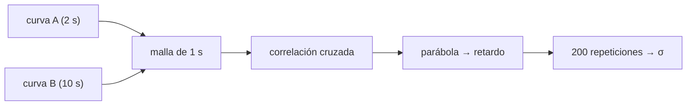

# B34-C09 — Integración multiinstrumento de datos heliofísicos

<!-- nav:top -->
[🏠 Programa](../../../../README.md) · [📚 Bloque B34](../../../tronco-comun/B34-corona-solar-y-erupciones-diagnostico-y-modelos.md) · [← Anterior: B34-C08 — Erupciones de filamentos y prominencias](../B34-C08-erupciones-de-filamentos-y-prominencias/CLASE.md) · [Siguiente: B35-C01 — Funciones de distribución de velocidades en plasmas →](../../../tronco-comun/B35-fisica-avanzada-de-plasmas-y-mhd-espacial.md#b35-c01)
<!-- /nav -->

## 1. Ubicación, nivel y alcance

Clase 9 del bloque B34. Nivel N3. Instrumentos distintos tienen cadencia y retardo distintos. Aquí alineas tres **curvas de luz sintéticas** de una fulguración (cadencias de 2, 10 y 24 s): **remuestreas** a una malla común, calculas la **correlación cruzada** y refinas el retardo con el **vértice de una parábola**, con la incertidumbre por Monte Carlo. Usas [B12](../../../tronco-comun/B12-probabilidad-estadistica-e-incertidumbre.md) y [B34-C07](../B34-C07-comparacion-de-modelos-coronales-con-observaciones/CLASE.md). Los datos son sintéticos.

## 2. Por qué esta clase existe

Combinar instrumentos mal alineados produce conclusiones falsas. La decisión central: **¿cómo se mide el retardo entre dos instrumentos con precisión sub-muestra?**

## 3. Lo que podrás hacer al terminar

1. Remuestrear con interpolación lineal.
2. Calcular la correlación cruzada.
3. Refinar el retardo con una parábola.
4. Estimar la incertidumbre por Monte Carlo.
5. Comparar con el retardo impuesto.
6. Reconocer el sesgo de la interpolación.

La evidencia es la **ficha de la integración multiinstrumento** del ejercicio 12 (sección 20).

## 4. Con qué llegas y cómo comprobarlo

1. ¿Qué es una incertidumbre?
2. ¿Qué es una simulación Monte Carlo?
3. ¿Qué es una tabla de resultados?
4. ¿Qué es un valor ilustrativo?
5. ¿Qué es una verificación?

<details>
<summary>Ver respuestas</summary>

1. Un intervalo en que se espera el valor verdadero. 2. Repetir con números aleatorios de semilla fija. 3. Un resumen ordenado de cálculos. 4. Un valor propuesto para el ejemplo, no medido. 5. Comparar un cálculo con un caso independiente.
</details>

Con cuatro o cinco aciertos, sigue; si no, repasa los prerrequisitos.

## 5. Un caso de contexto y casos de referencia

Con retardos impuestos de `0`, `14` y `−8 s`, los recuperados son `14,56`, `−7,04` y `−21,52 s` para los pares A–B, A–C y B–C, con `σ ≈ 0,4–0,6 s`. Es el **ejemplo conductor**. Todo es **sintético**.

## 6. Vocabulario

La **cadencia**. El **remuestreo**. La **correlación cruzada**. El **retardo**. El **refinamiento sub-muestra**.

## 7. Modelo mental: sincronizar relojes

Dos relojes con distinto tic: se alinean comparando cuándo ocurre el mismo suceso.



*Descripción textual:* las series se llevan a una malla común, se correlacionan y el pico se refina con una parábola; la incertidumbre sale de repetir el ruido.

Analogía: sincronizar relojes. Límite: misma forma y retardo constante.

## 8. La explicación, paso a paso

### 8.1 Retardos recuperados

| par | impuesto (s) | recuperado (s) | correlación | `σ` (200 rep.) (s) |
|---|---|---|---|---|
| A–B | 14,0 | 14,56 | 0,9990 | 0,375 |
| A–C | −8,0 | −7,04 | 0,9965 | 0,571 |
| B–C | −22,0 | −21,52 | 0,9972 | 0,595 |

### 8.2 Lectura

El retardo se recupera dentro de 1 s con instrumentos de cadencia mucho mayor que esa precisión. Hay un sesgo de `≈ 0,5–1 s` que viene de la interpolación lineal de curvas poco muestreadas.

## 9. Magnitudes, símbolos y unidades

| Símbolo | Qué es | Unidad | Valor / nota |
|---|---|---|---|
| cadencia | intervalo entre muestras | s | 2; 10; 24 (ilustrativas) |
| retardo | diferencia temporal | s | ver 8.1 |
| `σ` | incertidumbre | s | 0,4–0,6 |

## 10. Convenciones y referencias

Misma forma y retardo constante; semilla `20261109`; sintético.

## 11. De dónde sale lo que afirmamos

| ID | Fuente | Localizador | Respalda | Estado |
|---|---|---|---|---|
| — | Sin fuente externa | — | relaciones estándar que verifica el laboratorio | No se consultó una fuente para esta clase |

Límites: no se integró ningún instrumento real.

## 12. Cómo ver los retardos

| Par | Recuperado (s) |
|---|---|
| A–B | 14,56 |
| A–C | −7,04 |
| B–C | −21,52 |

Descripción larga: los retardos recuperados difieren menos de 1 s de los impuestos.

## 13. Ejemplo trabajado: retardo A–B

**Paso 1 · Retardos impuestos.** `0` y `14`.

**Paso 2 · Diferencia.** `14 − 0 = 14`.

**Paso 3 · Correlación.** El máximo cae en `14` y la parábola da `14,56`.

**Paso 4 · Error.** `0,56 s`.

## 14. Distintas formas de describir una integración

**Por malla:** remuestreo. **Por pico:** correlación. **Por precisión:** parábola. **Por error:** Monte Carlo.

## 15. Práctica guiada

**Ejercicio 1 · con los pasos indicados.** Retardo B–C impuesto. *Pasos:* diferencia.

<details><summary>Solución comentada</summary>

`−22 s`.
</details>

**Ejercicio 2 · con una pista.** Error de A–B.

<details><summary>Solución comentada</summary>

`0,56 s`.
</details>

**Ejercicio 3 · casi autónomo.** Error de A–C.

<details><summary>Solución comentada</summary>

`0,96 s`.
</details>

## 16. Práctica autónoma, transferencia e integrador

**Ejercicio 4.** Error de B–C.

<details><summary>Solución comentada</summary>

`0,48 s`.
</details>

**Ejercicio 5.** `σ` mayor.

<details><summary>Solución comentada</summary>

`0,595 s` (B–C).
</details>

**Ejercicio 6.** ¿Qué cadencia limita?

<details><summary>Solución comentada</summary>

La más lenta (24 s).
</details>

**Ejercicio 7.** Correlación mínima.

<details><summary>Solución comentada</summary>

`0,9965`.
</details>

**Ejercicio 8.** ¿Qué sesgo hay?

<details><summary>Solución comentada</summary>

Interpolación lineal.
</details>

**Ejercicio 9 · transferencia.** **Transferencia.** Un compañero afirma que los instrumentos reales tienen estos retardos. Responde.

<details><summary>Solución comentada</summary>

Son sintéticos.
</details>

**Ejercicio 10 · transferencia.** **Transferencia.** ¿Qué pasa si las formas difieren?

<details><summary>Solución comentada</summary>

El retardo se sesga.
</details>

**Ejercicio 11 · transferencia.** **Transferencia.** ¿Por qué la parábola?

<details><summary>Solución comentada</summary>

Porque da precisión sub-muestra.
</details>

**Ejercicio 12.** **Integrador.** Elabora tu *ficha de la integración multiinstrumento*: alineación, retardos y errores.

<details><summary>Solución comentada</summary>

Secciones 8.1–8.2.
</details>

**Ejercicio 12 · integrador.** **Integrador.** Elabora tu *ficha de la integración multiinstrumento*: alineación, retardos y errores.

<details><summary>Solución modelo</summary>

Secciones 8.1–8.2.
</details>

## 17. Laboratorio: alineación temporal

El script [multiinstrumento.py](multiinstrumento.py) alinea tres series y estima los retardos (**comprueba** 1,5 s).

**Datos:** sin constantes; series **sintéticas**; semilla `20261109`. Tarda unos 30 s. **Predice antes de ejecutar:** ¿qué precisión tendrá el retardo? (<1 s.) **Ejecución del 2026-11-09 (Python 3.12.9):**

```text
Python 3.12.9 (biblioteca estandar)
par     retardo impuesto [s]  recuperado [s]  correlacion   sigma (200 repeticiones) [s]
A-B                     14.0           14.56       0.9990                          0.375
A-C                     -8.0           -7.04       0.9965                          0.571
B-C                    -22.0          -21.52       0.9972                          0.595
Pruebas superadas.
```

```bash
python programa/clases/B34/B34-C09-integracion-multiinstrumento-de-datos-heliofisicos/multiinstrumento.py
```

**Límites:** misma forma y retardo constante.

## 18. Errores frecuentes y cómo corregirlos

**Correlacionar sin remuestrear.** Se corrige con 8.1.

**Dar el retardo sin error.** Se corrige con 8.1.

**Ignorar las formas distintas.** Se corrige con el ejercicio 10.

**Tomar las series por reales.** Se corrige con la sección 10.

## 19. Cómo sabrás que vas bien

Tras la sección 8: ¿qué resultado esperabas y cuál obtuviste? Si dudas, repasa el ejemplo 13. Tras el laboratorio: ¿qué comprueba? (ver la sección 17).

## 20. Qué entregas y cómo se evalúa

El producto es tu **ficha de la integración multiinstrumento** (ejercicio 12).

| Criterio | Inicial | En desarrollo | Logrado | Destacado |
|---|---|---|---|---|
| Conceptos | Los confunde | Parciales | conceptos de la clase | Explica los límites |
| Cálculo | Sin unidades | Con errores | Tablas completas | Calcula casos nuevos |
| Numérico | Sin comprobar | Un caso | Contraste con el análisis | Interpreta las diferencias |
| Fuentes | Sin fuente | Sin fecha | fuentes con fecha | Declara lo ilustrativo |
| Límites | No los nombra | Uno | Tres | Discute qué falta del modelo |

**Condiciones críticas (no se compensan con promedio):** rotular las series como sintéticas; no alinear instrumentos reales con esto; citar solo lo consultado.

## 21. Ética, seguridad y límites

Clase educativa: los modelos son simplificados. Accesibilidad: tablas equivalentes a las gráficas, fórmulas en texto, ejercicios sin conexión.

## 22. Para cerrar y seguir

Tres series sintéticas con cadencias de 2 a 24 s se alinean con errores menores de 1 s. Con esto cierra el bloque de la corona solar y sus erupciones.

**Glosario español–inglés.** integración multiinstrumento · *multi-instrument integration*; correlación cruzada · *cross-correlation*; remuestreo · *resampling*; retardo · *lag*; cadencia · *cadence*.

**Continuidad.** Es la última clase del bloque; el siguiente trata la física avanzada de plasmas.

**Referencias:** ver sección 11.

<!-- nav:bottom -->
---

[← Anterior: B34-C08 — Erupciones de filamentos y prominencias](../B34-C08-erupciones-de-filamentos-y-prominencias/CLASE.md) · [📚 Bloque B34](../../../tronco-comun/B34-corona-solar-y-erupciones-diagnostico-y-modelos.md) · [Siguiente: B35-C01 — Funciones de distribución de velocidades en plasmas →](../../../tronco-comun/B35-fisica-avanzada-de-plasmas-y-mhd-espacial.md#b35-c01)
<!-- /nav -->
