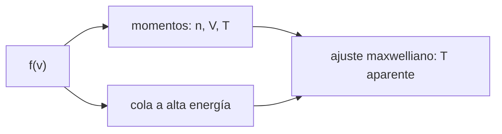

# B35-C01 — Funciones de distribución de velocidades en plasmas

<!-- nav:top -->
[🏠 Programa](../../../../README.md) · [📚 Bloque B35](../../../tronco-comun/B35-fisica-avanzada-de-plasmas-y-mhd-espacial.md) · [← Anterior: B34-C09 — Integración multiinstrumento de datos heliofísicos](../../B34/B34-C09-integracion-multiinstrumento-de-datos-heliofisicos/CLASE.md) · [Siguiente: B35-C02 — Ondas de Alfvén y ondas magnetosónicas →](../B35-C02-ondas-de-alfven-y-ondas-magnetosonicas/CLASE.md)
<!-- /nav -->

## 1. Ubicación, nivel y alcance

Clase 1 del bloque B35. Nivel N3. El plasma no colisional se describe con una **función de distribución** `f(v)` y no con una sola temperatura. Aquí comparas la distribución **maxwelliana** con la **kappa** (de cola supratérmica) en 3D, calculas sus momentos por integración numérica y por Monte Carlo y mides qué pasa si ajustas una maxwelliana a una distribución kappa. Usas [B05](../../../tronco-comun/B05-fisica-fundamental-para-el-espacio.md), [B12](../../../tronco-comun/B12-probabilidad-estadistica-e-incertidumbre.md) y [B30-C08](../../B30/B30-C08-frecuencias-y-ondas-de-plasma/CLASE.md). Todo es sintético.

## 2. Por qué esta clase existe

Los instrumentos miden distribuciones, y casi todas las fórmulas de fluido son momentos de ellas. La decisión central: **¿basta una maxwelliana o hay que conservar la cola?**

## 3. Lo que podrás hacer al terminar

1. Normalizar una distribución y calcular sus momentos.
2. Obtener la rapidez media y la cuadrática de una maxwelliana.
3. Definir la distribución kappa con temperatura cinética `T`.
4. Comparar las colas de ambas.
5. Estimar el sesgo de la temperatura de un ajuste maxwelliano.
6. Verificar un momento por una segunda vía (Monte Carlo).

La evidencia es la **ficha de las distribuciones de velocidad** del ejercicio 12 (sección 20).

## 4. Con qué llegas y cómo comprobarlo

1. ¿Qué es una incertidumbre?
2. ¿Qué es una simulación Monte Carlo?
3. ¿Qué es una tabla de resultados?
4. ¿Qué es un valor ilustrativo?
5. ¿Qué es una verificación?

<details>
<summary>Ver respuestas</summary>

1. Un intervalo en que se espera el valor verdadero. 2. Repetir con números aleatorios de semilla fija. 3. Un resumen ordenado de cálculos. 4. Un valor propuesto para el ejemplo, no medido. 5. Comparar un cálculo con un caso independiente.
</details>

Con cuatro o cinco aciertos, sigue; si no, repasa los prerrequisitos.

## 5. Un caso de contexto y casos de referencia

Para protones de `T = 10⁵ K` la rapidez térmica `v_t = √(k_B T/m_p)` vale `28,730 km/s`; la rapidez media maxwelliana es `1,5958 v_t = 45,85 km/s`. Con una distribución kappa de igual `T` cinética, la densidad de probabilidad a `5 v_t` es `46,3` veces la maxwelliana si `κ = 5`. Es el **ejemplo conductor**; los valores son **ilustrativos**.

## 6. Vocabulario

La **función de distribución** `f(v)` da la densidad en el espacio de velocidades. La **maxwelliana** es la del equilibrio. La **distribución kappa** tiene una cola de ley de potencias y se acerca a la maxwelliana si `κ → ∞`. Un **momento** es la integral de `vⁿ f`. La **rapidez térmica** es `√(k_B T/m)`.

## 7. Modelo mental: una multitud y sus rezagados

Una maxwelliana es una multitud cuyos rezagados se acaban deprisa; la kappa conserva una pequeña fracción de corredores muy rápidos. La media se parece, la cola no.



*Descripción textual:* la distribución produce momentos y una cola; ambos determinan la temperatura aparente de un ajuste.

Analogía: una multitud y sus rezagados. Límite: la kappa de esta clase es isótropa y sin deriva.

## 8. La explicación, paso a paso

### 8.1 Maxwelliana

Con `v` en unidades de `v_t` la maxwelliana 3D es `f = (2π)^(−3/2) exp(−v²/2)`. La integración numérica da `n = 1,000000`, `⟨v²⟩ = 3,000000` y `⟨v⟩ = 1,595769`, igual al valor analítico `√(8/π)`. El Monte Carlo (200 000 muestras, semilla `20261109`) da `⟨v⟩ = 1,5958` y `⟨v²⟩ = 2,9991`: dos vías independientes.

### 8.2 Kappa

La forma usada es `f ∝ (1 + v²/(κθ²))^−(κ+1)` con `θ² = (2κ−3)/κ` (en unidades de `k_B T/m`), de modo que la temperatura cinética sea `T`.

| κ | densidad | `⟨v²⟩/3` | `f_κ/f_M` a 5 `v_t` | `T` del ajuste / `T` |
|---|---|---|---|---|
| 2 | 1,00000 | sin calcular | 97,45 | 0,2906 |
| 3 | 1,00000 | 1,00000 | 86,88 | 0,5492 |
| 5 | 1,00000 | 1,00000 | 46,32 | 0,7385 |
| 10 | 1,00000 | 1,00000 | 15,74 | 0,8723 |
| 100 | 1,00000 | 1,00000 | 1,572 | 0,9875 |

Para `κ = 2` la integral de `v²` converge muy despacio y no se calcula.

### 8.3 Lectura

La temperatura cinética es la misma en todas las filas, pero una maxwelliana que iguala el valor central de la kappa da una temperatura menor (`0,74 T` si `κ = 5`). Para `κ = 100` la diferencia es de `1,3 %`. La cola de la kappa supera a la maxwelliana en un factor creciente cuanto menor es `κ`.

## 9. Magnitudes, símbolos y unidades

| Símbolo | Qué es | Unidad | Valor / nota |
|---|---|---|---|
| `v_t` | rapidez térmica | km/s | 28,730 (a 10⁵ K) |
| `κ` | índice de la distribución kappa | — | 2, 3, 5, 10, 100 |
| `θ²` | parámetro de escala | `k_B T/m` | `(2κ−3)/κ` |
| `⟨v⟩` | rapidez media | `v_t` | 1,5958 |

## 10. Convenciones y referencias

Constantes de NIST CODATA 2022 consultadas el 2026-11-09 (`k_B`, `m_p`). La distribución kappa se define aquí con temperatura cinética `T`; otras convenciones usan otra escala `θ`. Temperatura del ajuste: se igualó el valor en `v = 0`.

## 11. De dónde sale lo que afirmamos

| ID | Fuente | Localizador | Respalda | Estado |
|---|---|---|---|---|
| S1 | NIST, *Fundamental Physical Constants* (CODATA 2022) | https://physics.nist.gov/cuu/Constants/Table/allascii.txt | `k_B`, `m_p`, `m_e`, `e`, `ε₀`, `μ₀` según la clase | Consultada el 2026-11-09 |
| S2 | arXiv:1610.01777 (Nicolaou y Livadiotis) | https://arxiv.org/abs/1610.01777 | ajustar una maxwelliana a datos kappa puede estimar mal la temperatura, según el índice kappa | Solo resumen, consultado el 2026-11-09 |

Límites: del artículo solo se leyó el resumen; las cifras de la tabla son de este laboratorio y no de ese trabajo.

## 12. Cómo ver los resultados

| Magnitud | Valor |
|---|---|
| `v_t` a 10⁵ K | 28,730 km/s |
| `⟨v⟩` maxwelliana | 1,5958 `v_t` |
| cola `κ = 5` a 5 `v_t` | 46,3 veces |
| `T` del ajuste, `κ = 5` | 0,7385 `T` |

Descripción larga: el ajuste maxwelliano subestima la temperatura y el defecto crece al bajar `κ`.

## 13. Ejemplo trabajado: la rapidez térmica

**Paso 1 · Cociente.** `k_B T/m_p = 1,380649×10⁻²³ × 10⁵ / 1,6726219×10⁻²⁷`.

**Paso 2 · Valor.** `8,2545×10⁸ m²/s²`.

**Paso 3 · Raíz.** `28 730 m/s = 28,730 km/s`.

**Paso 4 · Rapidez media.** `1,5958 × 28,730 = 45,85 km/s`.

## 14. Distintas formas de describir una distribución

**Por fórmula:** maxwelliana y kappa. **Por tabla:** momentos. **Por cola:** cociente `f_κ/f_M`. **Por muestra:** Monte Carlo.

## 15. Práctica guiada

**Ejercicio 1 · con los pasos indicados.** `v_t` para `T = 10⁵ K`. *Pasos:* `√(k_B T/m_p)`.

<details><summary>Solución comentada</summary>

`28,73 km/s`.
</details>

**Ejercicio 2 · con una pista.** Rapidez media maxwelliana en km/s.

<details><summary>Solución comentada</summary>

`1,5958 × 28,73 = 45,85 km/s`.
</details>

**Ejercicio 3 · casi autónomo.** `T` del ajuste maxwelliano a una kappa con `κ = 5`, si `T = 10⁵ K`.

<details><summary>Solución comentada</summary>

`0,7385 × 10⁵ = 7,4×10⁴ K`.
</details>

## 16. Práctica autónoma, transferencia e integrador

**Ejercicio 4.** Cola `κ = 3` a `5 v_t`.

<details><summary>Solución comentada</summary>

`86,88` veces.
</details>

**Ejercicio 5.** ¿Hacia qué distribución tiende la kappa si `κ → ∞`?

<details><summary>Solución comentada</summary>

A la maxwelliana (`κ = 100`: `0,9875`).
</details>

**Ejercicio 6.** `θ²` para `κ = 5`.

<details><summary>Solución comentada</summary>

`(10−3)/5 = 1,4`.
</details>

**Ejercicio 7.** Error relativo del Monte Carlo en `⟨v²⟩`.

<details><summary>Solución comentada</summary>

`(3−2,9991)/3 = 0,03 %`.
</details>

**Ejercicio 8.** ¿Por qué se exige `κ > 3/2`?

<details><summary>Solución comentada</summary>

Para que `2κ−3 > 0` y `θ²` sea positivo.
</details>

**Ejercicio 9 · transferencia.** **Transferencia.** Un colega dice que su temperatura maxwelliana es la cinética. Responde.

<details><summary>Solución comentada</summary>

Solo si la distribución es maxwelliana; con cola, subestima.
</details>

**Ejercicio 10 · transferencia.** **Transferencia.** ¿Qué ocurre con la densidad al cambiar `κ`?

<details><summary>Solución comentada</summary>

Nada: se normaliza a 1 (tabla 8.2).
</details>

**Ejercicio 11 · transferencia.** **Transferencia.** ¿Se usó alguna medición de una nave?

<details><summary>Solución comentada</summary>

No: todo es sintético.
</details>

**Ejercicio 12.** **Integrador.** Elabora tu *ficha de las distribuciones de velocidad*: momentos, colas y temperatura aparente.

<details><summary>Solución comentada</summary>

Secciones 8.1–8.3.
</details>

**Ejercicio 12 · integrador.** **Integrador.** Elabora tu *ficha de las distribuciones de velocidad*: momentos, colas y temperatura aparente.

<details><summary>Solución modelo</summary>

Secciones 8.1–8.3.
</details>

## 17. Laboratorio: distribuciones maxwelliana y kappa

El script [distribuciones.py](distribuciones.py) integra los momentos, los verifica por Monte Carlo y mide la temperatura aparente (**comprueba** densidad 1, `⟨v²⟩ = 3` y la cola creciente).

**Datos:** `k_B` y `m_p` de NIST (consultados el 2026-11-09); temperatura e índices **ilustrativos**; semilla `20261109`. **Predice antes de ejecutar:** ¿cuánto vale `⟨v⟩` en unidades de `v_t`? (`1,5958`.) **Ejecución del 2026-11-09 (Python 3.12.9):**

```text
Python 3.12.9 (biblioteca estandar)
v_t = sqrt(kT/m) = 28.730 km/s para T = 1e+05 K
Maxwell: n = 1.000000 ; <v^2> = 3.000000 (esperado 3) ; <v> = 1.595769 (analitico 1.595769)
Monte Carlo (N = 200000): <v> = 1.5958 ; <v^2> = 2.9991
 kappa         n   <v^2>/3  f(5 vt)/fM(5 vt)  T_ajuste/T
     2   1.00000       nan             97.45      0.2906
     3   1.00000   1.00000             86.88      0.5492
     5   1.00000   1.00000             46.32      0.7385
    10   1.00000   1.00000             15.74      0.8723
   100   1.00000   1.00000             1.572      0.9875
Pruebas superadas.
```

```bash
python programa/clases/B35/B35-C01-funciones-de-distribucion-de-velocidades-en-plasmas/distribuciones.py
```

**Límites:** plasma isótropo y sin deriva.

## 18. Errores frecuentes y cómo corregirlos

**Confundir la temperatura del ajuste con la cinética.** Se corrige con 8.2.

**Usar `κ ≤ 3/2`.** Se corrige con el ejercicio 8.

**Olvidar la cola.** Se corrige con 8.3.

**Presentar lo sintético como medición.** Se corrige con la sección 10.

## 19. Cómo sabrás que vas bien

Tras la sección 8: ¿qué resultado esperabas y cuál obtuviste? Si dudas, repasa el ejemplo 13. Tras el laboratorio: ¿qué comprueba? (ver la sección 17).

## 20. Qué entregas y cómo se evalúa

El producto es tu **ficha de las distribuciones de velocidad** (ejercicio 12).

| Criterio | Inicial | En desarrollo | Logrado | Destacado |
|---|---|---|---|---|
| Conceptos | Los confunde | Parciales | conceptos de la clase | Explica los límites |
| Cálculo | Sin unidades | Con errores | Tablas completas | Calcula casos nuevos |
| Numérico | Sin comprobar | Un caso | Contraste con el análisis | Interpreta las diferencias |
| Fuentes | Sin fuente | Sin fecha | fuentes con fecha | Declara lo ilustrativo |
| Límites | No los nombra | Uno | Tres | Discute qué falta del modelo |

**Condiciones críticas (no se compensan con promedio):** rotular lo sintético; no tomar la distribución como medición de una nave; citar solo lo consultado.

## 21. Ética, seguridad y límites

Clase educativa: los modelos son simplificados. Accesibilidad: tablas equivalentes a las gráficas, fórmulas en texto, ejercicios sin conexión.

## 22. Para cerrar y seguir

La maxwelliana y la kappa comparten la temperatura cinética pero no la cola, y el ajuste maxwelliano subestima la temperatura. Queda una pregunta: ¿cómo se propagan las perturbaciones en ese plasma?

**Glosario español–inglés.** función de distribución · *distribution function*; cola · *tail*; momento · *moment*; rapidez térmica · *thermal speed*; supratérmico · *suprathermal*.

**Continuidad.** [B35-C02](../B35-C02-ondas-de-alfven-y-ondas-magnetosonicas/CLASE.md) estudia las ondas de Alfvén y magnetosónicas.

**Referencias:** ver sección 11.

<!-- nav:bottom -->
---

[← Anterior: B34-C09 — Integración multiinstrumento de datos heliofísicos](../../B34/B34-C09-integracion-multiinstrumento-de-datos-heliofisicos/CLASE.md) · [📚 Bloque B35](../../../tronco-comun/B35-fisica-avanzada-de-plasmas-y-mhd-espacial.md) · [Siguiente: B35-C02 — Ondas de Alfvén y ondas magnetosónicas →](../B35-C02-ondas-de-alfven-y-ondas-magnetosonicas/CLASE.md)
<!-- /nav -->
