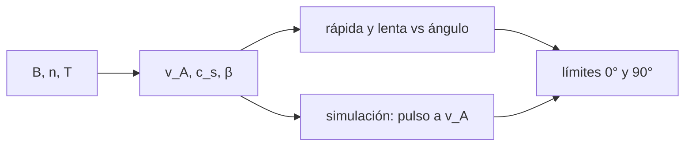

# B35-C02 — Ondas de Alfvén y ondas magnetosónicas

<!-- nav:top -->
[🏠 Programa](../../../../README.md) · [📚 Bloque B35](../../../tronco-comun/B35-fisica-avanzada-de-plasmas-y-mhd-espacial.md) · [← Anterior: B35-C01 — Funciones de distribución de velocidades en plasmas](../B35-C01-funciones-de-distribucion-de-velocidades-en-plasmas/CLASE.md) · [Siguiente: B35-C03 — Inestabilidades de plasma: cinéticas y de fluido →](../B35-C03-inestabilidades-de-plasma-cineticas-y-de-fluido/CLASE.md)
<!-- /nav -->

## 1. Ubicación, nivel y alcance

Clase 2 del bloque B35. Nivel N3. Las ondas MHD transportan perturbaciones en el plasma magnetizado. Aquí calculas la **velocidad de Alfvén**, la **del sonido** y las velocidades de fase **rápida** y **lenta** en función del ángulo, y compruebas la de Alfvén con una **simulación** de la ecuación de ondas. Usas [B05](../../../tronco-comun/B05-fisica-fundamental-para-el-espacio.md), [B30-C09](../../B30/B30-C09-magnetohidrodinamica/CLASE.md) y [B35-C04](../B35-C04-colisiones-regimen-cinetico-y-ecuacion-de-vlasov/CLASE.md) para el contexto cinético. Los parámetros del plasma son ilustrativos.

## 2. Por qué esta clase existe

Las ondas fijan los tiempos de respuesta del plasma y los modos de las fronteras. La decisión central: **¿qué modo y a qué velocidad viaja una perturbación según su dirección?**

## 3. Lo que podrás hacer al terminar

1. Calcular `v_A`, `c_s` y `β` desde `B`, `n` y `T`.
2. Obtener las velocidades de fase rápida y lenta.
3. Reconocer los límites a 0° y 90°.
4. Simular una onda de Alfvén y medir su velocidad.
5. Comparar la medida con `v_A`.
6. Reconocer los límites de la MHD ideal.

La evidencia es la **ficha de las ondas MHD** del ejercicio 12 (sección 20).

## 4. Con qué llegas y cómo comprobarlo

1. ¿Qué es una incertidumbre?
2. ¿Qué es una simulación Monte Carlo?
3. ¿Qué es una tabla de resultados?
4. ¿Qué es un valor ilustrativo?
5. ¿Qué es una verificación?

<details>
<summary>Ver respuestas</summary>

1. Un intervalo en que se espera el valor verdadero. 2. Repetir con números aleatorios de semilla fija. 3. Un resumen ordenado de cálculos. 4. Un valor propuesto para el ejemplo, no medido. 5. Comparar un cálculo con un caso independiente.
</details>

Con cuatro o cinco aciertos, sigue; si no, repasa los prerrequisitos.

## 5. Un caso de contexto y casos de referencia

Con `n = 5 cm⁻³`, `B = 5 nT` y `T = 10⁵ K` (ilustrativos) resulta `v_A = 48,77 km/s`, `c_s = 52,45 km/s` y `β = 1,388`. La simulación mueve un pulso con `0,99984 v_A`. Es el **ejemplo conductor**.

## 6. Vocabulario

La **velocidad de Alfvén** es `B/√(μ₀ρ)`. La **velocidad del sonido** es `√(γp/ρ)`. El modo **rápido** y el **lento** son las dos ondas magnetosónicas. `β` es la razón entre presión térmica y magnética. La **onda de Alfvén** es transversal y no comprime.

## 7. Modelo mental: una cuerda tensa

El campo magnético se comporta como una cuerda tensa cargada con masa: tirar de ella a un lado produce una onda transversal que viaja a `v_A`.



*Descripción textual:* los parámetros fijan las velocidades; la teoría y la simulación se contrastan.

Analogía: una cuerda tensa. Límite: MHD ideal, plasma uniforme y amplitud pequeña.

## 8. La explicación, paso a paso

### 8.1 Velocidades

`v_A = 48,77 km/s`, `c_s = 52,45 km/s`, `β = 1,388`.

### 8.2 Fase según el ángulo con el campo

| ángulo (grados) | rápida (km/s) | Alfvén (km/s) | lenta (km/s) |
|---|---|---|---|
| 0 | 52,45 | 48,77 | 48,77 |
| 30 | 62,11 | 42,24 | 35,67 |
| 60 | 69,20 | 24,39 | 18,49 |
| 90 | 71,63 | 0,00 | 0,00 |

A 0° la rápida es la mayor entre `v_A` y `c_s` y la lenta la menor. A 90° la rápida es `√(c_s² + v_A²) = 71,63 km/s` y la lenta se anula.

### 8.3 Simulación

La ecuación de onda transversal con salto de rana (CFL `0,5`, 800 celdas) desplaza un pulso gaussiano `0,39993` en `t = 0,4` (unidades de `v_A`): `v_medida/v_A = 0,99984` y amplitud `1,0000`.

### 8.4 Lectura

La simulación reproduce la velocidad de Alfvén con `0,016 %` de error. El esquema es no dispersivo para este ancho de pulso. La MHD ideal no incluye los efectos cinéticos de la clase C04.

## 9. Magnitudes, símbolos y unidades

| Símbolo | Qué es | Unidad | Valor / nota |
|---|---|---|---|
| `v_A` | velocidad de Alfvén | km/s | 48,77 |
| `c_s` | velocidad del sonido | km/s | 52,45 |
| `β` | presión térmica / magnética | — | 1,388 |
| `θ` | ángulo entre `k` y `B` | grados | 0, 30, 60, 90 |

## 10. Convenciones y referencias

`μ₀`, `m_p` y `k_B` de NIST CODATA 2022 (consultados el 2026-11-09). Presión térmica de protones y electrones con la misma temperatura; `γ = 5/3`. La relación de dispersión de los modos magnetosónicos es la estándar de la MHD ideal (no consultada).

## 11. De dónde sale lo que afirmamos

| ID | Fuente | Localizador | Respalda | Estado |
|---|---|---|---|---|
| S1 | NIST, *Fundamental Physical Constants* (CODATA 2022) | https://physics.nist.gov/cuu/Constants/Table/allascii.txt | `k_B`, `m_p`, `m_e`, `e`, `ε₀`, `μ₀` según la clase | Consultada el 2026-11-09 |

Límites: la relación de dispersión es estándar y no se consultó una fuente; los parámetros del plasma son ilustrativos.

## 12. Cómo ver las velocidades

| Magnitud | Valor |
|---|---|
| `v_A` | 48,77 km/s |
| `c_s` | 52,45 km/s |
| rápida a 90° | 71,63 km/s |
| simulación | 0,99984 `v_A` |

Descripción larga: la rápida crece con el ángulo y la lenta y la de Alfvén decrecen.

## 13. Ejemplo trabajado: la velocidad de Alfvén

**Paso 1 · Densidad.** `ρ = 5×10⁶ × 1,6726×10⁻²⁷ = 8,363×10⁻²¹ kg/m³`.

**Paso 2 · Producto.** `μ₀ρ = 1,0509×10⁻²⁶`.

**Paso 3 · Raíz.** `1,0251×10⁻¹³`.

**Paso 4 · Cociente.** `5×10⁻⁹ / 1,0251×10⁻¹³ = 4,877×10⁴ m/s = 48,77 km/s`.

## 14. Distintas formas de describir una onda

**Por fórmula:** `v_A` y los modos. **Por tabla:** velocidad según el ángulo. **Por simulación:** desplazamiento del pulso. **Por analogía:** cuerda tensa.

## 15. Práctica guiada

**Ejercicio 1 · con los pasos indicados.** `v_A` con `B = 5 nT` y `n = 5 cm⁻³`. *Pasos:* `B/√(μ₀ρ)`.

<details><summary>Solución comentada</summary>

`48,77 km/s`.
</details>

**Ejercicio 2 · con una pista.** `β` del plasma.

<details><summary>Solución comentada</summary>

`1,388`.
</details>

**Ejercicio 3 · casi autónomo.** Velocidad rápida a 90°. *Pista:* `√(c_s² + v_A²)`.

<details><summary>Solución comentada</summary>

`71,63 km/s`.
</details>

## 16. Práctica autónoma, transferencia e integrador

**Ejercicio 4.** Velocidad de Alfvén a 60°.

<details><summary>Solución comentada</summary>

`48,77 × 0,5 = 24,39 km/s`.
</details>

**Ejercicio 5.** Error relativo de la simulación.

<details><summary>Solución comentada</summary>

`1 − 0,99984 = 1,6×10⁻⁴`.
</details>

**Ejercicio 6.** `v_A` si se duplica `B`.

<details><summary>Solución comentada</summary>

`97,5 km/s`.
</details>

**Ejercicio 7.** `β` si se duplica `B`.

<details><summary>Solución comentada</summary>

Baja a la cuarta parte: `0,347`.
</details>

**Ejercicio 8.** Velocidad lenta a 30°.

<details><summary>Solución comentada</summary>

`35,67 km/s`.
</details>

**Ejercicio 9 · transferencia.** **Transferencia.** Un colega dice que las ondas de Alfvén comprimen el plasma. Responde.

<details><summary>Solución comentada</summary>

Son transversales e incompresibles.
</details>

**Ejercicio 10 · transferencia.** **Transferencia.** ¿Qué cambia si el campo es mayor?

<details><summary>Solución comentada</summary>

`v_A` crece y `β` baja.
</details>

**Ejercicio 11 · transferencia.** **Transferencia.** ¿Se midió algún plasma real?

<details><summary>Solución comentada</summary>

No: parámetros ilustrativos.
</details>

**Ejercicio 12.** **Integrador.** Elabora tu *ficha de las ondas MHD*: velocidades, ángulo y simulación.

<details><summary>Solución comentada</summary>

Secciones 8.1–8.4.
</details>

**Ejercicio 12 · integrador.** **Integrador.** Elabora tu *ficha de las ondas MHD*: velocidades, ángulo y simulación.

<details><summary>Solución modelo</summary>

Secciones 8.1–8.4.
</details>

## 17. Laboratorio: ondas MHD

El script [ondas_mhd.py](ondas_mhd.py) calcula las velocidades de fase y simula un pulso de Alfvén (**comprueba** los límites 0° y 90° y la velocidad medida).

**Datos:** `μ₀`, `m_p`, `k_B` de NIST (2026-11-09); plasma **ilustrativo**. **Predice antes de ejecutar:** ¿qué velocidad medirás en unidades de `v_A`? (cerca de 1.) **Ejecución del 2026-11-09 (Python 3.12.9):**

```text
Python 3.12.9 (biblioteca estandar)
vA = 48.77 km/s ; cs = 52.45 km/s ; beta = 1.388
th [grados]  rapida [km/s]  Alfven [km/s]  lenta [km/s]
          0          52.45          48.77         48.77
         30          62.11          42.24         35.67
         60          69.20          24.39         18.49
         90          71.63           0.00          0.00
Simulacion: t = 0.4000 ; desplazamiento = 0.39993 ; v_medida/vA = 0.99984 ; amplitud = 1.0000
Pruebas superadas.
```

```bash
python programa/clases/B35/B35-C02-ondas-de-alfven-y-ondas-magnetosonicas/ondas_mhd.py
```

**Límites:** uniforme, ideal, amplitud pequeña.

## 18. Errores frecuentes y cómo corregirlos

**Olvidar el ángulo.** Se corrige con 8.2.

**Usar `c_s` sin `γ`.** Se corrige con la sección 10.

**Creer que la lenta se propaga a 90°.** Se corrige con 8.2.

**Presentar lo ilustrativo como medición.** Se corrige con la sección 10.

## 19. Cómo sabrás que vas bien

Tras la sección 8: ¿qué resultado esperabas y cuál obtuviste? Si dudas, repasa el ejemplo 13. Tras el laboratorio: ¿qué comprueba? (ver la sección 17).

## 20. Qué entregas y cómo se evalúa

El producto es tu **ficha de las ondas MHD** (ejercicio 12).

| Criterio | Inicial | En desarrollo | Logrado | Destacado |
|---|---|---|---|---|
| Conceptos | Los confunde | Parciales | conceptos de la clase | Explica los límites |
| Cálculo | Sin unidades | Con errores | Tablas completas | Calcula casos nuevos |
| Numérico | Sin comprobar | Un caso | Contraste con el análisis | Interpreta las diferencias |
| Fuentes | Sin fuente | Sin fecha | fuentes con fecha | Declara lo ilustrativo |
| Límites | No los nombra | Uno | Tres | Discute qué falta del modelo |

**Condiciones críticas (no se compensan con promedio):** rotular el plasma como ilustrativo; no presentar el modelo como medición; citar solo lo consultado.

## 21. Ética, seguridad y límites

Clase educativa: los modelos son simplificados. Accesibilidad: tablas equivalentes a las gráficas, fórmulas en texto, ejercicios sin conexión.

## 22. Para cerrar y seguir

Las velocidades de fase dependen del ángulo y la simulación confirma la de Alfvén. Queda una pregunta: ¿cuándo crece una perturbación en lugar de propagarse?

**Glosario español–inglés.** onda de Alfvén · *Alfvén wave*; modo rápido · *fast mode*; modo lento · *slow mode*; beta · *beta*; velocidad de fase · *phase speed*.

**Continuidad.** [B35-C03](../B35-C03-inestabilidades-de-plasma-cineticas-y-de-fluido/CLASE.md) estudia las inestabilidades.

**Referencias:** ver sección 11.

<!-- nav:bottom -->
---

[← Anterior: B35-C01 — Funciones de distribución de velocidades en plasmas](../B35-C01-funciones-de-distribucion-de-velocidades-en-plasmas/CLASE.md) · [📚 Bloque B35](../../../tronco-comun/B35-fisica-avanzada-de-plasmas-y-mhd-espacial.md) · [Siguiente: B35-C03 — Inestabilidades de plasma: cinéticas y de fluido →](../B35-C03-inestabilidades-de-plasma-cineticas-y-de-fluido/CLASE.md)
<!-- /nav -->
