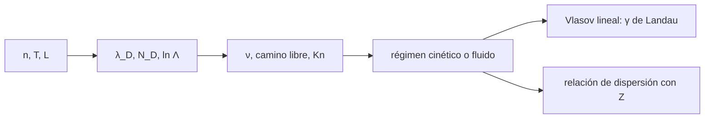

# B35-C04 — Colisiones, régimen cinético y ecuación de Vlasov

<!-- nav:top -->
[🏠 Programa](../../../../README.md) · [📚 Bloque B35](../../../tronco-comun/B35-fisica-avanzada-de-plasmas-y-mhd-espacial.md) · [← Anterior: B35-C03 — Inestabilidades de plasma: cinéticas y de fluido](../B35-C03-inestabilidades-de-plasma-cineticas-y-de-fluido/CLASE.md) · [Siguiente: B35-C05 — Simulación de plasmas por partículas (PIC) →](../B35-C05-simulacion-de-plasmas-por-particulas-pic/CLASE.md)
<!-- /nav -->

## 1. Ubicación, nivel y alcance

Clase 4 del bloque B35. Nivel N3. Cuando las colisiones son raras la descripción de fluido falla y hay que usar la **ecuación de Vlasov**. Aquí calculas la longitud de Debye, el parámetro de plasma y el **camino libre medio** de tres plasmas, y reproduces el **amortiguamiento de Landau** integrando la ecuación de Vlasov linealizada y resolviendo la relación de dispersión. Usas [B05](../../../tronco-comun/B05-fisica-fundamental-para-el-espacio.md), [B35-C03](../B35-C03-inestabilidades-de-plasma-cineticas-y-de-fluido/CLASE.md) y [B30-C08](../../B30/B30-C08-frecuencias-y-ondas-de-plasma/CLASE.md). Las densidades y temperaturas son ilustrativas.

## 2. Por qué esta clase existe

Saber si un plasma es colisional decide qué modelo usar. La decisión central: **¿es el camino libre medio mayor o menor que la escala del problema?**

## 3. Lo que podrás hacer al terminar

1. Calcular `λ_D`, `N_D` y `ln Λ`.
2. Estimar la frecuencia de colisión y el camino libre.
3. Clasificar un plasma por su número de Knudsen.
4. Integrar la ecuación de Vlasov linealizada.
5. Resolver la relación de dispersión con la función `Z`.
6. Comparar la tasa de Landau de ambas vías.

La evidencia es la **ficha del régimen cinético** del ejercicio 12 (sección 20).

## 4. Con qué llegas y cómo comprobarlo

1. ¿Qué es una incertidumbre?
2. ¿Qué es una simulación Monte Carlo?
3. ¿Qué es una tabla de resultados?
4. ¿Qué es un valor ilustrativo?
5. ¿Qué es una verificación?

<details>
<summary>Ver respuestas</summary>

1. Un intervalo en que se espera el valor verdadero. 2. Repetir con números aleatorios de semilla fija. 3. Un resumen ordenado de cálculos. 4. Un valor propuesto para el ejemplo, no medido. 5. Comparar un cálculo con un caso independiente.
</details>

Con cuatro o cinco aciertos, sigue; si no, repasa los prerrequisitos.

## 5. Un caso de contexto y casos de referencia

Para el viento solar a 1 au (`n = 5 cm⁻³`, `T = 10⁵ K`) el camino libre medio de Coulomb es `8,3×10¹⁰ m` (`Kn = 0,55` frente a 1 au), mientras que en la ionosfera F es `83 m`. Para `k λ_D = 0,5` la raíz es `ω = 1,41566 − 0,15336 i ω_p` y la simulación da `γ = −0,15378`. Es el **ejemplo conductor**; los plasmas son ilustrativos.

## 6. Vocabulario

La **longitud de Debye** `λ_D` es la escala de apantallamiento. El **parámetro de plasma** `N_D` es el número de partículas en una esfera de Debye. El **camino libre medio** `λ = v_t/ν`. El **número de Knudsen** `Kn = λ/L`. **Vlasov** es la ecuación sin colisiones. El **amortiguamiento de Landau** es la pérdida sin colisiones de una onda.

## 7. Modelo mental: una autopista sin choques

En una autopista vacía los autos casi no chocan; el flujo se describe por la velocidad de cada uno y no por una densidad media. El amortiguamiento de Landau es el intercambio de energía con los autos que van casi a la velocidad de la onda.



*Descripción textual:* los parámetros fijan el régimen; en el régimen cinético la tasa de Landau se obtiene por dos vías.

Analogía: una autopista sin choques. Límite: el plasma es de electrones con iones inmóviles y amplitud pequeña.

## 8. La explicación, paso a paso

### 8.1 Régimen

| plasma | `λ_D` (m) | `N_D` | `ln Λ` | `ν` (1/s) | camino libre (m) | `Kn` |
|---|---|---|---|---|---|---|
| viento solar, L = 1 au | 9,759 | 1,95×10¹⁰ | 25,89 | 1,487×10⁻⁵ | 8,278×10¹⁰ | 0,5533 |
| ionosfera F, L = 10⁵ m | 2,182×10⁻³ | 4,35×10⁴ | 12,88 | 1480 | 83,2 | 8,32×10⁻⁴ |
| descarga, L = 0,1 m | 1,051×10⁻⁶ | 486 | 8,38 | 8,62×10⁸ | 6,88×10⁻⁴ | 6,88×10⁻³ |

La frecuencia es la de Spitzer, escrita en el laboratorio sin consultar una fuente. Su coeficiente práctico `2,906×10⁻⁶ s⁻¹` coincide con el valor recordado `2,9×10⁻⁶` (no consultado) dentro del 3 %.

### 8.2 Landau

La relación de dispersión da `ω = 1,41566 − 0,15336 i`. La ecuación de Vlasov linealizada (321 puntos en velocidad, paso `0,02`, hasta `t = 22`) da el módulo del campo en sus picos:

| `t` (1/ω_p) | `E` en el pico |
|---|---|
| 2,50 | 1,0113×10⁻³ |
| 6,96 | 5,0287×10⁻⁴ |
| 11,40 | 2,5459×10⁻⁴ |
| 15,84 | 1,2890×10⁻⁴ |
| 20,28 | 6,5257×10⁻⁵ |

El ajuste de los nueve picos da `γ = −0,15378` y `ω_r = 1,4135`: errores de `0,3 %` y `0,15 %` frente a la raíz.

### 8.3 Lectura

Con `Kn` de orden 1, como en el viento solar, hay que usar la descripción cinética; con `Kn ≪ 1`, como en la ionosfera de este ejemplo, el fluido suele bastar. El amortiguamiento ocurre sin ninguna colisión.

## 9. Magnitudes, símbolos y unidades

| Símbolo | Qué es | Unidad | Valor / nota |
|---|---|---|---|
| `λ_D` | longitud de Debye | m | 9,759 (viento solar) |
| `N_D` | partículas por esfera de Debye | — | 1,95×10¹⁰ |
| `Kn` | camino libre / escala | — | 0,5533 |
| `γ` | tasa de Landau | `ω_p` | −0,1534 |

## 10. Convenciones y referencias

`k_B`, `e`, `m_e` y `ε₀` de NIST CODATA 2022 (consultados el 2026-11-09). La unidad astronómica `1,495978707×10¹¹ m` es un valor recordado, no consultado en esta clase. Unidades normalizadas en Vlasov (`ω_p = 1`, `v_t = 1`).

## 11. De dónde sale lo que afirmamos

| ID | Fuente | Localizador | Respalda | Estado |
|---|---|---|---|---|
| S1 | NIST, *Fundamental Physical Constants* (CODATA 2022) | https://physics.nist.gov/cuu/Constants/Table/allascii.txt | `k_B`, `m_p`, `m_e`, `e`, `ε₀`, `μ₀` según la clase | Consultada el 2026-11-09 |
| S2 | arXiv:2303.12620 (Finn y otros) | https://arxiv.org/abs/2303.12620 | simulación de Landau con PIC contrastada con la relación de dispersión completa y con Vlasov-Poisson | Solo resumen, consultado el 2026-11-09 |

Límites: del artículo solo se leyó el resumen; la fórmula de Spitzer y la relación de dispersión son estándar y no se consultó una fuente.

## 12. Cómo ver el régimen

| Magnitud | Valor |
|---|---|
| camino libre, viento solar | 8,3×10¹⁰ m |
| `Kn` viento solar | 0,55 |
| `γ` de Landau | −0,1534 `ω_p` |
| `γ` simulada | −0,1538 `ω_p` |

Descripción larga: el viento solar es poco colisional y el campo se amortigua sin colisiones.

## 13. Ejemplo trabajado: la tasa entre dos picos

**Paso 1 · Cociente.** `1,8115×10⁻⁴ / 2,5459×10⁻⁴ = 0,7115`.

**Paso 2 · Logaritmo.** `ln 0,7115 = −0,3404`.

**Paso 3 · Intervalo.** `13,62 − 11,40 = 2,22`.

**Paso 4 · Tasa.** `−0,3404/2,22 = −0,1533`.

## 14. Distintas formas de describir el régimen

**Por escala:** `Kn`. **Por tabla:** `λ_D`, `N_D`, `ν`. **Por onda:** `γ` de Landau. **Por analogía:** autopista sin choques.

## 15. Práctica guiada

**Ejercicio 1 · con los pasos indicados.** `Kn` del viento solar. *Pasos:* `8,278×10¹⁰ / 1,496×10¹¹`.

<details><summary>Solución comentada</summary>

`0,553`.
</details>

**Ejercicio 2 · con una pista.** `γ` entre los picos de `t = 11,40` y `13,62`.

<details><summary>Solución comentada</summary>

`−0,1533`.
</details>

**Ejercicio 3 · casi autónomo.** Error relativo de la `γ` simulada frente a la raíz.

<details><summary>Solución comentada</summary>

`(0,15378−0,15336)/0,15336 = 0,3 %`.
</details>

## 16. Práctica autónoma, transferencia e integrador

**Ejercicio 4.** Camino libre en la ionosfera F.

<details><summary>Solución comentada</summary>

`83,2 m`.
</details>

**Ejercicio 5.** ¿Cuál de los tres plasmas es más colisional?

<details><summary>Solución comentada</summary>

La descarga (`Kn = 6,9×10⁻³`).
</details>

**Ejercicio 6.** `N_D` del viento solar, ¿es un plasma ideal?

<details><summary>Solución comentada</summary>

Sí: `N_D ≫ 1`.
</details>

**Ejercicio 7.** Coeficiente práctico de `ν`.

<details><summary>Solución comentada</summary>

`2,906×10⁻⁶ s⁻¹`.
</details>

**Ejercicio 8.** ¿Por qué la ecuación de Vlasov no tiene colisiones?

<details><summary>Solución comentada</summary>

Describe un plasma de partículas que solo interactúan por el campo medio.
</details>

**Ejercicio 9 · transferencia.** **Transferencia.** Un colega dice que Landau es una colisión. Responde.

<details><summary>Solución comentada</summary>

Es un intercambio resonante sin colisiones.
</details>

**Ejercicio 10 · transferencia.** **Transferencia.** ¿Qué limita la malla en velocidad?

<details><summary>Solución comentada</summary>

El tiempo de recurrencia `2π/(k Δv)`.
</details>

**Ejercicio 11 · transferencia.** **Transferencia.** ¿Qué parte es medición real?

<details><summary>Solución comentada</summary>

Ninguna: los plasmas son ilustrativos.
</details>

**Ejercicio 12.** **Integrador.** Elabora tu *ficha del régimen cinético*: parámetros, `Kn` y Landau.

<details><summary>Solución comentada</summary>

Secciones 8.1–8.3.
</details>

**Ejercicio 12 · integrador.** **Integrador.** Elabora tu *ficha del régimen cinético*: parámetros, `Kn` y Landau.

<details><summary>Solución modelo</summary>

Secciones 8.1–8.3.
</details>

## 17. Laboratorio: régimen cinético y Landau

El script [vlasov.py](vlasov.py) calcula los parámetros de tres plasmas e integra Vlasov linealizado (**comprueba** `γ` y `ω_r` frente a la raíz de la relación de dispersión).

**Datos:** constantes de NIST (2026-11-09); plasmas **ilustrativos**; au recordada. **Predice antes de ejecutar:** ¿cuánto valdrá `γ` de Landau? (cerca de −0,153.) **Ejecución del 2026-11-09 (Python 3.12.9):**

```text
Python 3.12.9 (biblioteca estandar)
        plasma  lambda_D [m]        N_D    lnL    nu [1/s]  camino [m]  Kn=lambda/L
  viento solar         9.759   1.95e+10  25.89   1.487e-05   8.278e+10       0.5533
   ionosfera F      0.002182   4.35e+04  12.88        1480        83.2     0.000832
  descarga lab     1.051e-06        486   8.38    8.62e+08   0.0006879     0.006879
coeficiente practico = 2.906e-06 s^-1 (referencia recordada, no consultada: 2.9e-6)
relacion de dispersion (k lD = 0.5): omega = 1.41566 -0.15336 i wp
 t_pico [1/wp]     |E| pico
          2.50   1.0113e-03
          4.74   7.0763e-04
          6.96   5.0287e-04
          9.18   3.5781e-04
         11.40   2.5459e-04
         13.62   1.8115e-04
         15.84   1.2890e-04
         18.06   9.1714e-05
         20.28   6.5257e-05
simulacion: gamma = -0.15378 ; omega_r = 1.4135  (raiz: -0.15336; 1.4157)
Pruebas superadas.
```

```bash
python programa/clases/B35/B35-C04-colisiones-regimen-cinetico-y-ecuacion-de-vlasov/vlasov.py
```

**Límites:** electrones con iones inmóviles y amplitud pequeña.

## 18. Errores frecuentes y cómo corregirlos

**Usar la fórmula de Spitzer con otra temperatura.** Se corrige con la sección 10.

**Creer que Landau necesita colisiones.** Se corrige con 8.3.

**Ignorar la recurrencia de la malla.** Se corrige con el ejercicio 10.

**Presentar los plasmas como medición.** Se corrige con la sección 10.

## 19. Cómo sabrás que vas bien

Tras la sección 8: ¿qué resultado esperabas y cuál obtuviste? Si dudas, repasa el ejemplo 13. Tras el laboratorio: ¿qué comprueba? (ver la sección 17).

## 20. Qué entregas y cómo se evalúa

El producto es tu **ficha del régimen cinético** (ejercicio 12).

| Criterio | Inicial | En desarrollo | Logrado | Destacado |
|---|---|---|---|---|
| Conceptos | Los confunde | Parciales | conceptos de la clase | Explica los límites |
| Cálculo | Sin unidades | Con errores | Tablas completas | Calcula casos nuevos |
| Numérico | Sin comprobar | Un caso | Contraste con el análisis | Interpreta las diferencias |
| Fuentes | Sin fuente | Sin fecha | fuentes con fecha | Declara lo ilustrativo |
| Límites | No los nombra | Uno | Tres | Discute qué falta del modelo |

**Condiciones críticas (no se compensan con promedio):** rotular los plasmas como ilustrativos; no presentar el modelo como medición; citar solo lo consultado.

## 21. Ética, seguridad y límites

Clase educativa: los modelos son simplificados. Accesibilidad: tablas equivalentes a las gráficas, fórmulas en texto, ejercicios sin conexión.

## 22. Para cerrar y seguir

El número de Knudsen decide el régimen y Vlasov reproduce el amortiguamiento de Landau con un error de `0,3 %`. Queda una pregunta: ¿cómo se simula ese plasma con partículas?

**Glosario español–inglés.** longitud de Debye · *Debye length*; camino libre medio · *mean free path*; ecuación de Vlasov · *Vlasov equation*; amortiguamiento de Landau · *Landau damping*; número de Knudsen · *Knudsen number*.

**Continuidad.** [B35-C05](../B35-C05-simulacion-de-plasmas-por-particulas-pic/CLASE.md) estudia la simulación por partículas.

**Referencias:** ver sección 11.

<!-- nav:bottom -->
---

[← Anterior: B35-C03 — Inestabilidades de plasma: cinéticas y de fluido](../B35-C03-inestabilidades-de-plasma-cineticas-y-de-fluido/CLASE.md) · [📚 Bloque B35](../../../tronco-comun/B35-fisica-avanzada-de-plasmas-y-mhd-espacial.md) · [Siguiente: B35-C05 — Simulación de plasmas por partículas (PIC) →](../B35-C05-simulacion-de-plasmas-por-particulas-pic/CLASE.md)
<!-- /nav -->
