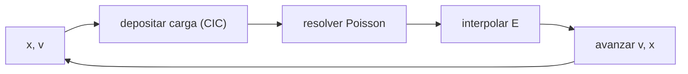

# B35-C05 — Simulación de plasmas por partículas (PIC)

<!-- nav:top -->
[🏠 Programa](../../../../README.md) · [📚 Bloque B35](../../../tronco-comun/B35-fisica-avanzada-de-plasmas-y-mhd-espacial.md) · [← Anterior: B35-C04 — Colisiones, régimen cinético y ecuación de Vlasov](../B35-C04-colisiones-regimen-cinetico-y-ecuacion-de-vlasov/CLASE.md) · [Siguiente: B35-C06 — Mediciones in situ de plasmas espaciales →](../B35-C06-mediciones-in-situ-de-plasmas-espaciales/CLASE.md)
<!-- /nav -->

## 1. Ubicación, nivel y alcance

Clase 5 del bloque B35. Nivel N3. El método **particle-in-cell (PIC)** sigue partículas en un campo calculado en una malla. Aquí programas un código electrostático 1D (salto de rana, ponderación lineal, Poisson espectral) y lo validas con dos casos analíticos: la **oscilación fría** de plasma y la **inestabilidad de dos haces** de [B35-C03](../B35-C03-inestabilidades-de-plasma-cineticas-y-de-fluido/CLASE.md). Usas [B05](../../../tronco-comun/B05-fisica-fundamental-para-el-espacio.md) y [B35-C04](../B35-C04-colisiones-regimen-cinetico-y-ecuacion-de-vlasov/CLASE.md). Todo está normalizado.

## 2. Por qué esta clase existe

Un código sin validar produce figuras bonitas y físicas falsas. La decisión central: **¿reproduce el código la frecuencia y la tasa de crecimiento conocidas?**

## 3. Lo que podrás hacer al terminar

1. Depositar carga y resolver el campo en una malla.
2. Avanzar partículas con el salto de rana.
3. Validar la frecuencia de plasma.
4. Medir la conservación de energía y momento.
5. Medir una tasa de crecimiento.
6. Reconocer el ruido y las limitaciones del método.

La evidencia es la **ficha de la simulación PIC** del ejercicio 12 (sección 20).

## 4. Con qué llegas y cómo comprobarlo

1. ¿Qué es una incertidumbre?
2. ¿Qué es una simulación Monte Carlo?
3. ¿Qué es una tabla de resultados?
4. ¿Qué es un valor ilustrativo?
5. ¿Qué es una verificación?

<details>
<summary>Ver respuestas</summary>

1. Un intervalo en que se espera el valor verdadero. 2. Repetir con números aleatorios de semilla fija. 3. Un resumen ordenado de cálculos. 4. Un valor propuesto para el ejemplo, no medido. 5. Comparar un cálculo con un caso independiente.
</details>

Con cuatro o cinco aciertos, sigue; si no, repasa los prerrequisitos.

## 5. Un caso de contexto y casos de referencia

Con 32 celdas y 4000 partículas la oscilación fría da `ω = 0,99722 ω_p` y la deriva de energía es de `2,5×10⁻³`. Con 6000 partículas y `k v₀ = 0,6124` la tasa de dos haces medida es `0,3557 ω_p` frente a `0,3536` analítica. Es el **ejemplo conductor**; todo está normalizado.

## 6. Vocabulario

Una **macropartícula** representa muchas reales. La **ponderación CIC** reparte la carga entre dos nodos. El **salto de rana** desfasa posición y velocidad medio paso. El **ruido de partículas** es la fluctuación estadística. La **deriva de energía** mide el error del esquema.

## 7. Modelo mental: un bosque de cuentas

Las partículas son cuentas sobre un hilo que sienten el campo de una malla; la malla se calcula con las cuentas. Si las cuentas son pocas, el campo tiembla.



*Descripción textual:* el ciclo deposita, resuelve, interpola y avanza, y se repite en cada paso.

Analogía: un bosque de cuentas. Límite: 1D electrostático, con iones fijos y pocas partículas.

## 8. La explicación, paso a paso

### 8.1 Oscilación fría

Desplazamiento inicial `d = 0,01`: la amplitud inicial del campo es `0,00997` (analítica `0,01000`). La frecuencia medida por los mínimos de `E₁` es `0,99722 ω_p` (error `0,28 %`). La deriva relativa de energía es `2,48×10⁻³` y el momento total máximo `4,4×10⁻¹⁸`.

### 8.2 Dos haces

Crecimiento de la energía de campo (6000 partículas, paso `0,1`):

| `t` (1/ω_p) | `E₁` | energía de campo |
|---|---|---|
| 0 | 9,97×10⁻⁴ | 2,55×10⁻⁶ |
| 8 | 2,06×10⁻³ | 1,09×10⁻⁵ |
| 12 | 8,03×10⁻³ | 1,65×10⁻⁴ |
| 16 | 3,45×10⁻² | 3,05×10⁻³ |
| 20 | 0,142 | 5,22×10⁻² |

El ajuste exponencial de `E₁` en `t ∈ [7,2; 17,2]` (101 puntos) da `γ = 0,3557`, cociente `1,006` con la analítica `0,3536`.

### 8.3 Lectura

El código reproduce frecuencia y tasa con menos de `1 %`. La saturación (`t > 20`) es no lineal y no la cubre la teoría. Con pocas partículas el ruido sube y la deriva de energía crece; el método no sustituye a los códigos de investigación.

## 9. Magnitudes, símbolos y unidades

| Símbolo | Qué es | Unidad | Valor / nota |
|---|---|---|---|
| `ω_p` | frecuencia de plasma | — | 1 (normalizada) |
| `Δt` | paso de tiempo | `1/ω_p` | 0,1 |
| `N_p` | macropartículas | — | 4000; 6000 |
| `γ` | tasa de crecimiento | `ω_p` | 0,3557 |

## 10. Convenciones y referencias

Unidades normalizadas: carga `−1`, masa `1`, densidad media `1`, iones fijos. Semilla `20261109` para la fase de la perturbación. La tasa analítica proviene de la clase B35-C03.

## 11. De dónde sale lo que afirmamos

| ID | Fuente | Localizador | Respalda | Estado |
|---|---|---|---|---|
| S1 | arXiv:2602.15939 (Bacchini y otros) | https://arxiv.org/abs/2602.15939 | revisión de extensiones del método PIC para plasmas astrofísicos con cizalladura, expansión o escape | Solo resumen, consultado el 2026-11-09 |
| S2 | arXiv:2303.12620 (Finn y otros) | https://arxiv.org/abs/2303.12620 | uso de PIC en Landau contrastado con soluciones de Vlasov-Poisson | Solo resumen, consultado el 2026-11-09 |

Límites: de ambos artículos solo se leyó el resumen; el método y los resultados son de este laboratorio.

## 12. Cómo ver las validaciones

| Magnitud | Valor |
|---|---|
| `ω` medida | 0,99722 `ω_p` |
| deriva de energía | 2,5×10⁻³ |
| `γ` medida | 0,3557 `ω_p` |
| cociente con el análisis | 1,006 |

Descripción larga: ambas validaciones concuerdan con la teoría dentro del 1 %.

## 13. Ejemplo trabajado: la tasa desde dos puntos

**Paso 1 · Cociente de energías.** `3,05×10⁻³ / 1,09×10⁻⁵ = 279,5`.

**Paso 2 · Logaritmo.** `ln 279,5 = 5,633`.

**Paso 3 · Intervalo.** La energía crece como `e^(2γt)` durante `16 − 8 = 8`.

**Paso 4 · Tasa.** `γ = 5,633/(2×8) = 0,352`.

## 14. Distintas formas de describir un código PIC

**Por ciclo:** depositar, resolver, interpolar, avanzar. **Por tabla:** validaciones. **Por energía:** deriva. **Por analogía:** cuentas sobre un hilo.

## 15. Práctica guiada

**Ejercicio 1 · con los pasos indicados.** Error relativo de `ω`. *Pasos:* `(1 − 0,99722)/1`.

<details><summary>Solución comentada</summary>

`0,28 %`.
</details>

**Ejercicio 2 · con una pista.** `γ` desde la energía entre `t = 8` y `t = 16`.

<details><summary>Solución comentada</summary>

`0,352`.
</details>

**Ejercicio 3 · casi autónomo.** Error relativo de `γ` frente a `0,3536`.

<details><summary>Solución comentada</summary>

`(0,3557−0,3536)/0,3536 = 0,6 %`.
</details>

## 16. Práctica autónoma, transferencia e integrador

**Ejercicio 4.** Amplitud inicial del campo frente a la analítica.

<details><summary>Solución comentada</summary>

`0,00997/0,01000 = 0,997`.
</details>

**Ejercicio 5.** ¿Por qué el momento total se conserva a `10⁻¹⁸`?

<details><summary>Solución comentada</summary>

La ponderación CIC es simétrica.
</details>

**Ejercicio 6.** ¿Qué pasa en `t > 20`?

<details><summary>Solución comentada</summary>

Saturación no lineal.
</details>

**Ejercicio 7.** Número de macropartículas por celda en dos haces.

<details><summary>Solución comentada</summary>

`6000/32 ≈ 188`.
</details>

**Ejercicio 8.** ¿Qué mide la deriva de energía?

<details><summary>Solución comentada</summary>

El error acumulado del esquema.
</details>

**Ejercicio 9 · transferencia.** **Transferencia.** Un colega dice que el código reproduce el plasma real. Responde.

<details><summary>Solución comentada</summary>

Solo valida dos casos 1D normalizados.
</details>

**Ejercicio 10 · transferencia.** **Transferencia.** ¿Qué haces con pocas partículas?

<details><summary>Solución comentada</summary>

Sube el ruido; hay que aumentar `N_p`.
</details>

**Ejercicio 11 · transferencia.** **Transferencia.** ¿Qué parte es medición?

<details><summary>Solución comentada</summary>

Ninguna.
</details>

**Ejercicio 12.** **Integrador.** Elabora tu *ficha de la simulación PIC*: validación, energía y tasa.

<details><summary>Solución comentada</summary>

Secciones 8.1–8.3.
</details>

**Ejercicio 12 · integrador.** **Integrador.** Elabora tu *ficha de la simulación PIC*: validación, energía y tasa.

<details><summary>Solución modelo</summary>

Secciones 8.1–8.3.
</details>

## 17. Laboratorio: PIC 1D

El script [pic1d.py](pic1d.py) ejecuta la oscilación fría y los dos haces (**comprueba** la frecuencia, la deriva de energía, el momento y la tasa de crecimiento).

**Datos:** sin constantes; parámetros **normalizados**; semilla `20261109`. **Predice antes de ejecutar:** ¿qué `γ` medirás? (cerca de 0,35.) **Ejecución del 2026-11-09 (Python 3.12.9):**

```text
Python 3.12.9 (biblioteca estandar)
(A) oscilacion fria: omega medida = 0.99722 wp ; deriva relativa de energia = 2.48e-03 ; |momento total| maximo = 4.4e-18
    amplitud |E1| inicial = 0.00997 (analitica d*1 = 0.01000 en E = d)
 t [1/wp]         |E1|      E_campo
      0.0   9.9679e-04   2.5487e-06
      2.0   3.7078e-04   3.5265e-07
      4.0   1.0548e-03   2.8538e-06
      6.0   7.9707e-04   1.6297e-06
      8.0   2.0614e-03   1.0900e-05
     10.0   4.5872e-03   5.3975e-05
     12.0   8.0255e-03   1.6522e-04
     14.0   1.8115e-02   8.4179e-04
     16.0   3.4455e-02   3.0466e-03
     18.0   7.1719e-02   1.3217e-02
     20.0   1.4207e-01   5.2173e-02
     22.0   2.7769e-01   2.0470e-01
(B) dos haces: ventana t = [7.2, 17.2] (101 puntos) ; gamma medida = 0.3557 ; gamma analitica = 0.3536 ; cociente = 1.006
Pruebas superadas.
```

```bash
python programa/clases/B35/B35-C05-simulacion-de-plasmas-por-particulas-pic/pic1d.py
```

**Límites:** 1D electrostático y pocas partículas.

## 18. Errores frecuentes y cómo corregirlos

**No validar el código.** Se corrige con 8.1.

**Medir la tasa en la zona saturada.** Se corrige con 8.3.

**Tomar pocos puntos de ajuste.** Se corrige con 8.2.

**Presentar el resultado como plasma real.** Se corrige con la sección 10.

## 19. Cómo sabrás que vas bien

Tras la sección 8: ¿qué resultado esperabas y cuál obtuviste? Si dudas, repasa el ejemplo 13. Tras el laboratorio: ¿qué comprueba? (ver la sección 17).

## 20. Qué entregas y cómo se evalúa

El producto es tu **ficha de la simulación PIC** (ejercicio 12).

| Criterio | Inicial | En desarrollo | Logrado | Destacado |
|---|---|---|---|---|
| Conceptos | Los confunde | Parciales | conceptos de la clase | Explica los límites |
| Cálculo | Sin unidades | Con errores | Tablas completas | Calcula casos nuevos |
| Numérico | Sin comprobar | Un caso | Contraste con el análisis | Interpreta las diferencias |
| Fuentes | Sin fuente | Sin fecha | fuentes con fecha | Declara lo ilustrativo |
| Límites | No los nombra | Uno | Tres | Discute qué falta del modelo |

**Condiciones críticas (no se compensan con promedio):** rotular lo normalizado; no presentar el código como herramienta de investigación; citar solo lo consultado.

## 21. Ética, seguridad y límites

Clase educativa: los modelos son simplificados. Accesibilidad: tablas equivalentes a las gráficas, fórmulas en texto, ejercicios sin conexión.

## 22. Para cerrar y seguir

El código PIC reproduce la frecuencia de plasma y la tasa de dos haces con errores menores de 1 %. Queda una pregunta: ¿qué se mide realmente de un plasma en el espacio?

**Glosario español–inglés.** partícula en celda · *particle-in-cell*; macropartícula · *macroparticle*; salto de rana · *leapfrog*; ruido de partículas · *particle noise*; deriva de energía · *energy drift*.

**Continuidad.** [B35-C06](../B35-C06-mediciones-in-situ-de-plasmas-espaciales/CLASE.md) estudia las mediciones in situ.

**Referencias:** ver sección 11.

<!-- nav:bottom -->
---

[← Anterior: B35-C04 — Colisiones, régimen cinético y ecuación de Vlasov](../B35-C04-colisiones-regimen-cinetico-y-ecuacion-de-vlasov/CLASE.md) · [📚 Bloque B35](../../../tronco-comun/B35-fisica-avanzada-de-plasmas-y-mhd-espacial.md) · [Siguiente: B35-C06 — Mediciones in situ de plasmas espaciales →](../B35-C06-mediciones-in-situ-de-plasmas-espaciales/CLASE.md)
<!-- /nav -->
