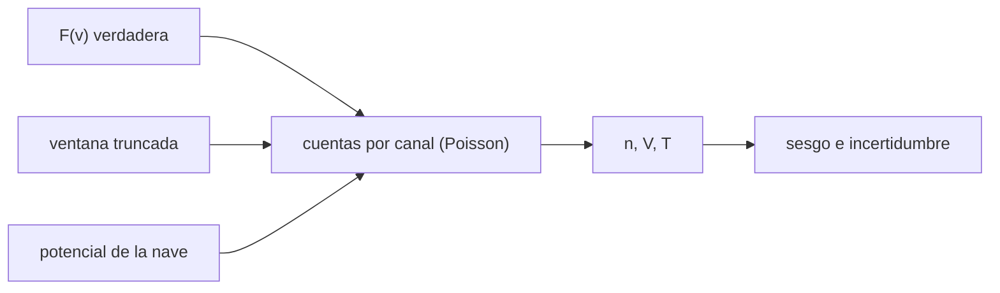

# B35-C06 — Mediciones in situ de plasmas espaciales

<!-- nav:top -->
[🏠 Programa](../../../../README.md) · [📚 Bloque B35](../../../tronco-comun/B35-fisica-avanzada-de-plasmas-y-mhd-espacial.md) · [← Anterior: B35-C05 — Simulación de plasmas por partículas (PIC)](../B35-C05-simulacion-de-plasmas-por-particulas-pic/CLASE.md) · [Siguiente: B35-C07 — Congelamiento del flujo magnético y conservación en MHD ideal →](../B35-C07-congelamiento-del-flujo-magnetico-y-conservacion-en-mhd-ideal/CLASE.md)
<!-- /nav -->

## 1. Ubicación, nivel y alcance

Clase 6 del bloque B35. Nivel N3. Una nave no mide `n`, `V` y `T`: cuenta partículas por canal de energía y de ahí se calculan los **momentos**. Aquí generas cuentas de Poisson de una distribución sintética, calculas los momentos, verificas su incertidumbre y estimas el sesgo por **truncar la ventana** de medida y por el **potencial de la nave**. Usas [B05](../../../tronco-comun/B05-fisica-fundamental-para-el-espacio.md), [B12](../../../tronco-comun/B12-probabilidad-estadistica-e-incertidumbre.md) y [B35-C01](../B35-C01-funciones-de-distribucion-de-velocidades-en-plasmas/CLASE.md). Ningún instrumento ni misión real se simula.

## 2. Por qué esta clase existe

Un momento sin su incertidumbre ni sus sesgos no es una medición. La decisión central: **¿cuántas cuentas hacen falta y qué sesgos introduce el instrumento?**

## 3. Lo que podrás hacer al terminar

1. Calcular `n`, `V` y `T` desde cuentas por canal.
2. Predecir la incertidumbre estadística.
3. Medir el sesgo de una ventana truncada.
4. Reconocer el efecto del potencial de la nave.
5. Contrastar el sesgo con la gaussiana truncada analítica.
6. Reconocer los límites de un instrumento idealizado.

La evidencia es la **ficha de las mediciones in situ** del ejercicio 12 (sección 20).

## 4. Con qué llegas y cómo comprobarlo

1. ¿Qué es una incertidumbre?
2. ¿Qué es una simulación Monte Carlo?
3. ¿Qué es una tabla de resultados?
4. ¿Qué es un valor ilustrativo?
5. ¿Qué es una verificación?

<details>
<summary>Ver respuestas</summary>

1. Un intervalo en que se espera el valor verdadero. 2. Repetir con números aleatorios de semilla fija. 3. Un resumen ordenado de cálculos. 4. Un valor propuesto para el ejemplo, no medido. 5. Comparar un cálculo con un caso independiente.
</details>

Con cuatro o cinco aciertos, sigue; si no, repasa los prerrequisitos.

## 5. Un caso de contexto y casos de referencia

Con `20 000` cuentas, `T = 10⁵ K` y `V = 400 km/s` (ilustrativos), la velocidad se mide con una dispersión de `201,7 m/s` (teoría `203,2`) y la temperatura de `913 K` (teoría `1000`). Si la ventana corta la cola de baja velocidad, la temperatura medida cae a `61 577 K`. Es el **ejemplo conductor**.

## 6. Vocabulario

Las **cuentas** son el número de partículas por canal. El **momento** es una suma ponderada de las cuentas. La **ventana** es el intervalo de velocidades medido. El **potencial de la nave** desplaza la energía por carga. El **ruido de Poisson** crece como la raíz de las cuentas.

## 7. Modelo mental: contar gotas de lluvia

Medir un plasma es contar gotas en cubos de distintos tamaños: con pocas gotas el recuento fluctúa, y si el campo de cubos no cubre toda la lluvia, la estimación se sesga.



*Descripción textual:* la distribución se muestrea con ruido y sesgos; los momentos resumen las cuentas.

Analogía: contar gotas de lluvia. Límite: respuesta ideal, sin fondo y bins independientes.

## 8. La explicación, paso a paso

### 8.1 Incertidumbre estadística

Con `σ = 28,730 km/s` y bins de `5,746 km/s`, 300 realizaciones de 20 000 cuentas dan: `V − V₀ = −11,9 m/s` (error estándar `11,6`), dispersión de `V` de `201,7 m/s` frente a `σ/√N = 203,2 m/s`, `T` media `100 078 K` con sesgo `78 K` (error estándar `53 K`) y dispersión `913 K` frente a `T√(2/N) = 1000 K`.

### 8.2 Ventana truncada

Si solo se mide de `−1σ` a `+3σ` alrededor de `V₀`:

| magnitud | medida | analítica |
|---|---|---|
| `T` (K) | 61 577 | 61 614 |
| `V − V₀` (km/s) | 8,126 | 8,125 |

La temperatura medida es el `61,6 %` de la verdadera y la velocidad se sesga `+8,1 km/s`.

### 8.3 Potencial de la nave

A `400 km/s` un protón tiene `835 eV`. Un potencial de `+10 V` añade `10 eV` a la energía por carga y la velocidad aparente aumenta `2,388 km/s`.

### 8.4 Lectura

El ruido de Poisson se controla con más cuentas (`σ_V ∝ 1/√N`). Los sesgos de la ventana y del potencial no desaparecen con más cuentas y hay que corregirlos con el modelo del instrumento.

## 9. Magnitudes, símbolos y unidades

| Símbolo | Qué es | Unidad | Valor / nota |
|---|---|---|---|
| `N` | cuentas totales | — | 20 000 |
| `σ_V` | dispersión de la velocidad | m/s | 201,7 |
| `σ_T/T` | dispersión relativa de `T` | — | 0,0091 |
| `φ` | potencial de la nave | V | +10 (ilustrativo) |

## 10. Convenciones y referencias

`k_B` y `m_p` de NIST CODATA 2022 (consultados el 2026-11-09). Distribución reducida 1D; la temperatura se calcula con la varianza de las cuentas. La gaussiana truncada analítica es una relación estándar no consultada.

## 11. De dónde sale lo que afirmamos

| ID | Fuente | Localizador | Respalda | Estado |
|---|---|---|---|---|
| S1 | NIST, *Fundamental Physical Constants* (CODATA 2022) | https://physics.nist.gov/cuu/Constants/Table/allascii.txt | `k_B`, `m_p`, `μ₀` según la clase | Consultada el 2026-11-09 |

Límites: no se consultó ninguna fuente sobre instrumentos reales; los parámetros son ilustrativos.

## 12. Cómo ver los resultados

| Magnitud | Valor |
|---|---|
| dispersión de `V` | 201,7 m/s |
| dispersión de `T` | 913 K |
| `T` con ventana truncada | 61 577 K |
| sesgo de `V` truncada | +8,13 km/s |

Descripción larga: más cuentas reducen el ruido, pero no el sesgo de la ventana.

## 13. Ejemplo trabajado: las cuentas necesarias

**Paso 1 · Objetivo.** `σ_V = 50 m/s` con `σ = 28 730 m/s`.

**Paso 2 · Relación.** `N = (σ/σ_V)²`.

**Paso 3 · Cociente.** `28 730/50 = 574,6`.

**Paso 4 · Cuentas.** `N = 3,3×10⁵`.

## 14. Distintas formas de describir una medición

**Por fórmula:** `σ_V = σ/√N`. **Por tabla:** sesgos. **Por simulación:** 300 realizaciones. **Por analogía:** contar gotas.

## 15. Práctica guiada

**Ejercicio 1 · con los pasos indicados.** `σ_V` para `N = 20 000`. *Pasos:* `σ/√N`.

<details><summary>Solución comentada</summary>

`203,2 m/s`.
</details>

**Ejercicio 2 · con una pista.** `σ_T/T` para `N = 20 000`.

<details><summary>Solución comentada</summary>

`√(2/N) = 0,01`.
</details>

**Ejercicio 3 · casi autónomo.** `N` para `σ_V = 50 m/s`.

<details><summary>Solución comentada</summary>

`3,3×10⁵`.
</details>

## 16. Práctica autónoma, transferencia e integrador

**Ejercicio 4.** Energía de un protón a 400 km/s.

<details><summary>Solución comentada</summary>

`835 eV`.
</details>

**Ejercicio 5.** Temperatura medida con la ventana truncada, en fracción.

<details><summary>Solución comentada</summary>

`0,616`.
</details>

**Ejercicio 6.** ¿Cambia el sesgo de la ventana con más cuentas?

<details><summary>Solución comentada</summary>

No.
</details>

**Ejercicio 7.** `N` para un error de `T` de 1 %.

<details><summary>Solución comentada</summary>

`2×10⁴`.
</details>

**Ejercicio 8.** Velocidad aparente con `+10 V`.

<details><summary>Solución comentada</summary>

`+2,388 km/s`.
</details>

**Ejercicio 9 · transferencia.** **Transferencia.** Un colega dice que más cuentas corrigen todo. Responde.

<details><summary>Solución comentada</summary>

Solo el ruido, no los sesgos.
</details>

**Ejercicio 10 · transferencia.** **Transferencia.** ¿Qué se necesita para corregir la ventana?

<details><summary>Solución comentada</summary>

El modelo de la distribución y del instrumento.
</details>

**Ejercicio 11 · transferencia.** **Transferencia.** ¿Se simuló una misión real?

<details><summary>Solución comentada</summary>

No: todo es sintético.
</details>

**Ejercicio 12.** **Integrador.** Elabora tu *ficha de las mediciones in situ*: momentos, ruido y sesgos.

<details><summary>Solución comentada</summary>

Secciones 8.1–8.4.
</details>

**Ejercicio 12 · integrador.** **Integrador.** Elabora tu *ficha de las mediciones in situ*: momentos, ruido y sesgos.

<details><summary>Solución modelo</summary>

Secciones 8.1–8.4.
</details>

## 17. Laboratorio: momentos desde cuentas

El script [momentos.py](momentos.py) genera cuentas de Poisson y calcula momentos, ruido y sesgos (**comprueba** el ruido frente a `σ/√N` y el sesgo frente a la gaussiana truncada).

**Datos:** `k_B`, `m_p` de NIST (2026-11-09); distribución e instrumento **ilustrativos**; semilla `20261109`. **Predice antes de ejecutar:** ¿cuánto valdrá `σ_V`? (cerca de 203 m/s.) **Ejecución del 2026-11-09 (Python 3.12.9):**

```text
Python 3.12.9 (biblioteca estandar)
sigma_termica = 28.730 km/s ; dv = 5.746 km/s ; V0 = 400 km/s
(1) ventana +-6 sigma: V medio - V0 = -11.9 m/s (error estandar 11.6) ; desv(V) = 201.7 m/s (sigma/sqrt(N) = 203.2) ; T medio = 100078 K ; desv(T) = 913 K (T sqrt(2/N) = 1000)
    sesgo de T = 78.3 K (error estandar 52.7 K)
(2) ventana [-1, +3] sigma: T medio = 61577 K (analitico del truncamiento 61614 K, razon 0.616) ; V medio - V0 = 8.126 km/s (analitico 8.125)
(3) potencial de la nave de +10 V: la energia por carga medida difiere en 10 eV ; sobre 400 km/s (E = 835 eV) la velocidad aparente cambia en 2.388 km/s
Pruebas superadas.
```

```bash
python programa/clases/B35/B35-C06-mediciones-in-situ-de-plasmas-espaciales/momentos.py
```

**Límites:** respuesta ideal, sin fondo.

## 18. Errores frecuentes y cómo corregirlos

**Ignorar el ruido de Poisson.** Se corrige con 8.1.

**Creer que más cuentas quitan el sesgo.** Se corrige con 8.4.

**Olvidar el potencial de la nave.** Se corrige con 8.3.

**Presentar lo sintético como medición.** Se corrige con la sección 10.

## 19. Cómo sabrás que vas bien

Tras la sección 8: ¿qué resultado esperabas y cuál obtuviste? Si dudas, repasa el ejemplo 13. Tras el laboratorio: ¿qué comprueba? (ver la sección 17).

## 20. Qué entregas y cómo se evalúa

El producto es tu **ficha de las mediciones in situ** (ejercicio 12).

| Criterio | Inicial | En desarrollo | Logrado | Destacado |
|---|---|---|---|---|
| Conceptos | Los confunde | Parciales | conceptos de la clase | Explica los límites |
| Cálculo | Sin unidades | Con errores | Tablas completas | Calcula casos nuevos |
| Numérico | Sin comprobar | Un caso | Contraste con el análisis | Interpreta las diferencias |
| Fuentes | Sin fuente | Sin fecha | fuentes con fecha | Declara lo ilustrativo |
| Límites | No los nombra | Uno | Tres | Discute qué falta del modelo |

**Condiciones críticas (no se compensan con promedio):** rotular lo sintético; no simular un instrumento real como si lo fuera; citar solo lo consultado.

## 21. Ética, seguridad y límites

Clase educativa: los modelos son simplificados. Accesibilidad: tablas equivalentes a las gráficas, fórmulas en texto, ejercicios sin conexión.

## 22. Para cerrar y seguir

El ruido de Poisson sigue `1/√N` y los sesgos de ventana y de potencial requieren un modelo del instrumento. Queda una pregunta: ¿qué conserva un plasma ideal al fluir?

**Glosario español–inglés.** cuentas · *counts*; ventana · *window*; potencial de la nave · *spacecraft potential*; momento · *moment*; ruido de Poisson · *Poisson noise*.

**Continuidad.** [B35-C07](../B35-C07-congelamiento-del-flujo-magnetico-y-conservacion-en-mhd-ideal/CLASE.md) estudia el congelamiento del flujo magnético.

**Referencias:** ver sección 11.

<!-- nav:bottom -->
---

[← Anterior: B35-C05 — Simulación de plasmas por partículas (PIC)](../B35-C05-simulacion-de-plasmas-por-particulas-pic/CLASE.md) · [📚 Bloque B35](../../../tronco-comun/B35-fisica-avanzada-de-plasmas-y-mhd-espacial.md) · [Siguiente: B35-C07 — Congelamiento del flujo magnético y conservación en MHD ideal →](../B35-C07-congelamiento-del-flujo-magnetico-y-conservacion-en-mhd-ideal/CLASE.md)
<!-- /nav -->
