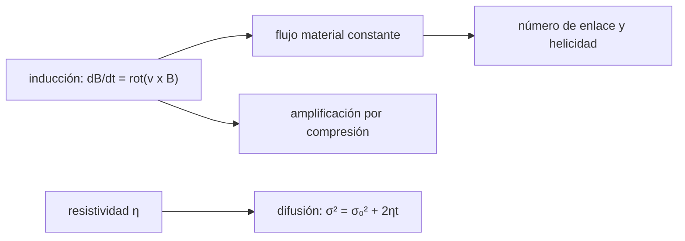

# B35-C07 — Congelamiento del flujo magnético y conservación en MHD ideal

<!-- nav:top -->
[🏠 Programa](../../../../README.md) · [📚 Bloque B35](../../../tronco-comun/B35-fisica-avanzada-de-plasmas-y-mhd-espacial.md) · [← Anterior: B35-C06 — Mediciones in situ de plasmas espaciales](../B35-C06-mediciones-in-situ-de-plasmas-espaciales/CLASE.md) · [Siguiente: B35-C08 — Flujos de plasma estacionarios y balance de presiones →](../B35-C08-flujos-de-plasma-estacionarios-y-balance-de-presiones/CLASE.md)
<!-- /nav -->

## 1. Ubicación, nivel y alcance

Clase 7 del bloque B35. Nivel N3. En MHD ideal el campo magnético se mueve con el plasma y su **flujo** a través de una superficie material se conserva. Aquí integras la ecuación de inducción 1D con un flujo de compresión y compruebas la conservación del flujo; calculas la **difusión resistiva** frente a su solución exacta y el **número de enlace** de Gauss como medida topológica de la helicidad. Usas [B05](../../../tronco-comun/B05-fisica-fundamental-para-el-espacio.md) y [B30-C09](../../B30/B30-C09-magnetohidrodinamica/CLASE.md). Todo está normalizado.

## 2. Por qué esta clase existe

La conservación del flujo explica por qué el campo se amplifica al comprimirse y por qué la reconexión exige romper la idealidad. La decisión central: **¿cuándo el campo se mueve con el plasma y cuándo se difunde?**

## 3. Lo que podrás hacer al terminar

1. Escribir la ecuación de inducción ideal.
2. Verificar la conservación del flujo entre puntos materiales.
3. Calcular la amplificación por compresión.
4. Resolver la difusión resistiva.
5. Calcular un número de enlace.
6. Relacionarlo con la helicidad.

La evidencia es la **ficha del flujo congelado** del ejercicio 12 (sección 20).

## 4. Con qué llegas y cómo comprobarlo

1. ¿Qué es una incertidumbre?
2. ¿Qué es una simulación Monte Carlo?
3. ¿Qué es una tabla de resultados?
4. ¿Qué es un valor ilustrativo?
5. ¿Qué es una verificación?

<details>
<summary>Ver respuestas</summary>

1. Un intervalo en que se espera el valor verdadero. 2. Repetir con números aleatorios de semilla fija. 3. Un resumen ordenado de cálculos. 4. Un valor propuesto para el ejemplo, no medido. 5. Comparar un cálculo con un caso independiente.
</details>

Con cuatro o cinco aciertos, sigue; si no, repasa los prerrequisitos.

## 5. Un caso de contexto y casos de referencia

Con `v = −0,2 x` el intervalo material `[−2; 3]` se contrae a `[−1,0976; 1,6464]` en `t = 3` y el campo se amplifica `e^0,6 = 1,822`; el flujo entre los puntos materiales cambia `0,22 %` (difusión numérica). Es el **ejemplo conductor**; todo está normalizado.

## 6. Vocabulario

El **flujo magnético** es la integral de `B` por una superficie. **Congelado** significa que el flujo a través de una superficie material no cambia. La **resistividad** `η` rompe la idealidad. El **número de enlace** cuenta cuántas veces se enlazan dos curvas. La **helicidad** `K = ∫A·B dV` mide el enlace del campo.

## 7. Modelo mental: hilos cosidos en una tela

Las líneas de campo son hilos cosidos en una tela que es el plasma: al estirar o comprimir la tela, los hilos se mueven con ella; con resistividad, los hilos se disuelven poco a poco.



*Descripción textual:* la inducción ideal conserva el flujo; la resistividad lo difunde; el enlace mide la topología.

Analogía: hilos cosidos en una tela. Límite: solo 1D para el flujo y curvas simples para el enlace.

## 8. La explicación, paso a paso

### 8.1 Compresión

Con `B₀ = 1 + 0,8 e^(−x²/2)`, 400 celdas y paso `0,02`, a `t = 3`: error relativo máximo del campo `8,35×10⁻³`; flujo inicial `6,95697` y flujo entre los puntos materiales `6,94165` (deriva `2,20×10⁻³`); `B` máximo `3,2701` frente al analítico `3,2783`. El esquema es de primer orden y la deriva es difusión numérica.

### 8.2 Difusión

Con `η = 1`, ancho inicial `1` y `t = 2`: `σ² = 1 + 2·1·2 = 5`, pico analítico `0,44721` y numérico `0,44718`; error máximo `1,93×10⁻⁵`; flujo total conservado a `10⁻⁹`.

### 8.3 Enlace

| anillos | número de enlace de Gauss | helicidad `K` (en `Φ²`) |
|---|---|---|
| enlazados | −1,000000 | 2 |
| separados | 0,000000 | 0 |

### 8.4 Lectura

La compresión amplifica el campo pero conserva el flujo. La difusión conserva el flujo total pero ensancha el perfil. El número de enlace, entero, es invariante bajo deformaciones sin cortes.

## 9. Magnitudes, símbolos y unidades

| Símbolo | Qué es | Unidad | Valor / nota |
|---|---|---|---|
| `Φ` | flujo magnético | unid. normalizadas | 6,957 |
| `η` | difusividad magnética | — | 1 |
| `Lk` | número de enlace | — | −1; 0 |
| `K` | helicidad de dos tubos | `Φ²` | `2 Lk Φ₁Φ₂` |

## 10. Convenciones y referencias

Unidades normalizadas; no se usa ninguna constante. La relación `K = 2 Lk Φ₁Φ₂` para tubos delgados es teórica y no se consultó una fuente. El signo de `Lk` depende de la orientación.

## 11. De dónde sale lo que afirmamos

| ID | Fuente | Localizador | Respalda | Estado |
|---|---|---|---|---|
| — | Sin fuente externa | — | relaciones estándar que verifica el laboratorio | No se consultó una fuente para esta clase |

Límites: las leyes de conservación son estándar y no se consultó una fuente para esta clase.

## 12. Cómo ver las conservaciones

| Magnitud | Valor |
|---|---|
| amplificación `e^0,6` | 1,822 |
| deriva del flujo | 2,2×10⁻³ |
| error de la difusión | 1,9×10⁻⁵ |
| enlace de los anillos | ±1 |

Descripción larga: la compresión y la difusión se verifican contra sus soluciones exactas.

## 13. Ejemplo trabajado: el intervalo material

**Paso 1 · Trayectoria.** `x(t) = x(0) e^(−at)` con `a = 0,2`.

**Paso 2 · Factor.** `e^(−0,6) = 0,5488`.

**Paso 3 · Extremos.** `−2 → −1,0976` y `3 → 1,6464`.

**Paso 4 · Campo.** Se amplifica en `1/0,5488 = 1,822`.

## 14. Distintas formas de describir la conservación

**Por fórmula:** `B(x,t) = e^(at) B₀(x e^(at))`. **Por tabla:** deriva y error. **Por topología:** número de enlace. **Por analogía:** hilos cosidos.

## 15. Práctica guiada

**Ejercicio 1 · con los pasos indicados.** Extremo `x = 3` del intervalo en `t = 3`. *Pasos:* `3 e^(−0,6)`.

<details><summary>Solución comentada</summary>

`1,6464`.
</details>

**Ejercicio 2 · con una pista.** Factor de amplificación del campo.

<details><summary>Solución comentada</summary>

`1,822`.
</details>

**Ejercicio 3 · casi autónomo.** Ancho `σ²` tras la difusión con `η = 1`, `t = 2`.

<details><summary>Solución comentada</summary>

`5`.
</details>

## 16. Práctica autónoma, transferencia e integrador

**Ejercicio 4.** Pico analítico de la difusión.

<details><summary>Solución comentada</summary>

`1/√5 = 0,4472`.
</details>

**Ejercicio 5.** Deriva relativa del flujo.

<details><summary>Solución comentada</summary>

`2,2×10⁻³`.
</details>

**Ejercicio 6.** Helicidad de dos tubos enlazados con `Φ₁ = Φ₂ = 1`.

<details><summary>Solución comentada</summary>

`K = 2`.
</details>

**Ejercicio 7.** ¿Qué ocurre con la helicidad de tubos separados?

<details><summary>Solución comentada</summary>

`K = 0`.
</details>

**Ejercicio 8.** ¿Por qué el esquema deriva?

<details><summary>Solución comentada</summary>

Es de primer orden y difunde.
</details>

**Ejercicio 9 · transferencia.** **Transferencia.** Un colega dice que con resistividad el flujo desaparece. Responde.

<details><summary>Solución comentada</summary>

Se conserva el total y se ensancha el perfil.
</details>

**Ejercicio 10 · transferencia.** **Transferencia.** ¿Qué número de Reynolds magnético conviene?

<details><summary>Solución comentada</summary>

Grande para que domine la advección.
</details>

**Ejercicio 11 · transferencia.** **Transferencia.** ¿Se usó algún campo real?

<details><summary>Solución comentada</summary>

No: todo es normalizado.
</details>

**Ejercicio 12.** **Integrador.** Elabora tu *ficha del flujo congelado*: compresión, difusión y enlace.

<details><summary>Solución comentada</summary>

Secciones 8.1–8.4.
</details>

**Ejercicio 12 · integrador.** **Integrador.** Elabora tu *ficha del flujo congelado*: compresión, difusión y enlace.

<details><summary>Solución modelo</summary>

Secciones 8.1–8.4.
</details>

## 17. Laboratorio: flujo congelado

El script [flujo_congelado.py](flujo_congelado.py) integra la inducción y la difusión y calcula el número de enlace (**comprueba** la deriva del flujo, el error de la difusión y `Lk = ±1`).

**Datos:** sin constantes; perfiles **normalizados**. **Predice antes de ejecutar:** ¿cuánto valdrá el número de enlace de los anillos enlazados? (±1.) **Ejecución del 2026-11-09 (Python 3.12.9):**

```text
Python 3.12.9 (biblioteca estandar)
(1) t = 3.00 ; error relativo maximo del campo = 8.35e-03 ; flujo inicial = 6.95697 ; flujo entre los puntos materiales = 6.94165 ; deriva = 2.20e-03
    intervalo material: [-2.0, 3.0] -> [-1.0976, 1.6464] ; B maximo = 3.2701 (analitico 3.2783)
(2) difusion: pico numerico = 0.44718 ; analitico = 0.44721 ; error maximo = 1.93e-05 ; flujo total conservado: 1.00000000
(3) numero de enlace de Gauss: anillos enlazados Lk = -1.000000 ; anillos separados Lk = -0.000000
    helicidad de dos tubos delgados K = 2 Lk F1 F2 = 2.0 (enlazados) y 0.0 (separados), en unidades de F^2
Pruebas superadas.
```

```bash
python programa/clases/B35/B35-C07-congelamiento-del-flujo-magnetico-y-conservacion-en-mhd-ideal/flujo_congelado.py
```

**Límites:** 1D y curvas simples.

## 18. Errores frecuentes y cómo corregirlos

**Confundir amplificar con crear flujo.** Se corrige con 8.1.

**Olvidar la difusión numérica.** Se corrige con 8.1.

**Creer que la topología cambia por deformar.** Se corrige con 8.4.

**Presentar lo normalizado como medición.** Se corrige con la sección 10.

## 19. Cómo sabrás que vas bien

Tras la sección 8: ¿qué resultado esperabas y cuál obtuviste? Si dudas, repasa el ejemplo 13. Tras el laboratorio: ¿qué comprueba? (ver la sección 17).

## 20. Qué entregas y cómo se evalúa

El producto es tu **ficha del flujo congelado** (ejercicio 12).

| Criterio | Inicial | En desarrollo | Logrado | Destacado |
|---|---|---|---|---|
| Conceptos | Los confunde | Parciales | conceptos de la clase | Explica los límites |
| Cálculo | Sin unidades | Con errores | Tablas completas | Calcula casos nuevos |
| Numérico | Sin comprobar | Un caso | Contraste con el análisis | Interpreta las diferencias |
| Fuentes | Sin fuente | Sin fecha | fuentes con fecha | Declara lo ilustrativo |
| Límites | No los nombra | Uno | Tres | Discute qué falta del modelo |

**Condiciones críticas (no se compensan con promedio):** rotular lo normalizado; no presentar el modelo como medición; citar solo lo consultado.

## 21. Ética, seguridad y límites

Clase educativa: los modelos son simplificados. Accesibilidad: tablas equivalentes a las gráficas, fórmulas en texto, ejercicios sin conexión.

## 22. Para cerrar y seguir

El flujo se conserva en la compresión ideal, se difunde con resistividad y el número de enlace mide la topología. Queda una pregunta: ¿qué equilibrio rige los flujos estacionarios?

**Glosario español–inglés.** flujo congelado · *frozen-in flux*; inducción · *induction*; resistividad · *resistivity*; número de enlace · *linking number*; helicidad · *helicity*.

**Continuidad.** [B35-C08](../B35-C08-flujos-de-plasma-estacionarios-y-balance-de-presiones/CLASE.md) estudia los flujos estacionarios y el balance de presiones.

**Referencias:** ver sección 11.

<!-- nav:bottom -->
---

[← Anterior: B35-C06 — Mediciones in situ de plasmas espaciales](../B35-C06-mediciones-in-situ-de-plasmas-espaciales/CLASE.md) · [📚 Bloque B35](../../../tronco-comun/B35-fisica-avanzada-de-plasmas-y-mhd-espacial.md) · [Siguiente: B35-C08 — Flujos de plasma estacionarios y balance de presiones →](../B35-C08-flujos-de-plasma-estacionarios-y-balance-de-presiones/CLASE.md)
<!-- /nav -->
