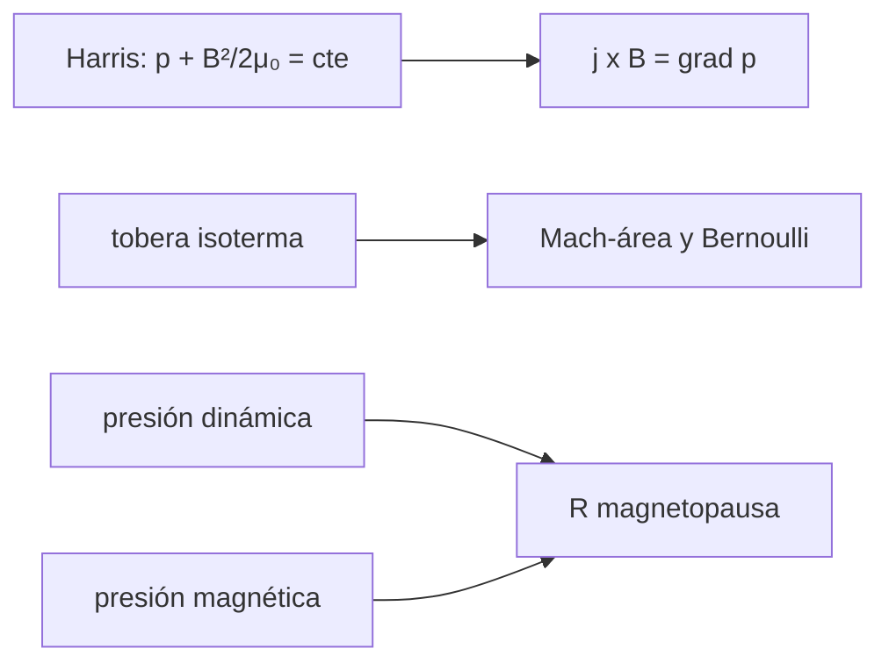

# B35-C08 — Flujos de plasma estacionarios y balance de presiones

<!-- nav:top -->
[🏠 Programa](../../../../README.md) · [📚 Bloque B35](../../../tronco-comun/B35-fisica-avanzada-de-plasmas-y-mhd-espacial.md) · [← Anterior: B35-C07 — Congelamiento del flujo magnético y conservación en MHD ideal](../B35-C07-congelamiento-del-flujo-magnetico-y-conservacion-en-mhd-ideal/CLASE.md) · [Siguiente: B35-C09 — Turbulencia en plasmas y MHD →](../B35-C09-turbulencia-en-plasmas-y-mhd/CLASE.md)
<!-- /nav -->

## 1. Ubicación, nivel y alcance

Clase 8 del bloque B35. Nivel N3. En estado estacionario las fuerzas del plasma se compensan. Aquí compruebas el **balance de presiones** de una lámina de Harris, resuelves un **flujo isotermo** en un tubo de área variable por dos vías y estimas la **distancia de la magnetopausa** igualando presión dinámica y magnética. Usas [B05](../../../tronco-comun/B05-fisica-fundamental-para-el-espacio.md) y [B30-C09](../../B30/B30-C09-magnetohidrodinamica/CLASE.md). Los parámetros son ilustrativos.

## 2. Por qué esta clase existe

Los equilibrios estacionarios fijan la forma de las fronteras. La decisión central: **¿qué presiones se compensan y qué fuerza es la que equilibra?**

## 3. Lo que podrás hacer al terminar

1. Verificar que `p + B²/(2μ₀)` es constante en una lámina.
2. Comprobar `j × B = ∇p`.
3. Usar la relación de Mach–área.
4. Verificar Bernoulli isotermo.
5. Estimar una distancia de magnetopausa.
6. Reconocer los límites del modelo.

La evidencia es la **ficha del balance de presiones** del ejercicio 12 (sección 20).

## 4. Con qué llegas y cómo comprobarlo

1. ¿Qué es una incertidumbre?
2. ¿Qué es una simulación Monte Carlo?
3. ¿Qué es una tabla de resultados?
4. ¿Qué es un valor ilustrativo?
5. ¿Qué es una verificación?

<details>
<summary>Ver respuestas</summary>

1. Un intervalo en que se espera el valor verdadero. 2. Repetir con números aleatorios de semilla fija. 3. Un resumen ordenado de cálculos. 4. Un valor propuesto para el ejemplo, no medido. 5. Comparar un cálculo con un caso independiente.
</details>

Con cuatro o cinco aciertos, sigue; si no, repasa los prerrequisitos.

## 5. Un caso de contexto y casos de referencia

En una lámina de Harris con `B₀ = 10 nT` la presión térmica central es `0,039789 nPa` y la total es constante. Con `n = 5 cm⁻³` y `V = 400 km/s` la presión dinámica es `1,338 nPa` y el modelo da `R = 10,2 R_E`. Es el **ejemplo conductor**; los valores son **ilustrativos**.

## 6. Vocabulario

La **presión magnética** es `B²/(2μ₀)`. La **lámina de Harris** tiene `B = B₀ tanh(z/L)`. El **número de Mach** `M = v/c_s`. La **garganta** es donde `M = 1`. La **magnetopausa** es la frontera entre el viento y el campo terrestre.

## 7. Modelo mental: un globo en una bolsa

Un globo (el plasma) en una bolsa elástica (el campo) se equilibra cuando la presión de adentro iguala a la de afuera; si sopla el viento, la bolsa se aplasta hasta compensarlo.



*Descripción textual:* el balance de presiones se verifica en tres situaciones y fija las fronteras.

Analogía: un globo en una bolsa. Límite: 1D para la lámina y el tubo, dipolo y estancamiento simplificados.

## 8. La explicación, paso a paso

### 8.1 Lámina de Harris

Con `B₀ = 10 nT`, `L = 100 km` y `n₀ = 10⁶ m⁻³` (ilustrativos): `p₀ = 3,9789×10⁻¹¹ Pa`, `β = 1` en el centro.

| `z/L` | `B` (nT) | `p` (nPa) | `p + B²/2μ₀` (nPa) | `j × B` (pN/m³) | `dp/dz` (pN/m³) |
|---|---|---|---|---|---|
| −2,0 | −9,640 | 0,0028 | 0,039789 | 0,00005 | 0,00005 |
| −1,0 | −7,616 | 0,0167 | 0,039789 | 0,00025 | 0,00025 |
| 0,0 | 0,000 | 0,0398 | 0,039789 | 0,00000 | 0,00000 |
| 1,0 | 7,616 | 0,0167 | 0,039789 | −0,00025 | −0,00025 |

### 8.2 Flujo isotermo

La relación `A/A* = exp((M²−1)/2)/M` da `3,0939` en `M = 0,2`; `1,3746` en `0,5`; `1,0441` en `0,8`; `1` en `1`; `1,2455` en `1,5` y `2,2408` en `2`. La integración Runge–Kutta de `(1−M²) d ln v = −d ln A` desde `M = 0,2` hasta el área de `M = 0,8` da `0,80000000`, y desde `2,0` a `1,4` da `1,40000000`. Con la densidad obtenida del flujo másico, `M²/2 + ln ρ = 0,5` en todas las filas.

### 8.3 Magnetopausa

Presión dinámica `1,3381 nPa`; `R = 10,225 R_E`; la presión magnética comprimida en ese radio es `1,3381 nPa` (cierre); al duplicar la presión dinámica `R = 9,110 R_E`, cociente `0,89090 = 2^(−1/6)`.

### 8.4 Lectura

La presión total constante y `j × B = ∇p` son la misma condición. La tobera tiene dos ramas (subsónica y supersónica) con la misma área. La distancia de la magnetopausa varía con la presión como `P^(−1/6)`; el modelo es de orden de magnitud y no un modelo de magnetopausa.

## 9. Magnitudes, símbolos y unidades

| Símbolo | Qué es | Unidad | Valor / nota |
|---|---|---|---|
| `p₀` | presión central | Pa | 3,9789×10⁻¹¹ |
| `M` | número de Mach | — | 0,2 a 2 |
| `P_d` | presión dinámica | nPa | 1,3381 |
| `R/R_E` | distancia de la magnetopausa | — | 10,225 |

## 10. Convenciones y referencias

`μ₀`, `k_B` y `m_p` de NIST CODATA 2022 (consultados el 2026-11-09). El campo ecuatorial terrestre (31 000 nT), el radio terrestre (6378 km), la densidad y la velocidad del viento son valores de orden de magnitud recordados, no consultados. Presión térmica `p = n k (T_i + T_e)`.

## 11. De dónde sale lo que afirmamos

| ID | Fuente | Localizador | Respalda | Estado |
|---|---|---|---|---|
| S1 | NIST, *Fundamental Physical Constants* (CODATA 2022) | https://physics.nist.gov/cuu/Constants/Table/allascii.txt | `k_B`, `m_p`, `μ₀` según la clase | Consultada el 2026-11-09 |

Límites: no se consultó una fuente para el campo terrestre ni para el modelo de magnetopausa.

## 12. Cómo ver el balance

| Magnitud | Valor |
|---|---|
| presión total de la lámina | 0,039789 nPa |
| `A/A*` en `M = 2` | 2,2408 |
| `R/R_E` | 10,225 |
| `R/R_E` con doble presión | 9,110 |

Descripción larga: la presión total es constante y la magnetopausa se acerca al aumentar la presión dinámica.

## 13. Ejemplo trabajado: la relación de Mach–área

**Paso 1 · Mach.** `M = 0,5`.

**Paso 2 · Exponente.** `(0,25−1)/2 = −0,375`.

**Paso 3 · Exponencial.** `e^(−0,375) = 0,6873`.

**Paso 4 · Cociente.** `0,6873/0,5 = 1,3746`.

## 14. Distintas formas de describir un equilibrio

**Por fórmula:** `p + B²/2μ₀`. **Por tabla:** Mach–área. **Por exponente:** `P^(−1/6)`. **Por analogía:** globo en una bolsa.

## 15. Práctica guiada

**Ejercicio 1 · con los pasos indicados.** `A/A*` en `M = 0,5`. *Pasos:* `exp((M²−1)/2)/M`.

<details><summary>Solución comentada</summary>

`1,3746`.
</details>

**Ejercicio 2 · con una pista.** `A/A*` en `M = 2`.

<details><summary>Solución comentada</summary>

`e^1,5/2 = 2,2408`.
</details>

**Ejercicio 3 · casi autónomo.** Presión de la lámina a `z = L`.

<details><summary>Solución comentada</summary>

`0,039789/cosh²1 = 0,0167 nPa`.
</details>

## 16. Práctica autónoma, transferencia e integrador

**Ejercicio 4.** `R` si la presión dinámica se cuadruplica.

<details><summary>Solución comentada</summary>

`10,225 × 4^(−1/6) = 8,12 R_E`.
</details>

**Ejercicio 5.** Presión dinámica con `n = 5 cm⁻³`, `V = 400 km/s`.

<details><summary>Solución comentada</summary>

`1,338 nPa`.
</details>

**Ejercicio 6.** `β` en el centro de la lámina.

<details><summary>Solución comentada</summary>

`1`.
</details>

**Ejercicio 7.** ¿Hay dos `M` para `A/A* = 1,3746`?

<details><summary>Solución comentada</summary>

Sí: `0,5` y una supersónica.
</details>

**Ejercicio 8.** Valor de `M²/2 + ln ρ`.

<details><summary>Solución comentada</summary>

`0,5`.
</details>

**Ejercicio 9 · transferencia.** **Transferencia.** Un colega dice que el modelo da la magnetopausa real. Responde.

<details><summary>Solución comentada</summary>

Es de orden de magnitud.
</details>

**Ejercicio 10 · transferencia.** **Transferencia.** ¿Qué sube `R`?

<details><summary>Solución comentada</summary>

Menor presión dinámica.
</details>

**Ejercicio 11 · transferencia.** **Transferencia.** ¿Qué parte es medición?

<details><summary>Solución comentada</summary>

Ninguna.
</details>

**Ejercicio 12.** **Integrador.** Elabora tu *ficha del balance de presiones*: lámina, tobera y magnetopausa.

<details><summary>Solución comentada</summary>

Secciones 8.1–8.4.
</details>

**Ejercicio 12 · integrador.** **Integrador.** Elabora tu *ficha del balance de presiones*: lámina, tobera y magnetopausa.

<details><summary>Solución modelo</summary>

Secciones 8.1–8.4.
</details>

## 17. Laboratorio: balance de presiones

El script [balance.py](balance.py) verifica la lámina, la tobera y la magnetopausa (**comprueba** presión total constante, Mach por RK4 y cierre del balance).

**Datos:** `μ₀`, `k_B`, `m_p` de NIST (2026-11-09); resto **ilustrativo**. **Predice antes de ejecutar:** ¿a qué distancia queda la magnetopausa? (cerca de 10 `R_E`.) **Ejecución del 2026-11-09 (Python 3.12.9):**

```text
Python 3.12.9 (biblioteca estandar)
(1) Harris: p0 = 3.9789e-11 Pa ; (Ti+Te) = 2.882e+06 K ; beta(centro) = 1.000
  z/L   B [nT]   p [nPa]   p+B^2/2mu0 [nPa]  jxB [pN/m3]  dp/dz [pN/m3]
 -2.0   -9.640    0.0028           0.039789      0.00005        0.00005
 -1.0   -7.616    0.0167           0.039789      0.00025        0.00025
  0.0    0.000    0.0398           0.039789     -0.00000        0.00000
  0.5    4.621    0.0313           0.039789     -0.00029       -0.00029
  1.0    7.616    0.0167           0.039789     -0.00025       -0.00025
  2.0    9.640    0.0028           0.039789     -0.00005       -0.00005
(2) tobera isoterma:      M     A/A*
                    0.20   3.0939
                    0.50   1.3746
                    0.80   1.0441
                    1.00   1.0000
                    1.50   1.2455
                    2.00   2.2408
    integracion RK4 de M = 0.2 a la area de M = 0.8: M final = 0.80000000
    integracion RK4 de M = 2.0 a la area de M = 1.4: M final = 1.40000000
         M   rho/rho*  M^2/2 + ln(rho)
      0.20    1.61607   0.500000000000
      0.50    1.45499   0.500000000000
      0.80    1.19722   0.500000000000
      1.50    0.53526   0.500000000000
      2.00    0.22313   0.500000000000
(3) presion dinamica = 1.3381 nPa ; R/R_E = 10.225 ; presion magnetica comprimida = 1.3381 nPa ; al duplicar Pd: R/R_E = 9.110 (cociente 0.89090, 2^(-1/6) = 0.89090)
Pruebas superadas.
```

```bash
python programa/clases/B35/B35-C08-flujos-de-plasma-estacionarios-y-balance-de-presiones/balance.py
```

**Límites:** 1D, dipolo simplificado.

## 18. Errores frecuentes y cómo corregirlos

**Olvidar la presión magnética.** Se corrige con 8.1.

**Usar una sola rama del flujo.** Se corrige con 8.2.

**Tomar el modelo como real.** Se corrige con 8.4.

**Presentar lo ilustrativo como medición.** Se corrige con la sección 10.

## 19. Cómo sabrás que vas bien

Tras la sección 8: ¿qué resultado esperabas y cuál obtuviste? Si dudas, repasa el ejemplo 13. Tras el laboratorio: ¿qué comprueba? (ver la sección 17).

## 20. Qué entregas y cómo se evalúa

El producto es tu **ficha del balance de presiones** (ejercicio 12).

| Criterio | Inicial | En desarrollo | Logrado | Destacado |
|---|---|---|---|---|
| Conceptos | Los confunde | Parciales | conceptos de la clase | Explica los límites |
| Cálculo | Sin unidades | Con errores | Tablas completas | Calcula casos nuevos |
| Numérico | Sin comprobar | Un caso | Contraste con el análisis | Interpreta las diferencias |
| Fuentes | Sin fuente | Sin fecha | fuentes con fecha | Declara lo ilustrativo |
| Límites | No los nombra | Uno | Tres | Discute qué falta del modelo |

**Condiciones críticas (no se compensan con promedio):** rotular lo ilustrativo; no presentar la magnetopausa como estimación real; citar solo lo consultado.

## 21. Ética, seguridad y límites

Clase educativa: los modelos son simplificados. Accesibilidad: tablas equivalentes a las gráficas, fórmulas en texto, ejercicios sin conexión.

## 22. Para cerrar y seguir

La presión total es constante en la lámina, la tobera isoterma tiene dos ramas y la magnetopausa escala como `P^(−1/6)`. Queda una pregunta: ¿cómo se distribuye la energía entre escalas?

**Glosario español–inglés.** balance de presiones · *pressure balance*; lámina de Harris · *Harris sheet*; número de Mach · *Mach number*; magnetopausa · *magnetopause*; presión dinámica · *dynamic pressure*.

**Continuidad.** [B35-C09](../B35-C09-turbulencia-en-plasmas-y-mhd/CLASE.md) estudia la turbulencia.

**Referencias:** ver sección 11.

<!-- nav:bottom -->
---

[← Anterior: B35-C07 — Congelamiento del flujo magnético y conservación en MHD ideal](../B35-C07-congelamiento-del-flujo-magnetico-y-conservacion-en-mhd-ideal/CLASE.md) · [📚 Bloque B35](../../../tronco-comun/B35-fisica-avanzada-de-plasmas-y-mhd-espacial.md) · [Siguiente: B35-C09 — Turbulencia en plasmas y MHD →](../B35-C09-turbulencia-en-plasmas-y-mhd/CLASE.md)
<!-- /nav -->
