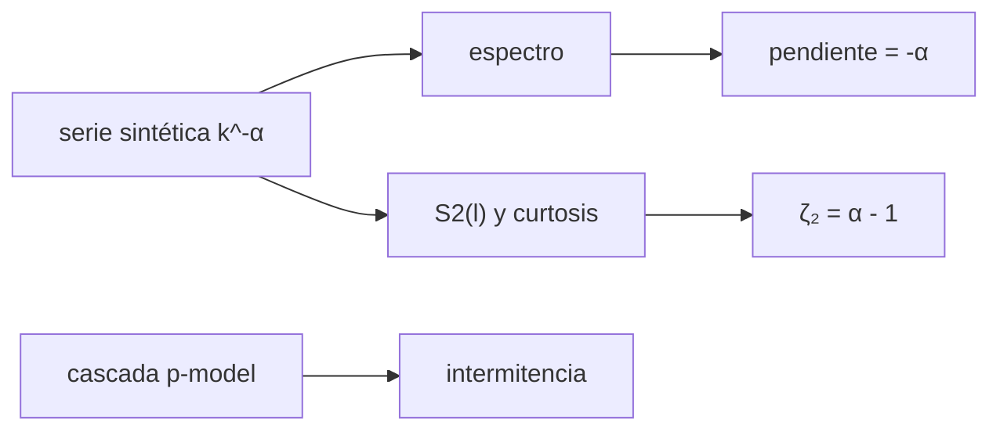

# B35-C09 — Turbulencia en plasmas y MHD

<!-- nav:top -->
[🏠 Programa](../../../../README.md) · [📚 Bloque B35](../../../tronco-comun/B35-fisica-avanzada-de-plasmas-y-mhd-espacial.md) · [← Anterior: B35-C08 — Flujos de plasma estacionarios y balance de presiones](../B35-C08-flujos-de-plasma-estacionarios-y-balance-de-presiones/CLASE.md) · [Siguiente: B35-C10 — Condiciones de frontera en modelos MHD →](../B35-C10-condiciones-de-frontera-en-modelos-mhd/CLASE.md)
<!-- /nav -->

## 1. Ubicación, nivel y alcance

Clase 9 del bloque B35. Nivel N3. La turbulencia reparte energía entre escalas. Aquí sintetizas series con espectro de ley de potencias, mides la pendiente espectral y el exponente de la **función de estructura**, calculas la **intermitencia** de una **cascada multiplicativa** con solución exacta y la **helicidad cruzada** de series correlacionadas. Usas [B05](../../../tronco-comun/B05-fisica-fundamental-para-el-espacio.md), [B12](../../../tronco-comun/B12-probabilidad-estadistica-e-incertidumbre.md) y [B35-C08](../B35-C08-flujos-de-plasma-estacionarios-y-balance-de-presiones/CLASE.md). Las series son sintéticas.

## 2. Por qué esta clase existe

La pendiente de un espectro y su intermitencia distinguen modelos de turbulencia. La decisión central: **¿qué pendiente y qué curtosis tiene la serie y qué modelo sugiere?**

## 3. Lo que podrás hacer al terminar

1. Sintetizar una serie con espectro `k^(−α)`.
2. Medir la pendiente espectral.
3. Relacionar `α` con el exponente de `S₂`.
4. Medir la curtosis de los incrementos.
5. Calcular la intermitencia de una cascada binomial.
6. Calcular la helicidad cruzada.

La evidencia es la **ficha de la turbulencia** del ejercicio 12 (sección 20).

## 4. Con qué llegas y cómo comprobarlo

1. ¿Qué es una incertidumbre?
2. ¿Qué es una simulación Monte Carlo?
3. ¿Qué es una tabla de resultados?
4. ¿Qué es un valor ilustrativo?
5. ¿Qué es una verificación?

<details>
<summary>Ver respuestas</summary>

1. Un intervalo en que se espera el valor verdadero. 2. Repetir con números aleatorios de semilla fija. 3. Un resumen ordenado de cálculos. 4. Un valor propuesto para el ejemplo, no medido. 5. Comparar un cálculo con un caso independiente.
</details>

Con cuatro o cinco aciertos, sigue; si no, repasa los prerrequisitos.

## 5. Un caso de contexto y casos de referencia

Con `α = 5/3` la pendiente espectral medida es `−1,6803` y con `α = 3/2`, `−1,5087`. La curtosis de los incrementos gaussianos es `≈ 3`, mientras que una cascada binomial con `p = 0,7` llega a `106,6` en 12 niveles. Es el **ejemplo conductor**; las series son **sintéticas**.

## 6. Vocabulario

El **espectro** es la potencia por número de onda. La **función de estructura** `S₂(l)` es el promedio del incremento al cuadrado. La **curtosis** mide las colas. La **intermitencia** es la concentración de la energía en pocas regiones. La **cascada** reparte la energía por niveles. La **helicidad cruzada** mide la correlación entre velocidad y campo.

## 7. Modelo mental: una cascada de agua

La energía cae por escalones: de las grandes escalas a las pequeñas. En una cascada lisa todos los escalones reparten parejo; en una intermitente unos pocos reciben casi todo.



*Descripción textual:* la serie da espectro y estructura; la cascada da la intermitencia exacta.

Analogía: una cascada de agua. Límite: dominio finito y campo gaussiano estacionario.

## 8. La explicación, paso a paso

### 8.1 Espectro y estructura

Promedio de 40 realizaciones de 4096 puntos (semilla `20261109`):

| `α` | pendiente espectral | `ζ₂` medido | `ζ₂` de la suma discreta | `α − 1` | curtosis (l = 4) | curtosis (l = 64) |
|---|---|---|---|---|---|---|
| 1,6667 | −1,6803 | 0,7118 | 0,7099 | 0,6667 | 2,997 | 3,008 |
| 1,5000 | −1,5087 | 0,5700 | 0,5691 | 0,5000 | 3,031 | 2,957 |

El exponente de `S₂` medido coincide con el de la suma discreta (error `< 0,002`) pero supera a `α − 1` en `0,04` y `0,07` por el dominio finito: el límite a bajo `k` no converge rápido cuando `2 − α` es pequeño.

### 8.2 Cascada binomial

Con `p = 0,7`:

| nivel | `Σμ²` | analítica | `Σμ⁴` | analítica | curtosis | analítica |
|---|---|---|---|---|---|---|
| 1 | 5,800×10⁻¹ | 5,800×10⁻¹ | 2,482×10⁻¹ | 2,482×10⁻¹ | 1,476 | 1,476 |
| 4 | 1,132×10⁻¹ | 1,132×10⁻¹ | 3,795×10⁻³ | 3,795×10⁻³ | 4,741 | 4,741 |
| 8 | 1,281×10⁻² | 1,281×10⁻² | 1,440×10⁻⁵ | 1,440×10⁻⁵ | 22,481 | 22,481 |
| 12 | 1,449×10⁻³ | 1,449×10⁻³ | 5,465×10⁻⁸ | 5,465×10⁻⁸ | 106,588 | 106,588 |

### 8.3 Helicidad cruzada

Con `b = 0,8 v + ruido(0,6)`: `σ_c = 0,8015` medida y `0,8000` analítica.

### 8.4 Lectura

Un campo gaussiano tiene curtosis 3 a todas las escalas; la cascada multiplicativa la hace crecer al disminuir la escala. Los pendientes `−5/3` y `−3/2` son las predicciones de dos teorías y distinguirlas con datos exige mucho más que un ajuste.

## 9. Magnitudes, símbolos y unidades

| Símbolo | Qué es | Unidad | Valor / nota |
|---|---|---|---|
| `α` | índice espectral | — | 5/3; 3/2 |
| `ζ₂` | exponente de `S₂` | — | 0,7118 |
| `p` | parámetro de la cascada | — | 0,7 |
| `σ_c` | helicidad cruzada | — | 0,8015 |

## 10. Convenciones y referencias

Sin constantes. Las pendientes `−5/3` (Kolmogorov) y `−3/2` (Iroshnikov–Kraichnan) se citan como valores de las teorías, no consultadas en una fuente. Las series son sintéticas con amplitud gaussiana.

## 11. De dónde sale lo que afirmamos

| ID | Fuente | Localizador | Respalda | Estado |
|---|---|---|---|---|
| S1 | arXiv:2308.12376 (Shi y otros) | https://arxiv.org/abs/2308.12376 | simulaciones de turbulencia MHD con caja en expansión: la expansión hace más marcada la intermitencia | Solo resumen, consultado el 2026-11-09 |
| S2 | arXiv:0710.0763 (Alexandrova y otros) | https://arxiv.org/abs/0710.0763 | datos de Cluster: la intermitencia aumenta por encima de la ruptura espectral de ciclotrón iónico | Solo resumen, consultado el 2026-11-09 |

Límites: de ambos trabajos solo se leyó el resumen; las cifras de las tablas son de este laboratorio.

## 12. Cómo ver los exponentes

| Magnitud | Valor |
|---|---|
| pendiente medida (5/3) | −1,6803 |
| `ζ₂` medido (5/3) | 0,7118 |
| curtosis nivel 12 | 106,6 |
| `σ_c` | 0,8015 |

Descripción larga: la serie gaussiana mantiene curtosis 3 y la cascada la aumenta con la profundidad.

## 13. Ejemplo trabajado: la curtosis de la cascada

**Paso 1 · Momentos.** `Σμ² = (0,49+0,09)^1 = 0,58` y `Σμ⁴ = 0,2401+0,0081 = 0,2482`.

**Paso 2 · Cociente.** `2¹ × 0,2482 / 0,58² = 0,4964/0,3364`.

**Paso 3 · Valor.** `1,476`.

## 14. Distintas formas de describir la turbulencia

**Por espectro:** pendiente. **Por estructura:** `ζ₂`. **Por momentos:** curtosis. **Por analogía:** cascada de agua.

## 15. Práctica guiada

**Ejercicio 1 · con los pasos indicados.** Curtosis del nivel 1. *Pasos:* `2·Σμ⁴/(Σμ²)²`.

<details><summary>Solución comentada</summary>

`1,476`.
</details>

**Ejercicio 2 · con una pista.** `Σμ²` del nivel 2.

<details><summary>Solución comentada</summary>

`0,58² = 0,3364`.
</details>

**Ejercicio 3 · casi autónomo.** `ζ₂` esperado para `α = 3/2`.

<details><summary>Solución comentada</summary>

`0,5`.
</details>

## 16. Práctica autónoma, transferencia e integrador

**Ejercicio 4.** Error de la pendiente medida para `α = 5/3`.

<details><summary>Solución comentada</summary>

`1,6803−1,6667 = 0,014`.
</details>

**Ejercicio 5.** `σ_c` analítica con `c = 0,8` y ruido `0,6`.

<details><summary>Solución comentada</summary>

`1,6/2 = 0,8`.
</details>

**Ejercicio 6.** Curtosis del nivel 12.

<details><summary>Solución comentada</summary>

`106,6`.
</details>

**Ejercicio 7.** ¿Qué curtosis tiene un campo gaussiano?

<details><summary>Solución comentada</summary>

`3`.
</details>

**Ejercicio 8.** ¿Por qué `ζ₂` supera a `α − 1`?

<details><summary>Solución comentada</summary>

Por el dominio finito.
</details>

**Ejercicio 9 · transferencia.** **Transferencia.** Un colega dice que una pendiente `−1,67` prueba Kolmogorov en el viento solar. Responde.

<details><summary>Solución comentada</summary>

Las series son sintéticas.
</details>

**Ejercicio 10 · transferencia.** **Transferencia.** ¿Qué mide la curtosis?

<details><summary>Solución comentada</summary>

La intermitencia.
</details>

**Ejercicio 11 · transferencia.** **Transferencia.** ¿Se analizó algún dato real?

<details><summary>Solución comentada</summary>

No.
</details>

**Ejercicio 12.** **Integrador.** Elabora tu *ficha de la turbulencia*: espectro, estructura e intermitencia.

<details><summary>Solución comentada</summary>

Secciones 8.1–8.4.
</details>

**Ejercicio 12 · integrador.** **Integrador.** Elabora tu *ficha de la turbulencia*: espectro, estructura e intermitencia.

<details><summary>Solución modelo</summary>

Secciones 8.1–8.4.
</details>

## 17. Laboratorio: turbulencia sintética

El script [turbulencia.py](turbulencia.py) sintetiza series, mide pendientes y curtosis y verifica la cascada (**comprueba** las sumas exactas del modelo `p`).

**Datos:** sin constantes; series y parámetros **sintéticos**; semilla `20261109`. **Predice antes de ejecutar:** ¿qué curtosis tendrá la serie gaussiana? (3.) **Ejecución del 2026-11-09 (Python 3.12.9):**

```text
Python 3.12.9 (biblioteca estandar)
  alpha  pendiente espectral  zeta2 medido  alpha-1  curtosis(l=4)  curtosis(l=64)
 1.6667              -1.6803        0.7118   0.6667          2.997           3.008
        pendiente de S2 prevista por la suma discreta (dominio finito): 0.7099
 1.5000              -1.5087        0.5700   0.5000          3.031           2.957
        pendiente de S2 prevista por la suma discreta (dominio finito): 0.5691
 nivel n     sum mu^2    analitico     sum mu^4    analitico   curtosis  analitica
       1 5.800000e-01 5.800000e-01 2.482000e-01 2.482000e-01      1.476      1.476
       2 3.364000e-01 3.364000e-01 6.160324e-02 6.160324e-02      2.177      2.177
       4 1.131650e-01 1.131650e-01 3.794959e-03 3.794959e-03      4.741      4.741
       8 1.280631e-02 1.280631e-02 1.440172e-05 1.440172e-05     22.481     22.481
      12 1.449225e-03 1.449225e-03 5.465392e-08 5.465392e-08    106.588    106.588
helicidad cruzada: medida 0.8015 ; analitica 0.8000
Pruebas superadas.
```

```bash
python programa/clases/B35/B35-C09-turbulencia-en-plasmas-y-mhd/turbulencia.py
```

**Límites:** dominio finito y campo gaussiano.

## 18. Errores frecuentes y cómo corregirlos

**Asumir `ζ₂ = α − 1` en un dominio corto.** Se corrige con 8.1.

**Confundir pendiente espectral con teoría.** Se corrige con 8.4.

**Olvidar la intermitencia.** Se corrige con 8.2.

**Presentar lo sintético como medición.** Se corrige con la sección 10.

## 19. Cómo sabrás que vas bien

Tras la sección 8: ¿qué resultado esperabas y cuál obtuviste? Si dudas, repasa el ejemplo 13. Tras el laboratorio: ¿qué comprueba? (ver la sección 17).

## 20. Qué entregas y cómo se evalúa

El producto es tu **ficha de la turbulencia** (ejercicio 12).

| Criterio | Inicial | En desarrollo | Logrado | Destacado |
|---|---|---|---|---|
| Conceptos | Los confunde | Parciales | conceptos de la clase | Explica los límites |
| Cálculo | Sin unidades | Con errores | Tablas completas | Calcula casos nuevos |
| Numérico | Sin comprobar | Un caso | Contraste con el análisis | Interpreta las diferencias |
| Fuentes | Sin fuente | Sin fecha | fuentes con fecha | Declara lo ilustrativo |
| Límites | No los nombra | Uno | Tres | Discute qué falta del modelo |

**Condiciones críticas (no se compensan con promedio):** rotular las series como sintéticas; no atribuir los pendientes a datos reales; citar solo lo consultado.

## 21. Ética, seguridad y límites

Clase educativa: los modelos son simplificados. Accesibilidad: tablas equivalentes a las gráficas, fórmulas en texto, ejercicios sin conexión.

## 22. Para cerrar y seguir

El espectro, la función de estructura y la curtosis dan tres miradas de la turbulencia y la cascada binomial tiene intermitencia exacta. Queda una pregunta: ¿cómo se cierran estos modelos en una frontera numérica?

**Glosario español–inglés.** espectro · *spectrum*; función de estructura · *structure function*; curtosis · *kurtosis*; intermitencia · *intermittency*; cascada · *cascade*.

**Continuidad.** [B35-C10](../B35-C10-condiciones-de-frontera-en-modelos-mhd/CLASE.md) estudia las condiciones de frontera.

**Referencias:** ver sección 11.

<!-- nav:bottom -->
---

[← Anterior: B35-C08 — Flujos de plasma estacionarios y balance de presiones](../B35-C08-flujos-de-plasma-estacionarios-y-balance-de-presiones/CLASE.md) · [📚 Bloque B35](../../../tronco-comun/B35-fisica-avanzada-de-plasmas-y-mhd-espacial.md) · [Siguiente: B35-C10 — Condiciones de frontera en modelos MHD →](../B35-C10-condiciones-de-frontera-en-modelos-mhd/CLASE.md)
<!-- /nav -->
