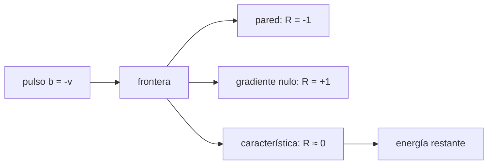

# B35-C10 — Condiciones de frontera en modelos MHD

<!-- nav:top -->
[🏠 Programa](../../../../README.md) · [📚 Bloque B35](../../../tronco-comun/B35-fisica-avanzada-de-plasmas-y-mhd-espacial.md) · [← Anterior: B35-C09 — Turbulencia en plasmas y MHD](../B35-C09-turbulencia-en-plasmas-y-mhd/CLASE.md) · [Siguiente: B36-C01 — Crecimiento lineal de perturbaciones de densidad →](../../../tronco-comun/B36-formacion-de-estructuras-cosmicas-y-materia-oscura.md#b36-c01)
<!-- /nav -->

## 1. Ubicación, nivel y alcance

Clase 10 del bloque B35. Nivel N3. Una frontera numérica mal elegida refleja ondas que no existen. Aquí propagas un pulso de Alfvén hacia una frontera con una malla escalonada y mides la **reflexión** para una pared rígida, un gradiente nulo y una condición de **característica saliente**. Usas [B05](../../../tronco-comun/B05-fisica-fundamental-para-el-espacio.md), [B35-C02](../B35-C02-ondas-de-alfven-y-ondas-magnetosonicas/CLASE.md) y [B30-C09](../../B30/B30-C09-magnetohidrodinamica/CLASE.md). El problema está normalizado.

## 2. Por qué esta clase existe

Las fronteras de los modelos heliosféricos deben dejar salir las ondas. La decisión central: **¿refleja la frontera la onda y con qué signo y amplitud?**

## 3. Lo que podrás hacer al terminar

1. Escribir las ecuaciones de Alfvén en variables `v` y `b`.
2. Programar tres condiciones de frontera.
3. Medir el coeficiente de reflexión.
4. Reconocer el signo de la reflexión.
5. Medir la energía restante.
6. Relacionar la reflexión con la resolución.

La evidencia es la **ficha de las fronteras MHD** del ejercicio 12 (sección 20).

## 4. Con qué llegas y cómo comprobarlo

1. ¿Qué es una incertidumbre?
2. ¿Qué es una simulación Monte Carlo?
3. ¿Qué es una tabla de resultados?
4. ¿Qué es un valor ilustrativo?
5. ¿Qué es una verificación?

<details>
<summary>Ver respuestas</summary>

1. Un intervalo en que se espera el valor verdadero. 2. Repetir con números aleatorios de semilla fija. 3. Un resumen ordenado de cálculos. 4. Un valor propuesto para el ejemplo, no medido. 5. Comparar un cálculo con un caso independiente.
</details>

Con cuatro o cinco aciertos, sigue; si no, repasa los prerrequisitos.

## 5. Un caso de contexto y casos de referencia

Con un pulso de 12 celdas de ancho, la pared devuelve `R = 0,9999` con signo opuesto, el gradiente nulo `R = 0,9999` con el mismo signo y la frontera de características solo `R = 0,0064`. Es el **ejemplo conductor**; todo está normalizado.

## 6. Vocabulario

La **condición de pared** fija `v = 0`. El **gradiente nulo** copia el valor vecino. La **característica saliente** anula la onda entrante. El **coeficiente de reflexión** `R` es la razón de amplitudes. Una **malla escalonada** coloca `v` y `b` en puntos distintos.

## 7. Modelo mental: un eco en un cañón

Una frontera rígida devuelve un eco; una frontera que absorbe como un acantilado de arena deja pasar el sonido sin eco. En un modelo, el eco es una onda falsa que contamina la solución.



*Descripción textual:* el pulso llega a la frontera, que lo refleja con signo, no lo refleja o lo refleja con otro signo.

Analogía: un eco en un cañón. Límite: lineal, 1D, `v_A` uniforme y frontera de primer orden.

## 8. La explicación, paso a paso

### 8.1 Reflexión

Con 400 celdas, CFL `0,5` y `t = 0,5` (el pulso llega a la frontera y vuelve):

| frontera | ancho | `R` | signo de `v` | energía restante | posición del pulso |
|---|---|---|---|---|---|
| pared | 0,060 | 1,00000 | − | 1,00000 | 0,8000 |
| pared | 0,030 | 0,99990 | − | 1,00000 | 0,8000 |
| pared | 0,015 | 0,99433 | − | 1,00000 | 0,8025 |
| gradiente nulo | 0,060 | 0,99999 | + | 0,99999 | 0,7975 |
| gradiente nulo | 0,030 | 0,99990 | + | 1,00000 | 0,7975 |
| gradiente nulo | 0,015 | 0,99433 | + | 1,00000 | 0,8000 |
| característica | 0,060 | 0,00316 | − | 0,00001 | 0,8600 |
| característica | 0,030 | 0,00637 | − | 0,00005 | 0,8300 |
| característica | 0,015 | 0,01341 | − | 0,00022 | 0,8150 |

### 8.2 Lectura

La pared y el gradiente nulo reflejan toda la energía con signos opuestos, como predice la teoría. La condición de características la reduce a `0,6 %` con 12 celdas por pulso, pero crece al estrechar el pulso (`1,3 %` con 6 celdas) porque la frontera es de primer orden. Una condición no reflectante nunca es perfecta en una malla finita.

## 9. Magnitudes, símbolos y unidades

| Símbolo | Qué es | Unidad | Valor / nota |
|---|---|---|---|
| `R` | coeficiente de reflexión | — | 0,9999; 0,0064 |
| `w` | ancho del pulso | longitud del dominio | 0,03 |
| `Δx` | celda | longitud del dominio | 1/400 |
| CFL | `v_A Δt/Δx` | — | 0,5 |

## 10. Convenciones y referencias

Unidades normalizadas (`v_A = 1`, dominio de longitud 1); no se usa ninguna constante. Un pulso que viaja a `+x` cumple `b = −v`. El resultado de la pared y del gradiente nulo es la solución analítica de la ecuación de ondas.

## 11. De dónde sale lo que afirmamos

| ID | Fuente | Localizador | Respalda | Estado |
|---|---|---|---|---|
| — | Sin fuente externa | — | relaciones estándar que verifica el laboratorio | No se consultó una fuente para esta clase |

Límites: la ecuación de ondas y los coeficientes de reflexión son estándar y no se consultó una fuente para esta clase.

## 12. Cómo ver la reflexión

| Frontera | `R` (ancho 0,03) |
|---|---|
| pared | 0,9999 (signo −) |
| gradiente nulo | 0,9999 (signo +) |
| característica | 0,0064 |

Descripción larga: solo la condición de característica deja salir el pulso.

## 13. Ejemplo trabajado: el coeficiente de reflexión

**Paso 1 · Amplitud incidente.** `1`.

**Paso 2 · Amplitud reflejada.** El máximo de `v` en `x < 0,93` es `0,00637`.

**Paso 3 · Cociente.** `R = 0,00637/1`.

**Paso 4 · Energía.** `R² = 4×10⁻⁵`, cercana al `0,00005` medido.

## 14. Distintas formas de describir una frontera

**Por fórmula:** condición en el borde. **Por tabla:** `R` según la resolución. **Por energía:** fracción restante. **Por analogía:** eco en un cañón.

## 15. Práctica guiada

**Ejercicio 1 · con los pasos indicados.** `R` de la característica con ancho 0,03. *Pasos:* máximo reflejado / incidente.

<details><summary>Solución comentada</summary>

`0,0064`.
</details>

**Ejercicio 2 · con una pista.** Signo reflejado en la pared.

<details><summary>Solución comentada</summary>

Negativo (`R = −1`).
</details>

**Ejercicio 3 · casi autónomo.** Signo reflejado en el gradiente nulo.

<details><summary>Solución comentada</summary>

Positivo (`R = +1`).
</details>

## 16. Práctica autónoma, transferencia e integrador

**Ejercicio 4.** Celdas por pulso de ancho `0,03` con 400 celdas.

<details><summary>Solución comentada</summary>

`0,03 × 400 = 12`.
</details>

**Ejercicio 5.** Energía de la característica, ancho 0,03.

<details><summary>Solución comentada</summary>

`5×10⁻⁵`.
</details>

**Ejercicio 6.** ¿Cómo cambia `R` al estrechar el pulso a `0,015`?

<details><summary>Solución comentada</summary>

Sube a `0,0134`.
</details>

**Ejercicio 7.** Posición de un pulso reflejado por la pared.

<details><summary>Solución comentada</summary>

`0,8000`.
</details>

**Ejercicio 8.** ¿Qué energía queda con una pared?

<details><summary>Solución comentada</summary>

La inicial: `1,0000`.
</details>

**Ejercicio 9 · transferencia.** **Transferencia.** Un colega dice que una frontera absorbente es perfecta. Responde.

<details><summary>Solución comentada</summary>

Solo en el límite continuo; en malla finita refleja algo.
</details>

**Ejercicio 10 · transferencia.** **Transferencia.** ¿Qué mejora la característica?

<details><summary>Solución comentada</summary>

Más celdas por longitud de onda.
</details>

**Ejercicio 11 · transferencia.** **Transferencia.** ¿Se modeló la heliosfera?

<details><summary>Solución comentada</summary>

No: es un problema normalizado.
</details>

**Ejercicio 12.** **Integrador.** Elabora tu *ficha de las fronteras MHD*: tres condiciones y su reflexión.

<details><summary>Solución comentada</summary>

Secciones 8.1–8.2.
</details>

**Ejercicio 12 · integrador.** **Integrador.** Elabora tu *ficha de las fronteras MHD*: tres condiciones y su reflexión.

<details><summary>Solución modelo</summary>

Secciones 8.1–8.2.
</details>

## 17. Laboratorio: reflexión en fronteras

El script [fronteras.py](fronteras.py) propaga el pulso contra tres fronteras y mide la reflexión (**comprueba** `R ≈ 1` con el signo correcto en dos casos y `R < 0,02` con características).

**Datos:** sin constantes; pulso y malla **normalizados**. **Predice antes de ejecutar:** ¿qué `R` esperas con la pared? (cerca de 1.) **Ejecución del 2026-11-09 (Python 3.12.9):**

```text
Python 3.12.9 (biblioteca estandar)
  frontera   ancho        R  signo de v reflejado  energia restante  posicion del pulso
     pared   0.060  1.00000                    -1           1.00000              0.8000
     pared   0.030  0.99990                    -1           1.00000              0.8000
     pared   0.015  0.99433                    -1           1.00000              0.8025
 gradiente   0.060  0.99999                     1           0.99999              0.7975
 gradiente   0.030  0.99990                     1           1.00000              0.7975
 gradiente   0.015  0.99433                     1           1.00000              0.8000
caracteristica   0.060  0.00316                    -1           0.00001              0.8600
caracteristica   0.030  0.00637                    -1           0.00005              0.8300
caracteristica   0.015  0.01341                    -1           0.00022              0.8150
Pruebas superadas.
```

```bash
python programa/clases/B35/B35-C10-condiciones-de-frontera-en-modelos-mhd/fronteras.py
```

**Límites:** lineal, 1D y de primer orden.

## 18. Errores frecuentes y cómo corregirlos

**Fijar `v = 0` en una frontera abierta.** Se corrige con 8.1.

**Creer que el gradiente nulo absorbe.** Se corrige con 8.1.

**Usar pulsos de pocas celdas.** Se corrige con 8.2.

**Presentar lo normalizado como un modelo heliosférico.** Se corrige con la sección 10.

## 19. Cómo sabrás que vas bien

Tras la sección 8: ¿qué resultado esperabas y cuál obtuviste? Si dudas, repasa el ejemplo 13. Tras el laboratorio: ¿qué comprueba? (ver la sección 17).

## 20. Qué entregas y cómo se evalúa

El producto es tu **ficha de las fronteras MHD** (ejercicio 12).

| Criterio | Inicial | En desarrollo | Logrado | Destacado |
|---|---|---|---|---|
| Conceptos | Los confunde | Parciales | conceptos de la clase | Explica los límites |
| Cálculo | Sin unidades | Con errores | Tablas completas | Calcula casos nuevos |
| Numérico | Sin comprobar | Un caso | Contraste con el análisis | Interpreta las diferencias |
| Fuentes | Sin fuente | Sin fecha | fuentes con fecha | Declara lo ilustrativo |
| Límites | No los nombra | Uno | Tres | Discute qué falta del modelo |

**Condiciones críticas (no se compensan con promedio):** rotular lo normalizado; no presentar el ejemplo como un modelo de la heliosfera; citar solo lo consultado.

## 21. Ética, seguridad y límites

Clase educativa: los modelos son simplificados. Accesibilidad: tablas equivalentes a las gráficas, fórmulas en texto, ejercicios sin conexión.

## 22. Para cerrar y seguir

La pared y el gradiente nulo reflejan toda la energía y la condición de características deja salir el pulso con una reflexión de menos del 1 % a 12 celdas. Con esta clase se cierra el bloque.

**Glosario español–inglés.** condición de frontera · *boundary condition*; reflexión · *reflection*; característica · *characteristic*; malla escalonada · *staggered grid*; condición de pared · *wall condition*.

**Continuidad.** Con esta clase se cierra el bloque B35.

**Referencias:** ver sección 11.

<!-- nav:bottom -->
---

[← Anterior: B35-C09 — Turbulencia en plasmas y MHD](../B35-C09-turbulencia-en-plasmas-y-mhd/CLASE.md) · [📚 Bloque B35](../../../tronco-comun/B35-fisica-avanzada-de-plasmas-y-mhd-espacial.md) · [Siguiente: B36-C01 — Crecimiento lineal de perturbaciones de densidad →](../../../tronco-comun/B36-formacion-de-estructuras-cosmicas-y-materia-oscura.md#b36-c01)
<!-- /nav -->
