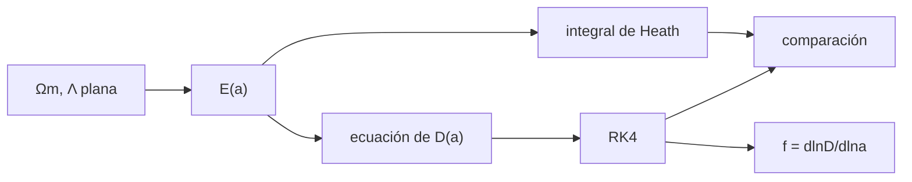

# B36-C01 — Crecimiento lineal de perturbaciones de densidad

<!-- nav:top -->
[🏠 Programa](../../../../README.md) · [📚 Bloque B36](../../../tronco-comun/B36-formacion-de-estructuras-cosmicas-y-materia-oscura.md) · [← Anterior: B35-C10 — Condiciones de frontera en modelos MHD](../../B35/B35-C10-condiciones-de-frontera-en-modelos-mhd/CLASE.md) · [Siguiente: B36-C02 — Función de transferencia y espectro de materia →](../B36-C02-funcion-de-transferencia-y-espectro-de-materia/CLASE.md)
<!-- /nav -->

## 1. Ubicación, nivel y alcance

Clase 1 del bloque B36. Nivel N3. Las estructuras crecen porque las regiones algo más densas atraen más materia. Aquí resuelves la **ecuación de crecimiento lineal** `D'' + (3/a + dlnE/da) D' − 1,5 Ωm/(a⁵E²) D = 0` en un universo plano con materia y Λ, la comparas con la **solución integral** y calculas el **factor de tasa** `f = dlnD/dlna`. Usas [B05](../../../tronco-comun/B05-fisica-fundamental-para-el-espacio.md) y [B12](../../../tronco-comun/B12-probabilidad-estadistica-e-incertidumbre.md). Es la base de [B36-C02](../B36-C02-funcion-de-transferencia-y-espectro-de-materia/CLASE.md) a [B36-C08](../B36-C08-sesgo-de-galaxias-y-trazadores-de-la-materia/CLASE.md).

## 2. Por qué esta clase existe

Sin la teoría lineal no se sabe cuánto ha crecido una perturbación entre el CMB y hoy. La decisión central: **¿cuánto frena la constante cosmológica el crecimiento y cómo se comprueba la solución numérica?**

## 3. Lo que podrás hacer al terminar

1. Plantear la ecuación de crecimiento en la variable a.
2. Integrarla con Runge–Kutta de cuarto orden.
3. Compararla con la solución integral y con el caso Einstein–de Sitter.
4. Calcular el factor de tasa f.
5. Comparar f con el ajuste Ωm(a)^0,55.
6. Reconocer los límites del modelo (sin radiación ni neutrinos).

La evidencia es la **ficha del crecimiento lineal** del ejercicio 12 (sección 20).

## 4. Con qué llegas y cómo comprobarlo

1. ¿Qué es una incertidumbre?
2. ¿Qué es una simulación Monte Carlo?
3. ¿Qué es una tabla de resultados?
4. ¿Qué es un valor ilustrativo?
5. ¿Qué es una verificación?

<details>
<summary>Ver respuestas</summary>

1. Un intervalo en que se espera el valor verdadero. 2. Repetir con números aleatorios de semilla fija. 3. Un resumen ordenado de cálculos. 4. Un valor propuesto para el ejemplo, no medido. 5. Comparar un cálculo con un caso independiente.
</details>

Con cuatro o cinco aciertos, sigue; si no, repasa los prerrequisitos.

## 5. Un caso de contexto y casos de referencia

Con `Ωm = 0,315` (resumen de Planck 2018) y un universo plano, el crecimiento lineal hasta hoy queda en `D(1) = 0,7878` frente a `1` de un universo de solo materia, y el factor de tasa en `f(0) = 0,527`. Es el **ejemplo conductor**; el modelo es **ilustrativo** (sin radiación).

## 6. Vocabulario

La **perturbación** `δ = (ρ − ρ̄)/ρ̄`. El **factor de crecimiento** `D(a)` normalizado a `D = a` en la era de la materia. El **factor de tasa** `f = dlnD/dlna`. El **parámetro de densidad** `Ωm(a) = Ωm a⁻³/E²`. El caso **Einstein–de Sitter** (EdS) tiene `Ωm = 1`.

## 7. Modelo mental: una bola en una ladera que se aplana

Es como una bola que rueda hacia un valle: la gravedad la acelera, pero la expansión acelerada de Λ «aplana la ladera» y el crecimiento se frena.



*Descripción textual:* los parámetros fijan E(a); la ecuación se integra por dos vías y se calcula f.

Analogía: una bola en una ladera que se aplana. Límite: materia sin presión, sin radiación ni neutrinos, perturbaciones pequeñas.

## 8. La explicación, paso a paso

### 8.1 Caso de control

En un universo Einstein–de Sitter (`Ωm = 1`) la ecuación tiene la solución `D = a`. El laboratorio obtiene `D(1) = 1,000000002`, con error `2,35 × 10⁻⁹`.

### 8.2 Universo con Λ

| z | a | D (RK4) | D (integral) | g = D/a | f | Ωm(a)^0,55 |
|---|---|---|---|---|---|---|
| 0 | 1,00000 | 0,787813 | 0,787813 | 0,78781 | 0,5271 | 0,5297 |
| 0,5 | 0,66667 | 0,605767 | 0,605767 | 0,90865 | 0,7610 | 0,7607 |
| 1 | 0,50000 | 0,478008 | 0,478008 | 0,95602 | 0,8767 | 0,8761 |
| 2 | 0,33333 | 0,328628 | 0,328628 | 0,98589 | 0,9586 | 0,9583 |
| 5 | 0,16667 | 0,166363 | 0,166363 | 0,99818 | 0,9946 | 0,9945 |

Las dos vías coinciden con diferencia relativa `7,91 × 10⁻¹⁰` en `a = 1`.

### 8.3 Lectura

Entre `z = 1` y hoy, la perturbación crece un factor `0,787813/0,478008 = 1,648`; en EdS habría crecido `2,000`. El ajuste `Ωm(a)^0,55` reproduce a `f` con error menor que `0,003` en todo el rango. La constante cosmológica empieza a frenar el crecimiento hacia `z ≈ 1`.

## 9. Magnitudes, símbolos y unidades

| Símbolo | Qué es | Unidad | Valor / nota |
|---|---|---|---|
| `D(a)` | factor de crecimiento | — | 0,7878 en a = 1 |
| `f` | dlnD/dlna | — | 0,5271 en z = 0 |
| `Ωm(a)` | densidad de materia relativa | — | 0,7863 en z = 1 |
| `E(a)` | H/H₀ | — | √(Ωm a⁻³ + 1 − Ωm) |

## 10. Convenciones y referencias

Variable independiente `a`; `D` normalizado a `D = a` cuando `a → 0`; sin unidades; comienzo en `a = 10⁻³`.

## 11. De dónde sale lo que afirmamos

| ID | Fuente | Localizador | Respalda | Estado |
|---|---|---|---|---|
| S1 | Planck Collaboration, *Planck 2018 results. VI. Cosmological parameters* | https://arxiv.org/abs/1807.06209 | Ωm = 0,315, H₀ = 67,4 km/s/Mpc, σ₈ = 0,811, Ωb h² = 0,0224, nₛ = 0,965 (solo el resumen) | Solo resumen, consultado el 2026-11-09 |
| S2 | Ajuste de la tasa de crecimiento (literatura) | — | ajuste f ≈ Ωm(a)^γ con γ ≈ 0,55 | No se consultó la fuente; relación conocida que verifica el laboratorio |

Límites: solo se consultó el resumen de Planck; el universo se tomó plano y sin radiación, y el ajuste con exponente 0,55 no se consultó.

## 12. Cómo ver el crecimiento

| Magnitud | Valor |
|---|---|
| `D(1)` | 0,7878 |
| `f(0)` | 0,5271 |
| `D(1)/D(0,5)` | 1,648 |
| error EdS | 2,35 × 10⁻⁹ |

Descripción larga: D crece menos que a desde z ≈ 1 y f baja de 0,99 a 0,53.

## 13. Ejemplo trabajado: f en z = 1

**Paso 1 · Ωm(a).** `0,315 × 8/(0,315 × 8 + 0,685) = 0,7863`.

**Paso 2 · Potencia.** `0,7863^0,55 = 0,8761`.

**Paso 3 · Comparar.** El laboratorio obtiene `f = 0,8767`, diferencia `0,0006`.

## 14. Distintas formas de describir una perturbación

**Por la ecuación:** diferencial en `a`. **Por la integral:** `D ∝ E ∫ da/(aE)³`. **Por la tasa:** `f`. **Por el caso límite:** EdS, `D = a`.

## 15. Práctica guiada

**Ejercicio 1 · con los pasos indicados.** Calcula `Ωm(a)` en `z = 1` para `Ωm = 0,315`. *Pasos:* `a = 0,5`.

<details><summary>Solución comentada</summary>

`0,7863`.
</details>

**Ejercicio 2 · con una pista.** Con `f ≈ Ωm(a)^0,55`, estima `f(z = 1)`. *Pista:* usa el resultado anterior.

<details><summary>Solución comentada</summary>

`0,8761`; el laboratorio da `0,8767`.
</details>

**Ejercicio 3 · casi autónomo.** Calcula el crecimiento entre `z = 1` y hoy. *Casi autónomo.*

<details><summary>Solución comentada</summary>

`0,787813/0,478008 = 1,648`.
</details>

## 16. Práctica autónoma, transferencia e integrador

**Ejercicio 4.** Una perturbación `δ = 10⁻³` en `z = 5`: ¿cuánto vale hoy en teoría lineal?

<details><summary>Solución comentada</summary>

`× 0,787813/0,166363 = 4,735`, o sea `4,7 × 10⁻³`.
</details>

**Ejercicio 5.** ¿Cuánto crecería en EdS entre `z = 5` y hoy?

<details><summary>Solución comentada</summary>

`1/a = 6`.
</details>

**Ejercicio 6.** Cociente de los dos casos.

<details><summary>Solución comentada</summary>

`4,735/6 = 0,789`.
</details>

**Ejercicio 7.** `g = D/a` en `z = 0,5`.

<details><summary>Solución comentada</summary>

`0,9087`.
</details>

**Ejercicio 8.** ¿Cuánto vale `f` hoy?

<details><summary>Solución comentada</summary>

`0,527`.
</details>

**Ejercicio 9 · transferencia.** **Transferencia.** Un compañero dice que con Λ las estructuras dejan de crecer. Responde.

<details><summary>Solución comentada</summary>

No: crecen más despacio (`D` aún crece), y el valor de hoy es `0,79` del caso EdS.
</details>

**Ejercicio 10 · transferencia.** **Transferencia.** ¿Por qué se comparan dos vías de cálculo?

<details><summary>Solución comentada</summary>

Para detectar errores del integrador, no del modelo.
</details>

**Ejercicio 11 · transferencia.** **Transferencia.** ¿Qué ignora el modelo a `z ≈ 1000`?

<details><summary>Solución comentada</summary>

La radiación y los neutrinos, que cambian `E(a)`.
</details>

**Ejercicio 12.** **Integrador.** Elabora tu *ficha del crecimiento lineal*: ecuación, tabla de D y f, comparación y límites.

<details><summary>Solución comentada</summary>

Secciones 8.1–8.3 con tus cifras.
</details>

**Ejercicio 12 · integrador.** **Integrador.** Elabora tu *ficha del crecimiento lineal*: ecuación, tabla de D y f, comparación y límites.

<details><summary>Solución modelo</summary>

Secciones 8.1–8.3 con tus cifras.
</details>

## 17. Laboratorio: crecimiento lineal

El script [crecimiento.py](crecimiento.py) integra la ecuación con RK4, la compara con la integral y con EdS, y calcula f (**comprueba** que EdS da D = a y que las vías coinciden a `10⁻⁵`).

**Datos:** `Ωm = 0,315` (resumen de Planck); universo plano **ilustrativo**; sin semilla (determinista). **Predice antes de ejecutar:** ¿cuánto valdrá `D(1)`? (Algo menos de 0,8.) **Ejecución del 2026-11-09 (Python 3.12.9):**

```text
Python 3.12.9 (biblioteca estandar)
EdS (Omega_m = 1): D(1) = 1.000000002 ; |D - a| = 2.35e-09
    z        a      D RK4  D integral    g=D/a       f  Om(a)^0.55
  0.0  1.00000   0.787813    0.787813  0.78781  0.5271      0.5297
  0.5  0.66667   0.605767    0.605767  0.90865  0.7610      0.7607
  1.0  0.50000   0.478008    0.478008  0.95602  0.8767      0.8761
  2.0  0.33333   0.328628    0.328628  0.98589  0.9586      0.9583
  5.0  0.16667   0.166363    0.166363  0.99818  0.9946      0.9945
D(1): RK4 = 0.787813 ; integral = 0.787813 ; diferencia relativa = 7.91e-10
supresion por Lambda: D(1)/a(1) = 0.7878 ; f(0) = 0.5271 ; Omega_m^0.55 = 0.5297
crecimiento entre z=1 y z=0: D(1)/D(0.5) = 1.6481 (EdS daria 2.0000)
Pruebas superadas.
```

```bash
python programa/clases/B36/B36-C01-crecimiento-lineal-de-perturbaciones-de-densidad/crecimiento.py
```

**Límites:** sin radiación ni neutrinos; el ajuste 0,55 no se consultó.

## 18. Errores frecuentes y cómo corregirlos

**Usar `D = a` con Λ.** Se corrige con 8.2.

**Confundir `D` con `f`.** `f` es la derivada logarítmica.

**Integrar desde `a = 1`.** Se parte de `a = 10⁻³` en el modo creciente.

**Presentar el modelo como un cálculo cosmológico completo.** Se corrige con la sección 10.

## 19. Cómo sabrás que vas bien

Tras la sección 8: ¿qué resultado esperabas y cuál obtuviste? Si dudas, repasa el ejemplo 13. Tras el laboratorio: ¿qué comprueba? (ver la sección 17).

## 20. Qué entregas y cómo se evalúa

El producto es tu **ficha del crecimiento lineal** (ejercicio 12).

| Criterio | Inicial | En desarrollo | Logrado | Destacado |
|---|---|---|---|---|
| Conceptos | Los confunde | Parciales | conceptos de la clase | Explica los límites |
| Cálculo | Sin unidades | Con errores | Tablas completas | Calcula casos nuevos |
| Numérico | Sin comprobar | Un caso | Contraste con el análisis | Interpreta las diferencias |
| Fuentes | Sin fuente | Sin fecha | fuentes con fecha | Declara lo ilustrativo |
| Límites | No los nombra | Uno | Tres | Discute qué falta del modelo |

**Condiciones críticas (no se compensan con promedio):** rotular lo sintético y lo ilustrativo; no presentar el modelo simplificado como un resultado cosmológico; citar solo lo consultado.

## 21. Ética, seguridad y límites

Clase educativa: los modelos son simplificados. Accesibilidad: tablas equivalentes a las gráficas, fórmulas en texto, ejercicios sin conexión.

## 22. Para cerrar y seguir

El crecimiento lineal hasta hoy es `0,79` del de EdS y `f(0) = 0,53`. Queda una pregunta: ¿qué forma tiene el espectro de las perturbaciones que crecen?

**Glosario español–inglés.** crecimiento · *growth*; factor de tasa · *growth rate*; perturbación · *perturbation*; sombrero de copa · *top hat*.

**Continuidad.** [B36-C02](../B36-C02-funcion-de-transferencia-y-espectro-de-materia/CLASE.md) estudia cómo la función de transferencia da forma al espectro.

**Referencias:** ver sección 11.

<!-- nav:bottom -->
---

[← Anterior: B35-C10 — Condiciones de frontera en modelos MHD](../../B35/B35-C10-condiciones-de-frontera-en-modelos-mhd/CLASE.md) · [📚 Bloque B36](../../../tronco-comun/B36-formacion-de-estructuras-cosmicas-y-materia-oscura.md) · [Siguiente: B36-C02 — Función de transferencia y espectro de materia →](../B36-C02-funcion-de-transferencia-y-espectro-de-materia/CLASE.md)
<!-- /nav -->
