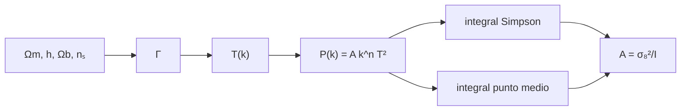

# B36-C02 — Función de transferencia y espectro de materia

<!-- nav:top -->
[🏠 Programa](../../../../README.md) · [📚 Bloque B36](../../../tronco-comun/B36-formacion-de-estructuras-cosmicas-y-materia-oscura.md) · [← Anterior: B36-C01 — Crecimiento lineal de perturbaciones de densidad](../B36-C01-crecimiento-lineal-de-perturbaciones-de-densidad/CLASE.md) · [Siguiente: B36-C03 — Funciones de correlación de galaxias →](../B36-C03-funciones-de-correlacion-de-galaxias/CLASE.md)
<!-- /nav -->

## 1. Ubicación, nivel y alcance

Clase 2 del bloque B36. Nivel N3. El espectro primordial no llega intacto a la era de la materia: la evolución en la era de radiación lo modifica según la escala. Aquí aplicas una **función de transferencia** de forma ajustada, calculas `P(k) = A k^nₛ T(k)²` y normalizas con **σ₈** por dos integrales independientes. Usas [B36-C01](../B36-C01-crecimiento-lineal-de-perturbaciones-de-densidad/CLASE.md) y [B12](../../../tronco-comun/B12-probabilidad-estadistica-e-incertidumbre.md). La forma de `T(k)` es una fórmula de la literatura **no consultada**.

## 2. Por qué esta clase existe

Sin la función de transferencia no se sabe qué escalas dominan la estructura. La decisión central: **¿cómo cambia la amplitud del espectro si cambia su forma?**

## 3. Lo que podrás hacer al terminar

1. Calcular el parámetro de forma Γ.
2. Evaluar `T(k)` y `P(k)`.
3. Normalizar con σ₈ por dos integrales.
4. Hallar el máximo del espectro.
5. Calcular σ(R) para varios radios.
6. Medir la sensibilidad de σ₈ a Γ.

La evidencia es la **ficha de la función de transferencia** del ejercicio 12 (sección 20).

## 4. Con qué llegas y cómo comprobarlo

1. ¿Qué es una incertidumbre?
2. ¿Qué es una simulación Monte Carlo?
3. ¿Qué es una tabla de resultados?
4. ¿Qué es un valor ilustrativo?
5. ¿Qué es una verificación?

<details>
<summary>Ver respuestas</summary>

1. Un intervalo en que se espera el valor verdadero. 2. Repetir con números aleatorios de semilla fija. 3. Un resumen ordenado de cálculos. 4. Un valor propuesto para el ejemplo, no medido. 5. Comparar un cálculo con un caso independiente.
</details>

Con cuatro o cinco aciertos, sigue; si no, repasa los prerrequisitos.

## 5. Un caso de contexto y casos de referencia

Con `Ωm = 0,315`, `h = 0,674`, `Ωb h² = 0,0224`, `nₛ = 0,965` y `σ₈ = 0,811` (resumen de Planck 2018), `Γ = 0,1685 h/Mpc`, el máximo de `P(k)` está en `k = 0,0163 h/Mpc` y `σ(1 Mpc/h) = 2,379`. Es el **ejemplo conductor**; la forma de `T` es **ilustrativa**.

## 6. Vocabulario

La **función de transferencia** `T(k)` pasa de 1 en escalas grandes a decaer en escalas pequeñas. El **espectro** `P(k) = A k^nₛ T²`. El **parámetro de forma** `Γ`. La **varianza** `σ²(R) = (1/2π²) ∫ k² P W² dk`. `W` es el filtro de esfera. `σ₈` es σ con `R = 8 Mpc/h`.

## 7. Modelo mental: una cuerda con una sordina

Es como tocar una cuerda y apagar los armónicos agudos: el tono grave (escalas grandes) sigue igual y el agudo (escalas pequeñas) se atenúa.



*Descripción textual:* los parámetros fijan Γ y T; el espectro se integra por dos vías y se normaliza con σ₈.

Analogía: una cuerda con una sordina. Límite: ajuste suave, sin oscilaciones acústicas ni neutrinos.

## 8. La explicación, paso a paso

### 8.1 Forma y normalización

`Γ = 0,1685 h/Mpc` y `Ωb = 0,0493`. La integral sin normalizar es `2,461882 × 10⁻⁷` (Simpson en ln k) y `2,461882 × 10⁻⁷` (punto medio), con diferencia `5,13 × 10⁻⁸`. La amplitud resulta `A = 2,6716 × 10⁶ (Mpc/h)³`.

### 8.2 El espectro

| k (h/Mpc) | T(k) | P(k) ((Mpc/h)³) | Δ² | dlnP/dlnk |
|---|---|---|---|---|
| 0,001 | 0,9853 | 3,3028 × 10³ | 1,67 × 10⁻⁷ | 0,931 |
| 0,01 | 0,7686 | 1,8544 × 10⁴ | 9,39 × 10⁻⁴ | 0,328 |
| 0,03 | 0,4414 | 1,7656 × 10⁴ | 2,42 × 10⁻² | −0,435 |
| 0,1 | 0,1420 | 5,8405 × 10³ | 0,296 | −1,400 |
| 1 | 0,0049 | 63,18 | 3,20 | −2,334 |
| 10 | 0,0001 | 0,1966 | 9,96 | −2,632 |

El máximo está en `k = 0,0163 h/Mpc`. A escalas muy grandes la pendiente tiende a `nₛ = 0,965` y a escalas pequeñas se acerca a −3 (con correcciones logarítmicas).

### 8.3 Varianza y sensibilidad

| R (Mpc/h) | σ(R) |
|---|---|
| 1 | 2,3788 |
| 4 | 1,2434 |
| 8 | 0,8110 |
| 16 | 0,4791 |
| 32 | 0,2493 |

Con `A` fija, `Γ` ×0,9 da `σ₈ = 0,7063`, ×1,0 da `0,8110` y ×1,1 da `0,9172`: un 10 % de error en la forma cambia σ₈ casi un 13 %.

## 9. Magnitudes, símbolos y unidades

| Símbolo | Qué es | Unidad | Valor / nota |
|---|---|---|---|
| `Γ` | parámetro de forma | h/Mpc | 0,1685 |
| `T(k)` | función de transferencia | — | 1 en k → 0 |
| `A` | amplitud | (Mpc/h)³ | 2,6716 × 10⁶ |
| `σ₈` | varianza en 8 Mpc/h | — | 0,811 |

## 10. Convenciones y referencias

`k` en h/Mpc; `P` en (Mpc/h)³; `R` en Mpc/h; filtro de esfera; amplitud fijada por σ₈.

## 11. De dónde sale lo que afirmamos

| ID | Fuente | Localizador | Respalda | Estado |
|---|---|---|---|---|
| S1 | Planck Collaboration, *Planck 2018 results. VI. Cosmological parameters* | https://arxiv.org/abs/1807.06209 | Ωm = 0,315, H₀ = 67,4 km/s/Mpc, σ₈ = 0,811, Ωb h² = 0,0224, nₛ = 0,965 (solo el resumen) | Solo resumen, consultado el 2026-11-09 |
| S2 | Ajustes de T(k) y de Γ (literatura) | — | forma de T(k) tipo BBKS y Γ de Sugiyama | No se consultó la fuente; relación conocida que verifica el laboratorio |

Límites: el espectro es un ajuste suave que no se consultó; no sustituye a un código de Boltzmann.

## 12. Cómo ver el espectro

| Magnitud | Valor |
|---|---|
| `Γ` | 0,1685 h/Mpc |
| `A` | 2,6716 × 10⁶ |
| `k` del máximo | 0,0163 h/Mpc |
| `σ(8)` | 0,8110 |

Descripción larga: P sube como k hasta 0,016 y luego baja con pendiente que se acerca a −3.

## 13. Ejemplo trabajado: el parámetro Γ

**Paso 1 · Ωb.** `0,0224/0,674² = 0,0493`.

**Paso 2 · Exponente.** `√(2h)/Ωm = 1,161/0,315 = 3,686`; `Ωb(1 + 3,686) = 0,2310`.

**Paso 3 · Γ.** `Ωm h exp(−0,2310) = 0,2123 × 0,7937 = 0,1685`.

## 14. Distintas formas de describir un espectro

**Por k:** `P(k)`. **Por Δ²:** `k³P/2π²`. **Por σ:** `σ(R)`. **Por pendiente:** `dlnP/dlnk`.

## 15. Práctica guiada

**Ejercicio 1 · con los pasos indicados.** Calcula `Ωb` con `Ωb h² = 0,0224` y `h = 0,674`. *Pasos:* divide.

<details><summary>Solución comentada</summary>

`0,0493`.
</details>

**Ejercicio 2 · con una pista.** Calcula `Γ` con la fórmula. *Pista:* ver el ejemplo 13.

<details><summary>Solución comentada</summary>

`0,1685 h/Mpc`.
</details>

**Ejercicio 3 · casi autónomo.** Calcula `A = σ₈²/I` con `I = 2,461882 × 10⁻⁷`. *Casi autónomo.*

<details><summary>Solución comentada</summary>

`0,657721/2,461882 × 10⁻⁷ = 2,6716 × 10⁶`.
</details>

## 16. Práctica autónoma, transferencia e integrador

**Ejercicio 4.** Cociente `σ(1)/σ(8)`.

<details><summary>Solución comentada</summary>

`2,3788/0,8110 = 2,933`.
</details>

**Ejercicio 5.** Variación porcentual de σ₈ si Γ sube un 10 %.

<details><summary>Solución comentada</summary>

`+13,1 %`.
</details>

**Ejercicio 6.** ¿Y si Γ baja un 10 %?

<details><summary>Solución comentada</summary>

`−12,9 %`.
</details>

**Ejercicio 7.** ¿Por qué coinciden Simpson y punto medio?

<details><summary>Solución comentada</summary>

Integran la misma función suave; la diferencia es `5 × 10⁻⁸`.
</details>

**Ejercicio 8.** `Δ²` en `k = 1`.

<details><summary>Solución comentada</summary>

`3,20`: ya no es lineal.
</details>

**Ejercicio 9 · transferencia.** **Transferencia.** Un compañero dice que el máximo de P indica la masa de la materia oscura. Responde.

<details><summary>Solución comentada</summary>

El máximo depende de Γ ∝ Ωm h (igualdad materia–radiación), no de una masa de partícula.
</details>

**Ejercicio 10 · transferencia.** **Transferencia.** ¿Qué se pierde al ignorar las oscilaciones acústicas?

<details><summary>Solución comentada</summary>

La señal de las oscilaciones acústicas bariónicas (clase B36-C07).
</details>

**Ejercicio 11 · transferencia.** **Transferencia.** ¿Por qué σ₈ se usa para normalizar?

<details><summary>Solución comentada</summary>

Porque mide la amplitud en una escala casi lineal.
</details>

**Ejercicio 12.** **Integrador.** Elabora tu *ficha de la función de transferencia*: Γ, tabla de P, σ(R) y límites.

<details><summary>Solución comentada</summary>

Secciones 8.1–8.3.
</details>

**Ejercicio 12 · integrador.** **Integrador.** Elabora tu *ficha de la función de transferencia*: Γ, tabla de P, σ(R) y límites.

<details><summary>Solución modelo</summary>

Secciones 8.1–8.3.
</details>

## 17. Laboratorio: función de transferencia y σ₈

El script [transferencia.py](transferencia.py) calcula Γ, T, P, normaliza con σ₈ por dos integrales y mide la sensibilidad (**comprueba** que las dos integrales coinciden a `10⁻⁴` y que σ₈ se recupera).

**Datos:** valores de Planck (resumen) para Ωm, h, Ωb h², nₛ y σ₈; forma de T **ilustrativa**; sin semilla. **Predice antes de ejecutar:** ¿qué pasará con σ₈ si Γ sube? (Sube.) **Ejecución del 2026-11-09 (Python 3.12.9):**

```text
Python 3.12.9 (biblioteca estandar)
Gamma = 0.1685 h/Mpc ; Omega_b = 0.0493
sigma_8^2 sin normalizar: Simpson ln k = 2.461882e-07 ; punto medio = 2.461882e-07 ; dif. relativa = 5.13e-08
amplitud A = 2.6716e+06 (Mpc/h)^3 para sigma8 = 0.811
sigma8 recuperado = 0.811000
 k [h/Mpc]     T(k)   P(k) [(Mpc/h)^3]    Delta^2  d ln P/d ln k
     0.001   0.9853         3.3028e+03 1.6732e-07          0.931
      0.01   0.7686         1.8544e+04 9.3944e-04          0.328
      0.03   0.4414         1.7656e+04 2.4151e-02         -0.435
       0.1   0.1420         5.8405e+03 2.9588e-01         -1.400
         1   0.0049         6.3179e+01 3.2007e+00         -2.334
        10   0.0001         1.9664e-01 9.9618e+00         -2.632
maximo de P(k) en k = 0.0163 h/Mpc (Gamma = 0.1685)
 R [Mpc/h]   sigma(R)
       1.0     2.3788
       4.0     1.2434
       8.0     0.8110
      16.0     0.4791
      32.0     0.2493
sigma8 con A fija y Gamma x0.9, x1.0, x1.1: 0.7063, 0.8110, 0.9172
Pruebas superadas.
```

```bash
python programa/clases/B36/B36-C02-funcion-de-transferencia-y-espectro-de-materia/transferencia.py
```

**Límites:** ajuste suave sin neutrinos ni BAO.

## 18. Errores frecuentes y cómo corregirlos

**Confundir k con h/Mpc y 1/Mpc.** Se corrige con la sección 10.

**Normalizar con otra R.** σ₈ es con R = 8 Mpc/h.

**Creer que T es observable.** Es un ajuste de un modelo.

**Presentar el espectro como el real.** Se corrige con la sección 11.

## 19. Cómo sabrás que vas bien

Tras la sección 8: ¿qué resultado esperabas y cuál obtuviste? Si dudas, repasa el ejemplo 13. Tras el laboratorio: ¿qué comprueba? (ver la sección 17).

## 20. Qué entregas y cómo se evalúa

El producto es tu **ficha de la función de transferencia** (ejercicio 12).

| Criterio | Inicial | En desarrollo | Logrado | Destacado |
|---|---|---|---|---|
| Conceptos | Los confunde | Parciales | conceptos de la clase | Explica los límites |
| Cálculo | Sin unidades | Con errores | Tablas completas | Calcula casos nuevos |
| Numérico | Sin comprobar | Un caso | Contraste con el análisis | Interpreta las diferencias |
| Fuentes | Sin fuente | Sin fecha | fuentes con fecha | Declara lo ilustrativo |
| Límites | No los nombra | Uno | Tres | Discute qué falta del modelo |

**Condiciones críticas (no se compensan con promedio):** rotular lo sintético y lo ilustrativo; no presentar el modelo simplificado como un resultado cosmológico; citar solo lo consultado.

## 21. Ética, seguridad y límites

Clase educativa: los modelos son simplificados. Accesibilidad: tablas equivalentes a las gráficas, fórmulas en texto, ejercicios sin conexión.

## 22. Para cerrar y seguir

El espectro tiene su máximo en `k = 0,016 h/Mpc` y σ₈ es sensible a Γ (±13 % por ±10 %). Queda una pregunta: ¿cómo se mide la agrupación a partir de un catálogo?

**Glosario español–inglés.** función de transferencia · *transfer function*; espectro de potencia · *power spectrum*; filtro · *window function*; normalización · *normalisation*.

**Continuidad.** [B36-C03](../B36-C03-funciones-de-correlacion-de-galaxias/CLASE.md) estudia la función de correlación de galaxias.

**Referencias:** ver sección 11.

<!-- nav:bottom -->
---

[← Anterior: B36-C01 — Crecimiento lineal de perturbaciones de densidad](../B36-C01-crecimiento-lineal-de-perturbaciones-de-densidad/CLASE.md) · [📚 Bloque B36](../../../tronco-comun/B36-formacion-de-estructuras-cosmicas-y-materia-oscura.md) · [Siguiente: B36-C03 — Funciones de correlación de galaxias →](../B36-C03-funciones-de-correlacion-de-galaxias/CLASE.md)
<!-- /nav -->
