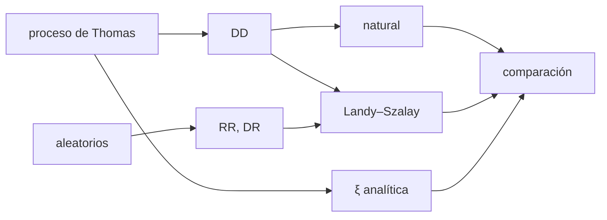

# B36-C03 — Funciones de correlación de galaxias

<!-- nav:top -->
[🏠 Programa](../../../../README.md) · [📚 Bloque B36](../../../tronco-comun/B36-formacion-de-estructuras-cosmicas-y-materia-oscura.md) · [← Anterior: B36-C02 — Función de transferencia y espectro de materia](../B36-C02-funcion-de-transferencia-y-espectro-de-materia/CLASE.md) · [Siguiente: B36-C04 — Espectro de potencia de materia →](../B36-C04-espectro-de-potencia-de-materia/CLASE.md)
<!-- /nav -->

## 1. Ubicación, nivel y alcance

Clase 3 del bloque B36. Nivel N3. La **función de correlación de dos puntos** `ξ(r)` mide el exceso de pares de galaxias a la distancia `r`. Aquí generas **maquetas** de un proceso de cúmulos en una caja periódica, estimas `ξ` con el estimador **natural** y el de **Landy–Szalay** y las comparas con la forma analítica. Usas [B36-C04](../B36-C04-espectro-de-potencia-de-materia/CLASE.md) como complemento y [B12](../../../tronco-comun/B12-probabilidad-estadistica-e-incertidumbre.md). Todo es **sintético**.

## 2. Por qué esta clase existe

Medir la agrupación exige un estimador sin sesgo y con error conocido. La decisión central: **¿concuerda el estimador con la verdad analítica dentro de su error?**

## 3. Lo que podrás hacer al terminar

1. Generar un proceso de cúmulos en una caja periódica.
2. Contar pares por intervalos de distancia.
3. Calcular el estimador natural y el de Landy–Szalay.
4. Comparar con la ξ analítica del proceso.
5. Estimar el error con varias maquetas.
6. Reconocer la restricción integral.

La evidencia es la **ficha de la función de correlación** del ejercicio 12 (sección 20).

## 4. Con qué llegas y cómo comprobarlo

1. ¿Qué es una incertidumbre?
2. ¿Qué es una simulación Monte Carlo?
3. ¿Qué es una tabla de resultados?
4. ¿Qué es un valor ilustrativo?
5. ¿Qué es una verificación?

<details>
<summary>Ver respuestas</summary>

1. Un intervalo en que se espera el valor verdadero. 2. Repetir con números aleatorios de semilla fija. 3. Un resumen ordenado de cálculos. 4. Un valor propuesto para el ejemplo, no medido. 5. Comparar un cálculo con un caso independiente.
</details>

Con cuatro o cinco aciertos, sigue; si no, repasa los prerrequisitos.

## 5. Un caso de contexto y casos de referencia

Con 8 maquetas de unas 987 galaxias en una caja de `100 Mpc/h` (100 centros, 10 miembros por centro, `σ = 2 Mpc/h`), `ξ` en `r = 1` vale `24,89 ± 0,95` frente a `25,73` analítico, y el `χ²` de la media es `8,5` con 12 intervalos. Es el **ejemplo conductor**; es **sintético**.

## 6. Vocabulario

El **estimador natural** `DD/RR − 1`. El de **Landy–Szalay** `(DD − 2DR + RR)/RR`. Un **proceso de Thomas** reparte centros uniformes y miembros gaussianos. La **caja periódica** identifica los bordes. Un **catálogo aleatorio** reproduce la geometría sin agrupación.

## 7. Modelo mental: contar vecinos en una fiesta

Es como contar cuántos invitados hay a cierta distancia de cada uno y compararlo con una fiesta donde todos se reparten al azar.



*Descripción textual:* las maquetas dan conteos de pares; los estimadores se comparan con la ξ analítica.

Analogía: contar vecinos en una fiesta. Límite: isotropía, caja periódica, sin geometría de encuesta.

## 8. La explicación, paso a paso

### 8.1 Verdad analítica

Para centros con densidad `n_c = 10⁻⁴ (Mpc/h)⁻³` y desplazamiento gaussiano de `σ = 2 Mpc/h` por eje, `ξ(r) = exp(−r²/4σ²)/[(4πσ²)^{3/2} n_c]`, con `ξ(0) = 28,06`.

### 8.2 Comparación

| r (Mpc/h) | ξ teórico | media de 8 maquetas | error de la media | natural (1) | Landy–Szalay (1) | pull |
|---|---|---|---|---|---|---|
| 1 | 25,731 | 24,895 | 0,948 | 21,256 | 20,855 | −0,88 |
| 2 | 21,353 | 21,083 | 0,641 | 18,233 | 17,816 | −0,42 |
| 3 | 15,670 | 15,291 | 0,292 | 15,609 | 15,177 | −1,30 |
| 4 | 10,163 | 10,045 | 0,186 | 10,078 | 10,444 | −0,63 |
| 5 | 5,825 | 5,877 | 0,117 | 5,679 | 5,617 | 0,45 |
| 6 | 2,950 | 3,036 | 0,091 | 3,412 | 3,403 | 0,96 |
| 8 | 0,522 | 0,507 | 0,091 | 1,053 | 1,005 | −0,17 |
| 10 | 0,056 | −0,015 | 0,060 | 0,306 | 0,285 | −1,19 |

El `χ²` de la media frente al analítico es `8,5` con 12 intervalos. La integral `∫ξ dV` estimada es `9650` frente a `9983` teórica.

### 8.3 Lectura

Una sola maqueta se aparta de la verdad hasta 5 unidades en `r = 1` (21,3 frente a 25,7): la varianza entre maquetas es real. Las maquetas dan valores ligeramente negativos a `r ≥ 10` porque la media del catálogo se estima con los mismos datos (**restricción integral**). Natural y Landy–Szalay difieren como máximo `0,43` en la maqueta 1.

## 9. Magnitudes, símbolos y unidades

| Símbolo | Qué es | Unidad | Valor / nota |
|---|---|---|---|
| `ξ(r)` | función de correlación | — | 25,73 en r = 1 (teórico) |
| `n_c` | densidad de centros | (Mpc/h)⁻³ | 10⁻⁴ (sintético) |
| `σ` | dispersión por eje | Mpc/h | 2 (sintético) |
| `DD, DR, RR` | pares normalizados | — | conteos |

## 10. Convenciones y referencias

Distancias en Mpc/h; caja periódica de `100 Mpc/h`; intervalos de `1 Mpc/h` entre `0,5` y `12,5`; semilla `20261109`.

## 11. De dónde sale lo que afirmamos

| ID | Fuente | Localizador | Respalda | Estado |
|---|---|---|---|---|
| — | Sin fuente externa | — | relaciones estándar que verifica el laboratorio | No se consultó una fuente para esta clase |

Límites: no se usó un catálogo real ni una fuente externa.

## 12. Cómo ver la correlación

| Magnitud | Valor |
|---|---|
| ξ(1) teórico | 25,73 |
| ξ(1) media | 24,89 |
| χ² (12 gl) | 8,5 |
| ∫ξ dV (est./teo.) | 9650 / 9983 |

Descripción larga: ξ cae de 25 a casi 0 entre 1 y 10 Mpc/h.

## 13. Ejemplo trabajado: ξ(0)

**Paso 1 · Varianza.** `4πσ² = 50,27 (Mpc/h)²`.

**Paso 2 · Potencia.** `50,27^1,5 = 356,4`.

**Paso 3 · Cociente.** `1/(356,4 × 10⁻⁴) = 28,06`.

## 14. Distintas formas de describir una función de correlación

**Por pares:** DD. **Por estimador:** natural y LS. **Por forma:** exponencial gaussiana. **Por integral:** ∫ξ dV.

## 15. Práctica guiada

**Ejercicio 1 · con los pasos indicados.** Calcula `4πσ²` con `σ = 2`. *Pasos:* `4π × 4`.

<details><summary>Solución comentada</summary>

`50,27`.
</details>

**Ejercicio 2 · con una pista.** Calcula `ξ(0)`. *Pista:* ejemplo 13.

<details><summary>Solución comentada</summary>

`28,06`.
</details>

**Ejercicio 3 · casi autónomo.** Calcula `∫ξ dV` sobre todo el espacio. *Casi autónomo.*

<details><summary>Solución comentada</summary>

`1/n_c = 10⁴`, porque la densidad de desplazamientos integra 1.
</details>

## 16. Práctica autónoma, transferencia e integrador

**Ejercicio 4.** ¿Qué fracción de esa integral recoge `r < 12,5`?

<details><summary>Solución comentada</summary>

`9983/10⁴ = 0,998`.
</details>

**Ejercicio 5.** Diferencia entre estimada y teórica.

<details><summary>Solución comentada</summary>

`9650 − 9983 = −333 (−3,3 %)`.
</details>

**Ejercicio 6.** `pull` en `r = 3`.

<details><summary>Solución comentada</summary>

`(15,291 − 15,670)/0,292 = −1,30`.
</details>

**Ejercicio 7.** ¿Cuántos pares hay en total para N = 987?

<details><summary>Solución comentada</summary>

`987 × 986/2 = 486 591`.
</details>

**Ejercicio 8.** `χ²` por grado de libertad.

<details><summary>Solución comentada</summary>

`8,5/12 = 0,71`.
</details>

**Ejercicio 9 · transferencia.** **Transferencia.** Un compañero dice que LS es siempre igual al natural. Responde.

<details><summary>Solución comentada</summary>

Solo con geometría periódica y RR exacto; con máscaras difieren.
</details>

**Ejercicio 10 · transferencia.** **Transferencia.** ¿Por qué hacen falta varias maquetas?

<details><summary>Solución comentada</summary>

Para medir la varianza real del estimador.
</details>

**Ejercicio 11 · transferencia.** **Transferencia.** ¿Qué sesgo produce estimar la media con los mismos datos?

<details><summary>Solución comentada</summary>

Un valor algo negativo a gran r (restricción integral).
</details>

**Ejercicio 12.** **Integrador.** Elabora tu *ficha de la función de correlación*: proceso, tabla de ξ, pulls y límites.

<details><summary>Solución comentada</summary>

Secciones 8.1–8.3.
</details>

**Ejercicio 12 · integrador.** **Integrador.** Elabora tu *ficha de la función de correlación*: proceso, tabla de ξ, pulls y límites.

<details><summary>Solución modelo</summary>

Secciones 8.1–8.3.
</details>

## 17. Laboratorio: estimadores de ξ

El script [correlacion.py](correlacion.py) genera 8 maquetas, estima ξ con el estimador natural y Landy–Szalay y las compara con la forma analítica (**comprueba** que los `pull` son menores que 3,5 y que la integral queda dentro del 10 %).

**Datos:** datos **sintéticos**; semilla `20261109`; sin fuente externa. **Predice antes de ejecutar:** ¿cuánto vale ξ en r = 1? (Unos 25.) **Ejecución del 2026-11-09 (Python 3.12.9):**

```text
Python 3.12.9 (biblioteca estandar)
maquetas: N = [948, 989, 1002, 1025, 975, 1012, 972, 974] ; media = 987.1
 r [Mpc/h]  xi teorico  media 8 maq.  error media  natural(1)     LS(1)   pull
       1.0     25.7310       24.8947       0.9483     21.2556   20.8546  -0.88
       2.0     21.3532       21.0828       0.6407     18.2332   17.8157  -0.42
       3.0     15.6704       15.2913       0.2924     15.6091   15.1774  -1.30
       4.0     10.1632       10.0454       0.1856     10.0778   10.4439  -0.63
       5.0      5.8246        5.8765       0.1166      5.6790    5.6173   0.45
       6.0      2.9497        3.0362       0.0905      3.4120    3.4029   0.96
       7.0      1.3200        1.3389       0.0654      1.6619    1.5321   0.29
       8.0      0.5219        0.5068       0.0913      1.0527    1.0053  -0.17
       9.0      0.1823        0.1154       0.0654      0.4868    0.4289  -1.02
      10.0      0.0563       -0.0151       0.0602      0.3055    0.2847  -1.19
      11.0      0.0154       -0.0272       0.0544      0.1933    0.1918  -0.78
      12.0      0.0037       -0.0370       0.0383      0.0791    0.0679  -1.06
chi2 de la media frente al analitico = 8.5 con 12 bins
maxima diferencia |LS - natural| en la maqueta 1 = 0.432
integral de xi dV: estimada = 9649.5 ; teorica = 9983.3 (Mpc/h)^3
Pruebas superadas.
```

```bash
python programa/clases/B36/B36-C03-funciones-de-correlacion-de-galaxias/correlacion.py
```

**Límites:** sin geometría de encuesta ni distorsiones de redshift.

## 18. Errores frecuentes y cómo corregirlos

**Olvidar la caja periódica.** Se corrige con la distancia mínima.

**Usar un solo catálogo para el error.** Se corrige con 8.3.

**Creer que ξ negativa es un descubrimiento.** Es la restricción integral.

**Presentar lo sintético como real.** Se corrige con la sección 10.

## 19. Cómo sabrás que vas bien

Tras la sección 8: ¿qué resultado esperabas y cuál obtuviste? Si dudas, repasa el ejemplo 13. Tras el laboratorio: ¿qué comprueba? (ver la sección 17).

## 20. Qué entregas y cómo se evalúa

El producto es tu **ficha de la función de correlación** (ejercicio 12).

| Criterio | Inicial | En desarrollo | Logrado | Destacado |
|---|---|---|---|---|
| Conceptos | Los confunde | Parciales | conceptos de la clase | Explica los límites |
| Cálculo | Sin unidades | Con errores | Tablas completas | Calcula casos nuevos |
| Numérico | Sin comprobar | Un caso | Contraste con el análisis | Interpreta las diferencias |
| Fuentes | Sin fuente | Sin fecha | fuentes con fecha | Declara lo ilustrativo |
| Límites | No los nombra | Uno | Tres | Discute qué falta del modelo |

**Condiciones críticas (no se compensan con promedio):** rotular lo sintético y lo ilustrativo; no presentar el modelo simplificado como un resultado cosmológico; citar solo lo consultado.

## 21. Ética, seguridad y límites

Clase educativa: los modelos son simplificados. Accesibilidad: tablas equivalentes a las gráficas, fórmulas en texto, ejercicios sin conexión.

## 22. Para cerrar y seguir

Los dos estimadores recuperan la forma analítica (`χ² = 8,5` con 12 intervalos) y el error viene de la varianza entre maquetas. Queda una pregunta: ¿qué dice la misma información en el espacio de Fourier?

**Glosario español–inglés.** función de correlación · *correlation function*; estimador · *estimator*; maqueta · *mock catalogue*; catálogo aleatorio · *random catalogue*; restricción integral · *integral constraint*.

**Continuidad.** [B36-C04](../B36-C04-espectro-de-potencia-de-materia/CLASE.md) estudia el espectro de potencia.

**Referencias:** ver sección 11.

<!-- nav:bottom -->
---

[← Anterior: B36-C02 — Función de transferencia y espectro de materia](../B36-C02-funcion-de-transferencia-y-espectro-de-materia/CLASE.md) · [📚 Bloque B36](../../../tronco-comun/B36-formacion-de-estructuras-cosmicas-y-materia-oscura.md) · [Siguiente: B36-C04 — Espectro de potencia de materia →](../B36-C04-espectro-de-potencia-de-materia/CLASE.md)
<!-- /nav -->
