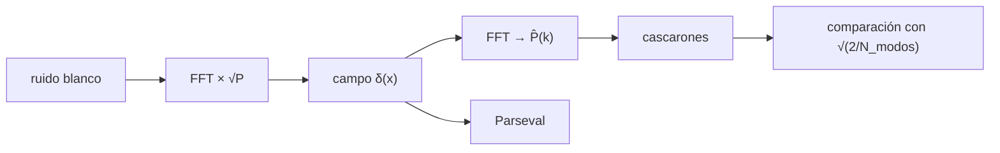

# B36-C04 — Espectro de potencia de materia

<!-- nav:top -->
[🏠 Programa](../../../../README.md) · [📚 Bloque B36](../../../tronco-comun/B36-formacion-de-estructuras-cosmicas-y-materia-oscura.md) · [← Anterior: B36-C03 — Funciones de correlación de galaxias](../B36-C03-funciones-de-correlacion-de-galaxias/CLASE.md) · [Siguiente: B36-C05 — Simulaciones cosmológicas de N cuerpos: condiciones iniciales y caja periódica →](../B36-C05-simulaciones-cosmologicas-de-n-cuerpos-condiciones-iniciales-y-caja-periodica/CLASE.md)
<!-- /nav -->

## 1. Ubicación, nivel y alcance

Clase 4 del bloque B36. Nivel N3. El **espectro de potencia** `P(k)` es la transformada de Fourier de `ξ(r)`. Aquí generas un campo gaussiano en una rejilla de `32³` celdas con un espectro de entrada conocido, estimas `P(k)` en cascarones y comparas con la **varianza cósmica gaussiana**; compruebas la FFT propia con una DFT directa y con el teorema de Parseval, y estimas el **ruido de Poisson**. Usas [B36-C02](../B36-C02-funcion-de-transferencia-y-espectro-de-materia/CLASE.md) y [B36-C03](../B36-C03-funciones-de-correlacion-de-galaxias/CLASE.md). Todo es **sintético**.

## 2. Por qué esta clase existe

Un espectro estimado sin su error no se puede comparar con un modelo. La decisión central: **¿está la desviación de cada intervalo dentro de la varianza cósmica?**

## 3. Lo que podrás hacer al terminar

1. Generar un campo gaussiano con espectro dado.
2. Comprobar la FFT con una DFT y con Parseval.
3. Estimar P(k) en cascarones.
4. Calcular la varianza cósmica por intervalo.
5. Estimar el ruido de Poisson.
6. Reconocer los límites (sin asignación de masa).

La evidencia es la **ficha del espectro de potencia** del ejercicio 12 (sección 20).

## 4. Con qué llegas y cómo comprobarlo

1. ¿Qué es una incertidumbre?
2. ¿Qué es una simulación Monte Carlo?
3. ¿Qué es una tabla de resultados?
4. ¿Qué es un valor ilustrativo?
5. ¿Qué es una verificación?

<details>
<summary>Ver respuestas</summary>

1. Un intervalo en que se espera el valor verdadero. 2. Repetir con números aleatorios de semilla fija. 3. Un resumen ordenado de cálculos. 4. Un valor propuesto para el ejemplo, no medido. 5. Comparar un cálculo con un caso independiente.
</details>

Con cuatro o cinco aciertos, sigue; si no, repasa los prerrequisitos.

## 5. Un caso de contexto y casos de referencia

Con una caja de `200 Mpc/h`, `32³` celdas y `P(k) = 1000 (k/0,1)⁻¹·⁵`, el estimador en `|n| = 3` vale `1107,7` frente a `1030,2` de entrada (`pull = 1,05`), y el ruido de un muestreo de Poisson da `121,59 (Mpc/h)³` frente a `1/n̄ = 122,07`. Es el **ejemplo conductor**; es **sintético**.

## 6. Vocabulario

El **espectro** `P(k)`. El **modo fundamental** `k_f = 2π/L`. El **estimador** `P̂ = (V/N⁶)|δ̃_k|²`. La **varianza cósmica** `σ_P/P = √(2/N_modos)`. El **ruido de Poisson** `1/n̄`. El **teorema de Parseval** iguala la varianza en el espacio real y el de Fourier.

## 7. Modelo mental: afinar un piano por sus armónicos

Es como descomponer un acorde en sus notas: cada nota es un modo, y las notas graves tienen pocos modos y por tanto más incertidumbre.



*Descripción textual:* un campo gaussiano se transforma, se promedia por cascarones y se compara con la varianza cósmica.

Analogía: afinar un piano por sus armónicos. Límite: campo gaussiano, caja periódica, sin asignación de masa.

## 8. La explicación, paso a paso

### 8.1 Pruebas de la FFT

La FFT propia coincide con una DFT directa de 16 puntos con error `4,24 × 10⁻¹⁴`, y el teorema de Parseval se cumple con error relativo `2,17 × 10⁻¹⁶`.

### 8.2 Estimación (4 realizaciones)

`k_f = 0,0314 h/Mpc` y `k_Nyquist = 0,503 h/Mpc`.

| n (módulo) | k (h/Mpc) | modos | P entrada | P estimado | σ teórico | pull |
|---|---|---|---|---|---|---|
| 1 | 0,0314 | 18 | 4144,20 | 3938,70 | 690,70 | −0,30 |
| 2 | 0,0628 | 62 | 1746,66 | 1802,01 | 156,85 | 0,35 |
| 3 | 0,0942 | 98 | 1030,24 | 1107,68 | 73,59 | 1,05 |
| 5 | 0,1571 | 350 | 496,72 | 438,92 | 18,77 | −3,08 |
| 8 | 0,2513 | 762 | 250,32 | 252,45 | 6,41 | 0,33 |
| 12 | 0,3770 | 1814 | 136,26 | 132,45 | 2,26 | −1,69 |
| 15 | 0,4712 | 2622 | 97,65 | 98,62 | 1,35 | 0,72 |

El `χ²` con 15 intervalos es `19,3` y el `|pull|` máximo `3,08` (en `|n| = 5`): un pull de 3,08 tiene una probabilidad de cerca del 3 % de aparecer en algún intervalo entre 15; es poco habitual y no se investigó si hay un sesgo (por ejemplo, de los cascarones discretos).

### 8.3 Ruido de Poisson

Con `λ = 2` cuentas por celda, `P̂` medio es `121,59 (Mpc/h)³` y `1/n̄ = 122,07`: razón `0,9961`.

## 9. Magnitudes, símbolos y unidades

| Símbolo | Qué es | Unidad | Valor / nota |
|---|---|---|---|
| `P(k)` | espectro de potencia | (Mpc/h)³ | 1000 a k = 0,1 (entrada) |
| `k_f` | modo fundamental | h/Mpc | 0,0314 |
| `N_modos` | modos por cascarón | — | 18 a 2622 |
| `1/n̄` | ruido de Poisson | (Mpc/h)³ | 122,07 |

## 10. Convenciones y referencias

Caja periódica de `200 Mpc/h`; `32³` celdas; cascarones de ancho `k_f`; semilla `20261109`.

## 11. De dónde sale lo que afirmamos

| ID | Fuente | Localizador | Respalda | Estado |
|---|---|---|---|---|
| — | Sin fuente externa | — | relaciones estándar que verifica el laboratorio | No se consultó una fuente para esta clase |

Límites: no se usó una fuente externa; no hay asignación de masa ni corrección de aliasing.

## 12. Cómo ver el espectro estimado

| Magnitud | Valor |
|---|---|
| error FFT | 4,24 × 10⁻¹⁴ |
| Parseval | 2,17 × 10⁻¹⁶ |
| χ² (15 bins) | 19,3 |
| razón de Poisson | 0,9961 |

Descripción larga: los intervalos se desvían de la entrada menos de 3,1 σ y el ruido de Poisson reproduce 1/n̄.

## 13. Ejemplo trabajado: la varianza cósmica de un cascarón

**Paso 1 · Modos.** `N = 98` y 4 realizaciones.

**Paso 2 · Fracción.** `√(2/(98 × 4)) = 0,0714`.

**Paso 3 · Sigma.** `1030,24 × 0,0714 = 73,6`.

## 14. Distintas formas de describir un cascarón

**Por modos:** `δ̃_k`. **Por cascarones:** promedio. **Por error:** `√(2/N)`. **Por ruido:** `1/n̄`.

## 15. Práctica guiada

**Ejercicio 1 · con los pasos indicados.** Calcula `k_f` con `L = 200`. *Pasos:* `2π/200`.

<details><summary>Solución comentada</summary>

`0,03142 h/Mpc`.
</details>

**Ejercicio 2 · con una pista.** Calcula `σ` en `|n| = 3`. *Pista:* ejemplo 13.

<details><summary>Solución comentada</summary>

`73,6`.
</details>

**Ejercicio 3 · casi autónomo.** Calcula el pull en `|n| = 5`. *Casi autónomo.*

<details><summary>Solución comentada</summary>

`(438,92 − 496,72)/18,77 = −3,08`.
</details>

## 16. Práctica autónoma, transferencia e integrador

**Ejercicio 4.** Volumen de una celda.

<details><summary>Solución comentada</summary>

`(200/32)³ = 244,14 (Mpc/h)³`.
</details>

**Ejercicio 5.** Ruido de Poisson con `λ = 2`.

<details><summary>Solución comentada</summary>

`244,14/2 = 122,07`.
</details>

**Ejercicio 6.** Razón medida/esperada.

<details><summary>Solución comentada</summary>

`121,59/122,07 = 0,9961`.
</details>

**Ejercicio 7.** Fracción `σ_P/P` con 350 modos y 4 realizaciones.

<details><summary>Solución comentada</summary>

`√(2/1400) = 0,0378`.
</details>

**Ejercicio 8.** `k_Nyquist`.

<details><summary>Solución comentada</summary>

`π × 32/200 = 0,503`.
</details>

**Ejercicio 9 · transferencia.** **Transferencia.** Un compañero dice que 3 σ en un intervalo prueba que el modelo falla. Responde.

<details><summary>Solución comentada</summary>

Con 15 intervalos, un pull de 3 no es raro; cuenta el `χ²` total (19,3 con 15).
</details>

**Ejercicio 10 · transferencia.** **Transferencia.** ¿Por qué hay menos modos a k pequeño?

<details><summary>Solución comentada</summary>

El cascarón tiene menos celdas de Fourier.
</details>

**Ejercicio 11 · transferencia.** **Transferencia.** ¿Qué falta para medir P(k) de galaxias reales?

<details><summary>Solución comentada</summary>

Asignación de masa, máscara, ruido de Poisson restado y corrección de aliasing.
</details>

**Ejercicio 12.** **Integrador.** Elabora tu *ficha del espectro de potencia*: rejilla, tabla de P, pulls y límites.

<details><summary>Solución comentada</summary>

Secciones 8.1–8.3.
</details>

**Ejercicio 12 · integrador.** **Integrador.** Elabora tu *ficha del espectro de potencia*: rejilla, tabla de P, pulls y límites.

<details><summary>Solución modelo</summary>

Secciones 8.1–8.3.
</details>

## 17. Laboratorio: estimación de P(k)

El script [espectro_pk.py](espectro_pk.py) genera un campo gaussiano, estima P(k) en cascarones y lo compara con la varianza cósmica (**comprueba** FFT, Parseval, `|pull| < 3,5` y el ruido de Poisson dentro del 3 %).

**Datos:** datos **sintéticos**; semilla `20261109`; sin fuente externa. **Predice antes de ejecutar:** ¿cuánto valdrá el ruido? (Unos 122.) **Ejecución del 2026-11-09 (Python 3.12.9):**

```text
Python 3.12.9 (biblioteca estandar)
FFT frente a DFT directa (n=16): error maximo = 4.24e-14
Parseval: error relativo maximo = 2.17e-16
 |n|  k [h/Mpc]  modos   P entrada  P estimado  sigma teor.   pull
   1     0.0314     18     4144.20     3938.70       690.70  -0.30
   2     0.0628     62     1746.66     1802.01       156.85   0.35
   3     0.0942     98     1030.24     1107.68        73.59   1.05
   5     0.1571    350      496.72      438.92        18.77  -3.08
   8     0.2513    762      250.32      252.45         6.41   0.33
  12     0.3770   1814      136.26      132.45         2.26  -1.69
  15     0.4712   2622       97.65       98.62         1.35   0.72
chi2 = 19.3 con 15 bins ; |pull| maximo = 3.08
Poisson: P medio = 121.59 (Mpc/h)^3 ; 1/n = 122.07 (Mpc/h)^3 ; razon = 0.9961
Pruebas superadas.
```

```bash
python programa/clases/B36/B36-C04-espectro-de-potencia-de-materia/espectro_pk.py
```

**Límites:** sin asignación de masa ni aliasing.

## 18. Errores frecuentes y cómo corregirlos

**Olvidar los factores V y N en el estimador.** Se corrige con el ejemplo 13.

**Contar todos los modos como independientes.** Solo la mitad lo es (campo real).

**No restar el ruido de Poisson.** Se corrige con 8.3.

**Presentar lo sintético como real.** Se corrige con la sección 10.

## 19. Cómo sabrás que vas bien

Tras la sección 8: ¿qué resultado esperabas y cuál obtuviste? Si dudas, repasa el ejemplo 13. Tras el laboratorio: ¿qué comprueba? (ver la sección 17).

## 20. Qué entregas y cómo se evalúa

El producto es tu **ficha del espectro de potencia** (ejercicio 12).

| Criterio | Inicial | En desarrollo | Logrado | Destacado |
|---|---|---|---|---|
| Conceptos | Los confunde | Parciales | conceptos de la clase | Explica los límites |
| Cálculo | Sin unidades | Con errores | Tablas completas | Calcula casos nuevos |
| Numérico | Sin comprobar | Un caso | Contraste con el análisis | Interpreta las diferencias |
| Fuentes | Sin fuente | Sin fecha | fuentes con fecha | Declara lo ilustrativo |
| Límites | No los nombra | Uno | Tres | Discute qué falta del modelo |

**Condiciones críticas (no se compensan con promedio):** rotular lo sintético y lo ilustrativo; no presentar el modelo simplificado como un resultado cosmológico; citar solo lo consultado.

## 21. Ética, seguridad y límites

Clase educativa: los modelos son simplificados. Accesibilidad: tablas equivalentes a las gráficas, fórmulas en texto, ejercicios sin conexión.

## 22. Para cerrar y seguir

El estimador recupera el espectro dentro de la varianza cósmica (`χ² = 19,3` con 15 intervalos, un intervalo a 3,08 σ) y el ruido de Poisson es `1/n̄`. Queda una pregunta: ¿cómo evoluciona un campo así bajo gravedad?

**Glosario español–inglés.** espectro de potencia · *power spectrum*; varianza cósmica · *cosmic variance*; ruido de Poisson · *shot noise*; modo · *mode*; rejilla · *grid*.

**Continuidad.** [B36-C05](../B36-C05-simulaciones-cosmologicas-de-n-cuerpos-condiciones-iniciales-y-caja-periodica/CLASE.md) estudia las simulaciones de N cuerpos.

**Referencias:** ver sección 11.

<!-- nav:bottom -->
---

[← Anterior: B36-C03 — Funciones de correlación de galaxias](../B36-C03-funciones-de-correlacion-de-galaxias/CLASE.md) · [📚 Bloque B36](../../../tronco-comun/B36-formacion-de-estructuras-cosmicas-y-materia-oscura.md) · [Siguiente: B36-C05 — Simulaciones cosmológicas de N cuerpos: condiciones iniciales y caja periódica →](../B36-C05-simulaciones-cosmologicas-de-n-cuerpos-condiciones-iniciales-y-caja-periodica/CLASE.md)
<!-- /nav -->
