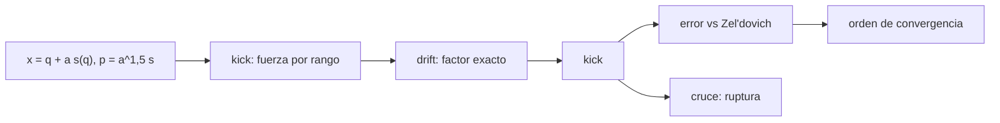

# B36-C05 — Simulaciones cosmológicas de N cuerpos: condiciones iniciales y caja periódica

<!-- nav:top -->
[🏠 Programa](../../../../README.md) · [📚 Bloque B36](../../../tronco-comun/B36-formacion-de-estructuras-cosmicas-y-materia-oscura.md) · [← Anterior: B36-C04 — Espectro de potencia de materia](../B36-C04-espectro-de-potencia-de-materia/CLASE.md) · [Siguiente: B36-C06 — Formación de halos y función de masa →](../B36-C06-formacion-de-halos-y-funcion-de-masa/CLASE.md)
<!-- /nav -->

## 1. Ubicación, nivel y alcance

Clase 5 del bloque B36. Nivel N3. Una simulación cosmológica de N cuerpos sigue partículas en una **caja periódica** que se expande. Aquí evolucionas **256 láminas** en una dimensión, donde la fuerza es exacta, con **condiciones iniciales de Zel'dovich**, las comparas con la solución analítica antes del cruce de láminas y mides el **orden de convergencia** del integrador. Usas [B36-C01](../B36-C01-crecimiento-lineal-de-perturbaciones-de-densidad/CLASE.md) y [B05](../../../tronco-comun/B05-fisica-fundamental-para-el-espacio.md). Todo es **sintético**.

## 2. Por qué esta clase existe

Una simulación sin comprobar contra un caso exacto no es una prueba. La decisión central: **¿converge el integrador al resultado analítico y qué pasa cuando las láminas se cruzan?**

## 3. Lo que podrás hacer al terminar

1. Construir condiciones iniciales de Zel'dovich.
2. Plantear la ecuación de movimiento en la variable a.
3. Integrar con salto de rana y factores exactos de a.
4. Medir el error y el orden de convergencia.
5. Comparar la densidad con 1/(1 − aε).
6. Reconocer la ruptura de Zel'dovich tras el cruce.

La evidencia es la **ficha de la simulación de N cuerpos** del ejercicio 12 (sección 20).

## 4. Con qué llegas y cómo comprobarlo

1. ¿Qué es una incertidumbre?
2. ¿Qué es una simulación Monte Carlo?
3. ¿Qué es una tabla de resultados?
4. ¿Qué es un valor ilustrativo?
5. ¿Qué es una verificación?

<details>
<summary>Ver respuestas</summary>

1. Un intervalo en que se espera el valor verdadero. 2. Repetir con números aleatorios de semilla fija. 3. Un resumen ordenado de cálculos. 4. Un valor propuesto para el ejemplo, no medido. 5. Comparar un cálculo con un caso independiente.
</details>

Con cuatro o cinco aciertos, sigue; si no, repasa los prerrequisitos.

## 5. Un caso de contexto y casos de referencia

Con `256` láminas, `ε = 1` y paso `Δa = 0,001`, el error máximo en `a = 0,81` es `5,1 × 10⁻³` espaciados, el orden observado `1,97–1,99` y la densidad en el pico `5,259` frente a `5,263`. Es el **ejemplo conductor**; es **sintético** y 1D.

## 6. Vocabulario

Una **lámina** es una masa repartida en un plano. La **aproximación de Zel'dovich** `x = q + D s(q)`. La **posición lagrangiana** `q`. La **caja periódica** identifica los bordes. El **salto de rana** alterna medio impulso, un movimiento y otro medio impulso. El **cruce de láminas** ocurre cuando `1 − aε = 0`.

## 7. Modelo mental: fichas de dominó que se cruzan

Es como una fila de fichas empujadas hacia un punto: antes de que se toquen, su posición es una fórmula simple; después, hay que seguirlas una a una.



*Descripción textual:* las condiciones iniciales entran en el salto de rana y el resultado se compara con Zel'dovich y con la densidad analítica.

Analogía: fichas de dominó que se cruzan. Límite: 1D plano, Einstein–de Sitter, sin suavizado.

## 8. La explicación, paso a paso

### 8.1 Plan del cálculo

En Einstein–de Sitter (`4πGρ̄ = 1,5 H²`) la ecuación de cada lámina es `x'' + (3/2a) x' = (3/2) a⁻² (x − q)` en la variable `a`, donde `q` es la posición lagrangiana del rango (la fuerza en 1D es exacta incluso después del cruce). El desplazamiento inicial es `s(q) = −(ε/k) sin(kq)` con `k = 2π/L` y el cruce llega en `a = 1/ε = 1`.

### 8.2 Convergencia (a = 0,81, antes del cruce)

| Δa | pasos | error máximo (espaciados) |
|---|---|---|
| 0,004 | 200 | 8,009 × 10⁻² |
| 0,002 | 400 | 2,046 × 10⁻² |
| 0,001 | 800 | 5,145 × 10⁻³ |

Los órdenes observados son `1,97` y `1,99`: segundo orden.

### 8.3 Densidad y momento

En `a = 0,81` la densidad en `q = 0` es `5,259` en la simulación y `1/(1 − 0,81) = 5,263` en Zel'dovich. El momento total vale `−2,64 × 10⁻¹⁴` (cero salvo redondeo).

### 8.4 Tras el cruce

En `a = 1,51` la desviación máxima respecto de Zel'dovich es `3,8` espaciados y hay `74` pares adyacentes fuera de orden: Zel'dovich deja de valer, la simulación sigue.

## 9. Magnitudes, símbolos y unidades

| Símbolo | Qué es | Unidad | Valor / nota |
|---|---|---|---|
| `a` | factor de escala | — | 0,01 a 1,51 |
| `ε` | amplitud del modo | — | 1 |
| `N` | láminas | — | 256 |
| `Δa` | paso | — | 0,001 |

## 10. Convenciones y referencias

Longitud de la caja `L = 1`; `k = 2π/L`; tiempo en `a`; fuerza por rango; semilla no necesaria (determinista).

## 11. De dónde sale lo que afirmamos

| ID | Fuente | Localizador | Respalda | Estado |
|---|---|---|---|---|
| — | Sin fuente externa | — | relaciones estándar que verifica el laboratorio | No se consultó una fuente para esta clase |

Límites: la aproximación de Zel'dovich y el salto de rana son resultados conocidos que no se consultaron; el modelo es 1D.

## 12. Cómo ver la convergencia

| Magnitud | Valor |
|---|---|
| error con Δa = 0,001 | 5,1 × 10⁻³ espaciados |
| orden | 1,97 y 1,99 |
| densidad pico | 5,259 vs 5,263 |
| pares cruzados (a = 1,51) | 74 |

Descripción larga: el error cae por 4 cuando Δa se divide por 2.

## 13. Ejemplo trabajado: el orden de convergencia

**Paso 1 · Cociente.** `8,009 × 10⁻²/2,046 × 10⁻² = 3,914`.

**Paso 2 · Logaritmo.** `log₂ 3,914 = 1,97`.

**Paso 3 · Lectura.** Orden 2: el error cae como `Δa²`.

## 14. Distintas formas de describir una simulación

**Por fórmula:** Zel'dovich. **Por error:** orden. **Por densidad:** `1/(1 − aε)`. **Por rangos:** fuerza exacta.

## 15. Práctica guiada

**Ejercicio 1 · con los pasos indicados.** Densidad de Zel'dovich en `a = 0,5` con `ε = 1`. *Pasos:* `1/(1 − 0,5)`.

<details><summary>Solución comentada</summary>

`2`.
</details>

**Ejercicio 2 · con una pista.** Densidad en `a = 0,9`. *Pista:* misma fórmula.

<details><summary>Solución comentada</summary>

`10`.
</details>

**Ejercicio 3 · casi autónomo.** Orden entre `Δa = 0,002` y `0,001`. *Casi autónomo.*

<details><summary>Solución comentada</summary>

`log₂(2,046 × 10⁻²/5,145 × 10⁻³) = 1,99`.
</details>

## 16. Práctica autónoma, transferencia e integrador

**Ejercicio 4.** Número de pasos de `a = 0,01` a `0,81` con `Δa = 0,004`.

<details><summary>Solución comentada</summary>

`0,80/0,004 = 200`.
</details>

**Ejercicio 5.** Espaciado medio.

<details><summary>Solución comentada</summary>

`1/256 = 0,0039 L`.
</details>

**Ejercicio 6.** Error absoluto con `Δa = 0,001`.

<details><summary>Solución comentada</summary>

`5,1 × 10⁻³ × 0,0039 = 2,0 × 10⁻⁵ L`.
</details>

**Ejercicio 7.** Desplazamiento máximo inicial en `a = 0,01`.

<details><summary>Solución comentada</summary>

`0,01/(2π) = 1,6 × 10⁻³ L = 0,41` espaciados.
</details>

**Ejercicio 8.** Diferencia relativa de la densidad.

<details><summary>Solución comentada</summary>

`(5,263 − 5,259)/5,263 = 0,08 %`.
</details>

**Ejercicio 9 · transferencia.** **Transferencia.** Un compañero dice que Zel'dovich vale siempre. Responde.

<details><summary>Solución comentada</summary>

Solo antes del cruce de láminas (`a < 1/ε`); a `a = 1,51` se desvía 3,8 espaciados.
</details>

**Ejercicio 10 · transferencia.** **Transferencia.** ¿Por qué una caja periódica?

<details><summary>Solución comentada</summary>

Para eliminar los bordes y permitir un campo homogéneo y la FFT.
</details>

**Ejercicio 11 · transferencia.** **Transferencia.** ¿Qué cambia en 3D?

<details><summary>Solución comentada</summary>

La fuerza ya no es exacta por rangos: se resuelve con árbol o malla.
</details>

**Ejercicio 12.** **Integrador.** Elabora tu *ficha de la simulación de N cuerpos*: ecuación, tabla de convergencia, densidad y ruptura.

<details><summary>Solución comentada</summary>

Secciones 8.1–8.4.
</details>

**Ejercicio 12 · integrador.** **Integrador.** Elabora tu *ficha de la simulación de N cuerpos*: ecuación, tabla de convergencia, densidad y ruptura.

<details><summary>Solución modelo</summary>

Secciones 8.1–8.4.
</details>

## 17. Laboratorio: simulación 1D de láminas

El script [nbody1d.py](nbody1d.py) evoluciona 256 láminas con salto de rana y las compara con Zel'dovich (**comprueba** el orden 2, la densidad y la conservación del momento).

**Datos:** datos **sintéticos** (1D, EdS); sin fuente externa; determinista. **Predice antes de ejecutar:** ¿qué orden esperas? (2.) **Ejecución del 2026-11-09 (Python 3.12.9):**

```text
Python 3.12.9 (biblioteca estandar)
      da  pasos   error max en a=0.81 [espaciados]
  0.0040    200                          8.009e-02
  0.0020    400                          2.046e-02
  0.0010    800                          5.145e-03
orden de convergencia observado: 1.97 y 1.99
densidad en q = 0 en a = 0.81: simulacion = 5.259 ; Zel'dovich 1/(1 - a eps) = 5.263
momento total = -2.64e-14 (debe ser ~0)
a = 1.51 (tras el cruce): desviacion maxima respecto a Zel'dovich = 3.8 espaciados ; pares de laminas fuera de orden = 74
Pruebas superadas.
```

```bash
python programa/clases/B36/B36-C05-simulaciones-cosmologicas-de-n-cuerpos-condiciones-iniciales-y-caja-periodica/nbody1d.py
```

**Límites:** 1D plano, EdS, sin suavizado.

## 18. Errores frecuentes y cómo corregirlos

**Integrar en el tiempo cosmológico sin los factores de a.** Se corrige con el ejemplo 8.1.

**Aplicar Zel'dovich tras el cruce.** Se corrige con 8.4.

**Olvidar el orden de las láminas.** La fuerza depende del rango.

**Presentar el 1D como una simulación cosmológica real.** Se corrige con la sección 10.

## 19. Cómo sabrás que vas bien

Tras la sección 8: ¿qué resultado esperabas y cuál obtuviste? Si dudas, repasa el ejemplo 13. Tras el laboratorio: ¿qué comprueba? (ver la sección 17).

## 20. Qué entregas y cómo se evalúa

El producto es tu **ficha de la simulación de N cuerpos** (ejercicio 12).

| Criterio | Inicial | En desarrollo | Logrado | Destacado |
|---|---|---|---|---|
| Conceptos | Los confunde | Parciales | conceptos de la clase | Explica los límites |
| Cálculo | Sin unidades | Con errores | Tablas completas | Calcula casos nuevos |
| Numérico | Sin comprobar | Un caso | Contraste con el análisis | Interpreta las diferencias |
| Fuentes | Sin fuente | Sin fecha | fuentes con fecha | Declara lo ilustrativo |
| Límites | No los nombra | Uno | Tres | Discute qué falta del modelo |

**Condiciones críticas (no se compensan con promedio):** rotular lo sintético y lo ilustrativo; no presentar el modelo simplificado como un resultado cosmológico; citar solo lo consultado.

## 21. Ética, seguridad y límites

Clase educativa: los modelos son simplificados. Accesibilidad: tablas equivalentes a las gráficas, fórmulas en texto, ejercicios sin conexión.

## 22. Para cerrar y seguir

El integrador converge con orden 2 a la solución exacta y reproduce la densidad `5,26`; tras el cruce Zel'dovich falla. Queda una pregunta: ¿cuándo y cuánta masa colapsa en un halo?

**Glosario español–inglés.** N cuerpos · *N-body*; caja periódica · *periodic box*; salto de rana · *leapfrog*; lámina · *sheet*; condiciones iniciales · *initial conditions*.

**Continuidad.** [B36-C06](../B36-C06-formacion-de-halos-y-funcion-de-masa/CLASE.md) estudia la formación de halos.

**Referencias:** ver sección 11.

<!-- nav:bottom -->
---

[← Anterior: B36-C04 — Espectro de potencia de materia](../B36-C04-espectro-de-potencia-de-materia/CLASE.md) · [📚 Bloque B36](../../../tronco-comun/B36-formacion-de-estructuras-cosmicas-y-materia-oscura.md) · [Siguiente: B36-C06 — Formación de halos y función de masa →](../B36-C06-formacion-de-halos-y-funcion-de-masa/CLASE.md)
<!-- /nav -->
