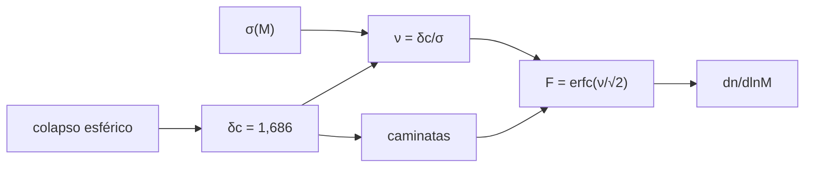

# B36-C06 — Formación de halos y función de masa

<!-- nav:top -->
[🏠 Programa](../../../../README.md) · [📚 Bloque B36](../../../tronco-comun/B36-formacion-de-estructuras-cosmicas-y-materia-oscura.md) · [← Anterior: B36-C05 — Simulaciones cosmológicas de N cuerpos: condiciones iniciales y caja periódica](../B36-C05-simulaciones-cosmologicas-de-n-cuerpos-condiciones-iniciales-y-caja-periodica/CLASE.md) · [Siguiente: B36-C07 — Oscilaciones acústicas bariónicas como regla estándar →](../B36-C07-oscilaciones-acusticas-barionicas-como-regla-estandar/CLASE.md)
<!-- /nav -->

## 1. Ubicación, nivel y alcance

Clase 6 del bloque B36. Nivel N3. Una región suficientemente densa se desacopla de la expansión y **colapsa en un halo**. Aquí calculas el umbral lineal `δc` del **colapso esférico** por dos vías, la **fracción de masa en halos** de Press–Schechter por cuadratura y con **caminatas aleatorias** del conjunto de excursión. Usas [B36-C01](../B36-C01-crecimiento-lineal-de-perturbaciones-de-densidad/CLASE.md) y [B36-C02](../B36-C02-funcion-de-transferencia-y-espectro-de-materia/CLASE.md). La ley `σ(M)` es **ilustrativa**.

## 2. Por qué esta clase existe

Contar halos exige un umbral de colapso y una función de masa. La decisión central: **¿cuánta masa del universo está en halos de más de cierta masa?**

## 3. Lo que podrás hacer al terminar

1. Calcular δc con una fórmula cerrada.
2. Calcular δc con una cuadratura independiente.
3. Obtener la fracción de masa F(>M).
4. Integrar la función de masa.
5. Simular caminatas del conjunto de excursión.
6. Reconocer la corrección de discretización.

La evidencia es la **ficha de halos y función de masa** del ejercicio 12 (sección 20).

## 4. Con qué llegas y cómo comprobarlo

1. ¿Qué es una incertidumbre?
2. ¿Qué es una simulación Monte Carlo?
3. ¿Qué es una tabla de resultados?
4. ¿Qué es un valor ilustrativo?
5. ¿Qué es una verificación?

<details>
<summary>Ver respuestas</summary>

1. Un intervalo en que se espera el valor verdadero. 2. Repetir con números aleatorios de semilla fija. 3. Un resumen ordenado de cálculos. 4. Un valor propuesto para el ejemplo, no medido. 5. Comparar un cálculo con un caso independiente.
</details>

Con cuatro o cinco aciertos, sigue; si no, repasa los prerrequisitos.

## 5. Un caso de contexto y casos de referencia

Con `δc = 1,6865`, `σ₈ = 0,811` y `σ(M) ∝ M^−0,27` (ilustrativa), la fracción de masa en halos de `M > 10¹⁴ M☉/h` es `F = 0,0793`, con una densidad de `3,86 × 10⁻⁵ (Mpc/h)⁻³`. Es el **ejemplo conductor**; la `σ(M)` es **ilustrativa**.

## 6. Vocabulario

El **umbral de colapso** `δc`. La **altura** `ν = δc/σ(M)`. La **fracción de masa** `F(>M) = erfc(ν/√2)`. La **función de masa** `dn/dlnM`. La **caminata del conjunto de excursión** sigue `δ(S)` con `S = σ²`. El **primer cruce** de la barrera `δc`.

## 7. Modelo mental: una piscina que se desborda

Es como una piscina con un borde: el agua (la densidad) sube al azar y la fracción de caminos que alguna vez pasan el borde es la fracción de masa en halos.



*Descripción textual:* el colapso esférico fija el umbral, que junto con σ(M) da la fracción de masa y la función de masa; las caminatas lo verifican.

Analogía: una piscina que se desborda. Límite: colapso esférico en Einstein–de Sitter, sin cizalla ni rotación.

## 8. La explicación, paso a paso

### 8.1 Umbral de colapso

La fórmula cerrada `δc = (3/20)(12π)^(2/3)` vale `1,68647`. La cuadratura numérica del tiempo de colapso de una capa con perturbación inicial `δᵢ` da:

| δᵢ | δc numérico | diferencia relativa |
|---|---|---|
| 10⁻³ | 1,68703 | 3,33 × 10⁻⁴ |
| 10⁻⁴ | 1,68653 | 3,33 × 10⁻⁵ |
| 10⁻⁵ | 1,68648 | 3,33 × 10⁻⁶ |

La diferencia es proporcional a `δᵢ`, como corresponde a una corrección de primer orden.

### 8.2 Fracción de masa

Con `ρ_crit = 2,7754 × 10¹¹ h² M☉/Mpc³`, `ρ_m = 8,742 × 10¹⁰ M☉ (Mpc/h)⁻³` y `M₈ = 1,875 × 10¹⁴ M☉/h`:

| M (M☉/h) | σ(M) | ν | F(>M) | n(>M) ((Mpc/h)⁻³) |
|---|---|---|---|---|
| 10¹¹ | 6,205 | 0,272 | 0,7858 | 6,33 × 10⁻² |
| 10¹² | 3,332 | 0,506 | 0,6128 | 9,61 × 10⁻³ |
| 10¹³ | 1,789 | 0,942 | 0,3460 | 1,01 × 10⁻³ |
| 10¹⁴ | 0,961 | 1,755 | 0,0793 | 3,86 × 10⁻⁵ |
| 10¹⁵ | 0,516 | 3,268 | 0,0011 | 7,36 × 10⁻⁸ |

La integral de `M dn/dlnM` desde `10¹³` da `0,34597`, igual que `erfc`.

### 8.3 Caminatas aleatorias (4000 caminatas)

| S | pasos | fracción simulada | erfc(δc/√2S) | barrera corregida | σ binomial |
|---|---|---|---|---|---|
| 1 | 250 | 0,0777 | 0,0917 | 0,0784 | 0,0046 |
| 1 | 1000 | 0,0810 | 0,0917 | 0,0848 | 0,0046 |
| 2 | 1000 | 0,2210 | 0,2331 | 0,2230 | 0,0067 |
| 4 | 1000 | 0,3760 | 0,3991 | 0,3889 | 0,0077 |

Con pasos discretos se pierden cruces; desplazar la barrera `0,5826 √ΔS` (corrección conocida **no consultada**) reproduce la simulación dentro de 3 σ.

## 9. Magnitudes, símbolos y unidades

| Símbolo | Qué es | Unidad | Valor / nota |
|---|---|---|---|
| `δc` | umbral de colapso lineal | — | 1,68647 |
| `ν` | altura | — | 1,755 a 10¹⁴ |
| `F(>M)` | fracción de masa | — | 0,0793 a 10¹⁴ |
| `M₈` | masa en 8 Mpc/h | M☉/h | 1,875 × 10¹⁴ |

## 10. Convenciones y referencias

Masas en `M☉/h`; `σ(M) = σ₈ (M/M₈)^−0,27` (ilustrativa); `ρ_m` con `h = 1`; semilla `20261109`.

## 11. De dónde sale lo que afirmamos

| ID | Fuente | Localizador | Respalda | Estado |
|---|---|---|---|---|
| S1 | NIST, *Fundamental Physical Constants* (CODATA 2022) | https://physics.nist.gov/cuu/Constants/Table/allascii.txt | G | Consultada el 2026-11-09 |
| S2 | UAI, Resolución B3 de 2015 | https://arxiv.org/abs/1510.07674 | GM nominal del Sol | Consultada el 2026-11-09 |
| S3 | IERS Technical Note 36, Tabla 1.1 | https://iers-conventions.obspm.fr/ | `au` exacta, de la que se deriva el pc | Consultada el 2026-11-09 |
| S4 | Planck Collaboration, *Planck 2018 results. VI. Cosmological parameters* | https://arxiv.org/abs/1807.06209 | Ωm = 0,315, H₀ = 67,4 km/s/Mpc, σ₈ = 0,811, Ωb h² = 0,0224, nₛ = 0,965 (solo el resumen) | Solo resumen, consultado el 2026-11-09 |
| S5 | Función de masa de Press–Schechter y corrección de discretización (literatura) | — | Press–Schechter y la corrección de barrera 0,5826 | No se consultó la fuente; relación conocida que verifica el laboratorio |

Límites: Press–Schechter y la corrección de discretización no se consultaron; no se usa Sheth–Tormen ni simulaciones.

## 12. Cómo ver la función de masa

| Magnitud | Valor |
|---|---|
| δc cerrado | 1,68647 |
| δc numérico (δᵢ = 10⁻⁵) | 1,68648 |
| F(>10¹⁴) | 0,0793 |
| n(>10¹⁴) | 3,86 × 10⁻⁵ (Mpc/h)⁻³ |

Descripción larga: F cae de 0,79 a 0,001 entre 10¹¹ y 10¹⁵.

## 13. Ejemplo trabajado: la altura ν

**Paso 1 · Cociente.** `1,6865/0,961 = 1,755`.

**Paso 2 · Argumento.** `ν/√2 = 1,241`.

**Paso 3 · erfc.** `erfc(1,241) = 0,0793`.

## 14. Distintas formas de describir una fracción

**Por fórmula:** `δc`. **Por cuadratura:** colapso de una capa. **Por altura:** `ν`. **Por caminata:** primer cruce.

## 15. Práctica guiada

**Ejercicio 1 · con los pasos indicados.** Calcula `δc = (3/20)(12π)^(2/3)`. *Pasos:* `12π = 37,70`.

<details><summary>Solución comentada</summary>

`1,6865`.
</details>

**Ejercicio 2 · con una pista.** Calcula `ν` en `M = 10¹⁴`. *Pista:* ejemplo 13.

<details><summary>Solución comentada</summary>

`1,755`.
</details>

**Ejercicio 3 · casi autónomo.** Calcula `F` para `ν = 1,755`. *Casi autónomo.*

<details><summary>Solución comentada</summary>

`erfc(1,241) = 0,0793`.
</details>

## 16. Práctica autónoma, transferencia e integrador

**Ejercicio 4.** Halos de `M > 10¹⁴` en una caja de `(1 Gpc/h)³`.

<details><summary>Solución comentada</summary>

`3,86 × 10⁻⁵ × 10⁹ = 3,9 × 10⁴`.
</details>

**Ejercicio 5.** Halos de `M > 10¹⁵` en la misma caja.

<details><summary>Solución comentada</summary>

`7,36 × 10⁻⁸ × 10⁹ = 74`.
</details>

**Ejercicio 6.** Diferencia relativa entre `δc` numérico (10⁻⁵) y cerrado.

<details><summary>Solución comentada</summary>

`3,3 × 10⁻⁶`.
</details>

**Ejercicio 7.** ¿Qué fracción de masa queda fuera de halos de `10¹¹`?

<details><summary>Solución comentada</summary>

`1 − 0,7858 = 0,214`.
</details>

**Ejercicio 8.** Error del extremo `S = 1` con 1000 pasos.

<details><summary>Solución comentada</summary>

`0,0848 − 0,0810 = 0,0038 = 0,8 σ`.
</details>

**Ejercicio 9 · transferencia.** **Transferencia.** Un compañero dice que `δc` depende de la masa. Responde.

<details><summary>Solución comentada</summary>

En este modelo esférico en EdS es una constante.
</details>

**Ejercicio 10 · transferencia.** **Transferencia.** ¿Por qué `F` no suma 1 con la masa en halos?

<details><summary>Solución comentada</summary>

En Press–Schechter se corrige con el factor 2; ν → 0 da F → 1.
</details>

**Ejercicio 11 · transferencia.** **Transferencia.** ¿Qué limita la `σ(M)` de potencia?

<details><summary>Solución comentada</summary>

Es ilustrativa: no sale del espectro de la clase C02.
</details>

**Ejercicio 12.** **Integrador.** Elabora tu *ficha de halos y función de masa*: δc, tabla de F, caminatas y límites.

<details><summary>Solución comentada</summary>

Secciones 8.1–8.3.
</details>

**Ejercicio 12 · integrador.** **Integrador.** Elabora tu *ficha de halos y función de masa*: δc, tabla de F, caminatas y límites.

<details><summary>Solución modelo</summary>

Secciones 8.1–8.3.
</details>

## 17. Laboratorio: colapso y función de masa

El script [halos.py](halos.py) calcula δc de dos maneras, integra la función de masa y simula caminatas (**comprueba** `δc` al 0,1 %, la cuadratura de `F` y las caminatas dentro de 3 σ).

**Datos:** G (NIST), au (IERS), GM☉ (UAI), Ωm, h, σ₈ (resumen de Planck); `σ(M)` **ilustrativa**; semilla `20261109`. **Predice antes de ejecutar:** ¿qué valdrá δc? (Cerca de 1,69.) **Ejecución del 2026-11-09 (Python 3.12.9):**

```text
Python 3.12.9 (biblioteca estandar)
delta_c cerrado = 1.68647
  delta_i  delta_c numerico  dif. relativa
    1e-03           1.68703       3.33e-04
    1e-04           1.68653       3.33e-05
    1e-05           1.68648       3.33e-06
rho_crit/h^2 = 2.7754e+11 Msun/Mpc^3 ; rho_m (h=1) = 8.7424e+10 ; M8 = 1.875e+14 Msun/h
 M [Msun/h]  sigma(M)      nu    F(>M)   n(>M) [(Mpc/h)^-3]
    1.0e+11     6.205   0.272   0.7858            6.327e-02
    1.0e+12     3.332   0.506   0.6128            9.614e-03
    1.0e+13     1.789   0.942   0.3460            1.012e-03
    1.0e+14     0.961   1.755   0.0793            3.858e-05
    1.0e+15     0.516   3.268   0.0011            7.361e-08
fraccion de masa por cuadratura = 0.34597 ; erfc = 0.34597
    S  pasos  cruces  frac. sim.  erfc(dc/sqrt(2S))  barrera corr. sigma bin.
  1.0    250     311      0.0777             0.0917             0.0784     0.0046
  2.0    250     839      0.2097             0.2331             0.2133     0.0067
  4.0    250    1501      0.3752             0.3991             0.3788     0.0077
  1.0   1000     324      0.0810             0.0917             0.0848     0.0046
  2.0   1000     884      0.2210             0.2331             0.2230     0.0067
  4.0   1000    1504      0.3760             0.3991             0.3889     0.0077
Pruebas superadas.
```

```bash
python programa/clases/B36/B36-C06-formacion-de-halos-y-funcion-de-masa/halos.py
```

**Límites:** colapso esférico; PS sin refinamientos.

## 18. Errores frecuentes y cómo corregirlos

**Usar 1,06 (turnaround) como umbral.** Se corrige con 8.1.

**Olvidar el factor 2 de Press–Schechter.** Se corrige con la fracción de masa.

**Contar la discretización como un fallo físico.** Se corrige con 8.3.

**Presentar σ(M) como la real.** Se corrige con la sección 10.

## 19. Cómo sabrás que vas bien

Tras la sección 8: ¿qué resultado esperabas y cuál obtuviste? Si dudas, repasa el ejemplo 13. Tras el laboratorio: ¿qué comprueba? (ver la sección 17).

## 20. Qué entregas y cómo se evalúa

El producto es tu **ficha de halos y función de masa** (ejercicio 12).

| Criterio | Inicial | En desarrollo | Logrado | Destacado |
|---|---|---|---|---|
| Conceptos | Los confunde | Parciales | conceptos de la clase | Explica los límites |
| Cálculo | Sin unidades | Con errores | Tablas completas | Calcula casos nuevos |
| Numérico | Sin comprobar | Un caso | Contraste con el análisis | Interpreta las diferencias |
| Fuentes | Sin fuente | Sin fecha | fuentes con fecha | Declara lo ilustrativo |
| Límites | No los nombra | Uno | Tres | Discute qué falta del modelo |

**Condiciones críticas (no se compensan con promedio):** rotular lo sintético y lo ilustrativo; no presentar el modelo simplificado como un resultado cosmológico; citar solo lo consultado.

## 21. Ética, seguridad y límites

Clase educativa: los modelos son simplificados. Accesibilidad: tablas equivalentes a las gráficas, fórmulas en texto, ejercicios sin conexión.

## 22. Para cerrar y seguir

El umbral `δc = 1,686` se obtiene por dos vías y la fracción de masa en halos de `10¹⁴ M☉/h` es `0,079`. Queda una pregunta: ¿qué regla estándar deja el plasma primordial en la distribución de materia?

**Glosario español–inglés.** colapso esférico · *spherical collapse*; función de masa · *mass function*; conjunto de excursión · *excursion set*; barrera · *barrier*; halo · *halo*.

**Continuidad.** [B36-C07](../B36-C07-oscilaciones-acusticas-barionicas-como-regla-estandar/CLASE.md) estudia las oscilaciones acústicas bariónicas.

**Referencias:** ver sección 11.

<!-- nav:bottom -->
---

[← Anterior: B36-C05 — Simulaciones cosmológicas de N cuerpos: condiciones iniciales y caja periódica](../B36-C05-simulaciones-cosmologicas-de-n-cuerpos-condiciones-iniciales-y-caja-periodica/CLASE.md) · [📚 Bloque B36](../../../tronco-comun/B36-formacion-de-estructuras-cosmicas-y-materia-oscura.md) · [Siguiente: B36-C07 — Oscilaciones acústicas bariónicas como regla estándar →](../B36-C07-oscilaciones-acusticas-barionicas-como-regla-estandar/CLASE.md)
<!-- /nav -->
