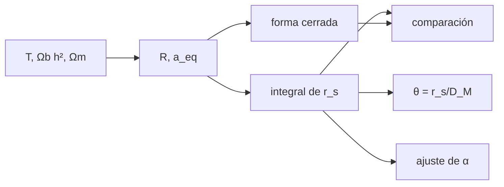

# B36-C07 — Oscilaciones acústicas bariónicas como regla estándar

<!-- nav:top -->
[🏠 Programa](../../../../README.md) · [📚 Bloque B36](../../../tronco-comun/B36-formacion-de-estructuras-cosmicas-y-materia-oscura.md) · [← Anterior: B36-C06 — Formación de halos y función de masa](../B36-C06-formacion-de-halos-y-funcion-de-masa/CLASE.md) · [Siguiente: B36-C08 — Sesgo de galaxias y trazadores de la materia →](../B36-C08-sesgo-de-galaxias-y-trazadores-de-la-materia/CLASE.md)
<!-- /nav -->

## 1. Ubicación, nivel y alcance

Clase 7 del bloque B36. Nivel N3. Antes de la recombinación, los fotones y bariones forman un fluido que sostiene ondas de sonido. La distancia que recorren hasta el **desacoplamiento de arrastre** es el **horizonte sonoro** `r_s`, una escala característica que se imprime en la distribución de galaxias. Aquí calculas `r_s` por integración y con una **forma cerrada**, lo usas como regla y ajustas la dilatación de un pico sintético. Usas [B36-C03](../B36-C03-funciones-de-correlacion-de-galaxias/CLASE.md) y [B36-C04](../B36-C04-espectro-de-potencia-de-materia/CLASE.md).

## 2. Por qué esta clase existe

Una regla estándar permite medir distancias si se conoce su longitud. La decisión central: **¿cuánto mide la regla y cuál es la precisión con que se puede medir su dilatación?**

## 3. Lo que podrás hacer al terminar

1. Calcular Ωγ y Ωr con constantes de NIST.
2. Integrar el horizonte sonoro.
3. Compararlo con la forma cerrada.
4. Calcular distancias D_M, D_H y D_V.
5. Ajustar la dilatación α de un pico sintético.
6. Comparar el error con el cálculo de Fisher.

La evidencia es la **ficha de las oscilaciones acústicas** del ejercicio 12 (sección 20).

## 4. Con qué llegas y cómo comprobarlo

1. ¿Qué es una incertidumbre?
2. ¿Qué es una simulación Monte Carlo?
3. ¿Qué es una tabla de resultados?
4. ¿Qué es un valor ilustrativo?
5. ¿Qué es una verificación?

<details>
<summary>Ver respuestas</summary>

1. Un intervalo en que se espera el valor verdadero. 2. Repetir con números aleatorios de semilla fija. 3. Un resumen ordenado de cálculos. 4. Un valor propuesto para el ejemplo, no medido. 5. Comparar un cálculo con un caso independiente.
</details>

Con cuatro o cinco aciertos, sigue; si no, repasa los prerrequisitos.

## 5. Un caso de contexto y casos de referencia

Con `Ωm = 0,315`, `H₀ = 67,4 km/s/Mpc` y `Ωb h² = 0,0224` (resumen de Planck 2018) y `T = 2,7255 K`, `N_eff = 3,046` y `z_d = 1060` (ilustrativos), `r_s = 146,89 Mpc = 99,0 h⁻¹ Mpc`, cercano a los «unos 100 h⁻¹ Mpc» del resumen de Eisenstein et al. (2005). Es el **ejemplo conductor**.

## 6. Vocabulario

El **horizonte sonoro** `r_s = ∫ c_s da/(a²H)`. La **velocidad del sonido** `c_s = c/√(3(1+R))`. La **carga bariónica** `R = 3ρ_b/(4ρ_γ)`. La **igualdad materia–radiación** `a_eq`. La **distancia comóvil transversal** `D_M`. La **dilatación** `α` desplaza el pico.

## 7. Modelo mental: un reloj de arena en el universo

Es como una regla de longitud conocida colocada a gran distancia: cuanto más pequeña la vemos, más lejos está.



*Descripción textual:* los parámetros fijan R y a_eq; r_s se integra, se compara con la forma cerrada y se usa como regla.

Analogía: un reloj de arena en el universo. Límite: plano, sin neutrinos masivos, fluido fotón–barión sin recombinación detallada.

## 8. La explicación, paso a paso

### 8.1 Cantidades derivadas

Con las constantes de NIST: `Ωγ h² = 2,4730 × 10⁻⁵`, `Ωr h² = 4,1837 × 10⁻⁵` (con neutrinos), `Ωr = 9,210 × 10⁻⁵`, `ΩΛ = 0,6849`, `a_eq = 2,924 × 10⁻⁴` (`z_eq = 3419`), `R₀ = 679,3` y `R(z_d) = 0,640`.

### 8.2 Horizonte sonoro

| Cálculo | r_s (Mpc) |
|---|---|
| numérico con Λ | 146,888 |
| numérico sin Λ | 146,888 |
| forma cerrada | 146,888 |

La diferencia relativa entre el numérico sin Λ y la forma cerrada es `6,2 × 10⁻¹⁴`; el efecto de Λ es `1,2 × 10⁻¹⁰`. En unidades de `h`: `r_s h = 99,00 h⁻¹ Mpc`.

### 8.3 Regla estándar

| z | D_M (Mpc) | D_H (Mpc) | D_V (Mpc) | D_V/r_s | θ = r_s/D_M (°) |
|---|---|---|---|---|---|
| 0,35 | 1423,2 | 3680,9 | 1376,7 | 9,373 | 5,914 |
| 0,57 | 2181,8 | 3223,1 | 2060,3 | 14,026 | 3,857 |
| 1,00 | 3400,9 | 2484,0 | 3062,8 | 20,851 | 2,475 |
| 2,34 | 5773,6 | 1261,4 | 4616,6 | 31,430 | 1,458 |

### 8.4 Ajuste de α

Un pico sintético con `α = 1,03` y ruido de `0,0006` se ajusta a `α = 1,0159 ± 0,0102` (Δχ² = 1) frente a `± 0,0105` de Fisher, con `χ² = 27,1` y 20 grados de libertad. Un 1 % en `α` equivale a `0,99 h⁻¹ Mpc` en la posición del pico.

## 9. Magnitudes, símbolos y unidades

| Símbolo | Qué es | Unidad | Valor / nota |
|---|---|---|---|
| `r_s` | horizonte sonoro | Mpc | 146,89 |
| `R₀` | carga bariónica hoy | — | 679,3 |
| `D_V` | distancia de volumen | Mpc | 2060,3 a z = 0,57 |
| `α` | dilatación | — | 1,0159 ± 0,0102 |

## 10. Convenciones y referencias

Distancias comóviles en Mpc; `h = 0,674`; `T = 2,7255 K` ilustrativa; semilla `20261109`.

## 11. De dónde sale lo que afirmamos

| ID | Fuente | Localizador | Respalda | Estado |
|---|---|---|---|---|
| S1 | NIST, *Fundamental Physical Constants* (CODATA 2022) | https://physics.nist.gov/cuu/Constants/Table/allascii.txt | c, G, k_B, ħ | Consultada el 2026-11-09 |
| S2 | IERS Technical Note 36, Tabla 1.1 | https://iers-conventions.obspm.fr/ | `au` exacta, de la que se deriva el pc | Consultada el 2026-11-09 |
| S3 | Planck Collaboration, *Planck 2018 results. VI. Cosmological parameters* | https://arxiv.org/abs/1807.06209 | Ωm = 0,315, H₀ = 67,4 km/s/Mpc, σ₈ = 0,811, Ωb h² = 0,0224, nₛ = 0,965 (solo el resumen) | Solo resumen, consultado el 2026-11-09 |
| S4 | Eisenstein et al., *Detection of the Baryon Acoustic Peak in the Large-Scale Correlation Function of SDSS Luminous Red Galaxies* | https://arxiv.org/abs/astro-ph/0501171 | pico en unos 100 h⁻¹ Mpc (solo el resumen) | Solo resumen, consultado el 2026-11-09 |

Límites: T_CMB, N_eff y z_d son ilustrativos; no se reprodujo el análisis de Eisenstein et al. y el pico del ajuste es sintético.

## 12. Cómo ver la regla estándar

| Magnitud | Valor |
|---|---|
| `r_s` | 146,89 Mpc |
| `r_s h` | 99,00 h⁻¹ Mpc |
| θ a z = 0,35 | 5,914° |
| α ajustado | 1,0159 ± 0,0102 |

Descripción larga: el ángulo de la regla baja de 5,9° a 1,5° entre z = 0,35 y z = 2,34.

## 13. Ejemplo trabajado: el ángulo de la regla

**Paso 1 · Cociente.** `146,888/1423,2 = 0,10321`.

**Paso 2 · Grados.** `× 180/π = 5,914°`.

**Paso 3 · Lectura.** A z = 0,35 la regla subtiende casi 6°.

## 14. Distintas formas de describir una regla

**Por integral:** `r_s`. **Por forma cerrada:** logaritmo. **Por ángulo:** `r_s/D_M`. **Por ajuste:** `α`.

## 15. Práctica guiada

**Ejercicio 1 · con los pasos indicados.** Calcula `R₀ = 3Ωb h²/(4Ωγ h²)`. *Pasos:* `0,0672/9,892 × 10⁻⁵`.

<details><summary>Solución comentada</summary>

`679,3`.
</details>

**Ejercicio 2 · con una pista.** Calcula `R(z_d)`. *Pista:* `R₀/(1 + z_d)`.

<details><summary>Solución comentada</summary>

`0,640`.
</details>

**Ejercicio 3 · casi autónomo.** Calcula `θ` a `z = 0,57`. *Casi autónomo.*

<details><summary>Solución comentada</summary>

`146,888/2181,8 = 0,06732 rad = 3,857°`.
</details>

## 16. Práctica autónoma, transferencia e integrador

**Ejercicio 4.** Convierte `r_s` a `h⁻¹ Mpc`.

<details><summary>Solución comentada</summary>

`146,888 × 0,674 = 99,0`.
</details>

**Ejercicio 5.** `D_V` a `z = 0,57`.

<details><summary>Solución comentada</summary>

`(0,57 × 2181,8² × 3223,1)^(1/3) = 2060`.
</details>

**Ejercicio 6.** `D_V/r_s` a z = 0,57.

<details><summary>Solución comentada</summary>

`2060,3/146,888 = 14,03`.
</details>

**Ejercicio 7.** Diferencia relativa entre `α` ajustado y el verdadero.

<details><summary>Solución comentada</summary>

`(1,03 − 1,0159)/1,0159 ≈ 1,4 %`, es decir 1,4 σ.
</details>

**Ejercicio 8.** ¿Cuántos σ?

<details><summary>Solución comentada</summary>

`0,0141/0,0102 = 1,4`.
</details>

**Ejercicio 9 · transferencia.** **Transferencia.** Un compañero dice que `r_s` depende de la distancia a la galaxia. Responde.

<details><summary>Solución comentada</summary>

No: es una escala comóvil fijada antes del arrastre; lo que depende de z es el ángulo.
</details>

**Ejercicio 10 · transferencia.** **Transferencia.** ¿Por qué cuenta el efecto de Λ en `r_s`?

<details><summary>Solución comentada</summary>

No cuenta (`10⁻¹⁰`): a `z = 1060` Λ es despreciable.
</details>

**Ejercicio 11 · transferencia.** **Transferencia.** ¿Qué ignora este `r_s`?

<details><summary>Solución comentada</summary>

Neutrinos masivos y la historia detallada de la recombinación.
</details>

**Ejercicio 12.** **Integrador.** Elabora tu *ficha de las oscilaciones acústicas*: cantidades, `r_s`, tabla de distancias y ajuste.

<details><summary>Solución comentada</summary>

Secciones 8.1–8.4.
</details>

**Ejercicio 12 · integrador.** **Integrador.** Elabora tu *ficha de las oscilaciones acústicas*: cantidades, `r_s`, tabla de distancias y ajuste.

<details><summary>Solución modelo</summary>

Secciones 8.1–8.4.
</details>

## 17. Laboratorio: horizonte sonoro y regla

El script [bao.py](bao.py) integra `r_s`, lo compara con la forma cerrada, calcula distancias y ajusta `α` (**comprueba** `r_s` a `10⁻⁵`, la ventana de 140–155 Mpc y `α` dentro de 3 σ).

**Datos:** constantes de NIST, au de IERS y parámetros de Planck (resumen); T, N_eff y z_d **ilustrativos**; picos **sintéticos**; semilla `20261109`. **Predice antes de ejecutar:** ¿cuánto vale `r_s`? (Unos 147 Mpc.) **Ejecución del 2026-11-09 (Python 3.12.9):**

```text
Python 3.12.9 (biblioteca estandar)
Omega_gamma h^2 = 2.4730e-05 ; Omega_r h^2 (con neutrinos) = 4.1837e-05 ; Omega_r = 9.210e-05 ; Omega_Lambda = 0.6849
a_eq = 2.924e-04 (z_eq = 3419) ; R0 = 3 rho_b/(4 rho_gamma) = 679.3 ; R(z_d) = 0.640
r_s numerico (con Lambda) = 146.888 Mpc ; sin Lambda = 146.888 Mpc ; forma cerrada = 146.888 Mpc
dif. relativa numerico(sin Lambda)-cerrado = 6.23e-14 ; efecto de Lambda = 1.20e-10
r_s h = 99.00 h^-1 Mpc
     z  D_M [Mpc]  D_H [Mpc]  D_V [Mpc]  D_V/r_s  theta=r_s/D_M [deg]
  0.35     1423.2     3680.9     1376.7    9.373                5.914
  0.57     2181.8     3223.1     2060.3   14.026                3.857
  1.00     3400.9     2484.0     3062.8   20.851                2.475
  2.34     5773.6     1261.4     4616.6   31.430                1.458
ajuste de alpha: 1.0159 +/- 0.0102 (Delta chi2 = 1) ; Fisher: +/- 0.0105 ; verdad 1.03 ; chi2_min = 27.1 con 20 gl
el 1 % en alpha equivale a 0.99 h^-1 Mpc en la posicion del pico (99.00 h^-1 Mpc)
Pruebas superadas.
```

```bash
python programa/clases/B36/B36-C07-oscilaciones-acusticas-barionicas-como-regla-estandar/bao.py
```

**Límites:** plano, sin neutrinos masivos, sin recombinación detallada.

## 18. Errores frecuentes y cómo corregirlos

**Confundir Mpc y h⁻¹ Mpc.** Se corrige con 8.2.

**Olvidar la radiación en la igualdad.** Se corrige con 8.1.

**Ajustar sin error.** Se corrige con 8.4.

**Presentar el pico sintético como observado.** Se corrige con la sección 10.

## 19. Cómo sabrás que vas bien

Tras la sección 8: ¿qué resultado esperabas y cuál obtuviste? Si dudas, repasa el ejemplo 13. Tras el laboratorio: ¿qué comprueba? (ver la sección 17).

## 20. Qué entregas y cómo se evalúa

El producto es tu **ficha de las oscilaciones acústicas** (ejercicio 12).

| Criterio | Inicial | En desarrollo | Logrado | Destacado |
|---|---|---|---|---|
| Conceptos | Los confunde | Parciales | conceptos de la clase | Explica los límites |
| Cálculo | Sin unidades | Con errores | Tablas completas | Calcula casos nuevos |
| Numérico | Sin comprobar | Un caso | Contraste con el análisis | Interpreta las diferencias |
| Fuentes | Sin fuente | Sin fecha | fuentes con fecha | Declara lo ilustrativo |
| Límites | No los nombra | Uno | Tres | Discute qué falta del modelo |

**Condiciones críticas (no se compensan con promedio):** rotular lo sintético y lo ilustrativo; no presentar el modelo simplificado como un resultado cosmológico; citar solo lo consultado.

## 21. Ética, seguridad y límites

Clase educativa: los modelos son simplificados. Accesibilidad: tablas equivalentes a las gráficas, fórmulas en texto, ejercicios sin conexión.

## 22. Para cerrar y seguir

El horizonte sonoro vale `146,9 Mpc` (`99,0 h⁻¹ Mpc`) y la dilatación del pico sintético se recupera con `1 %` de error. Queda una pregunta: ¿cómo se relacionan las galaxias con la materia que trazan?

**Glosario español–inglés.** horizonte sonoro · *sound horizon*; regla estándar · *standard ruler*; dilatación · *dilation*; recombinación · *recombination*; arrastre · *drag epoch*.

**Continuidad.** [B36-C08](../B36-C08-sesgo-de-galaxias-y-trazadores-de-la-materia/CLASE.md) estudia el sesgo de las galaxias.

**Referencias:** ver sección 11.

<!-- nav:bottom -->
---

[← Anterior: B36-C06 — Formación de halos y función de masa](../B36-C06-formacion-de-halos-y-funcion-de-masa/CLASE.md) · [📚 Bloque B36](../../../tronco-comun/B36-formacion-de-estructuras-cosmicas-y-materia-oscura.md) · [Siguiente: B36-C08 — Sesgo de galaxias y trazadores de la materia →](../B36-C08-sesgo-de-galaxias-y-trazadores-de-la-materia/CLASE.md)
<!-- /nav -->
