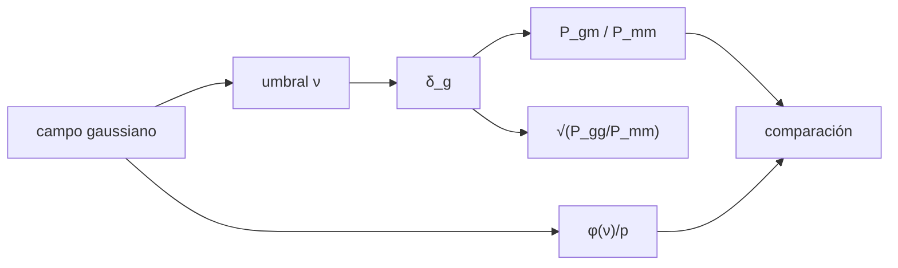

# B36-C08 — Sesgo de galaxias y trazadores de la materia

<!-- nav:top -->
[🏠 Programa](../../../../README.md) · [📚 Bloque B36](../../../tronco-comun/B36-formacion-de-estructuras-cosmicas-y-materia-oscura.md) · [← Anterior: B36-C07 — Oscilaciones acústicas bariónicas como regla estándar](../B36-C07-oscilaciones-acusticas-barionicas-como-regla-estandar/CLASE.md) · [Siguiente: B36-C09 — Cúmulos en colisión como prueba de materia oscura →](../B36-C09-cumulos-en-colision-como-prueba-de-materia-oscura/CLASE.md)
<!-- /nav -->

## 1. Ubicación, nivel y alcance

Clase 8 del bloque B36. Nivel N3. Las galaxias no siguen exactamente la materia: **trazan** las regiones más densas. Aquí seleccionas celdas por encima de un umbral en un campo gaussiano, mides el **sesgo** con el espectro cruzado y con `√(P_gg/P_mm)`, lo comparas con el **teorema de Bussgang** y calculas el sesgo lineal por **separación pico–fondo** de halos. Usas [B36-C04](../B36-C04-espectro-de-potencia-de-materia/CLASE.md) y [B36-C06](../B36-C06-formacion-de-halos-y-funcion-de-masa/CLASE.md). Todo es **sintético**.

## 2. Por qué esta clase existe

Si se ignora el sesgo, la amplitud de la materia se sobreestima. La decisión central: **¿qué sesgo corresponde a un trazador y cómo se mide?**

## 3. Lo que podrás hacer al terminar

1. Seleccionar trazadores por umbral.
2. Estimar el sesgo por el espectro cruzado.
3. Compararlo con φ(ν)/p.
4. Calcular √(P_gg/P_mm) a baja y alta k.
5. Calcular el sesgo de halos por separación pico–fondo.
6. Estimar el efecto de ignorar el sesgo.

La evidencia es la **ficha del sesgo** del ejercicio 12 (sección 20).

## 4. Con qué llegas y cómo comprobarlo

1. ¿Qué es una incertidumbre?
2. ¿Qué es una simulación Monte Carlo?
3. ¿Qué es una tabla de resultados?
4. ¿Qué es un valor ilustrativo?
5. ¿Qué es una verificación?

<details>
<summary>Ver respuestas</summary>

1. Un intervalo en que se espera el valor verdadero. 2. Repetir con números aleatorios de semilla fija. 3. Un resumen ordenado de cálculos. 4. Un valor propuesto para el ejemplo, no medido. 5. Comparar un cálculo con un caso independiente.
</details>

Con cuatro o cinco aciertos, sigue; si no, repasa los prerrequisitos.

## 5. Un caso de contexto y casos de referencia

Con un umbral `ν = 1,5` en un campo gaussiano de varianza 1, el sesgo previsto es `φ(ν)/p = 1,939`, el medido con el espectro cruzado `1,986 ± 0,025` y, si se ignorara, el `σ₈` aparente sería `1,572` en lugar de `0,811`. Es el **ejemplo conductor**; es **sintético**.

## 6. Vocabulario

El **sesgo lineal** `b` en `δ_g = b δ_m`. El **espectro cruzado** `P_gm`. El **teorema de Bussgang** iguala `P_gm = b P_mm` para una transformación local de un campo gaussiano. La **separación pico–fondo** da `b = 1 + (ν² − 1)/δc`. La **estocasticidad** es la parte de `δ_g` no explicada por `δ_m`.

## 7. Modelo mental: una lupa que solo ve las cumbres

Es como mirar solo las cumbres de un paisaje: se ven más contrastadas que el terreno medio, y eso hay que corregir al medir la altura del terreno.



*Descripción textual:* un umbral define los trazadores, y su sesgo se mide con dos estimadores y se compara con la teoría.

Analogía: una lupa que solo ve las cumbres. Límite: sesgo local determinista, sin muestreo de Poisson ni espacio de redshift.

## 8. La explicación, paso a paso

### 8.1 Predicción de Bussgang

Para un umbral `ν` en un campo de varianza 1, la fracción de celdas es `p = ½ erfc(ν/√2)` y la covarianza `E[δ·1] = φ(ν)`. El sesgo es `b = φ(ν)/p`, **sin dependencia de k**.

### 8.2 Medida

| ν | p | b = φ/p | b (cruzado, k bajo) | √(P_gg/P_mm) bajo | √(P_gg/P_mm) alto |
|---|---|---|---|---|---|
| 1,0 | 0,1583 | 1,525 | 1,528 ± 0,012 | 1,646 | 2,371 |
| 1,5 | 0,0673 | 1,939 | 1,986 ± 0,025 | 2,281 | 3,866 |
| 2,0 | 0,0225 | 2,373 | 2,464 ± 0,047 | 3,281 | 6,906 |

El estimador cruzado coincide con la teoría; `√(P_gg/P_mm)` es mayor y crece con k: el trazador tiene una parte no lineal y estocástica que no es el sesgo lineal.

### 8.3 Separación pico–fondo para halos

Con `δc = 1,6865` y la `σ(M)` ilustrativa de la clase B36-C06:

| M (M☉/h) | ν | b_L = 1 + (ν² − 1)/δc |
|---|---|---|
| 10¹¹ | 0,272 | 0,451 |
| 10¹² | 0,506 | 0,559 |
| 10¹³ | 0,942 | 0,934 |
| 10¹⁴ | 1,755 | 2,233 |
| 10¹⁵ | 3,268 | 6,739 |

### 8.4 Efecto sobre la amplitud

Con `b = 1,94`, el `σ₈` aparente de los trazadores sería `0,811 × 1,94 = 1,572`.

## 9. Magnitudes, símbolos y unidades

| Símbolo | Qué es | Unidad | Valor / nota |
|---|---|---|---|
| `b` | sesgo lineal | — | 1,939 (ν = 1,5) |
| `ν` | umbral | σ | 1,0 a 2,0 |
| `p` | fracción de celdas | — | 0,0673 |
| `δc` | umbral de colapso | — | 1,6865 |

## 10. Convenciones y referencias

Caja periódica de `200 Mpc/h`, `32³` celdas; varianza normalizada a 1; semilla `20261109`.

## 11. De dónde sale lo que afirmamos

| ID | Fuente | Localizador | Respalda | Estado |
|---|---|---|---|---|
| S1 | Planck Collaboration, *Planck 2018 results. VI. Cosmological parameters* | https://arxiv.org/abs/1807.06209 | Ωm = 0,315, H₀ = 67,4 km/s/Mpc, σ₈ = 0,811, Ωb h² = 0,0224, nₛ = 0,965 (solo el resumen) | Solo resumen, consultado el 2026-11-09 |
| S2 | NIST, *Fundamental Physical Constants* (CODATA 2022) | https://physics.nist.gov/cuu/Constants/Table/allascii.txt | G | Consultada el 2026-11-09 |
| S3 | UAI, Resolución B3 de 2015 | https://arxiv.org/abs/1510.07674 | GM nominal del Sol | Consultada el 2026-11-09 |
| S4 | Teorema de Bussgang y sesgo de separación pico–fondo (literatura) | — | teorema de Bussgang y separación pico–fondo | No se consultó la fuente; relación conocida que verifica el laboratorio |

Límites: el teorema de Bussgang y la fórmula pico–fondo no se consultaron; un sesgo de umbral no es el de los halos reales.

## 12. Cómo ver el sesgo

| Magnitud | Valor |
|---|---|
| b teórico (ν = 1,5) | 1,939 |
| b cruzado | 1,986 ± 0,025 |
| √(Pgg/Pmm) alto | 3,866 |
| σ₈ aparente | 1,572 |

Descripción larga: el sesgo cruzado coincide con la teoría; el cociente de autoespectros es mayor.

## 13. Ejemplo trabajado: el sesgo teórico

**Paso 1 · φ(1,5).** `exp(−1,125)/√(2π) = 0,1295`.

**Paso 2 · p.** `½ erfc(1,5/√2) = 0,0668`.

**Paso 3 · Cociente.** `0,1295/0,0668 = 1,939`.

## 14. Distintas formas de describir un trazador

**Por umbral:** `b = φ/p`. **Por espectro cruzado:** `P_gm/P_mm`. **Por halos:** `1 + (ν² − 1)/δc`. **Por efecto:** `b σ₈`.

## 15. Práctica guiada

**Ejercicio 1 · con los pasos indicados.** Calcula `φ(1)`. *Pasos:* `exp(−0,5)/√(2π)`.

<details><summary>Solución comentada</summary>

`0,2420`.
</details>

**Ejercicio 2 · con una pista.** Calcula `b` para `ν = 1`. *Pista:* `p = 0,1587`.

<details><summary>Solución comentada</summary>

`1,525`.
</details>

**Ejercicio 3 · casi autónomo.** Calcula `b_L` para `ν = 1,755`. *Casi autónomo.*

<details><summary>Solución comentada</summary>

`1 + (3,080 − 1)/1,6865 = 2,233`.
</details>

## 16. Práctica autónoma, transferencia e integrador

**Ejercicio 4.** Diferencia entre `b` medido y teórico a `ν = 1,5`.

<details><summary>Solución comentada</summary>

`1,986 − 1,939 = 0,047 (1,9 σ)`.
</details>

**Ejercicio 5.** `σ₈` aparente con `b = 1,939`.

<details><summary>Solución comentada</summary>

`1,572`.
</details>

**Ejercicio 6.** ¿Cuál es `b_L` mínimo del cuadro?

<details><summary>Solución comentada</summary>

`0,451` a `10¹¹`: halos menos agrupados que la materia.
</details>

**Ejercicio 7.** Cociente `√(Pgg/Pmm)/b` a k alto, `ν = 2`.

<details><summary>Solución comentada</summary>

`6,906/2,373 = 2,91`.
</details>

**Ejercicio 8.** Fracción de celdas con `ν = 2`.

<details><summary>Solución comentada</summary>

`0,0225`.
</details>

**Ejercicio 9 · transferencia.** **Transferencia.** Un compañero dice que el sesgo es una constante universal. Responde.

<details><summary>Solución comentada</summary>

Depende del trazador, de la masa y de la escala.
</details>

**Ejercicio 10 · transferencia.** **Transferencia.** ¿Por qué `√(Pgg/Pmm)` no es el sesgo lineal?

<details><summary>Solución comentada</summary>

Incluye términos no lineales y estocásticos.
</details>

**Ejercicio 11 · transferencia.** **Transferencia.** ¿Qué cambia con muestreo de Poisson?

<details><summary>Solución comentada</summary>

Aparece un ruido `1/n̄` que hay que restar.
</details>

**Ejercicio 12.** **Integrador.** Elabora tu *ficha del sesgo*: umbral, tabla de b, halos y efecto sobre σ₈.

<details><summary>Solución comentada</summary>

Secciones 8.1–8.4.
</details>

**Ejercicio 12 · integrador.** **Integrador.** Elabora tu *ficha del sesgo*: umbral, tabla de b, halos y efecto sobre σ₈.

<details><summary>Solución modelo</summary>

Secciones 8.1–8.4.
</details>

## 17. Laboratorio: sesgo de trazadores

El script [sesgo.py](sesgo.py) selecciona celdas por umbral, mide el sesgo con dos estimadores y lo compara con la teoría (**comprueba** `b` cruzado dentro del 8 % de φ/p).

**Datos:** campo **sintético**; semilla `20261109`; `δc` y `σ(M)` como en C06. **Predice antes de ejecutar:** ¿cuánto valdrá `b` a `ν = 1,5`? (Casi 2.) **Ejecución del 2026-11-09 (Python 3.12.9):**

```text
Python 3.12.9 (biblioteca estandar)
  nu        p  b Bussgang=phi/p  b cruzado (k bajo)  sqrt(Pgg/Pmm) bajo  sqrt(Pgg/Pmm) alto
 1.0   0.1583             1.525        1.528 +/-0.012               1.646               2.371
 1.5   0.0673             1.939        1.986 +/-0.025               2.281               3.866
 2.0   0.0225             2.373        2.464 +/-0.047               3.281               6.906
 M [Msun/h]    nu_h  b_L = 1+(nu^2-1)/dc
    1.0e+11   0.272                0.451
    1.0e+12   0.506                0.559
    1.0e+13   0.942                0.934
    1.0e+14   1.755                2.233
    1.0e+15   3.268                6.739
si se ignora un sesgo b = 1.94, el sigma8 aparente de los trazadores seria 1.572 en lugar de 0.811
Pruebas superadas.
```

```bash
python programa/clases/B36/B36-C08-sesgo-de-galaxias-y-trazadores-de-la-materia/sesgo.py
```

**Límites:** determinista y local; sin Poisson ni redshift.

## 18. Errores frecuentes y cómo corregirlos

**Medir el sesgo con el autoespectro a k alta.** Se corrige con 8.2.

**Olvidar el sesgo al estimar σ₈.** Se corrige con 8.4.

**Aplicar la fórmula de halos a un umbral.** Son modelos distintos.

**Presentar lo sintético como real.** Se corrige con la sección 10.

## 19. Cómo sabrás que vas bien

Tras la sección 8: ¿qué resultado esperabas y cuál obtuviste? Si dudas, repasa el ejemplo 13. Tras el laboratorio: ¿qué comprueba? (ver la sección 17).

## 20. Qué entregas y cómo se evalúa

El producto es tu **ficha del sesgo** (ejercicio 12).

| Criterio | Inicial | En desarrollo | Logrado | Destacado |
|---|---|---|---|---|
| Conceptos | Los confunde | Parciales | conceptos de la clase | Explica los límites |
| Cálculo | Sin unidades | Con errores | Tablas completas | Calcula casos nuevos |
| Numérico | Sin comprobar | Un caso | Contraste con el análisis | Interpreta las diferencias |
| Fuentes | Sin fuente | Sin fecha | fuentes con fecha | Declara lo ilustrativo |
| Límites | No los nombra | Uno | Tres | Discute qué falta del modelo |

**Condiciones críticas (no se compensan con promedio):** rotular lo sintético y lo ilustrativo; no presentar el modelo simplificado como un resultado cosmológico; citar solo lo consultado.

## 21. Ética, seguridad y límites

Clase educativa: los modelos son simplificados. Accesibilidad: tablas equivalentes a las gráficas, fórmulas en texto, ejercicios sin conexión.

## 22. Para cerrar y seguir

El sesgo de umbral coincide con φ(ν)/p (`1,986` frente a `1,939` a `ν = 1,5`) y ignorarlo duplicaría casi σ₈. Queda una pregunta: ¿qué pruebas directas hay de que la masa es oscura?

**Glosario español–inglés.** sesgo · *bias*; trazador · *tracer*; espectro cruzado · *cross-power spectrum*; estocasticidad · *stochasticity*; pico–fondo · *peak–background*.

**Continuidad.** [B36-C09](../B36-C09-cumulos-en-colision-como-prueba-de-materia-oscura/CLASE.md) estudia los cúmulos en colisión.

**Referencias:** ver sección 11.

<!-- nav:bottom -->
---

[← Anterior: B36-C07 — Oscilaciones acústicas bariónicas como regla estándar](../B36-C07-oscilaciones-acusticas-barionicas-como-regla-estandar/CLASE.md) · [📚 Bloque B36](../../../tronco-comun/B36-formacion-de-estructuras-cosmicas-y-materia-oscura.md) · [Siguiente: B36-C09 — Cúmulos en colisión como prueba de materia oscura →](../B36-C09-cumulos-en-colision-como-prueba-de-materia-oscura/CLASE.md)
<!-- /nav -->
