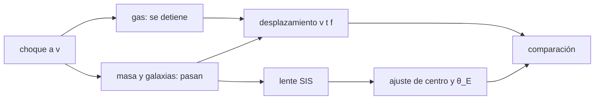

# B36-C09 — Cúmulos en colisión como prueba de materia oscura

<!-- nav:top -->
[🏠 Programa](../../../../README.md) · [📚 Bloque B36](../../../tronco-comun/B36-formacion-de-estructuras-cosmicas-y-materia-oscura.md) · [← Anterior: B36-C08 — Sesgo de galaxias y trazadores de la materia](../B36-C08-sesgo-de-galaxias-y-trazadores-de-la-materia/CLASE.md) · [Siguiente: B36-C10 — Búsqueda directa de materia oscura en laboratorio →](../B36-C10-busqueda-directa-de-materia-oscura-en-laboratorio/CLASE.md)
<!-- /nav -->

## 1. Ubicación, nivel y alcance

Clase 9 del bloque B36. Nivel N3. En un cúmulo en colisión, el gas se frena y las galaxias y la materia oscura sin colisiones siguen de largo. Aquí simulas ese **desplazamiento entre masa y gas** con un modelo de interacción de detención, lo conviertes en un límite de la **sección eficaz de autointeracción** `σ/m` y ajustas un **efecto de lente de esfera isoterma** para localizar el centro de masa. Usas [B36-C06](../B36-C06-formacion-de-halos-y-funcion-de-masa/CLASE.md), [B05](../../../tronco-comun/B05-fisica-fundamental-para-el-espacio.md) y [B12](../../../tronco-comun/B12-probabilidad-estadistica-e-incertidumbre.md). Los valores son **ilustrativos**; solo se consultaron los **resúmenes** de Clowe et al. y Randall et al.

## 2. Por qué esta clase existe

Que la masa esté separada del gas es el argumento clave contra explicaciones sin materia oscura. La decisión central: **¿cuánto debe medir el desplazamiento y con qué incertidumbre se localiza la masa?**

## 3. Lo que podrás hacer al terminar

1. Calcular la fracción de partículas que interaccionan.
2. Obtener el desplazamiento masa–gas esperado.
3. Comprobarlo con una simulación Monte Carlo.
4. Calcular el ángulo de Einstein de una esfera isoterma.
5. Ajustar el centro y el θ_E de la lente.
6. Reconocer los límites del modelo.

La evidencia es la **ficha del cúmulo en colisión** del ejercicio 12 (sección 20).

## 4. Con qué llegas y cómo comprobarlo

1. ¿Qué es una incertidumbre?
2. ¿Qué es una simulación Monte Carlo?
3. ¿Qué es una tabla de resultados?
4. ¿Qué es un valor ilustrativo?
5. ¿Qué es una verificación?

<details>
<summary>Ver respuestas</summary>

1. Un intervalo en que se espera el valor verdadero. 2. Repetir con números aleatorios de semilla fija. 3. Un resumen ordenado de cálculos. 4. Un valor propuesto para el ejemplo, no medido. 5. Comparar un cálculo con un caso independiente.
</details>

Con cuatro o cinco aciertos, sigue; si no, repasa los prerrequisitos.

## 5. Un caso de contexto y casos de referencia

Con `v = 3000 km/s`, `t = 0,05 Gyr` (ilustrativos) el gas se queda `151,6 ± 1,4 kpc` detrás de las galaxias (`153,3` teórico); con `σ/m = 1,25 cm²/g` la materia oscura lo haría `28,8 kpc`, y el centro de la lente se localiza a `32,0″` del gas con error de `2″`. Es el **ejemplo conductor**; el modelo es **sintético**.

## 6. Vocabulario

La **sección eficaz por masa** `σ/m`. La **columna de masa** `Σ`. La **profundidad óptica** `τ = Σ σ/m`. La **esfera isoterma singular** tiene `θ_E = 4π(σ_v/c)² D_ls/D_s`. El **cizallamiento tangencial** `γ_t = θ_E/(2θ)`. El **desplazamiento** es la separación entre el centroide de la masa y el del gas.

## 7. Modelo mental: dos nubes que se cruzan

Es como cruzar una nube de polvo pegajoso con otra de arena: el polvo se frena en el choque y la arena sigue su camino.



*Descripción textual:* un choque separa el gas de la masa; el desplazamiento se calcula y la lente localiza el centro de masa.

Analogía: dos nubes que se cruzan. Límite: interacción de detención total, sin hidrodinámica, lente aislada.

## 8. La explicación, paso a paso

### 8.1 Desplazamiento esperado

Con `v t = 153,4 kpc` y `Σ = 0,166 g/cm²` (1×10¹⁴ M☉ en 200 kpc), la fracción de partículas que interaccionan es `f = 1 − exp(−Σ σ/m)` y el desplazamiento `f v t`:

| σ/m (cm²/g) | τ | f | desplazamiento teórico (kpc) | Monte Carlo (kpc) | error | pull |
|---|---|---|---|---|---|---|
| 0 | 0,000 | 0,000 | 0,0 | −0,5 | 1,4 | −0,39 |
| 0,5 | 0,083 | 0,080 | 12,2 | 13,7 | 1,9 | 0,78 |
| 1,25 | 0,208 | 0,188 | 28,8 | 28,1 | 2,3 | −0,28 |
| 5,0 | 0,831 | 0,564 | 86,6 | 87,8 | 2,8 | 0,45 |

El gas (`f = 0,999`) queda `151,6 ± 1,4 kpc` detrás de las galaxias (teórico `153,3`).

### 8.2 Lente de esfera isoterma

Con `z = 0,296`, `D_A = 942,3 Mpc` y una escala de `4,569 kpc/″`, una esfera con `σ_v = 1000 km/s` y `D_ls/D_s = 0,5` tiene `θ_E = 14,42″`.

| Magnitud | Verdadero | Ajustado |
|---|---|---|
| centro (″) | (33,2; 0,0) | (32,0; 2,0) ± (2,0; 2,0) |
| θ_E (″) | 14,42 | 16,78 ± 2,02 |
| σ_v (km/s) | 1000 | 1079 |

### 8.3 Lectura

El centro ajustado queda a `32,0″` del gas (`16` errores de posición, con el error limitado por la rejilla de `2″`). Con una fracción de gas de `0,85` en la masa, una lente que siguiera los bariones se desplazaría solo `23 kpc`.

## 9. Magnitudes, símbolos y unidades

| Símbolo | Qué es | Unidad | Valor / nota |
|---|---|---|---|
| `σ/m` | sección eficaz por masa | cm²/g | 0 a 5 |
| `Σ` | columna de masa | g/cm² | 0,166 |
| `θ_E` | ángulo de Einstein | ″ | 14,42 |
| `v t` | recorrido | kpc | 153,4 |

## 10. Convenciones y referencias

Distancias con `D_A` de ΛCDM plano (`Ωm = 0,315`, `H₀ = 67,4`); semilla `20261109`.

## 11. De dónde sale lo que afirmamos

| ID | Fuente | Localizador | Respalda | Estado |
|---|---|---|---|---|
| S1 | Clowe et al., *A direct empirical proof of the existence of dark matter* | https://arxiv.org/abs/astro-ph/0608407 | z = 0,296; desplazamiento de 8 σ (solo el resumen) | Solo resumen, consultado el 2026-11-09 |
| S2 | Randall et al., *Constraints on the Self-Interaction Cross-Section of Dark Matter from Numerical Simulations of the Merging Galaxy Cluster 1E 0657-56* | https://arxiv.org/abs/0704.0261 | σ/m < 1,25 y < 0,7 cm²/g (solo el resumen) | Solo resumen, consultado el 2026-11-09 |
| S3 | NIST, *Fundamental Physical Constants* (CODATA 2022) | https://physics.nist.gov/cuu/Constants/Table/allascii.txt | G | Consultada el 2026-11-09 |
| S4 | UAI, Resolución B3 de 2015 | https://arxiv.org/abs/1510.07674 | GM nominal del Sol | Consultada el 2026-11-09 |
| S5 | IERS Technical Note 36, Tabla 1.1 | https://iers-conventions.obspm.fr/ | `au` exacta, de la que se deriva el pc | Consultada el 2026-11-09 |

Límites: no se reproducen los datos ni los métodos de Clowe et al. ni de Randall et al.; el modelo, las velocidades y las masas son ilustrativos.

## 12. Cómo ver el desplazamiento

| Magnitud | Valor |
|---|---|
| v t | 153,4 kpc |
| desplazamiento del gas | 151,6 ± 1,4 kpc |
| DM con σ/m = 1,25 | 28,8 kpc |
| θ_E | 14,42″ |

Descripción larga: el desplazamiento de la materia oscura crece con σ/m, y el del gas es casi el recorrido completo.

## 13. Ejemplo trabajado: la fracción de interacción

**Paso 1 · τ.** `0,166 × 1,25 = 0,2075`.

**Paso 2 · f.** `1 − exp(−0,2075) = 0,1875`.

**Paso 3 · Desplazamiento.** `0,1875 × 153,4 = 28,8 kpc`.

## 14. Distintas formas de describir un choque

**Por probabilidad:** `f`. **Por recorrido:** `v t`. **Por lente:** `θ_E`. **Por ajuste:** centro y error.

## 15. Práctica guiada

**Ejercicio 1 · con los pasos indicados.** Calcula `v t` con `3000 km/s` y `0,05 Gyr`. *Pasos:* `3 × 10⁶ m/s × 1,578 × 10¹⁵ s`.

<details><summary>Solución comentada</summary>

`4,73 × 10²¹ m = 153,4 kpc`.
</details>

**Ejercicio 2 · con una pista.** Calcula `τ` para `σ/m = 0,5`. *Pista:* ejemplo 13.

<details><summary>Solución comentada</summary>

`0,083`.
</details>

**Ejercicio 3 · casi autónomo.** Calcula el desplazamiento con `σ/m = 5`. *Casi autónomo.*

<details><summary>Solución comentada</summary>

`f = 0,564`, `86,6 kpc`.
</details>

## 16. Práctica autónoma, transferencia e integrador

**Ejercicio 4.** Calcula `θ_E` con `σ_v = 1000 km/s`.

<details><summary>Solución comentada</summary>

`4π (3,336 × 10⁻³)² × 0,5 = 6,99 × 10⁻⁵ rad = 14,42″`.
</details>

**Ejercicio 5.** Escala en kpc por ″ con `D_A = 942,3 Mpc`.

<details><summary>Solución comentada</summary>

`942,3 × 10³ × 4,848 × 10⁻⁶ = 4,569`.
</details>

**Ejercicio 6.** Convierte `151,6 kpc` a ″.

<details><summary>Solución comentada</summary>

`151,6/4,569 = 33,2″`.
</details>

**Ejercicio 7.** Pull del Monte Carlo a `σ/m = 0,5`.

<details><summary>Solución comentada</summary>

`(13,7 − 12,2)/1,9 = 0,78`.
</details>

**Ejercicio 8.** ¿Cuál es la fracción de pasada a `σ/m = 1,25`?

<details><summary>Solución comentada</summary>

`1 − 0,188 = 0,812`.
</details>

**Ejercicio 9 · transferencia.** **Transferencia.** Un compañero dice que este juguete reproduce el análisis de Clowe et al. Responde.

<details><summary>Solución comentada</summary>

No: el modelo es sintético; solo se citó su resumen (8 σ).
</details>

**Ejercicio 10 · transferencia.** **Transferencia.** ¿Por qué un desplazamiento pequeño de la materia oscura acota `σ/m`?

<details><summary>Solución comentada</summary>

Porque `f` crece con `σ/m`.
</details>

**Ejercicio 11 · transferencia.** **Transferencia.** ¿Qué haría una gravedad modificada con este desplazamiento?

<details><summary>Solución comentada</summary>

Se discute en la clase siguiente; en el juguete, `23 kpc` si la lente siguiera los bariones.
</details>

**Ejercicio 12.** **Integrador.** Elabora tu *ficha del cúmulo en colisión*: modelo, tabla de desplazamientos, lente y límites.

<details><summary>Solución comentada</summary>

Secciones 8.1–8.3.
</details>

**Ejercicio 12 · integrador.** **Integrador.** Elabora tu *ficha del cúmulo en colisión*: modelo, tabla de desplazamientos, lente y límites.

<details><summary>Solución modelo</summary>

Secciones 8.1–8.3.
</details>

## 17. Laboratorio: choque y lente

El script [colision.py](colision.py) simula el desplazamiento por Monte Carlo y ajusta una lente de esfera isoterma (**comprueba** los pulls menores que 3, `θ_E` dentro de 3 σ y el centro de la lente).

**Datos:** datos **sintéticos**; constantes y distancias de las fuentes consultadas; semilla `20261109`. **Predice antes de ejecutar:** ¿cuánto valdrá el desplazamiento del gas? (Casi `v t`.) **Ejecución del 2026-11-09 (Python 3.12.9):**

```text
Python 3.12.9 (biblioteca estandar)
v t = 153.4 kpc ; Sigma = 0.166 g/cm^2 (1e14 Msun en 200 kpc)
 sigma/m [cm2/g]     tau  f=1-e^-tau  offset DM-gal teo [kpc]   MC [kpc]   error   pull
            0.00   0.000       0.000                      0.0       -0.5     1.4  -0.39
            0.50   0.083       0.080                     12.2       13.7     1.9   0.78
            1.25   0.208       0.188                     28.8       28.1     2.3  -0.28
            5.00   0.831       0.564                     86.6       87.8     2.8   0.45
gas (f = 0.999) frente a galaxias: desplazamiento = 151.6 +/- 1.4 kpc (teorico 153.3)
D_A(z = 0.296) = 942.3 Mpc ; escala = 4.569 kpc/arcsec
theta_E verdadero = 14.42 arcsec
600 galaxias de fondo ; centro verdadero (33.2, 0.0) arcsec ; centro ajustado (32.0, 2.0) +/- (2.0, 2.0) arcsec
theta_E ajustado = 16.78 +/- 2.02 arcsec (verdadero 14.42) ; sigma_v ajustada = 1079 km/s
desplazamiento masa-gas: 151.6 kpc = 33.2 arcsec ; el centro de la lente (con gas en el origen) dista 32.0 arcsec = 16.0 errores de posicion
Pruebas superadas.
```

```bash
python programa/clases/B36/B36-C09-cumulos-en-colision-como-prueba-de-materia-oscura/colision.py
```

**Límites:** sin hidrodinámica, sin estructura real del cúmulo.

## 18. Errores frecuentes y cómo corregirlos

**Dar por buena la cifra de 8 σ de un juguete.** Se corrige con la sección 11.

**Olvidar que f no es la fracción de masa.** Se corrige con el ejemplo 13.

**Confundir σ_v con la masa del cúmulo.** Se corrige con 8.2.

**Presentar lo sintético como observado.** Se corrige con la sección 10.

## 19. Cómo sabrás que vas bien

Tras la sección 8: ¿qué resultado esperabas y cuál obtuviste? Si dudas, repasa el ejemplo 13. Tras el laboratorio: ¿qué comprueba? (ver la sección 17).

## 20. Qué entregas y cómo se evalúa

El producto es tu **ficha del cúmulo en colisión** (ejercicio 12).

| Criterio | Inicial | En desarrollo | Logrado | Destacado |
|---|---|---|---|---|
| Conceptos | Los confunde | Parciales | conceptos de la clase | Explica los límites |
| Cálculo | Sin unidades | Con errores | Tablas completas | Calcula casos nuevos |
| Numérico | Sin comprobar | Un caso | Contraste con el análisis | Interpreta las diferencias |
| Fuentes | Sin fuente | Sin fecha | fuentes con fecha | Declara lo ilustrativo |
| Límites | No los nombra | Uno | Tres | Discute qué falta del modelo |

**Condiciones críticas (no se compensan con promedio):** rotular lo sintético y lo ilustrativo; no presentar un modelo simplificado como un resultado de la colaboración citada; citar solo lo consultado.

## 21. Ética, seguridad y límites

Clase educativa: los modelos son simplificados. Accesibilidad: tablas equivalentes a las gráficas, fórmulas en texto, ejercicios sin conexión.

## 22. Para cerrar y seguir

El modelo reproduce el desplazamiento esperado (`151,6` frente a `153,3 kpc`) y la lente localiza el centro con `2″` de error. Queda una pregunta: ¿se puede detectar la materia oscura en el laboratorio?

**Glosario español–inglés.** cúmulo en colisión · *merging cluster*; lente débil · *weak lensing*; cizallamiento · *shear*; autointeracción · *self-interaction*; ángulo de Einstein · *Einstein angle*.

**Continuidad.** [B36-C10](../B36-C10-busqueda-directa-de-materia-oscura-en-laboratorio/CLASE.md) estudia la búsqueda directa en laboratorio.

**Referencias:** ver sección 11.

<!-- nav:bottom -->
---

[← Anterior: B36-C08 — Sesgo de galaxias y trazadores de la materia](../B36-C08-sesgo-de-galaxias-y-trazadores-de-la-materia/CLASE.md) · [📚 Bloque B36](../../../tronco-comun/B36-formacion-de-estructuras-cosmicas-y-materia-oscura.md) · [Siguiente: B36-C10 — Búsqueda directa de materia oscura en laboratorio →](../B36-C10-busqueda-directa-de-materia-oscura-en-laboratorio/CLASE.md)
<!-- /nav -->
