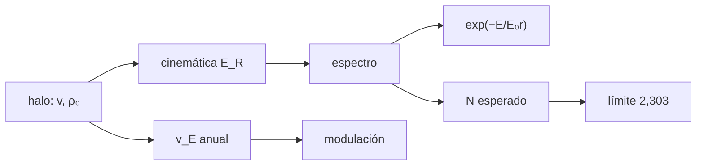

# B36-C10 — Búsqueda directa de materia oscura en laboratorio

<!-- nav:top -->
[🏠 Programa](../../../../README.md) · [📚 Bloque B36](../../../tronco-comun/B36-formacion-de-estructuras-cosmicas-y-materia-oscura.md) · [← Anterior: B36-C09 — Cúmulos en colisión como prueba de materia oscura](../B36-C09-cumulos-en-colision-como-prueba-de-materia-oscura/CLASE.md) · [Siguiente: B36-C11 — Gravedad modificada (MOND y relativistas) frente a materia oscura →](../B36-C11-gravedad-modificada-mond-y-relativistas-frente-a-materia-oscura/CLASE.md)
<!-- /nav -->

## 1. Ubicación, nivel y alcance

Clase 10 del bloque B36. Nivel N3. Un detector subterráneo busca el **retroceso nuclear** que produciría una partícula de materia oscura al chocar con un núcleo. Aquí calculas la **tasa de retroceso**, la comparas con la forma exponencial cerrada, estimas la **modulación anual** y obtienes el **límite sin fondo** de Poisson. Usas [B05](../../../tronco-comun/B05-fisica-fundamental-para-el-espacio.md), [B12](../../../tronco-comun/B12-probabilidad-estadistica-e-incertidumbre.md) y [B36-C09](../B36-C09-cumulos-en-colision-como-prueba-de-materia-oscura/CLASE.md). Los parámetros del halo son **convencionales no consultados**; solo se consultaron los **resúmenes** de XENON1T y de Schumann.

## 2. Por qué esta clase existe

Un límite de sección eficaz depende de la cinemática, de la exposición y de las cuentas. La decisión central: **¿qué sección eficaz excluye una exposición sin sucesos?**

## 3. Lo que podrás hacer al terminar

1. Calcular la cinemática del retroceso.
2. Comparar el espectro con la exponencial cerrada.
3. Calcular la tasa con el movimiento de la Tierra.
4. Estimar la modulación anual.
5. Obtener el límite de Poisson sin fondo.
6. Comprobar la cobertura por simulación.

La evidencia es la **ficha de la detección directa** del ejercicio 12 (sección 20).

## 4. Con qué llegas y cómo comprobarlo

1. ¿Qué es una incertidumbre?
2. ¿Qué es una simulación Monte Carlo?
3. ¿Qué es una tabla de resultados?
4. ¿Qué es un valor ilustrativo?
5. ¿Qué es una verificación?

<details>
<summary>Ver respuestas</summary>

1. Un intervalo en que se espera el valor verdadero. 2. Repetir con números aleatorios de semilla fija. 3. Un resumen ordenado de cálculos. 4. Un valor propuesto para el ejemplo, no medido. 5. Comparar un cálculo con un caso independiente.
</details>

Con cuatro o cinco aciertos, sigue; si no, repasa los prerrequisitos.

## 5. Un caso de contexto y casos de referencia

Con `m_χ = 100 GeV`, xenón (`A = 131`) y un umbral de `5 keV`, el espectro es `exp(−E/26,66 keV)` y con `σ_n = 10⁻⁴⁵ cm²` se esperan `689,8` sucesos en `1 t·año`; sin sucesos ni fondo, el límite a 90 % sería `3,3 × 10⁻⁴⁸ cm²`. Es el **ejemplo conductor**; todo es **ilustrativo** (sin eficiencia, forma ni fondo).

## 6. Vocabulario

El **retroceso nuclear** `E_R`. La **masa reducida** `μ`. La **cinemática** `E_R = (μ² v²/m_N)(1 − cosθ)`. El **espectro** exponencial `exp(−E/E₀r)`. La **modulación anual** por el movimiento de la Tierra. El **límite de Poisson** a 90 % sin sucesos es `−ln 0,1 = 2,303`.

## 7. Modelo mental: una bola de billar en el vacío

Es como lanzar bolas de billar contra una pared de bolas más pesadas: la energía que reciben depende de la velocidad, de las masas y del ángulo.



*Descripción textual:* la cinemática del halo da el espectro y la tasa; con la exposición se obtiene el límite de Poisson.

Analogía: una bola de billar en el vacío. Límite: halo estándar, dispersión independiente del espín, sin forma nuclear, sin fondo.

## 8. La explicación, paso a paso

### 8.1 Cinemática y espectro estático

Con `m_N = 122,03 GeV`, `μ = 54,96 GeV` y `E₀r = 26,66 keV`, la fracción de sucesos por encima de `E_th` en el caso estático (Earth en reposo, sin corte) es:

| E_th (keV) | Monte Carlo R(>E)/R(>0) | exp(−E/E₀r) |
|---|---|---|
| 2 | 0,9278 | 0,9277 |
| 5 | 0,8291 | 0,8290 |
| 10 | 0,6874 | 0,6872 |
| 20 | 0,4723 | 0,4723 |
| 40 | 0,2229 | 0,2231 |

### 8.2 Tasa y modulación

Con `σ_n = 10⁻⁴⁵ cm²`, umbral `5 keV`, `v_E = 232 ± 15 km/s` y corte de `544 km/s`:

| m_χ (GeV) | v_E (km/s) | R(>5 keV) (1/(kg·día)) |
|---|---|---|
| 30 | 247 | 7,9365 × 10⁻⁴ |
| 30 | 217 | 7,3178 × 10⁻⁴ |
| 100 | 247 | 1,9227 × 10⁻³ |
| 100 | 217 | 1,8542 × 10⁻³ |

La modulación `(junio − diciembre)/(junio + diciembre)` es `4,06 %` para 30 GeV y `1,82 %` para 100 GeV.

### 8.3 Límite sin fondo

Sin sucesos y sin fondo, el límite a 90 % es `N = −ln 0,1 = 2,3026` sucesos. Con `1 t·año`: a 30 GeV se esperan `278,6` sucesos con `σ_n = 10⁻⁴⁵ cm²` y el límite resulta `8,27 × 10⁻⁴⁸ cm²`; a 100 GeV `689,8` y `3,34 × 10⁻⁴⁸ cm²`. Con 40 000 experimentos simulados con media `2,303`, la fracción sin sucesos es `0,1000 ± 0,0015`.

## 9. Magnitudes, símbolos y unidades

| Símbolo | Qué es | Unidad | Valor / nota |
|---|---|---|---|
| `μ` | masa reducida | GeV | 54,96 |
| `E₀r` | escala del espectro | keV | 26,66 |
| `σ_n` | sección eficaz por nucleón | cm² | 10⁻⁴⁵ (ilustrativo) |
| `N_90` | sucesos del límite | — | 2,3026 |

## 10. Convenciones y referencias

Masas en GeV; velocidades en m/s; `ρ₀ = 0,3 GeV/cm³`; `v₀ = 220 km/s`; exposición `1 t·año`; semilla `20261109`.

## 11. De dónde sale lo que afirmamos

| ID | Fuente | Localizador | Respalda | Estado |
|---|---|---|---|---|
| S1 | NIST, *Fundamental Physical Constants* (CODATA 2022) | https://physics.nist.gov/cuu/Constants/Table/allascii.txt | c, u, masa del protón | Consultada el 2026-11-09 |
| S2 | XENON Collaboration, *Dark Matter Search Results from a One Tonne×Year Exposure of XENON1T* | https://arxiv.org/abs/1805.12562 | 1,0 t·año; 4,1 × 10⁻⁴⁷ cm² a 30 GeV (solo el resumen) | Solo resumen, consultado el 2026-11-09 |
| S3 | Schumann, *Direct Detection of WIMP Dark Matter: Concepts and Status* | https://arxiv.org/abs/1903.03026 | visión general (solo el resumen) | Solo resumen, consultado el 2026-11-09 |

Límites: no se consultaron el análisis de XENON1T ni las fórmulas de la revisión; el límite sin fondo de la clase es menor que el publicado porque ignora fondo, eficiencia y factor de forma.

## 12. Cómo ver la tasa

| Magnitud | Valor |
|---|---|
| E₀r | 26,66 keV |
| N esperado (100 GeV) | 689,8 |
| modulación (100 GeV) | 1,82 % |
| σ₉₀ (100 GeV) | 3,34 × 10⁻⁴⁸ cm² |

Descripción larga: la tasa de junio supera la de diciembre en un 2 a 4 %.

## 13. Ejemplo trabajado: la modulación

**Paso 1 · Diferencia.** `7,9365 − 7,3178 = 0,6187 (×10⁻⁴)`.

**Paso 2 · Suma.** `7,9365 + 7,3178 = 15,2543`.

**Paso 3 · Cociente.** `0,6187/15,2543 = 4,06 %`.

## 14. Distintas formas de describir una tasa

**Por espectro:** exponencial. **Por tasa:** `R(>E)`. **Por modulación:** junio y diciembre. **Por límite:** `2,303/N`.

## 15. Práctica guiada

**Ejercicio 1 · con los pasos indicados.** Calcula `m_N` para `A = 131`. *Pasos:* `131 × 0,93149`.

<details><summary>Solución comentada</summary>

`122,03 GeV`.
</details>

**Ejercicio 2 · con una pista.** Calcula `μ` con `m_χ = 100`. *Pista:* `m_χ m_N/(m_χ + m_N)`.

<details><summary>Solución comentada</summary>

`54,96 GeV`.
</details>

**Ejercicio 3 · casi autónomo.** Calcula la modulación a 100 GeV. *Casi autónomo.*

<details><summary>Solución comentada</summary>

`(1,9227 − 1,8542)/(1,9227 + 1,8542) = 1,82 %`.
</details>

## 16. Práctica autónoma, transferencia e integrador

**Ejercicio 4.** Sucesos esperados a 30 GeV, promedio anual, `1 t·año`.

<details><summary>Solución comentada</summary>

`7,627 × 10⁻⁴ × 365 250 = 278,6`.
</details>

**Ejercicio 5.** Límite a 30 GeV.

<details><summary>Solución comentada</summary>

`2,3026/278,6 × 10⁻⁴⁵ = 8,27 × 10⁻⁴⁸ cm²`.
</details>

**Ejercicio 6.** Cociente con el valor publicado de XENON1T.

<details><summary>Solución comentada</summary>

`4,1 × 10⁻⁴⁷/8,27 × 10⁻⁴⁸ ≈ 5`: es compatible con que este cálculo omita fondo, eficiencia y factor de forma; no se verificó cuánto aporta cada uno.
</details>

**Ejercicio 7.** `−ln 0,1`.

<details><summary>Solución comentada</summary>

`2,3026`.
</details>

**Ejercicio 8.** Cuantos sucesos esperarías con σ_n diez veces menor a 100 GeV.

<details><summary>Solución comentada</summary>

`68,98`.
</details>

**Ejercicio 9 · transferencia.** **Transferencia.** Un compañero dice que si no hay señal, la materia oscura no existe. Responde.

<details><summary>Solución comentada</summary>

Solo se excluye una sección eficaz y un modelo de halo.
</details>

**Ejercicio 10 · transferencia.** **Transferencia.** ¿Por qué se mide la modulación anual?

<details><summary>Solución comentada</summary>

Es una firma que distingue la señal del fondo.
</details>

**Ejercicio 11 · transferencia.** **Transferencia.** ¿Qué hace el factor de forma?

<details><summary>Solución comentada</summary>

Reduce la tasa a retrocesos grandes (no se incluye aquí).
</details>

**Ejercicio 12.** **Integrador.** Elabora tu *ficha de la detección directa*: cinemática, tabla de tasas, modulación y límite.

<details><summary>Solución comentada</summary>

Secciones 8.1–8.3.
</details>

**Ejercicio 12 · integrador.** **Integrador.** Elabora tu *ficha de la detección directa*: cinemática, tabla de tasas, modulación y límite.

<details><summary>Solución modelo</summary>

Secciones 8.1–8.3.
</details>

## 17. Laboratorio: tasa de retroceso y límite

El script [deteccion_directa.py](deteccion_directa.py) calcula la tasa, compara con la forma cerrada, estima la modulación y el límite de Poisson (**comprueba** el espectro al 1 %, la modulación positiva y la cobertura de 0,1).

**Datos:** constantes de NIST (c, u, masa del protón); parámetros del halo y del detector **ilustrativos**; semilla `20261109`. **Predice antes de ejecutar:** ¿qué fracción supera 5 keV? (Cerca de 0,83.) **Ejecución del 2026-11-09 (Python 3.12.9):**

```text
Python 3.12.9 (biblioteca estandar)
m_N = 122.03 GeV ; mu = 54.96 GeV ; E_0 r = 26.66 keV
E_th [keV]   MC R(>E)/R(>0)  exp(-E/E0r)
         2           0.9278       0.9277
         5           0.8291       0.8290
        10           0.6874       0.6872
        20           0.4723       0.4723
        40           0.2229       0.2231
m_chi [GeV]  ve [km/s]  R(>5keV) [1/(kg d)]
         30        247           7.9365e-04
         30        217           7.3178e-04
        100        247           1.9227e-03
        100        217           1.8542e-03
modulacion (junio - diciembre)/(junio + diciembre): m=30 GeV: 4.06 % ; m=100 GeV: 1.82 %
limite superior a 90 % CL sin sucesos observados ni fondo: N = -ln(0.1) = 2.3026
m_chi =    30 GeV: sucesos esperados con sigma_n = 1e-45 cm^2 en 1 t x a = 278.6 ; sigma_90 (sin fondo, sin eficiencia) = 8.27e-48 cm^2
m_chi =   100 GeV: sucesos esperados con sigma_n = 1e-45 cm^2 en 1 t x a = 689.8 ; sigma_90 (sin fondo, sin eficiencia) = 3.34e-48 cm^2
cobertura: fraccion de experimentos con 0 sucesos si la media es 2.303 = 0.1000 (esperado 0.1000 +/- 0.0015)
Pruebas superadas.
```

```bash
python programa/clases/B36/B36-C10-busqueda-directa-de-materia-oscura-en-laboratorio/deteccion_directa.py
```

**Límites:** sin fondo, eficiencia ni factor de forma.

## 18. Errores frecuentes y cómo corregirlos

**Olvidar el factor A² de la coherencia.** Se corrige con la sección 9.

**Comparar con XENON1T sin considerar el fondo.** Se corrige con el ejemplo 6.

**Usar la masa del protón en lugar de la del núcleo.** Se corrige con 8.1.

**Presentar el límite como un resultado real.** Se corrige con la sección 10.

## 19. Cómo sabrás que vas bien

Tras la sección 8: ¿qué resultado esperabas y cuál obtuviste? Si dudas, repasa el ejemplo 13. Tras el laboratorio: ¿qué comprueba? (ver la sección 17).

## 20. Qué entregas y cómo se evalúa

El producto es tu **ficha de la detección directa** (ejercicio 12).

| Criterio | Inicial | En desarrollo | Logrado | Destacado |
|---|---|---|---|---|
| Conceptos | Los confunde | Parciales | conceptos de la clase | Explica los límites |
| Cálculo | Sin unidades | Con errores | Tablas completas | Calcula casos nuevos |
| Numérico | Sin comprobar | Un caso | Contraste con el análisis | Interpreta las diferencias |
| Fuentes | Sin fuente | Sin fecha | fuentes con fecha | Declara lo ilustrativo |
| Límites | No los nombra | Uno | Tres | Discute qué falta del modelo |

**Condiciones críticas (no se compensan con promedio):** rotular lo sintético y lo ilustrativo; no presentar un modelo simplificado como un resultado de la colaboración citada; citar solo lo consultado.

## 21. Ética, seguridad y límites

Clase educativa: los modelos son simplificados. Accesibilidad: tablas equivalentes a las gráficas, fórmulas en texto, ejercicios sin conexión.

## 22. Para cerrar y seguir

El espectro es exponencial (`E₀r = 26,66 keV`), la modulación va de `1,8 %` a `4,1 %` y la exposición de `1 t·año` sin fondo excluiría `3,3 × 10⁻⁴⁸ cm²` a 100 GeV. Queda una pregunta: ¿puede explicarse todo sin materia oscura?

**Glosario español–inglés.** retroceso nuclear · *nuclear recoil*; modulación anual · *annual modulation*; exposición · *exposure*; masa reducida · *reduced mass*; límite · *upper limit*.

**Continuidad.** [B36-C11](../B36-C11-gravedad-modificada-mond-y-relativistas-frente-a-materia-oscura/CLASE.md) estudia la gravedad modificada.

**Referencias:** ver sección 11.

<!-- nav:bottom -->
---

[← Anterior: B36-C09 — Cúmulos en colisión como prueba de materia oscura](../B36-C09-cumulos-en-colision-como-prueba-de-materia-oscura/CLASE.md) · [📚 Bloque B36](../../../tronco-comun/B36-formacion-de-estructuras-cosmicas-y-materia-oscura.md) · [Siguiente: B36-C11 — Gravedad modificada (MOND y relativistas) frente a materia oscura →](../B36-C11-gravedad-modificada-mond-y-relativistas-frente-a-materia-oscura/CLASE.md)
<!-- /nav -->
