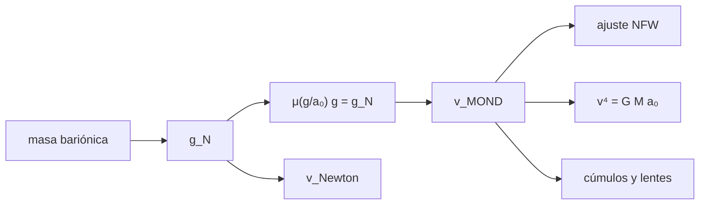

# B36-C11 — Gravedad modificada (MOND y relativistas) frente a materia oscura

<!-- nav:top -->
[🏠 Programa](../../../../README.md) · [📚 Bloque B36](../../../tronco-comun/B36-formacion-de-estructuras-cosmicas-y-materia-oscura.md) · [← Anterior: B36-C10 — Búsqueda directa de materia oscura en laboratorio](../B36-C10-busqueda-directa-de-materia-oscura-en-laboratorio/CLASE.md) · [Siguiente: B37-C01 — Convección: longitud de mezcla y criterios de Schwarzschild y Ledoux →](../../B37/B37-C01-conveccion-longitud-de-mezcla-y-criterios-de-schwarzschild-y-ledoux/CLASE.md)
<!-- /nav -->

## 1. Ubicación, nivel y alcance

Clase 11 del bloque B36. Nivel N3. MOND propone que por debajo de una aceleración `a₀` la gravedad se aparta de Newton. Aquí calculas curvas de rotación con la función de interpolación **«simple»**, verificas la relación de **Tully–Fisher bariónica**, ajustas un **halo NFW** a la curva MOND para ver que ambas descripciones son casi indistinguibles en una galaxia y enlazas con el **cúmulo en colisión** de [B36-C09](../B36-C09-cumulos-en-colision-como-prueba-de-materia-oscura/CLASE.md). Usas [B05](../../../tronco-comun/B05-fisica-fundamental-para-el-espacio.md). Solo se consultaron los **resúmenes** de Famaey y McGaugh y de Clowe et al.

## 2. Por qué esta clase existe

Una alternativa debe confrontarse con todas las pruebas. La decisión central: **¿qué observación separa la materia oscura de la gravedad modificada?**

## 3. Lo que podrás hacer al terminar

1. Resolver `μ(g/a₀) g = g_N`.
2. Calcular curvas de rotación newtoniana y MOND.
3. Verificar `v⁴ = G M a₀` a gran radio.
4. Ajustar un halo NFW a la curva MOND.
5. Calcular la relación de aceleraciones.
6. Comparar con el cúmulo en colisión.

La evidencia es la **ficha de la gravedad modificada** del ejercicio 12 (sección 20).

## 4. Con qué llegas y cómo comprobarlo

1. ¿Qué es una incertidumbre?
2. ¿Qué es una simulación Monte Carlo?
3. ¿Qué es una tabla de resultados?
4. ¿Qué es un valor ilustrativo?
5. ¿Qué es una verificación?

<details>
<summary>Ver respuestas</summary>

1. Un intervalo en que se espera el valor verdadero. 2. Repetir con números aleatorios de semilla fija. 3. Un resumen ordenado de cálculos. 4. Un valor propuesto para el ejemplo, no medido. 5. Comparar un cálculo con un caso independiente.
</details>

Con cuatro o cinco aciertos, sigue; si no, repasa los prerrequisitos.

## 5. Un caso de contexto y casos de referencia

Para una galaxia de `5×10¹⁰ M☉` y escala de `3 kpc` (ilustrativa), la curva MOND llega a `191,3 km/s` a 10 kpc frente a `134,8` newtoniana, un halo NFW la reproduce con una desviación de `1,55 km/s`, y la velocidad plana `168,62` coincide con `(G M a₀)^(1/4) = 167,98 km/s` al `0,4 %`. Es el **ejemplo conductor**; la galaxia es **ilustrativa**.

## 6. Vocabulario

La **aceleración de Milgrom** `a₀ ≈ 1,2×10⁻¹⁰ m/s²` (valor convencional no consultado). La **función de interpolación** `μ(x) = x/(1+x)`. La **aceleración newtoniana** `g_N`. La **relación de Tully–Fisher bariónica** `v⁴ ∝ M`. El **halo NFW**. La **curva plana** es la velocidad de rotación constante a gran radio.

## 7. Modelo mental: una cuesta que cambia de pendiente

Es como una cuesta que se hace menos empinada a gran distancia: la regla de la caída cambia por debajo de una aceleración crítica.



*Descripción textual:* la masa bariónica fija g_N; la interpolación da la curva MOND, que se compara con Newton, NFW y Tully–Fisher.

Analogía: una cuesta que cambia de pendiente. Límite: simetría esférica, sin gas ni bulbo, sin campo externo.

## 8. La explicación, paso a paso

### 8.1 Interpolación y curva de rotación

La función «simple» `g = (g_N/2)[1 + √(1 + 4a₀/g_N)]` cumple `μ(g/a₀) g = g_N` con error `1,3 × 10⁻¹⁶`. Para `M = 5×10¹⁰ M☉` y `R_d = 3 kpc` (aproximación esférica):

| r (kpc) | v Newton (km/s) | v MOND (km/s) | g_N/a₀ |
|---|---|---|---|
| 2 | 124,6 | 144,9 | 2,095 |
| 6 | 145,9 | 186,7 | 0,958 |
| 10 | 134,8 | 191,3 | 0,491 |
| 20 | 103,2 | 184,1 | 0,144 |
| 30 | 84,6 | 178,9 | 0,064 |

### 8.2 Tully–Fisher bariónica

| M (M☉) | v a 500 kpc (km/s) | (G M a₀)^(1/4) (km/s) | diferencia |
|---|---|---|---|
| 5,0×10¹⁰ | 168,62 | 167,98 | 0,0038 |
| 1,0×10¹⁰ | 112,53 | 112,34 | 0,0017 |
| 2,0×10⁹ | 75,18 | 75,12 | 0,0008 |

### 8.3 El halo reproduce la curva

El mejor NFW (rejilla) tiene `ρ_s = 8,51×10⁻²¹ kg/m³` y `r_s = 5,0 kpc`, con `rms = 1,55 km/s`:

| r (kpc) | v MOND | v NFW |
|---|---|---|
| 2 | 144,9 | 146,8 |
| 10 | 191,3 | 191,6 |
| 20 | 184,1 | 185,4 |
| 30 | 178,9 | 175,6 |

### 8.4 Relación de aceleraciones y cúmulo

La relación `g_obs/a₀` es única: `0,1051` para `g_N/a₀ = 0,01`, `0,3702` para `0,1`, `1,618` para `1` y `10,92` para `10`. Si en el cúmulo del juguete de C09 la lente siguiera los bariones (fracción de gas `0,85`), el desplazamiento masa–gas sería `23,0 kpc` frente a `153,4 kpc`.

## 9. Magnitudes, símbolos y unidades

| Símbolo | Qué es | Unidad | Valor / nota |
|---|---|---|---|
| `a₀` | aceleración de Milgrom | m/s² | 1,2×10⁻¹⁰ (convencional) |
| `g_N` | aceleración newtoniana | m/s² | GM(<r)/r² |
| `v_plana` | velocidad de rotación | km/s | 168,62 |
| `r_s` | radio de escala NFW | kpc | 5,0 |

## 10. Convenciones y referencias

`r` en kpc; masa en M☉; interpolación «simple» ilustrativa; sin semilla (determinista).

## 11. De dónde sale lo que afirmamos

| ID | Fuente | Localizador | Respalda | Estado |
|---|---|---|---|---|
| S1 | NIST, *Fundamental Physical Constants* (CODATA 2022) | https://physics.nist.gov/cuu/Constants/Table/allascii.txt | G | Consultada el 2026-11-09 |
| S2 | UAI, Resolución B3 de 2015 | https://arxiv.org/abs/1510.07674 | GM nominal del Sol | Consultada el 2026-11-09 |
| S3 | IERS Technical Note 36, Tabla 1.1 | https://iers-conventions.obspm.fr/ | `au` exacta, de la que se deriva el pc | Consultada el 2026-11-09 |
| S4 | Famaey y McGaugh, *Modified Newtonian Dynamics (MOND): Observational Phenomenology and Relativistic Extensions* | https://arxiv.org/abs/1112.3960 | revisión de MOND y extensiones relativistas (solo el resumen) | Solo resumen, consultado el 2026-11-09 |
| S5 | Clowe et al., *A direct empirical proof of the existence of dark matter* | https://arxiv.org/abs/astro-ph/0608407 | argumento contra la gravedad modificada (solo el resumen) | Solo resumen, consultado el 2026-11-09 |

Límites: no se ajustó ninguna galaxia real; a₀ y la interpolación son ilustrativos y no se evaluó la teoría relativista ni los cúmulos con datos.

## 12. Cómo ver las curvas de rotación

| Magnitud | Valor |
|---|---|
| v MOND a 10 kpc | 191,3 km/s |
| v Newton a 10 kpc | 134,8 km/s |
| rms NFW | 1,55 km/s |
| v plana (5×10¹⁰) | 168,62 km/s |

Descripción larga: la curva MOND es plana a 180 a 190 km/s y el NFW la reproduce.

## 13. Ejemplo trabajado: la relación de aceleraciones

**Paso 1 · Cociente.** `x = g_N/a₀ = 1`.

**Paso 2 · Raíz.** `√(1 + 4/1) = √5 = 2,236`.

**Paso 3 · g.** `(1/2)(1 + 2,236) a₀ = 1,618 a₀`.

## 14. Distintas formas de describir una galaxia

**Por interpolación:** `μ`. **Por curva:** `v(r)`. **Por halo:** NFW. **Por escala:** `v⁴ = G M a₀`.

## 15. Práctica guiada

**Ejercicio 1 · con los pasos indicados.** Calcula `g/a₀` para `g_N/a₀ = 1`. *Pasos:* ejemplo 13.

<details><summary>Solución comentada</summary>

`1,618`.
</details>

**Ejercicio 2 · con una pista.** Comprueba `μ(g/a₀) g = g_N` con `x = 1,618`. *Pista:* `μ = x/(1+x)`.

<details><summary>Solución comentada</summary>

`1,618 × 0,618 = 1,000`.
</details>

**Ejercicio 3 · casi autónomo.** Calcula `g/a₀` para `g_N/a₀ = 0,01`. *Casi autónomo.*

<details><summary>Solución comentada</summary>

`0,005(1 + √401) = 0,1051`.
</details>

## 16. Práctica autónoma, transferencia e integrador

**Ejercicio 4.** Cociente `v_MOND/v_Newton` a 10 kpc.

<details><summary>Solución comentada</summary>

`191,3/134,8 = 1,42`.
</details>

**Ejercicio 5.** `(G M a₀)^(1/4)` para `5×10¹⁰ M☉`.

<details><summary>Solución comentada</summary>

`167,98 km/s`.
</details>

**Ejercicio 6.** Diferencia de la velocidad plana simulada.

<details><summary>Solución comentada</summary>

`0,0038 = 0,4 %`.
</details>

**Ejercicio 7.** Diferencia MOND−NFW a 30 kpc.

<details><summary>Solución comentada</summary>

`178,9 − 175,6 = 3,3 km/s`.
</details>

**Ejercicio 8.** ¿Qué fracción de la velocidad es el rms de NFW?

<details><summary>Solución comentada</summary>

`1,55/191 = 0,8 %`.
</details>

**Ejercicio 9 · transferencia.** **Transferencia.** Un compañero dice que el buen ajuste de NFW prueba la materia oscura. Responde.

<details><summary>Solución comentada</summary>

No: el NFW tiene dos parámetros libres y reproduce también la curva MOND.
</details>

**Ejercicio 10 · transferencia.** **Transferencia.** ¿Qué observación separa ambas opciones según Clowe et al. (resumen)?

<details><summary>Solución comentada</summary>

El desplazamiento de 8 σ entre el centro de masa total y el bariónico.
</details>

**Ejercicio 11 · transferencia.** **Transferencia.** ¿Qué predice MOND para otra galaxia de masa distinta?

<details><summary>Solución comentada</summary>

La misma relación `g_obs(g_N)` y `v⁴ ∝ M`.
</details>

**Ejercicio 12.** **Integrador.** Elabora tu *ficha de la gravedad modificada*: interpolación, curvas, Tully–Fisher, NFW y cúmulo.

<details><summary>Solución comentada</summary>

Secciones 8.1–8.4.
</details>

**Ejercicio 12 · integrador.** **Integrador.** Elabora tu *ficha de la gravedad modificada*: interpolación, curvas, Tully–Fisher, NFW y cúmulo.

<details><summary>Solución modelo</summary>

Secciones 8.1–8.4.
</details>

## 17. Laboratorio: MOND frente a NFW

El script [mond.py](mond.py) calcula la curva MOND, verifica Tully–Fisher, ajusta un NFW y compara con el cúmulo del juguete (**comprueba** la sustitución, el `1 %` de la velocidad plana y el ajuste NFW).

**Datos:** G (NIST), GM☉ (UAI), au (IERS); a₀ y la galaxia **ilustrativos**; sin semilla. **Predice antes de ejecutar:** ¿qué curva será más alta lejos? (La MOND.) **Ejecución del 2026-11-09 (Python 3.12.9):**

```text
Python 3.12.9 (biblioteca estandar)
comprobacion mu(g/a0) g = g_N: error relativo maximo = 1.3e-16
 r [kpc]  v Newton   v MOND   g_N/a0
     2.0     124.6    144.9    2.095
     6.0     145.9    186.7    0.958
    10.0     134.8    191.3    0.491
    20.0     103.2    184.1    0.144
    30.0      84.6    178.9    0.064
 M_b [Msun]  v(500 kpc) [km/s]  (G M a0)^1/4     dif.
    5.0e+10             168.62        167.98   0.0038
    1.0e+10             112.53        112.34   0.0017
    2.0e+09              75.18         75.12   0.0008
NFW ajustado: rho_s = 8.51e-21 kg/m^3 ; r_s = 5.0 kpc ; rms = 1.55 km/s ; M(<10 r_s) = 2.94e+11 Msun (escala, no M200)
 r [kpc]   v MOND    v NFW
     2.0    144.9    146.8
    10.0    191.3    191.6
    20.0    184.1    185.4
    30.0    178.9    175.6
  g_N/a0  g_obs/a0 (MOND)
    0.01           0.1051
    0.10           0.3702
    1.00           1.6180
   10.00          10.9161
si la lente siguiera los barones con fraccion de gas 0.85: desplazamiento masa-gas previsto = 23.0 kpc frente a 153.4 kpc del juguete de C09
Pruebas superadas.
```

```bash
python programa/clases/B36/B36-C11-gravedad-modificada-mond-y-relativistas-frente-a-materia-oscura/mond.py
```

**Límites:** sin teoría relativista ni datos reales.

## 18. Errores frecuentes y cómo corregirlos

**Tomar un buen ajuste por una prueba.** Se corrige con 8.3.

**Confundir g_N con g.** Se corrige con 8.1.

**Olvidar la diferencia entre galaxias y cúmulos.** Se corrige con 8.4.

**Presentar una galaxia ilustrativa como real.** Se corrige con la sección 10.

## 19. Cómo sabrás que vas bien

Tras la sección 8: ¿qué resultado esperabas y cuál obtuviste? Si dudas, repasa el ejemplo 13. Tras el laboratorio: ¿qué comprueba? (ver la sección 17).

## 20. Qué entregas y cómo se evalúa

El producto es tu **ficha de la gravedad modificada** (ejercicio 12).

| Criterio | Inicial | En desarrollo | Logrado | Destacado |
|---|---|---|---|---|
| Conceptos | Los confunde | Parciales | conceptos de la clase | Explica los límites |
| Cálculo | Sin unidades | Con errores | Tablas completas | Calcula casos nuevos |
| Numérico | Sin comprobar | Un caso | Contraste con el análisis | Interpreta las diferencias |
| Fuentes | Sin fuente | Sin fecha | fuentes con fecha | Declara lo ilustrativo |
| Límites | No los nombra | Uno | Tres | Discute qué falta del modelo |

**Condiciones críticas (no se compensan con promedio):** rotular lo sintético y lo ilustrativo; no presentar un modelo simplificado como un resultado de la colaboración citada; citar solo lo consultado.

## 21. Ética, seguridad y límites

Clase educativa: los modelos son simplificados. Accesibilidad: tablas equivalentes a las gráficas, fórmulas en texto, ejercicios sin conexión.

## 22. Para cerrar y seguir

MOND y un halo NFW reproducen la misma curva de una galaxia (`rms = 1,55 km/s`), así que la prueba decisiva está en sistemas como los cúmulos en colisión; la clase no resuelve la cuestión. Cierra el bloque B36.

**Glosario español–inglés.** gravedad modificada · *modified gravity*; curva plana · *flat rotation curve*; interpolación · *interpolating function*; Tully–Fisher bariónica · *baryonic Tully–Fisher*; halo · *halo*.

**Continuidad.** no hay clase siguiente en este bloque.

**Referencias:** ver sección 11.

<!-- nav:bottom -->
---

[← Anterior: B36-C10 — Búsqueda directa de materia oscura en laboratorio](../B36-C10-busqueda-directa-de-materia-oscura-en-laboratorio/CLASE.md) · [📚 Bloque B36](../../../tronco-comun/B36-formacion-de-estructuras-cosmicas-y-materia-oscura.md) · [Siguiente: B37-C01 — Convección: longitud de mezcla y criterios de Schwarzschild y Ledoux →](../../B37/B37-C01-conveccion-longitud-de-mezcla-y-criterios-de-schwarzschild-y-ledoux/CLASE.md)
<!-- /nav -->
