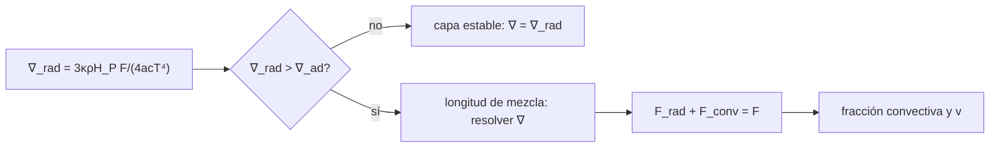

# B37-C01 — Convección: longitud de mezcla y criterios de Schwarzschild y Ledoux

<!-- nav:top -->
[🏠 Programa](../../../../README.md) · [📚 Bloque B37](../../../tronco-comun/B37-interiores-estelares-y-asterosismologia.md) · [← Anterior: B36-C11 — Gravedad modificada (MOND y relativistas) frente a materia oscura](../../B36/B36-C11-gravedad-modificada-mond-y-relativistas-frente-a-materia-oscura/CLASE.md) · [Siguiente: B37-C02 — Ecuaciones de estado estelares: gas ideal, radiación y degeneración →](../B37-C02-ecuaciones-de-estado-estelares-gas-ideal-radiacion-y-degeneracion/CLASE.md)
<!-- /nav -->

## 1. Ubicación, nivel y alcance

Clase 1 del bloque B37. Nivel N3. Aquí decides **dónde hay convección** con los criterios de Schwarzschild y de Ledoux y **cuánto flujo transporta** con una versión simplificada de la longitud de mezcla, en una capa de plasma de condiciones ilustrativas. Usas [B05](../../../tronco-comun/B05-fisica-fundamental-para-el-espacio.md) y la idea de gradiente radiativo de B24-C05. Ningún modelo solar ni estelar real se reproduce.

## 2. Por qué esta clase existe

Sin convección, un modelo de interior calcularía temperaturas imposibles en las capas inestables. La decisión central: **¿la capa es estable, y si no lo es, qué gradiente real `∇` y qué fracción del flujo lleva la convección?**

## 3. Lo que podrás hacer al terminar

1. Calcular `∇_rad` y aplicar el criterio de Schwarzschild.
2. Añadir el término de composición del criterio de Ledoux.
3. Resolver el gradiente `∇` que conserva el flujo total.
4. Medir la fracción convectiva del flujo y la velocidad de las burbujas.
5. Reconocer que `∇ − ∇_ad` es minúsculo en convección eficiente.
6. Nombrar los límites de la longitud de mezcla.

La evidencia es la **ficha de la convección** del ejercicio 12 (sección 20).

## 4. Con qué llegas y cómo comprobarlo

1. ¿Qué es una incertidumbre?
2. ¿Qué es una simulación Monte Carlo?
3. ¿Qué es una tabla de resultados?
4. ¿Qué es un valor ilustrativo?
5. ¿Qué es una verificación?

<details>
<summary>Ver respuestas</summary>

1. Un intervalo en que se espera el valor verdadero. 2. Repetir con números aleatorios de semilla fija. 3. Un resumen ordenado de cálculos. 4. Un valor propuesto para el ejemplo, no medido. 5. Comparar un cálculo con un caso independiente.
</details>

Con cuatro o cinco aciertos, sigue; si no, repasa los prerrequisitos.

## 5. Un caso de contexto y casos de referencia

En una capa con `T = 10⁶ K`, `g = 500 m/s²`, `H_P = 2 × 10⁷ m` y un flujo de `10⁹ W/m²` (todo **ilustrativo**), cuando `ρ κ` crece de 5 a 900 kg m⁻² el gradiente radiativo sube de `0,331` a `59,52`, pero el real queda a `1,4 × 10⁻⁶` del adiabático `0,4` y la convección lleva el `99,33 %` del flujo. Es el **ejemplo conductor**.

## 6. Vocabulario

El **gradiente radiativo** `∇_rad = 3 κ ρ H_P F/(4 a c T⁴)` es el que haría falta si todo el flujo fuese radiativo. El **gradiente adiabático** `∇_ad = 0,4` es el de un gas ideal monoatómico. **Schwarzschild**: hay convección si `∇_rad > ∇_ad`. **Ledoux**: si `∇_rad > ∇_ad + (φ/δ) ∇_μ`. La **longitud de mezcla** `l = α H_P` es lo que recorre una burbuja antes de disolverse.

## 7. Modelo mental: una olla de agua al fuego

Es como calentar una olla: si el fondo está lo bastante más caliente que el borde (`∇_rad > ∇_ad`), el agua sube y baja y transporta el calor; si el fondo apenas calienta, el calor pasa por conducción lenta. La sal disuelta en el fondo (`∇_μ`) puede impedir que el agua suba.



*Descripción textual:* se compara el gradiente radiativo con el adiabático; si es mayor se resuelve el gradiente real que conserva el flujo total.

Analogía: una olla de agua al fuego. Límite: capa local y estacionaria.

## 8. La explicación, paso a paso

### 8.1 El criterio

`∇_rad` crece con `κ ρ`. Con la capa ilustrativa, `ρ = 5 kg/m³` y `κ = 1 m²/kg` dan `∇_rad = 0,3307 < 0,4`: la capa es estable y todo el flujo es radiativo.

### 8.2 La convección eficiente

| `ρ` (kg/m³) | `κ` (m²/kg) | `∇_rad` | `∇ − ∇_ad` | `F_conv/F` | `v` (m/s) |
|---|---|---|---|---|---|
| 5 | 1 | 0,3307 | 0 | 0,0000 | 0 |
| 10 | 1 | 0,6613 | 7,347 × 10⁻⁶ | 0,3951 | 172,50 |
| 30 | 3 | 5,9520 | 6,262 × 10⁻⁶ | 0,9328 | 159,25 |
| 300 | 3 | 59,5199 | 1,407 × 10⁻⁶ | 0,9933 | 75,48 |

Cuanto más opaca y densa es la capa, más inestable (`∇_rad` enorme) y, sin embargo, **más cerca del adiabático** queda `∇`: la convección es tan eficiente que basta una superadiabaticidad de millonésimas. El flujo se conserva con un residuo menor que `10⁻⁹ F`.

### 8.3 El parámetro `α`

Para `ρ = 10 kg/m³`, `α = 1,0; 1,8; 2,5` dan `∇ − ∇_ad = 1,609 × 10⁻⁵; 7,347 × 10⁻⁶; 4,741 × 10⁻⁶`: una longitud de mezcla mayor transporta el mismo flujo con menos exceso de gradiente. Por eso `α` es un parámetro libre que se **calibra** (C06).

### 8.4 Ledoux

Con `∇_μ = 0,15` y `φ/δ = 1`, la capa con `∇_rad = 0,45` es inestable por Schwarzschild y **estable por Ledoux** (el umbral sube a `0,55`); con `0,60` y `0,70` ambos criterios dicen inestable.

### 8.5 Lectura

Dos números no deben confundirse: `∇_rad` mide cuánto necesitaría la radiación y `∇` mide lo que realmente ocurre. La forma de la longitud de mezcla es una **simplificación con coeficientes de orden unidad sin calibrar**.

## 9. Magnitudes, símbolos y unidades

| Símbolo | Qué es | Unidad | Valor / nota |
|---|---|---|---|
| `∇_rad` | gradiente radiativo | — | 0,33 a 59,52 (ilustrativo) |
| `∇_ad` | gradiente adiabático del gas ideal | — | 0,4 |
| `α` | longitud de mezcla en alturas de presión | — | 1,8 (ilustrativo) |
| `F_conv/F` | fracción convectiva | — | 0 a 0,9933 |
| `a` | constante de radiación `4σ/c` | J m⁻³ K⁻⁴ | de NIST |

## 10. Convenciones y referencias

Gas ideal con `δ = 1` y `μ = 0,6`; `c_p = 5k/(2 μ m_u)`; flujo y estructura de la capa ilustrativos; constantes de NIST.

## 11. De dónde sale lo que afirmamos

| ID | Fuente | Localizador | Respalda | Estado |
|---|---|---|---|---|
| S1 | NIST, *Fundamental Physical Constants* (CODATA 2022) | https://physics.nist.gov/cuu/Constants/Table/allascii.txt | `σ`, `c`, `k_B`, `m_u` | Consultada el 2026-11-09 |
| S2 | Valores y modelo del laboratorio | — | capa de plasma y `α = 1,8` | Ilustrativo o sintético; no consultado |

Límites: no se resolvió ningún modelo estelar real, y la longitud de mezcla local no describe el desbordamiento.

## 12. Cómo ver los resultados

| Magnitud | Valor |
|---|---|
| `∇_rad` para `ρκ = 5` | 0,3307 |
| `F_conv/F` para `ρκ = 900` | 0,9933 |
| `∇ − ∇_ad` para `ρκ = 900` | 1,407 × 10⁻⁶ |
| umbral de Ledoux | 0,55 |

Descripción larga: a mayor `ρκ`, mayor fracción convectiva y menor superadiabaticidad.

## 13. Ejemplo trabajado: gradiente y flujo en una capa

**Paso 1 · Gradiente radiativo.** `∇_rad = 3 κ ρ H_P F/(4 a c T⁴) = 0,6613` para `ρκ = 10`.

**Paso 2 · Criterio.** `0,6613 > 0,4`: hay convección.

**Paso 3 · Flujo.** Se busca `∇` en `[0,4; 0,6613]` tal que `F_rad + F_conv = F`: `∇ − ∇_ad = 7,347 × 10⁻⁶`.

**Paso 4 · Fracción.** `F_conv/F = 0,3951` y `v = 172,50 m/s`.

## 14. Distintas formas de describir una capa

**Por criterio:** Schwarzschild y Ledoux. **Por flujo:** `F_rad + F_conv`. **Por parámetros:** `α`. **Por límite:** `∇ → ∇_ad`.

## 15. Práctica guiada

**Ejercicio 1 · con los pasos indicados.** `∇_rad` para `ρ = 10` si para `ρ = 5` vale 0,3307. *Pasos:* proporcional a `ρ`.

<details><summary>Solución comentada</summary>

`0,6613`; es mayor que 0,4: convectiva.
</details>

**Ejercicio 2 · con una pista.** `∇_rad` de la fila 3 desde la fila 1. *Pista:* `ρκ` pasa de 5 a 90.

<details><summary>Solución comentada</summary>

Factor 18: `0,3307 × 18 = 5,95`.
</details>

**Ejercicio 3 · casi autónomo.** Umbral de Ledoux con `∇_μ = 0,30` y `φ/δ = 1`; ¿estable la capa con `∇_rad = 0,60`?

<details><summary>Solución comentada</summary>

Umbral `0,7`; `0,60 < 0,7`: estable.
</details>

## 16. Práctica autónoma, transferencia e integrador

**Ejercicio 4.** Fracción radiativa del flujo en la fila 2.

<details><summary>Solución comentada</summary>

`1 − 0,3951 = 0,6049`.
</details>

**Ejercicio 5.** Cociente de `∇ − ∇_ad` entre `α = 1,0` y `α = 2,5`.

<details><summary>Solución comentada</summary>

`1,609/0,4741 = 3,39`.
</details>

**Ejercicio 6.** Cociente de velocidades entre las filas 3 y 4.

<details><summary>Solución comentada</summary>

`159,25/75,48 = 2,11`.
</details>

**Ejercicio 7.** ¿Por qué `∇` queda cerca de `∇_ad` si `∇_rad = 59,5`?

<details><summary>Solución comentada</summary>

Porque la convección lleva el 99,33 % del flujo: basta una superadiabaticidad minúscula.
</details>

**Ejercicio 8.** ¿Qué pasa con `∇_rad` si la opacidad se duplica?

<details><summary>Solución comentada</summary>

Se duplica.
</details>

**Ejercicio 9 · transferencia.** **Transferencia.** Un compañero afirma que el laboratorio reproduce la zona convectiva del Sol. Responde.

<details><summary>Solución comentada</summary>

No: las condiciones de la capa son ilustrativas.
</details>

**Ejercicio 10 · transferencia.** **Transferencia.** ¿Por qué un gradiente de composición estabiliza?

<details><summary>Solución comentada</summary>

Porque una burbuja que sube lleva composición distinta y su densidad la devuelve; el umbral sube de `∇_ad` a `∇_ad + ∇_μ`.
</details>

**Ejercicio 11 · transferencia.** **Transferencia.** ¿Qué cambia si `α` se calibra con el Sol?

<details><summary>Solución comentada</summary>

Se fija con una restricción observacional (C06) y se usa en otras estrellas.
</details>

**Ejercicio 12.** **Integrador.** Elabora tu *ficha de la convección*: criterio, gradiente real y fracción convectiva de una capa.

<details><summary>Solución comentada</summary>

Secciones 8.1–8.5.
</details>

**Ejercicio 12 · integrador.** **Integrador.** Elabora tu *ficha de la convección*: criterio, gradiente real y fracción convectiva de una capa.

<details><summary>Solución modelo</summary>

Secciones 8.1–8.5.
</details>

## 17. Laboratorio: convección de longitud de mezcla

El script [conveccion_mlt.py](conveccion_mlt.py) resuelve el gradiente real de una capa (**comprueba** que se conserva el flujo y que `∇ → ∇_ad` al aumentar la densidad).

**Datos:** `σ`, `c`, `k_B`, `m_u` de NIST; capa y `α` **ilustrativos**. **Predice antes de ejecutar:** ¿qué ocurrirá con `∇ − ∇_ad` al subir la densidad? (bajará.) **Ejecución del 2026-11-09 (Python 3.12.9):**

```text
Python 3.12.9 (biblioteca estandar)
cp = 3.4644e+04 J/(kg K) ; nabla_ad = 0.4
 rho [kg/m3]  kappa [m2/kg]  nabla_rad   nabla-nad  F_conv/F    v [m/s]
     5.0e+00            1.0     0.3307   0.000e+00    0.0000       0.00
     1.0e+01            1.0     0.6613   7.347e-06    0.3951     172.50
     3.0e+01            3.0     5.9520   6.262e-06    0.9328     159.25
     3.0e+02            3.0    59.5199   1.407e-06    0.9933      75.48
capa estable: nabla_rad = 0.0000 < nabla_ad ; F_conv/F = 0.0
nabla - nabla_ad para alpha = 1,0 ; 1,8 ; 2,5: 1.609e-05 ; 7.347e-06 ; 4.741e-06
nabla_rad = 0.45: Schwarzschild inestable ; Ledoux (nabla_mu = 0.15) estable
nabla_rad = 0.60: Schwarzschild inestable ; Ledoux (nabla_mu = 0.15) inestable
nabla_rad = 0.70: Schwarzschild inestable ; Ledoux (nabla_mu = 0.15) inestable
Pruebas superadas.
```

```bash
python programa/clases/B37/B37-C01-conveccion-longitud-de-mezcla-y-criterios-de-schwarzschild-y-ledoux/conveccion_mlt.py
```

**Límites:** capa local y estacionaria, sin desbordamiento.

## 18. Errores frecuentes y cómo corregirlos

**Creer que `∇ = ∇_rad` en la zona convectiva.** Se corrige con 8.2.

**Olvidar la composición.** Se corrige con 8.4.

**Tomar `α` como constante universal.** Se corrige con 8.3.

**Presentar la capa como el Sol.** Se corrige en la sección 10.

## 19. Cómo sabrás que vas bien

Tras la sección 8: ¿qué resultado esperabas y cuál obtuviste? Si dudas, repasa el ejemplo 13. Tras el laboratorio: ¿qué comprueba? (ver la sección 17).

## 20. Qué entregas y cómo se evalúa

El producto es tu **ficha de la convección** (ejercicio 12).

| Criterio | Inicial | En desarrollo | Logrado | Destacado |
|---|---|---|---|---|
| Conceptos | Los confunde | Parciales | conceptos de la clase | Explica los límites |
| Cálculo | Sin unidades | Con errores | Tablas completas | Calcula casos nuevos |
| Numérico | Sin comprobar | Un caso | Contraste con el análisis | Interpreta las diferencias |
| Fuentes | Sin fuente | Sin fecha | fuentes con fecha | Declara lo ilustrativo |
| Límites | No los nombra | Uno | Tres | Discute qué falta del modelo |

**Condiciones críticas (no se compensan con promedio):** rotular la capa como ilustrativa; no presentarla como una estrella real; citar solo lo consultado.

## 21. Ética, seguridad y límites

Clase educativa: los modelos son simplificados. Accesibilidad: tablas equivalentes a las gráficas, fórmulas en texto, ejercicios sin conexión.

## 22. Para cerrar y seguir

La convección fija el gradiente real cerca del adiabático y la fracción del flujo que transporta. Queda una pregunta: ¿cómo se calcula la presión que sostiene la estrella?

**Glosario español–inglés.** convección · *convection*; longitud de mezcla · *mixing length*; gradiente adiabático · *adiabatic gradient*; criterio de Ledoux · *Ledoux criterion*; superadiabaticidad · *superadiabaticity*.

**Continuidad.** [B37-C02](../B37-C02-ecuaciones-de-estado-estelares-gas-ideal-radiacion-y-degeneracion/CLASE.md) estudia las ecuaciones de estado.

**Referencias:** ver sección 11.

<!-- nav:bottom -->
---

[← Anterior: B36-C11 — Gravedad modificada (MOND y relativistas) frente a materia oscura](../../B36/B36-C11-gravedad-modificada-mond-y-relativistas-frente-a-materia-oscura/CLASE.md) · [📚 Bloque B37](../../../tronco-comun/B37-interiores-estelares-y-asterosismologia.md) · [Siguiente: B37-C02 — Ecuaciones de estado estelares: gas ideal, radiación y degeneración →](../B37-C02-ecuaciones-de-estado-estelares-gas-ideal-radiacion-y-degeneracion/CLASE.md)
<!-- /nav -->
