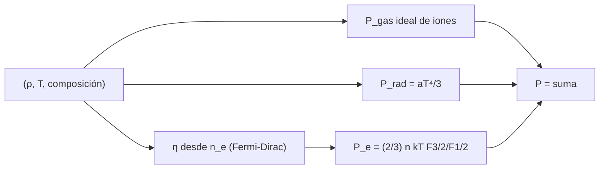

# B37-C02 — Ecuaciones de estado estelares: gas ideal, radiación y degeneración

<!-- nav:top -->
[🏠 Programa](../../../../README.md) · [📚 Bloque B37](../../../tronco-comun/B37-interiores-estelares-y-asterosismologia.md) · [← Anterior: B37-C01 — Convección: longitud de mezcla y criterios de Schwarzschild y Ledoux](../B37-C01-conveccion-longitud-de-mezcla-y-criterios-de-schwarzschild-y-ledoux/CLASE.md) · [Siguiente: B37-C03 — Opacidad media de Rosseland y tablas de opacidad en interiores →](../B37-C03-opacidad-media-de-rosseland-y-tablas-de-opacidad-en-interiores/CLASE.md)
<!-- /nav -->

## 1. Ubicación, nivel y alcance

Clase 2 del bloque B37. Nivel N3. La presión de un interior estelar es la suma de la del gas de iones, la de los electrones (ideal o degenerada) y la de la radiación. Aquí calculas cada una para cuatro estados ilustrativos con la **integral de Fermi–Dirac** y las constantes de NIST. Usas [B05](../../../tronco-comun/B05-fisica-fundamental-para-el-espacio.md). Los estados no son modelos de estrellas reales.

## 2. Por qué esta clase existe

La estructura depende de `P(ρ, T, composición)`. La decisión central: **¿qué término domina en cada estado y cuándo deja de valer el gas ideal?**

## 3. Lo que podrás hacer al terminar

1. Calcular `P_gas` y `P_rad` y el parámetro `β`.
2. Resolver el parámetro de degeneración `η` de los electrones.
3. Obtener `P_e` desde las integrales de Fermi–Dirac.
4. Comparar con los límites no degenerado y de temperatura nula.
5. Reconocer que la presión degenerada casi no depende de `T`.
6. Nombrar lo que el modelo omite (relatividad, coulombiana).

La evidencia es la **ficha de la ecuación de estado** del ejercicio 12 (sección 20).

## 4. Con qué llegas y cómo comprobarlo

1. ¿Qué es una incertidumbre?
2. ¿Qué es una simulación Monte Carlo?
3. ¿Qué es una tabla de resultados?
4. ¿Qué es un valor ilustrativo?
5. ¿Qué es una verificación?

<details>
<summary>Ver respuestas</summary>

1. Un intervalo en que se espera el valor verdadero. 2. Repetir con números aleatorios de semilla fija. 3. Un resumen ordenado de cálculos. 4. Un valor propuesto para el ejemplo, no medido. 5. Comparar un cálculo con un caso independiente.
</details>

Con cuatro o cinco aciertos, sigue; si no, repasa los prerrequisitos.

## 5. Un caso de contexto y casos de referencia

En un estado tipo centro solar (`ρ = 1,5 × 10⁵ kg/m³`, `T = 1,57 × 10⁷ K`, **ilustrativo**) el gas aporta `2,304 × 10¹⁶ Pa` y la radiación `1,532 × 10¹³ Pa` (`β = 0,9993`), y los electrones tienen `η = −1,268`: son apenas degenerados (`P_e/(n kT) = 1,0454`). Es el **ejemplo conductor**.

## 6. Vocabulario

El **gas ideal** `P = n k T`. La **presión de radiación** `P_rad = a T⁴/3`. El **parámetro `β`** es `P_gas/P`. La **degeneración** aparece cuando el principio de exclusión impide ocupar los estados bajos; se mide con `η = μ_químico/kT`. La **integral de Fermi–Dirac** `F_j(η) = ∫ x^j/(1 + e^{x−η}) dx`.

## 7. Modelo mental: un auditorio con asientos

Es como llenar un auditorio: si hay pocas personas (gas ideal) se sientan donde quieran; si hay muchas, los asientos bajos se agotan y las demás deben ocupar filas altas (degeneración), con una presión que ya no depende de la temperatura.



*Descripción textual:* se suman las presiones de iones, radiación y electrones, y estos últimos se obtienen de la integral de Fermi–Dirac.

Analogía: un auditorio con asientos. Límite: electrones no relativistas y plasma ideal.

## 8. La explicación, paso a paso

### 8.1 Gas y radiación

En el estado tipo solar: `P_gas = 2,304 × 10¹⁶ Pa`, `P_rad = 1,532 × 10¹³ Pa` y `β = 0,9993`. La radiación pesa menos del 0,1 %.

### 8.2 Electrones

| Estado | `ρ` (kg/m³) | `T` (K) | `η` | `P_e/(n k T)` | `P_e/P_e(T=0)` |
|---|---|---|---|---|---|
| tipo Sol | 1,50 × 10⁵ | 1,57 × 10⁷ | −1,268 | 1,0454 | 5,3478 |
| enana blanca | 1,00 × 10⁹ | 1,00 × 10⁷ | 190,094 | 76,0480 | 1,0001 |
| intermedio | 1,00 × 10⁷ | 1,00 × 10⁷ | 8,728 | 3,7120 | 1,0517 |
| gas diluido | 1,00 × 10² | 1,00 × 10⁷ | −7,995 | 1,0002 | 427,0695 |

`η < 0` es no degenerado (la presión cae al gas ideal, razón 1,0002); `η ≫ 1` es degenerado (la presión cae al valor de `T = 0`, razón 1,0001). El estado tipo solar está entre ambos: un 4,5 % más de presión que la ideal.

### 8.3 Independencia de la temperatura

En el estado degenerado, duplicar `T` de `10⁷` a `2 × 10⁷ K` multiplica `P_e` por `1,0003`; un gas ideal la multiplicaría por 2. Esa es la causa del **calor sin expansión** de los núcleos degenerados.

### 8.4 Comprobación de la integral

El cociente `F_{1/2}(−20)/(√π/2 · e^{−20}) − 1` vale `1,69 × 10⁻⁴`: la cuadratura de Simpson reproduce el límite analítico.

### 8.5 Lectura

Los electrones del centro solar no son un gas perfecto del todo. El modelo omite la relatividad (necesaria cerca de `10⁹ kg/m³` y más) y las correcciones coulombianas.

## 9. Magnitudes, símbolos y unidades

| Símbolo | Qué es | Unidad | Valor / nota |
|---|---|---|---|
| `P_gas` | presión de iones | Pa | 2,304 × 10¹⁶ (ilustrativo) |
| `β` | razón gas/total | — | 0,9993 |
| `η` | parámetro de degeneración | — | −1,268 a 190,094 |
| `F_j` | integral de Fermi–Dirac | — | cuadratura de Simpson |
| `h`, `k_B`, `m_e`, `m_u` | constantes | SI | de NIST |

## 10. Convenciones y referencias

Electrones no relativistas, iones ideales, sin ionización parcial ni correcciones coulombianas; `μ` y `μ_e` dados; constantes de NIST.

## 11. De dónde sale lo que afirmamos

| ID | Fuente | Localizador | Respalda | Estado |
|---|---|---|---|---|
| S1 | NIST, *Fundamental Physical Constants* (CODATA 2022) | https://physics.nist.gov/cuu/Constants/Table/allascii.txt | `h`, `k_B`, `m_e`, `m_u`, `σ`, `c` | Consultada el 2026-11-09 |
| S2 | Valores y modelo del laboratorio | — | los cuatro estados `(ρ, T, μ, μ_e)` | Ilustrativo o sintético; no consultado |

Límites: los estados no corresponden a modelos reales y falta la relatividad.

## 12. Cómo ver las presiones

| Estado | `P_e/(n k T)` |
|---|---|
| tipo Sol | 1,0454 |
| intermedio | 3,7120 |
| enana blanca | 76,0480 |
| gas diluido | 1,0002 |

Descripción larga: la razón sube de 1 al aumentar la densidad a temperatura fija.

## 13. Ejemplo trabajado: la razón `P_e/(n k T)`

**Paso 1 · Densidad numérica.** `n_e = ρ/(μ_e m_u)`.

**Paso 2 · Parámetro `η`.** Se busca por bisección el `η` que reproduce `n_e`: `−1,268`.

**Paso 3 · Presión.** `P_e = (2/3) n kT F_{3/2}/F_{1/2}`.

**Paso 4 · Razón.** `P_e/(n k T) = 1,0454`.

## 14. Distintas formas de describir la presión

**Por término:** gas, radiación, electrones. **Por límite:** ideal y `T = 0`. **Por parámetro:** `η`. **Por consecuencia:** calor sin expansión.

## 15. Práctica guiada

**Ejercicio 1 · con los pasos indicados.** `β` desde `P_gas = 2,304 × 10¹⁶` y `P_rad = 1,532 × 10¹³`. *Pasos:* `P_gas/(P_gas + P_rad)`.

<details><summary>Solución comentada</summary>

`0,9993`.
</details>

**Ejercicio 2 · con una pista.** Fracción de `P_rad` en la presión total del estado tipo Sol.

<details><summary>Solución comentada</summary>

`1 − 0,9993 = 0,0007`: 0,07 %.
</details>

**Ejercicio 3 · casi autónomo.** ¿Es degenerado el estado tipo Sol? *Pista:* signo de `η`.

<details><summary>Solución comentada</summary>

No: `η = −1,268 < 0`.
</details>

## 16. Práctica autónoma, transferencia e integrador

**Ejercicio 4.** Exceso de `P_e` sobre la ideal en el estado intermedio.

<details><summary>Solución comentada</summary>

`3,7120 − 1 = 2,712`: 271 %.
</details>

**Ejercicio 5.** Razón `P_e(2 × 10⁷)/P_e(10⁷)` de la enana blanca.

<details><summary>Solución comentada</summary>

`1,0003`.
</details>

**Ejercicio 6.** ¿Qué estado está más cerca del límite `T = 0`?

<details><summary>Solución comentada</summary>

La enana blanca, con razón 1,0001.
</details>

**Ejercicio 7.** Razón ideal esperada al duplicar `T`.

<details><summary>Solución comentada</summary>

2.
</details>

**Ejercicio 8.** ¿Cuál es la razón `P_e/(nkT)` del gas diluido?

<details><summary>Solución comentada</summary>

`1,0002`, es un gas ideal.
</details>

**Ejercicio 9 · transferencia.** **Transferencia.** Un compañero llama «enana blanca» al estado de 10⁹ kg/m³. Responde.

<details><summary>Solución comentada</summary>

Es un estado ilustrativo; no es un modelo de una estrella real.
</details>

**Ejercicio 10 · transferencia.** **Transferencia.** ¿Por qué se enfría una enana blanca sin contraerse?

<details><summary>Solución comentada</summary>

Porque su presión casi no depende de `T` (razón 1,0003).
</details>

**Ejercicio 11 · transferencia.** **Transferencia.** ¿Qué falta a 10⁹ kg/m³?

<details><summary>Solución comentada</summary>

La relatividad de los electrones.
</details>

**Ejercicio 12.** **Integrador.** Elabora tu *ficha de la ecuación de estado*: presiones y grado de degeneración de un estado.

<details><summary>Solución comentada</summary>

Secciones 8.1–8.5.
</details>

**Ejercicio 12 · integrador.** **Integrador.** Elabora tu *ficha de la ecuación de estado*: presiones y grado de degeneración de un estado.

<details><summary>Solución modelo</summary>

Secciones 8.1–8.5.
</details>

## 17. Laboratorio: presiones de gas, radiación y electrones

El script [ecuacion_estado.py](ecuacion_estado.py) calcula las presiones y el parámetro de degeneración (**comprueba** los límites ideal y de temperatura nula).

**Datos:** constantes de NIST; los estados son **ilustrativos**. **Predice antes de ejecutar:** ¿qué estado tendrá `η` positivo? (los densos.) **Ejecución del 2026-11-09 (Python 3.12.9):**

```text
Python 3.12.9 (biblioteca estandar)
F_1/2(-20) / (sqrt(pi)/2 exp(-20)) - 1 = 1.69e-04
centro tipo Sol: P_gas = 2.304e+16 Pa ; P_rad = 1.532e+13 Pa ; beta = 0.9993
estado                rho [kg/m3]     T [K]       eta  Pe/(n k T)  Pe/P(T=0)
tipo Sol                 1.50e+05  1.57e+07    -1.268      1.0454     5.3478
enana blanca             1.00e+09  1.00e+07   190.094     76.0480     1.0001
intermedio               1.00e+07  1.00e+07     8.728      3.7120     1.0517
gas diluido              1.00e+02  1.00e+07    -7.995      1.0002   427.0695
enana blanca: P_e(T = 2e7)/P_e(T = 1e7) = 1.0003 (gas ideal daria 2,0000)
Pruebas superadas.
```

```bash
python programa/clases/B37/B37-C02-ecuaciones-de-estado-estelares-gas-ideal-radiacion-y-degeneracion/ecuacion_estado.py
```

**Límites:** electrones no relativistas y plasma ideal.

## 18. Errores frecuentes y cómo corregirlos

**Usar siempre el gas ideal.** Se corrige con 8.2.

**Creer que la presión degenerada depende de `T`.** Se corrige con 8.3.

**Ignorar la radiación en estrellas masivas.** Se corrige con 8.1 (pesa 0,07 % solo en el estado solar).

**Presentar un estado como una estrella real.** Se corrige en la sección 10.

## 19. Cómo sabrás que vas bien

Tras la sección 8: ¿qué resultado esperabas y cuál obtuviste? Si dudas, repasa el ejemplo 13. Tras el laboratorio: ¿qué comprueba? (ver la sección 17).

## 20. Qué entregas y cómo se evalúa

El producto es tu **ficha de la ecuación de estado** (ejercicio 12).

| Criterio | Inicial | En desarrollo | Logrado | Destacado |
|---|---|---|---|---|
| Conceptos | Los confunde | Parciales | conceptos de la clase | Explica los límites |
| Cálculo | Sin unidades | Con errores | Tablas completas | Calcula casos nuevos |
| Numérico | Sin comprobar | Un caso | Contraste con el análisis | Interpreta las diferencias |
| Fuentes | Sin fuente | Sin fecha | fuentes con fecha | Declara lo ilustrativo |
| Límites | No los nombra | Uno | Tres | Discute qué falta del modelo |

**Condiciones críticas (no se compensan con promedio):** rotular los estados como ilustrativos; no presentarlos como estrellas reales; citar solo lo consultado.

## 21. Ética, seguridad y límites

Clase educativa: los modelos son simplificados. Accesibilidad: tablas equivalentes a las gráficas, fórmulas en texto, ejercicios sin conexión.

## 22. Para cerrar y seguir

La presión total es la suma de iones, radiación y electrones, y los electrones del centro solar son apenas degenerados. Queda una pregunta: ¿qué tan opaco es el plasma que atraviesa la luz?

**Glosario español–inglés.** ecuación de estado · *equation of state*; degeneración · *degeneracy*; presión de radiación · *radiation pressure*; integral de Fermi–Dirac · *Fermi–Dirac integral*; gas ideal · *ideal gas*.

**Continuidad.** [B37-C03](../B37-C03-opacidad-media-de-rosseland-y-tablas-de-opacidad-en-interiores/CLASE.md) estudia la opacidad de Rosseland.

**Referencias:** ver sección 11.

<!-- nav:bottom -->
---

[← Anterior: B37-C01 — Convección: longitud de mezcla y criterios de Schwarzschild y Ledoux](../B37-C01-conveccion-longitud-de-mezcla-y-criterios-de-schwarzschild-y-ledoux/CLASE.md) · [📚 Bloque B37](../../../tronco-comun/B37-interiores-estelares-y-asterosismologia.md) · [Siguiente: B37-C03 — Opacidad media de Rosseland y tablas de opacidad en interiores →](../B37-C03-opacidad-media-de-rosseland-y-tablas-de-opacidad-en-interiores/CLASE.md)
<!-- /nav -->
