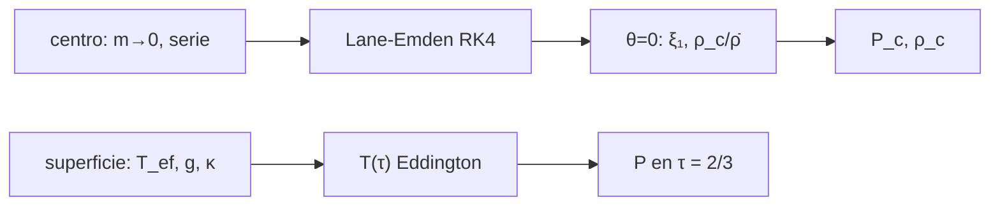

# B37-C04 — Condiciones de frontera centrales y superficiales en modelos estelares

<!-- nav:top -->
[🏠 Programa](../../../../README.md) · [📚 Bloque B37](../../../tronco-comun/B37-interiores-estelares-y-asterosismologia.md) · [← Anterior: B37-C03 — Opacidad media de Rosseland y tablas de opacidad en interiores](../B37-C03-opacidad-media-de-rosseland-y-tablas-de-opacidad-en-interiores/CLASE.md) · [Siguiente: B37-C05 — Códigos de evolución estelar: configuración, verificación y límites →](../../../tronco-comun/B37-interiores-estelares-y-asterosismologia.md#b37-c05)
<!-- /nav -->

## 1. Ubicación, nivel y alcance

Clase 4 del bloque B37. Nivel N3. Un sistema de ecuaciones de estructura necesita condiciones en el **centro** (series regulares) y en la **superficie** (una atmósfera). Aquí integras el **politropo** de Lane–Emden `n = 3` hasta su borde, calculas `ρ_c` y `P_c` para la masa y el radio nominales del Sol y construyes la **atmósfera gris de Eddington**. Usas [B05](../../../tronco-comun/B05-fisica-fundamental-para-el-espacio.md). El politropo no es el Sol.

## 2. Por qué esta clase existe

Sin condiciones de frontera no hay solución única. La decisión central: **¿qué valores fijan el centro y la superficie, y cuánto cuestan los errores de una frontera?**

## 3. Lo que podrás hacer al terminar

1. Resolver Lane–Emden con series centrales y RK4.
2. Contrastar con la solución analítica de `n = 1`.
3. Obtener `ρ_c/ρ̄` y `P_c` del politropo `n = 3`.
4. Verificar la serie central de la masa.
5. Construir `T(τ)` de Eddington y la presión fotosférica.
6. Nombrar los límites del politropo.

La evidencia es la **ficha de las condiciones de frontera** del ejercicio 12 (sección 20).

## 4. Con qué llegas y cómo comprobarlo

1. ¿Qué es una incertidumbre?
2. ¿Qué es una simulación Monte Carlo?
3. ¿Qué es una tabla de resultados?
4. ¿Qué es un valor ilustrativo?
5. ¿Qué es una verificación?

<details>
<summary>Ver respuestas</summary>

1. Un intervalo en que se espera el valor verdadero. 2. Repetir con números aleatorios de semilla fija. 3. Un resumen ordenado de cálculos. 4. Un valor propuesto para el ejemplo, no medido. 5. Comparar un cálculo con un caso independiente.
</details>

Con cuatro o cinco aciertos, sigue; si no, repasa los prerrequisitos.

## 5. Un caso de contexto y casos de referencia

Para `n = 1` el laboratorio da `ξ₁ = 3,141593`, igual a `π`; para `n = 3`, `ξ₁ = 6,89685`, `−ξ²θ′ = 2,01824` y `ρ_c/ρ̄ = 54,1825`. Con `GM = 1,3271244 × 10²⁰ m³/s²` y `R = 6,957 × 10⁸ m` resultan `ρ_c = 7,6385 × 10⁴ kg/m³` y `P_c = 1,2449 × 10¹⁶ Pa`. Es el **ejemplo conductor**; el politropo es un modelo de juguete.

## 6. Vocabulario

La **ecuación de Lane–Emden** `θ″ + 2θ′/ξ + θⁿ = 0` describe un politropo `P ∝ ρ^{1+1/n}`. La **serie central** `θ = 1 − ξ²/6 + nξ⁴/120`. La **atmósfera gris de Eddington** `T⁴ = (3/4) T_ef⁴ (τ + 2/3)`. La **profundidad óptica** `τ`. La **fotosfera** es donde `τ = 2/3`.

## 7. Modelo mental: dos extremos de una cuerda

Es como una cuerda fijada en dos extremos: la forma depende de lo que fijes en el techo (el centro) y en el piso (la superficie); si te equivocas en un extremo, toda la curva se desplaza.



*Descripción textual:* se integra desde la serie central hasta el borde y se enlaza con una atmósfera en la fotosfera.

Analogía: dos extremos de una cuerda. Límite: un politropo es una estructura de una sola variable.

## 8. La explicación, paso a paso

### 8.1 Verificación

Para `n = 1`: `ξ₁ = 3,141593` y `−ξ²θ′ = 3,141593`, ambos iguales a `π` (solución `sin ξ/ξ`). Para `n = 3`: `ξ₁ = 6,89685`, `−ξ²θ′ = 2,01824` y `ρ_c/ρ̄ = ξ₁³/(3 · 2,01824) = 54,1825`.

### 8.2 Centro

Con la masa `M = 1,9884 × 10³⁰ kg` y `R = 6,957 × 10⁸ m`: `ρ̄ = 1409,8 kg/m³`, `ρ_c = 7,6385 × 10⁴ kg/m³` y `P_c = 4πGρ_c²a²/4 = 1,2449 × 10¹⁶ Pa`, con `a = R/ξ₁`. Es 92,578 veces la presión de una esfera uniforme de la misma masa y radio.

La serie central de la masa a `ξ = 0,05` coincide con la integral numérica: el cociente vale `0,99925`.

### 8.3 Superficie

| `τ` | `T` (K) |
|---|---|
| 0,000 | 4853,7 |
| 0,667 | 5772,0 |
| 1,000 | 6103,1 |
| 10,000 | 9707,3 |

`T(τ = 2/3) = T_ef` exactamente. Con `g = 274,20 m/s²` y `κ = 0,05 m²/kg` (ilustrativa), `P(τ = 2/3) = g τ/κ = 3656,001 Pa`, que la integración numérica reproduce. La luminosidad `4πR²σT_ef⁴ = 3,8280 × 10²⁶ W`.

### 8.4 Lectura

Un politropo `n = 3` concentra la densidad (`ρ_c/ρ̄ = 54,2`), pero no reemplaza un modelo evolutivo. Las fronteras exigen **elegir** `T_ef`, `κ` y `g` en la fotosfera.

## 9. Magnitudes, símbolos y unidades

| Símbolo | Qué es | Unidad | Valor / nota |
|---|---|---|---|
| `ξ₁` | primer cero de `θ` | — | 3,141593 (`n=1`); 6,89685 (`n=3`) |
| `ρ_c/ρ̄` | concentración central | — | 54,1825 |
| `P_c` | presión central | Pa | 1,2449 × 10¹⁶ (politropo) |
| `T_ef` | temperatura efectiva | K | 5772 (UAI) |
| `G` | constante de gravitación | m³ kg⁻¹ s⁻² | 6,67430 × 10⁻¹¹ |

## 10. Convenciones y referencias

Politropo; `κ` constante en la atmósfera; `G` y `σ` de NIST; `GM`, `R`, `T_ef` nominales de la UAI; `κ` y `ρ_c` del laboratorio.

## 11. De dónde sale lo que afirmamos

| ID | Fuente | Localizador | Respalda | Estado |
|---|---|---|---|---|
| S1 | NIST, *Fundamental Physical Constants* (CODATA 2022) | https://physics.nist.gov/cuu/Constants/Table/allascii.txt | `G`, `σ` | Consultada el 2026-11-09 |
| S2 | UAI, Resolución B3 de 2015 (arXiv:1510.07674) | https://arxiv.org/abs/1510.07674 | valores nominales solares (GM, R, T_ef) | Solo resumen, consultado el 2026-11-09 |

Límites: el politropo no es un modelo solar y la atmósfera de `κ` constante es de juguete.

## 12. Cómo ver los valores de frontera

| Magnitud | Valor |
|---|---|
| `ξ₁` (`n = 3`) | 6,89685 |
| `ρ_c/ρ̄` | 54,1825 |
| `P_c` | 1,2449 × 10¹⁶ Pa |
| `T` en `τ = 2/3` | 5772,0 K |

Descripción larga: el centro fija `ρ_c` y `P_c`; la superficie fija `T_ef`.

## 13. Ejemplo trabajado: las constantes de Lane–Emden

**Paso 1 · Concentración.** `ρ_c/ρ̄ = ξ₁³/(3 · 2,01824) = 328,06/6,0547 = 54,18`.

**Paso 2 · Densidad.** `ρ_c = 54,18 × 1409,8 = 7,638 × 10⁴`.

**Paso 3 · Escala.** `a = R/ξ₁ = 1,0087 × 10⁸ m`.

**Paso 4 · Presión.** `P_c = πGρ_c²a² = 1,245 × 10¹⁶ Pa`.

## 14. Distintas formas de describir un modelo de una variable

**Por ecuación:** Lane–Emden. **Por serie:** expansión central. **Por atmósfera:** Eddington. **Por enlace:** fotosfera.

## 15. Práctica guiada

**Ejercicio 1 · con los pasos indicados.** `ρ_c` desde `ρ̄ = 1409,8` y `ρ_c/ρ̄ = 54,1825`. *Pasos:* producto.

<details><summary>Solución comentada</summary>

`7,64 × 10⁴ kg/m³`.
</details>

**Ejercicio 2 · con una pista.** `T` a `τ = 1` si `T_ef = 5772`. *Pasos:* `T_ef (0,75 × 1,667)^{1/4}`.

<details><summary>Solución comentada</summary>

`6103 K`.
</details>

**Ejercicio 3 · casi autónomo.** `P(τ = 2/3)` con `g = 274,20` y `κ = 0,05`.

<details><summary>Solución comentada</summary>

`3656 Pa`.
</details>

## 16. Práctica autónoma, transferencia e integrador

**Ejercicio 4.** Cociente `P_c` politropo y esfera uniforme.

<details><summary>Solución comentada</summary>

`92,578`.
</details>

**Ejercicio 5.** Error de `ξ₁` para `n = 1` frente a `π`.

<details><summary>Solución comentada</summary>

Menos de `10⁻⁶`.
</details>

**Ejercicio 6.** Luminosidad con `R = 6,957 × 10⁸` y `T_ef = 5772`.

<details><summary>Solución comentada</summary>

`3,828 × 10²⁶ W`.
</details>

**Ejercicio 7.** ¿Qué pasa con `T(τ)` a mayor `τ`?

<details><summary>Solución comentada</summary>

Crece: 9707,3 K a `τ = 10`.
</details>

**Ejercicio 8.** ¿Qué comprueba la serie central de la masa?

<details><summary>Solución comentada</summary>

Que el cociente numérico/serie vale 0,99925.
</details>

**Ejercicio 9 · transferencia.** **Transferencia.** Un compañero dice que el politropo `n = 3` es el Sol. Responde.

<details><summary>Solución comentada</summary>

No: es un modelo de una variable de estructura de juguete.
</details>

**Ejercicio 10 · transferencia.** **Transferencia.** ¿Por qué la fotosfera se toma en `τ = 2/3`?

<details><summary>Solución comentada</summary>

Porque ahí `T = T_ef` en la solución de Eddington.
</details>

**Ejercicio 11 · transferencia.** **Transferencia.** ¿Qué sesgo trae `κ` constante?

<details><summary>Solución comentada</summary>

Subestima o sobreestima la presión fotosférica según la opacidad real.
</details>

**Ejercicio 12.** **Integrador.** Elabora tu *ficha de las condiciones de frontera*: centro, superficie y enlace.

<details><summary>Solución comentada</summary>

Secciones 8.1–8.4.
</details>

**Ejercicio 12 · integrador.** **Integrador.** Elabora tu *ficha de las condiciones de frontera*: centro, superficie y enlace.

<details><summary>Solución modelo</summary>

Secciones 8.1–8.4.
</details>

## 17. Laboratorio: Lane–Emden y atmósfera de Eddington

El script [fronteras.py](fronteras.py) integra Lane–Emden y construye la atmósfera gris (**comprueba** `ξ₁ = π` para `n = 1` y `T(2/3) = T_ef`).

**Datos:** `G`, `σ` de NIST; `GM`, `R`, `T_ef` de la UAI; `κ` **ilustrativa**. **Predice antes de ejecutar:** ¿cuánto valdrá `ξ₁` de `n = 1`? (π.) **Ejecución del 2026-11-09 (Python 3.12.9):**

```text
Python 3.12.9 (biblioteca estandar)
n = 1: xi_1 = 3.141593 (pi = 3.141593) ; -xi^2 theta' = 3.141593 (pi = 3.141593)
n = 3: xi_1 = 6.89685 ; -xi^2 theta' = 2.01824 ; rho_c/rho_medio = 54.1825
M = 1.9884e+30 kg ; rho_medio = 1409.8 kg/m3 ; rho_c = 7.6385e+04 kg/m3 ; P_c = 1.2449e+16 Pa
P_c(politropo) / P_c(esfera uniforme) = 92.578
masa interior a xi = 0.05: integral numerica = 4.10201e+25 kg ; 4 pi/3 rho_c r^3 = 4.10509e+25 kg ; cociente = 0.99925
tau =  0.000 : T =   4853.7 K
tau =  0.667 : T =   5772.0 K
tau =  1.000 : T =   6103.1 K
tau = 10.000 : T =   9707.3 K
g = 274.20 m/s2 ; P(tau = 2/3) = 3656.001 Pa (integracion) ; g tau/kappa = 3656.001 Pa
L = 4 pi R^2 sigma T_ef^4 = 3.8280e+26 W
Pruebas superadas.
```

```bash
python programa/clases/B37/B37-C04-condiciones-de-frontera-centrales-y-superficiales-en-modelos-estelares/fronteras.py
```

**Límites:** politropo, `κ` constante.

## 18. Errores frecuentes y cómo corregirlos

**Empezar la integración en `ξ = 0`.** Se corrige con la serie central de 8.1.

**Confundir `T_ef` con `T(τ = 0)`.** Se corrige con 8.3.

**Usar el politropo como modelo real.** Se corrige con 8.4.

**Olvidar elegir `κ`.** Se corrige con 8.3.

## 19. Cómo sabrás que vas bien

Tras la sección 8: ¿qué resultado esperabas y cuál obtuviste? Si dudas, repasa el ejemplo 13. Tras el laboratorio: ¿qué comprueba? (ver la sección 17).

## 20. Qué entregas y cómo se evalúa

El producto es tu **ficha de las condiciones de frontera** (ejercicio 12).

| Criterio | Inicial | En desarrollo | Logrado | Destacado |
|---|---|---|---|---|
| Conceptos | Los confunde | Parciales | conceptos de la clase | Explica los límites |
| Cálculo | Sin unidades | Con errores | Tablas completas | Calcula casos nuevos |
| Numérico | Sin comprobar | Un caso | Contraste con el análisis | Interpreta las diferencias |
| Fuentes | Sin fuente | Sin fecha | fuentes con fecha | Declara lo ilustrativo |
| Límites | No los nombra | Uno | Tres | Discute qué falta del modelo |

**Condiciones críticas (no se compensan con promedio):** rotular el politropo y `κ` como ilustrativos; no presentar el modelo como el Sol; citar solo lo consultado.

## 21. Ética, seguridad y límites

Clase educativa: los modelos son simplificados. Accesibilidad: tablas equivalentes a las gráficas, fórmulas en texto, ejercicios sin conexión.

## 22. Para cerrar y seguir

El centro y la superficie cierran la estructura de un modelo de una variable. Queda una pregunta: ¿cómo se comprueba que un código resuelve bien estas ecuaciones?

**Glosario español–inglés.** condición de frontera · *boundary condition*; politropo · *polytrope*; Lane–Emden · *Lane–Emden*; atmósfera gris · *grey atmosphere*; fotosfera · *photosphere*.

**Continuidad.** [B37-C05](../B37-C05-codigos-de-evolucion-estelar-configuracion-verificacion-y-limites/CLASE.md) estudia los códigos de evolución.

**Referencias:** ver sección 11.

<!-- nav:bottom -->
---

[← Anterior: B37-C03 — Opacidad media de Rosseland y tablas de opacidad en interiores](../B37-C03-opacidad-media-de-rosseland-y-tablas-de-opacidad-en-interiores/CLASE.md) · [📚 Bloque B37](../../../tronco-comun/B37-interiores-estelares-y-asterosismologia.md) · [Siguiente: B37-C05 — Códigos de evolución estelar: configuración, verificación y límites →](../../../tronco-comun/B37-interiores-estelares-y-asterosismologia.md#b37-c05)
<!-- /nav -->
