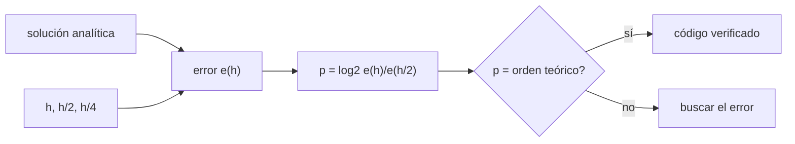

# B37-C05 — Códigos de evolución estelar: configuración, verificación y límites

<!-- nav:top -->
[🏠 Programa](../../../../README.md) · [📚 Bloque B37](../../../tronco-comun/B37-interiores-estelares-y-asterosismologia.md) · [← Anterior: B37-C04 — Condiciones de frontera centrales y superficiales en modelos estelares](../B37-C04-condiciones-de-frontera-centrales-y-superficiales-en-modelos-estelares/CLASE.md) · [Siguiente: B37-C06 — Calibración de modelos estelares con el Sol y binarias →](../B37-C06-calibracion-de-modelos-estelares-con-el-sol-y-binarias/CLASE.md)
<!-- /nav -->

## 1. Ubicación, nivel y alcance

Clase 5 del bloque B37. Nivel N3. Un código de estructura y evolución no se verifica porque «da números razonables», sino porque **converge al orden esperado** a una solución conocida. Aquí mides el orden observado de tres integradores en el politropo `n = 1` (con solución analítica) y el error global de un paso de tiempo adaptativo en una «evolución química» de juguete. Usas [B12](../../../tronco-comun/B12-probabilidad-estadistica-e-incertidumbre.md). No se ejecuta ningún código evolutivo real.

## 2. Por qué esta clase existe

Un código sin verificación puede dar resultados bonitos y falsos. La decisión central: **¿converge el error con el orden teórico al refinar la malla y el paso de tiempo?**

## 3. Lo que podrás hacer al terminar

1. Calcular el error frente a una solución analítica.
2. Estimar el orden observado `p = log₂(e(h)/e(h/2))`.
3. Comparar integradores de órdenes 1, 2 y 4.
4. Controlar el paso de tiempo con un parámetro relativo `η`.
5. Reconocer un paso excesivo.
6. Distinguir verificar de validar.

La evidencia es la **ficha de verificación de un código** del ejercicio 12 (sección 20).

## 4. Con qué llegas y cómo comprobarlo

1. ¿Qué es una incertidumbre?
2. ¿Qué es una simulación Monte Carlo?
3. ¿Qué es una tabla de resultados?
4. ¿Qué es un valor ilustrativo?
5. ¿Qué es una verificación?

<details>
<summary>Ver respuestas</summary>

1. Un intervalo en que se espera el valor verdadero. 2. Repetir con números aleatorios de semilla fija. 3. Un resumen ordenado de cálculos. 4. Un valor propuesto para el ejemplo, no medido. 5. Comparar un cálculo con un caso independiente.
</details>

Con cuatro o cinco aciertos, sigue; si no, repasa los prerrequisitos.

## 5. Un caso de contexto y casos de referencia

Para `ξ₁` del politropo `n = 1` (`ξ₁ = π`), el orden observado es `0,99` para Euler, `2,03` para el punto medio y `4,01` para RK4. Para `dX/dt = −kX²` (`X(10) = 1/11 = 0,090909`), el error de Euler implícito baja a la mitad cada vez que `η` se divide por 2. Es el **ejemplo conductor**; todo es **sintético**.

## 6. Vocabulario

**Verificar** es comprobar que el código resuelve bien las ecuaciones; **validar** es comprobar que las ecuaciones describen la estrella. El **orden de convergencia** `p` es el exponente con que el error baja con el paso. El **error global** se acumula en toda la integración. Un **paso adaptativo** se ajusta a la rapidez del cambio. Una **solución manufacturada** es una analítica contra la que se compara.

## 7. Modelo mental: afinar una regla de medir

Es como medir una curva con reglas cada vez más cortas: si al partir la regla por la mitad el error se divide por 2, 4 o 16, sabes qué tipo de regla tienes.



*Descripción textual:* se refina el paso, se mide el error frente a una solución exacta y se compara el orden observado con el teórico.

Analogía: afinar una regla de medir. Límite: problemas suaves.

## 8. La explicación, paso a paso

### 8.1 Orden en el espacio

Error en `ξ₁` del politropo `n = 1`:

| Orden | `h` | Error | `p` observado |
|---|---|---|---|
| 1 (Euler) | 0,020 | 8,631 × 10⁻³ | — |
| 1 | 0,010 | 4,347 × 10⁻³ | 0,99 |
| 1 | 0,005 | 2,182 × 10⁻³ | 0,99 |
| 2 (punto medio) | 0,040 | 9,169 × 10⁻⁵ | — |
| 2 | 0,020 | 2,228 × 10⁻⁵ | 2,04 |
| 2 | 0,010 | 5,442 × 10⁻⁶ | 2,03 |
| 4 (RK4) | 0,200 | 1,350 × 10⁻⁵ | — |
| 4 | 0,100 | 8,587 × 10⁻⁷ | 3,97 |
| 4 | 0,050 | 5,346 × 10⁻⁸ | 4,01 |

Con RK4 y `h = 0,05` el error es `5,3 × 10⁻⁸`; para igualarlo Euler necesitaría un paso cientos de miles de veces menor.

### 8.2 Paso de tiempo

Evolución de `dX/dt = −kX²` con Euler implícito y `Δt = η X/|dX/dt|`:

| `η` | Pasos | Error de `X(10)` | Cociente |
|---|---|---|---|
| 0,200 | 15 | 1,3364 × 10⁻² | — |
| 0,100 | 27 | 7,3280 × 10⁻³ | 1,82 |
| 0,050 | 51 | 3,8770 × 10⁻³ | 1,89 |
| 0,025 | 99 | 1,9992 × 10⁻³ | 1,94 |

El cociente tiende a 2: el método es de primer orden en el paso. Con `η = 5` (paso excesivo) `X(10) = 0,1857`, un error relativo de `1,04`.

### 8.3 Lectura

El orden observado distingue un error de código de un error de física. Que el orden sea el esperado **no** dice que el modelo describa una estrella. Un orden menor que el teórico revela un fallo; por ejemplo, un arranque o un último paso de orden bajo limitan el orden efectivo (aquí el último paso se recorta hasta `θ = 0` para no degradarlo).

## 9. Magnitudes, símbolos y unidades

| Símbolo | Qué es | Unidad | Valor / nota |
|---|---|---|---|
| `h` | paso de integración | — | 0,05 a 0,2 |
| `p` | orden observado | — | 0,99; 2,03; 4,01 |
| `η` | paso relativo de tiempo | — | 0,025 a 5 |
| `e` | error frente a la analítica | — | 5,3 × 10⁻⁸ a 1,3 × 10⁻² |

## 10. Convenciones y referencias

Problema suave con solución exacta; el orden teórico se alcanza si el arranque y el último paso son de igual orden; todo sintético.

## 11. De dónde sale lo que afirmamos

| ID | Fuente | Localizador | Respalda | Estado |
|---|---|---|---|---|
| S1 | Valores y modelo del laboratorio | — | problemas de prueba y sus parámetros | Ilustrativo o sintético; no consultado |

Límites: no se verificó ningún código evolutivo real.

## 12. Cómo ver los órdenes

| Integrador | `p` observado |
|---|---|
| Euler | 0,99 |
| Punto medio | 2,03 |
| RK4 | 4,01 |
| Paso adaptativo | 1,94 (cociente) |

Descripción larga: cada integrador alcanza su orden teórico.

## 13. Ejemplo trabajado: el orden observado

**Paso 1 · Errores.** `e(0,10) = 8,587 × 10⁻⁷` y `e(0,05) = 5,346 × 10⁻⁸`.

**Paso 2 · Cociente.** `8,587 × 10⁻⁷/5,346 × 10⁻⁸ = 16,06`.

**Paso 3 · Logaritmo.** `log₂ 16,06 = 4,01`.

**Paso 4 · Conclusión.** Orden 4, el teórico de RK4.

## 14. Distintas formas de describir un código

**Por orden:** `p`. **Por problema:** analítica. **Por tiempo:** `η`. **Por objetivo:** verificar y validar.

## 15. Práctica guiada

**Ejercicio 1 · con los pasos indicados.** `p` de Euler entre `h = 0,010` y `0,005`. *Pasos:* `log₂(4,347/2,182)`.

<details><summary>Solución comentada</summary>

`0,99`.
</details>

**Ejercicio 2 · con una pista.** Cociente de errores de RK4 al dividir `h` por 2.

<details><summary>Solución comentada</summary>

`16,06`.
</details>

**Ejercicio 3 · casi autónomo.** Error esperado de Euler con `h = 0,0025`.

<details><summary>Solución comentada</summary>

Cerca de `1,09 × 10⁻³`.
</details>

## 16. Práctica autónoma, transferencia e integrador

**Ejercicio 4.** Pasos de `η = 0,05` respecto de `η = 0,2`.

<details><summary>Solución comentada</summary>

`51/15 = 3,4`.
</details>

**Ejercicio 5.** Error esperado de RK4 con `h = 0,025`.

<details><summary>Solución comentada</summary>

Cerca de `3,3 × 10⁻⁹`.
</details>

**Ejercicio 6.** ¿Qué indica un `p` de 1,35 en un método de orden 2?

<details><summary>Solución comentada</summary>

Un error de arranque o de último paso.
</details>

**Ejercicio 7.** Cociente de errores entre `η = 0,1` y `η = 0,05`.

<details><summary>Solución comentada</summary>

`1,89`.
</details>

**Ejercicio 8.** ¿Por qué falla `η = 5`?

<details><summary>Solución comentada</summary>

El paso es mayor que la escala de cambio de `X`.
</details>

**Ejercicio 9 · transferencia.** **Transferencia.** Un compañero dice que su código es correcto porque da `ξ₁ ≈ 6,9`. Responde.

<details><summary>Solución comentada</summary>

Falta el orden de convergencia y una solución exacta.
</details>

**Ejercicio 10 · transferencia.** **Transferencia.** ¿Qué diferencia hay entre verificar y validar?

<details><summary>Solución comentada</summary>

Verificar comprueba las ecuaciones; validar, el modelo frente a la estrella.
</details>

**Ejercicio 11 · transferencia.** **Transferencia.** ¿Qué haría con una física de entrada discontinua?

<details><summary>Solución comentada</summary>

Reducir el paso en la discontinuidad.
</details>

**Ejercicio 12.** **Integrador.** Elabora tu *ficha de verificación de un código*: errores, órdenes y paso de tiempo.

<details><summary>Solución comentada</summary>

Secciones 8.1–8.3.
</details>

**Ejercicio 12 · integrador.** **Integrador.** Elabora tu *ficha de verificación de un código*: errores, órdenes y paso de tiempo.

<details><summary>Solución modelo</summary>

Secciones 8.1–8.3.
</details>

## 17. Laboratorio: orden de convergencia

El script [verificacion_codigo.py](verificacion_codigo.py) mide el orden observado y el error del paso de tiempo (**comprueba** `p` y el cociente 2).

**Datos:** ningún dato externo; problemas **sintéticos**. **Predice antes de ejecutar:** ¿qué orden saldrá para RK4? (4.) **Ejecución del 2026-11-09 (Python 3.12.9):**

```text
Python 3.12.9 (biblioteca estandar)
 orden         h   error de xi_1  p observado
     1    0.0200       8.631e-03            -
     1    0.0100       4.347e-03         0.99
     1    0.0050       2.182e-03         0.99
     2    0.0400       9.169e-05            -
     2    0.0200       2.228e-05         2.04
     2    0.0100       5.442e-06         2.03
     4    0.2000       1.350e-05            -
     4    0.1000       8.587e-07         3.97
     4    0.0500       5.346e-08         4.01
   eta  pasos   error de X(10)  cociente
 0.200     15       1.3364e-02         -
 0.100     27       7.3280e-03      1.82
 0.050     51       3.8770e-03      1.89
 0.025     99       1.9992e-03      1.94
solucion analitica X(10) = 0.090909
eta = 5 (paso excesivo): X(10) = 0.1857 ; error relativo = 1.04
Pruebas superadas.
```

```bash
python programa/clases/B37/B37-C05-codigos-de-evolucion-estelar-configuracion-verificacion-y-limites/verificacion_codigo.py
```

**Límites:** problemas suaves.

## 18. Errores frecuentes y cómo corregirlos

**Fiarse de un resultado plausible.** Se corrige con 8.1.

**Mezclar verificar con validar.** Se corrige con 8.3.

**Usar un paso fijo grande.** Se corrige con 8.2.

**Ignorar el arranque y el último paso.** Se corrige con 8.3.

## 19. Cómo sabrás que vas bien

Tras la sección 8: ¿qué resultado esperabas y cuál obtuviste? Si dudas, repasa el ejemplo 13. Tras el laboratorio: ¿qué comprueba? (ver la sección 17).

## 20. Qué entregas y cómo se evalúa

El producto es tu **ficha de verificación de un código** (ejercicio 12).

| Criterio | Inicial | En desarrollo | Logrado | Destacado |
|---|---|---|---|---|
| Conceptos | Los confunde | Parciales | conceptos de la clase | Explica los límites |
| Cálculo | Sin unidades | Con errores | Tablas completas | Calcula casos nuevos |
| Numérico | Sin comprobar | Un caso | Contraste con el análisis | Interpreta las diferencias |
| Fuentes | Sin fuente | Sin fecha | fuentes con fecha | Declara lo ilustrativo |
| Límites | No los nombra | Uno | Tres | Discute qué falta del modelo |

**Condiciones críticas (no se compensan con promedio):** rotular los problemas como sintéticos; no presentar la verificación como validación; citar solo lo consultado.

## 21. Ética, seguridad y límites

Clase educativa: los modelos son simplificados. Accesibilidad: tablas equivalentes a las gráficas, fórmulas en texto, ejercicios sin conexión.

## 22. Para cerrar y seguir

La verificación mide el orden de convergencia contra una solución exacta. Queda una pregunta: ¿cómo se ajustan los parámetros libres para que el modelo reproduzca el Sol?

**Glosario español–inglés.** verificación · *verification*; validación · *validation*; orden de convergencia · *convergence order*; paso adaptativo · *adaptive step*; solución manufacturada · *manufactured solution*.

**Continuidad.** [B37-C06](../B37-C06-calibracion-de-modelos-estelares-con-el-sol-y-binarias/CLASE.md) estudia la calibración de modelos.

**Referencias:** ver sección 11.

<!-- nav:bottom -->
---

[← Anterior: B37-C04 — Condiciones de frontera centrales y superficiales en modelos estelares](../B37-C04-condiciones-de-frontera-centrales-y-superficiales-en-modelos-estelares/CLASE.md) · [📚 Bloque B37](../../../tronco-comun/B37-interiores-estelares-y-asterosismologia.md) · [Siguiente: B37-C06 — Calibración de modelos estelares con el Sol y binarias →](../B37-C06-calibracion-de-modelos-estelares-con-el-sol-y-binarias/CLASE.md)
<!-- /nav -->
