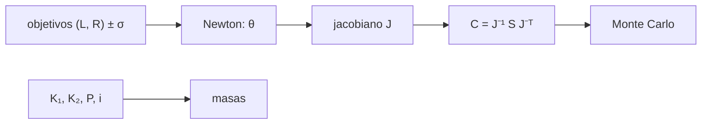

# B37-C06 — Calibración de modelos estelares con el Sol y binarias

<!-- nav:top -->
[🏠 Programa](../../../../README.md) · [📚 Bloque B37](../../../tronco-comun/B37-interiores-estelares-y-asterosismologia.md) · [← Anterior: B37-C05 — Códigos de evolución estelar: configuración, verificación y límites](../B37-C05-codigos-de-evolucion-estelar-configuracion-verificacion-y-limites/CLASE.md) · [Siguiente: B37-C07 — Oscilaciones radiales y relación período-densidad media →](../B37-C07-oscilaciones-radiales-y-relacion-periodo-densidad-media/CLASE.md)
<!-- /nav -->

## 1. Ubicación, nivel y alcance

Clase 6 del bloque B37. Nivel N3. Los parámetros libres de un modelo (helio inicial, longitud de mezcla) se ajustan para que reproduzca las observaciones del Sol. Aquí resuelves por **Newton** un problema de dos parámetros y dos observables, propagas la incertidumbre con la covarianza lineal y con **Monte Carlo**, y recuperas las **masas de una binaria eclipsante** sintética. Usas [B12](../../../tronco-comun/B12-probabilidad-estadistica-e-incertidumbre.md). Las respuestas del modelo son de juguete.

## 2. Por qué esta clase existe

Dos observables fijan dos parámetros, pero con degeneración. La decisión central: **¿qué parámetros se ajustan, con qué incertidumbre y qué correlación entre ellos?**

## 3. Lo que podrás hacer al terminar

1. Resolver `f(θ) = objetivo` con Newton.
2. Calcular la covarianza lineal `J⁻¹ S J⁻ᵀ`.
3. Contrastarla con 2000 realizaciones.
4. Aplicar la tercera ley de Kepler.
5. Recuperar masas de una binaria desde las velocidades.
6. Propagar el error de las velocidades a la masa.

La evidencia es la **ficha de calibración** del ejercicio 12 (sección 20).

## 4. Con qué llegas y cómo comprobarlo

1. ¿Qué es una incertidumbre?
2. ¿Qué es una simulación Monte Carlo?
3. ¿Qué es una tabla de resultados?
4. ¿Qué es un valor ilustrativo?
5. ¿Qué es una verificación?

<details>
<summary>Ver respuestas</summary>

1. Un intervalo en que se espera el valor verdadero. 2. Repetir con números aleatorios de semilla fija. 3. Un resumen ordenado de cálculos. 4. Un valor propuesto para el ejemplo, no medido. 5. Comparar un cálculo con un caso independiente.
</details>

Con cuatro o cinco aciertos, sigue; si no, repasa los prerrequisitos.

## 5. Un caso de contexto y casos de referencia

Con objetivos `ln L = −0,054720` y `ln R = −0,049920` (**sintéticos**) y errores del 0,2 % y 0,1 %, Newton recupera `Y = 0,268` y `a = 0,62` en 6 iteraciones, con `σ(Y) = 0,00098`, `σ(a) = 0,00317` y correlación `0,746`. Una binaria de `1,10` y `0,95` masas solares nominales tiene `K₁ = 73,253` y `K₂ = 84,819 km/s`. Es el **ejemplo conductor**.

## 6. Vocabulario

La **calibración** ajusta parámetros para igualar observables. El **jacobiano** `J = ∂f/∂θ`. La **covarianza** `C = J⁻¹ S J⁻ᵀ`. Una **degeneración** es una correlación alta entre parámetros. Una **binaria eclipsante** con velocidades radiales da las masas con `M sin³ i = P(K₁ + K₂)² K₂/(2πG)`.

## 7. Modelo mental: dos perillas y dos medidores

Es como ajustar la temperatura y el caudal de una ducha con dos termómetros: cada perilla mueve ambos medidores, y por eso el ajuste tiene una solución, pero con una correlación entre las perillas.



*Descripción textual:* un método de Newton ajusta los parámetros y la covarianza del jacobiano estima su incertidumbre.

Analogía: dos perillas y dos medidores. Límite: modelo de dos parámetros, errores gaussianos.

## 8. La explicación, paso a paso

### 8.1 El ajuste

Los objetivos corresponden a `θ* = (Y, a) = (0,268; 0,62)`. Newton, desde `(0,25; 0,50)`, recupera ese punto con error menor que `10⁻⁸` en 6 iteraciones. El determinante del jacobiano es `−0,9659`.

### 8.2 Incertidumbre

| Parámetro | `σ` lineal | `σ` Monte Carlo (2000) |
|---|---|---|
| `Y` | 0,00098 | 0,00100 |
| `a = ln(α/α₀)` | 0,00317 | 0,00312 |

La correlación es `0,746`: un `Y` mayor se compensa con un `a` mayor. Es la degeneración típica entre abundancia de helio y longitud de mezcla.

### 8.3 La binaria

Con `GM_☉ = 1,3271244 × 10²⁰` y `P = 5,0 d`, `i = 88°`: `K₁ = 73,253 km/s`, `K₂ = 84,819 km/s`; las masas recuperadas son `1,100000000` y `0,950000000` masas solares nominales. Con errores del 0,5 % en `K`, la incertidumbre relativa de `M₁` es `0,01127` (Monte Carlo) y `0,01135` (propagación lineal).

La tercera ley de Kepler con `GM_☉` y `P = 365,25 d` da `a = 1,495960 × 10¹¹ m`, que difiere de `1 au` en `−1,26 × 10⁻⁵`.

### 8.4 Lectura

Una calibración no «descubre» los parámetros: los fija, y cualquier error del modelo (opacidad, difusión) se traslada a ellos. La binaria da masas sin depender de un modelo estelar.

## 9. Magnitudes, símbolos y unidades

| Símbolo | Qué es | Unidad | Valor / nota |
|---|---|---|---|
| `Y` | abundancia de helio inicial | — | 0,268 (sintético) |
| `a` | `ln(α/α₀)` | — | 0,62 (sintético) |
| `J` | jacobiano | — | det = −0,9659 |
| `K₁`, `K₂` | semiamplitudes de velocidad | km/s | 73,253; 84,819 |
| `G` | constante de gravitación | m³ kg⁻¹ s⁻² | 6,67430 × 10⁻¹¹ |

## 10. Convenciones y referencias

Modelo de juguete `f(θ)` de dos parámetros; órbita circular; errores gaussianos independientes; semilla `20261109`; `G` de NIST; `GM_☉` de la UAI.

## 11. De dónde sale lo que afirmamos

| ID | Fuente | Localizador | Respalda | Estado |
|---|---|---|---|---|
| S1 | NIST, *Fundamental Physical Constants* (CODATA 2022) | https://physics.nist.gov/cuu/Constants/Table/allascii.txt | `G` | Consultada el 2026-11-09 |
| S2 | UAI, Resolución B3 de 2015 (arXiv:1510.07674) | https://arxiv.org/abs/1510.07674 | valores nominales solares (GM, R, T_ef) | Solo resumen, consultado el 2026-11-09 |
| S3 | Valores y modelo del laboratorio | — | respuestas del modelo, objetivos y binaria | Ilustrativo o sintético; no consultado |

Límites: el modelo no es un código estelar y la binaria es sintética.

## 12. Cómo ver la covarianza

| Magnitud | Valor |
|---|---|
| `σ(Y)` | 0,00098 |
| `σ(a)` | 0,00317 |
| correlación | 0,746 |
| `σ(M₁)/M₁` | 0,01135 |

Descripción larga: la propagación lineal y Monte Carlo coinciden dentro del 10 %.

## 13. Ejemplo trabajado: la propagación del error de `K`

**Paso 1 · Derivadas logarítmicas.** `∂ln M₁/∂ln K₁ = 2K₁/(K₁+K₂) = 0,9269`; `∂ln M₁/∂ln K₂ = 2K₂/(K₁+K₂) + 1 = 2,0732`.

**Paso 2 · Cuadraturas.** `(0,9269 × 0,005)² + (2,0732 × 0,005)² = 2,148 × 10⁻⁵ + 1,0745 × 10⁻⁴`.

**Paso 3 · Raíz.** `0,01135`.

## 14. Distintas formas de describir un ajuste

**Por parámetros:** `(Y, a)`. **Por incertidumbre:** covarianza. **Por contraste:** Monte Carlo. **Por observable:** binaria.

## 15. Práctica guiada

**Ejercicio 1 · con los pasos indicados.** Derivada logarítmica `∂ln M/∂ln K₁`. *Pasos:* `2K₁/(K₁+K₂)`.

<details><summary>Solución comentada</summary>

`2 × 73,253/158,072 = 0,927`.
</details>

**Ejercicio 2 · con una pista.** Incertidumbre relativa de `M₁` con 0,5 % en ambas `K`.

<details><summary>Solución comentada</summary>

`0,0114`.
</details>

**Ejercicio 3 · casi autónomo.** Iteraciones de Newton para el ajuste.

<details><summary>Solución comentada</summary>

6.
</details>

## 16. Práctica autónoma, transferencia e integrador

**Ejercicio 4.** Cociente `σ(a)/σ(Y)`.

<details><summary>Solución comentada</summary>

`0,00317/0,00098 = 3,2`.
</details>

**Ejercicio 5.** `a/au − 1` de la tercera ley de Kepler.

<details><summary>Solución comentada</summary>

`−1,26 × 10⁻⁵`.
</details>

**Ejercicio 6.** ¿Qué indica una correlación de 0,746?

<details><summary>Solución comentada</summary>

Una degeneración parcial.
</details>

**Ejercicio 7.** Suma `K₁ + K₂`.

<details><summary>Solución comentada</summary>

`158,072 km/s`.
</details>

**Ejercicio 8.** Razón de masas `M₂/M₁` desde `K`.

<details><summary>Solución comentada</summary>

`K₁/K₂ = 0,8636`.
</details>

**Ejercicio 9 · transferencia.** **Transferencia.** Un compañero afirma que Newton «mide» la longitud de mezcla del Sol. Responde.

<details><summary>Solución comentada</summary>

La calibra para un modelo de juguete.
</details>

**Ejercicio 10 · transferencia.** **Transferencia.** ¿Por qué las masas de binarias no dependen de modelos?

<details><summary>Solución comentada</summary>

Salen de la tercera ley de Kepler.
</details>

**Ejercicio 11 · transferencia.** **Transferencia.** ¿Qué haría con una degeneración fuerte?

<details><summary>Solución comentada</summary>

Añadir un observable que la rompa.
</details>

**Ejercicio 12.** **Integrador.** Elabora tu *ficha de calibración*: parámetros, covarianza y masas de una binaria.

<details><summary>Solución comentada</summary>

Secciones 8.1–8.4.
</details>

**Ejercicio 12 · integrador.** **Integrador.** Elabora tu *ficha de calibración*: parámetros, covarianza y masas de una binaria.

<details><summary>Solución modelo</summary>

Secciones 8.1–8.4.
</details>

## 17. Laboratorio: calibración y binaria

El script [calibracion.py](calibracion.py) resuelve el ajuste y contrasta la covarianza lineal con Monte Carlo (**comprueba** 10 %).

**Datos:** `G` de NIST, `GM_☉` de la UAI; modelo y binaria **sintéticos**. **Predice antes de ejecutar:** ¿cuál será la correlación? (positiva, 0,75.) **Ejecución del 2026-11-09 (Python 3.12.9):**

```text
Python 3.12.9 (biblioteca estandar)
objetivos: ln L = -0.054720 ; ln R = -0.049920
Newton: Y = 0.2680000000 ; a = ln(alpha/alpha0) = 0.6200000000 en 6 iteraciones
covarianza lineal: sigma(Y) = 0.00098 ; sigma(a) = 0.00317 ; correlacion = 0.746 ; det J = -0.9659
Monte Carlo (2000): sigma(Y) = 0.00100 ; sigma(a) = 0.00312
Kepler III (GM_sol, P = 365,25 d): a = 1.495960e+11 m ; 1 au = 1.495979e+11 m ; a/au - 1 = -1.26e-05
K1 = 73.253 km/s ; K2 = 84.819 km/s
masas recuperadas: M1 = 1.100000000 ; M2 = 0.950000000 masas solares nominales
incertidumbre relativa de M1: Monte Carlo = 0.01127 ; lineal = 0.01135
Pruebas superadas.
```

```bash
python programa/clases/B37/B37-C06-calibracion-de-modelos-estelares-con-el-sol-y-binarias/calibracion.py
```

**Límites:** dos parámetros, errores gaussianos.

## 18. Errores frecuentes y cómo corregirlos

**Creer que la calibración mide el parámetro.** Se corrige con 8.4.

**Ignorar la correlación.** Se corrige con 8.2.

**Olvidar el factor `sin³ i`.** Se corrige con 8.3.

**Presentar el modelo de juguete como un código.** Se corrige en la sección 10.

## 19. Cómo sabrás que vas bien

Tras la sección 8: ¿qué resultado esperabas y cuál obtuviste? Si dudas, repasa el ejemplo 13. Tras el laboratorio: ¿qué comprueba? (ver la sección 17).

## 20. Qué entregas y cómo se evalúa

El producto es tu **ficha de calibración** (ejercicio 12).

| Criterio | Inicial | En desarrollo | Logrado | Destacado |
|---|---|---|---|---|
| Conceptos | Los confunde | Parciales | conceptos de la clase | Explica los límites |
| Cálculo | Sin unidades | Con errores | Tablas completas | Calcula casos nuevos |
| Numérico | Sin comprobar | Un caso | Contraste con el análisis | Interpreta las diferencias |
| Fuentes | Sin fuente | Sin fecha | fuentes con fecha | Declara lo ilustrativo |
| Límites | No los nombra | Uno | Tres | Discute qué falta del modelo |

**Condiciones críticas (no se compensan con promedio):** rotular el modelo y la binaria como sintéticos; no presentar la calibración como una medida; citar solo lo consultado.

## 21. Ética, seguridad y límites

Clase educativa: los modelos son simplificados. Accesibilidad: tablas equivalentes a las gráficas, fórmulas en texto, ejercicios sin conexión.

## 22. Para cerrar y seguir

La calibración fija parámetros con incertidumbre y correlación, y las binarias dan masas sin modelo. Queda una pregunta: ¿cómo vibra una estrella una vez construida?

**Glosario español–inglés.** calibración · *calibration*; jacobiano · *Jacobian*; degeneración · *degeneracy*; binaria eclipsante · *eclipsing binary*; semiamplitud · *semi-amplitude*.

**Continuidad.** [B37-C07](../B37-C07-oscilaciones-radiales-y-relacion-periodo-densidad-media/CLASE.md) estudia las oscilaciones radiales.

**Referencias:** ver sección 11.

<!-- nav:bottom -->
---

[← Anterior: B37-C05 — Códigos de evolución estelar: configuración, verificación y límites](../B37-C05-codigos-de-evolucion-estelar-configuracion-verificacion-y-limites/CLASE.md) · [📚 Bloque B37](../../../tronco-comun/B37-interiores-estelares-y-asterosismologia.md) · [Siguiente: B37-C07 — Oscilaciones radiales y relación período-densidad media →](../B37-C07-oscilaciones-radiales-y-relacion-periodo-densidad-media/CLASE.md)
<!-- /nav -->
